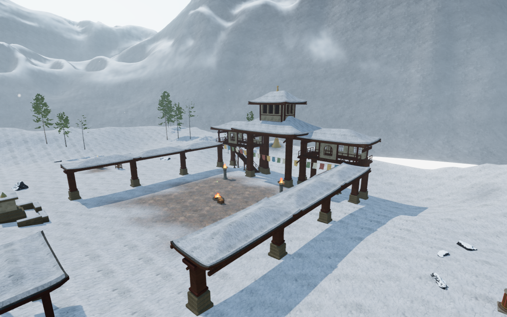
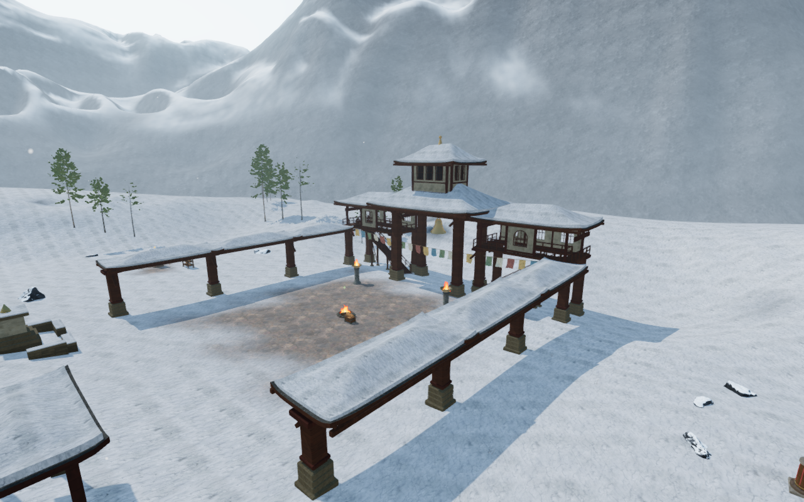
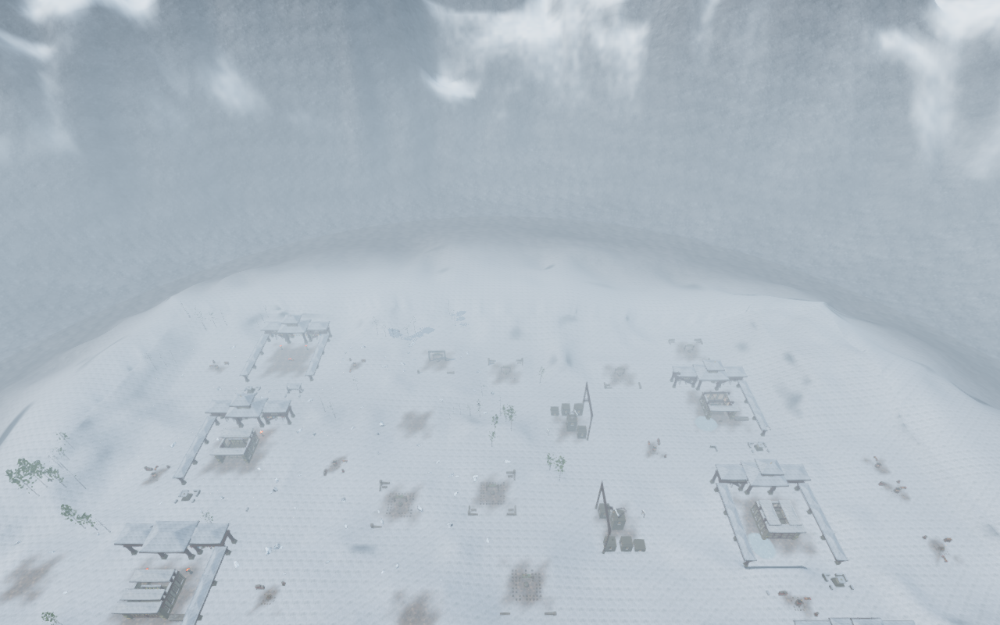
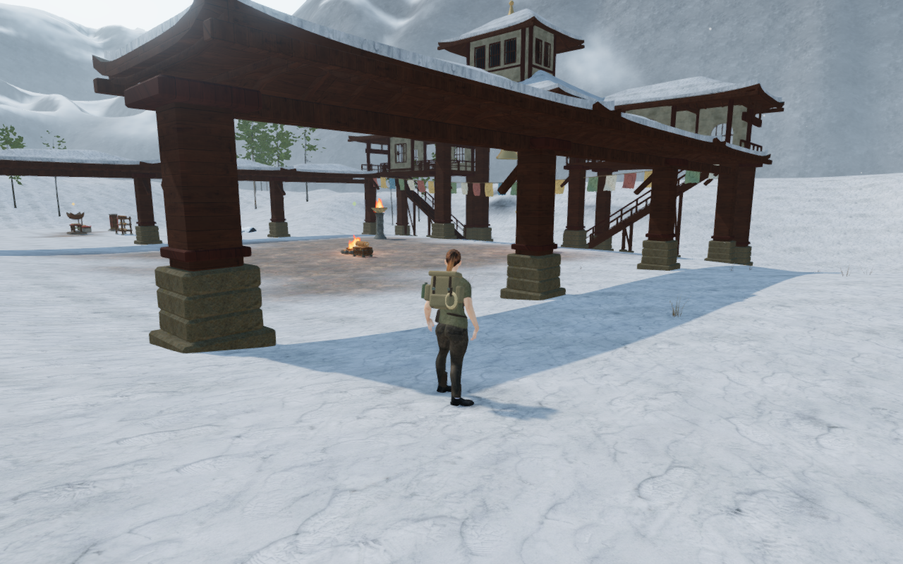

# Fitted snow foreland

The snow plateau ended before the first mountain ring, exposing the pale scene
background through a bright flat gap. A fitted foreland now joins the square
terrain boundary to the surrounding range, with snow shoulders, broad erosion
and a gradual transition to the mountain rock material.

The extension follows all 976 delivered terrain-edge segments and the 768
segments of the first mountain ring. It retains their exact positions and
lighting normals. A zipper joins their different subdivisions without adding
collinear boundary vertices. The resulting surface has 55,593 vertices and
109,376 triangles, covering the region between the two boundaries. It lies
beyond the playable square and participates in the existing background pass.

A densely sampled, periodically smoothed edge field carries the regional
shoulder into the range. The original edge detail fades within a short collar;
broad Cartesian erosion varies the intervening ground. Fixed-distance field
derivatives supply lighting normals independently of the narrow joining
triangles. This removes the radial comb observed in an early draft. Separate
shadow, contact-pass and conventional-camera comparisons established that the
draft pattern came from the shoulder shading rather than those render passes.

The material blends the existing terrain and alpine colour, normal, roughness,
environment and haze fields. Both ranges retain their preceding generated
shader text exactly. Texture handles are shared with the existing credited
snow and rock materials; no new runtime image or dependency is introduced.
The existing [asset attribution](asset-credits.md) applies.

All 24 focused Node regressions, three CPU-guard checks and the production build
pass. The build retains its existing large-chunk advisory. Geometry observers
check finite attributes, upward faces, noncollapsed UVs, the two exact boundary
loops, manifold interior edges, projected area and absence of triangles inside
the playable square. Removing a triangle exposes the expected missing area and
extra boundary. The terrain geometry fingerprints retain their preceding
values. Two recorded rays that previously missed opaque geometry now reach
the foreland; removing it restores the misses. Twenty-four independent
rendered-height gradients agree with the supplied normals within 0.022 vector
distance, with an incorrect-normal control rejected.

All 29 final development views are reviewed: six matched before/after pairs,
nine court overviews, three Performance views and five follow-camera poses.
The comparison pairs hide only the new foreland in the same frozen scene.
Sampled programs link, HDR output remains finite and GL queries pass. The view
sweep and subsequent depth/cleanup run share the same 414 runtime source
hashes. All four documentation figures preserve their PNG sources' decoded
pixels through lossless WebP conversion.

The public depth observer compares all three surfaces together. Four ordinary
projections match a conventional 1,600 m camera pixel for pixel. Twelve
foreground probes at 3, 225 and 449 m retain identical centre pixels. Four
oblique clipping comparisons differ in at most six colour channels above one
byte and have mean byte error below 0.00114. Their reference camera sits below
the retained plane, as a reflected camera would; the observer rejects an eye
on the wrong side. Chapter replacement disposes each of the sixteen tracked
foreland geometry, material and shared texture resources once and retains no
foreland mesh. The browser and temporary server close after verification.

Four production scenarios exercise keyboard input at 1280×800 in High and
touch input at 540×900 in Performance, using touch-capable Chromium. Veranda
movement and bell pulls pass four complete-store reload comparisons, excluding
volatile `lastPlayed` timestamps. All four native captures are reviewed. The
production run loads the built JS/CSS assets, exposes no development hook and
reports no application warnings or errors. Its 414 runtime source hashes match
the development sweep. Its browser and preview server also close. These are
prepared progress scenarios rather than campaign playthroughs or device
benchmarks.

This closes the observed background-gap finding VA-200. Broad mountain
composition, repeated court massing, sparse outdoor ground and wider campaign
coverage remain open. The inherited coastal archive hip-balance regression
VA-201 also remains open; the complete campaign suite has not been repeated
for this background revision. Consumer hardware performance, broader browser
and device coverage, continuous campaign contact and subjective listening
acceptance remain unverified.
