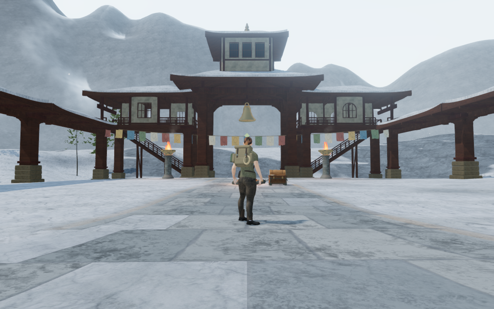
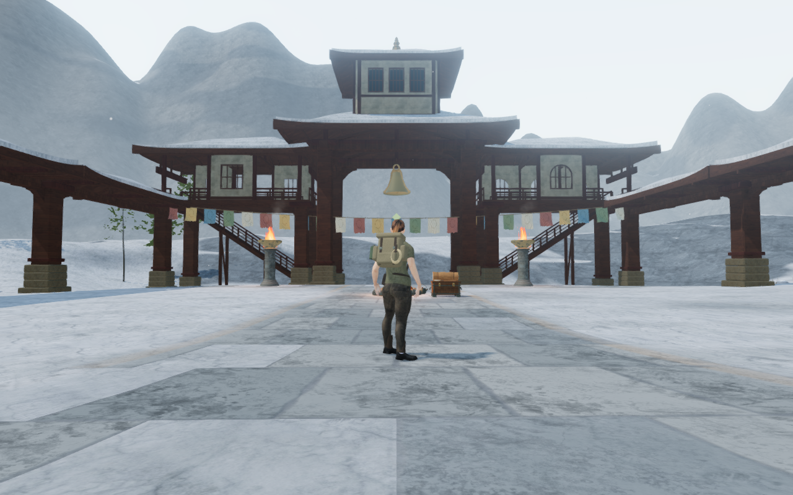
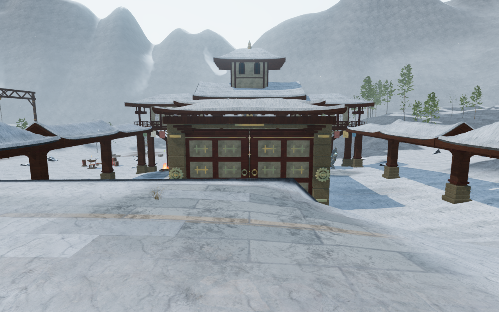
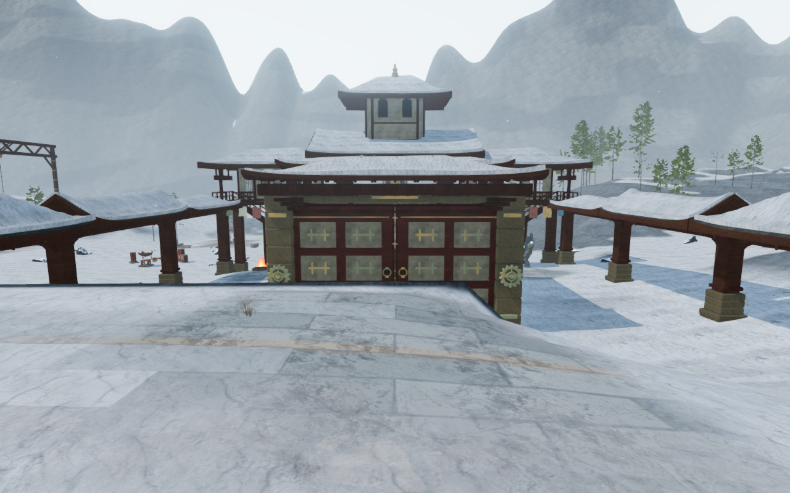

# Alpine gullies and exposed rock

The snow chapter's surrounding ranges now have descending gullies, narrower
crest caps and steeper upper flanks. Snow collects more strongly in the cuts
and on flatter shelves; exposed shoulders reveal irregular folded rock beds.
This revises the broad, uniformly pale faces recorded in the current campaign
survey. The playable terrain stays in place.

| Published entrance | Revised entrance |
| --- | --- |
|  |  |

Both captures use the same prepared standing position, camera, scene time and
High preset. Moving decoration can differ. The images are lossless conversions
of actual 1280 × 800 browser captures, with decoded pixel identity checked.
Existing [asset attribution](asset-credits.md) applies.

The range keeps 768 angular segments and 96 radial rows of cells. Those rows
now concentrate around each column's actual crest, resolving its narrower cap
without adding triangles. A continuous erosion field cuts down the inward
flanks and supplies a per-vertex snow-deposition weight. The weight vanishes at
both apron joints and joins exactly at the angular seam. Its interpolation
increases accumulation in the actual cut geometry while steep faces continue
to shed snow. The adjoining foreland shares the new rock/deposition material
without a gully weight at its apron.

Rock beds use inclined, warped noise rather than regularly repeating stripes.
Their edges account for the pixel footprint. Existing world-space colour and
normal maps, wind exposure, altitude snowline, haze and background depth remain
in use. No external asset, recording, music or dependency is added.

| Published fourth-court outlook | Revised fourth-court outlook |
| --- | --- |
|  |  |

## Verification

- All 27 selected tests pass across seven files, covering both mountain
  shells, their foreland, frozen ground, snow terrain and planting, monastery
  construction, and delivered terrain normals in all eight chapters. The
  three CPU-budget checks and production build pass. The build retains its
  existing bundle-size advisory.
- Independent Cartesian derivatives agree with the continuous mountain
  normals. Delivered-face checks cover 589,824 triangles across both shells at
  420 m and 427 m extents. Every face has positive area and upward winding;
  every checked lighting corner agrees with its face by more than 0.65.
  Deliberately inverted normals fail the same observer. At the delivered
  427 m extent, minimum alignment is 0.69467 / 0.74060 and minimum face area is
  2.351 / 3.406 square metres.
- Old/new construction retains all 81 playable terrain-buffer fingerprints
  and the complete terrain height array. The foreland retains all 55,593
  vertex heights and 109,376 triangles. Each range retains 74,593 vertices,
  147,456 triangles and its indices, with radial positions redistributed.
  The builders add no support, camera-contact or sound-source records. The
  foreland tests retain their 976 exact terrain-edge joins and removed-surface
  negative control.
- Each range adds one float of snow-deposition data per vertex: 298,372 bytes,
  bringing its source arrays to 4,454,820 bytes. The two existing draw meshes
  and shared material remain; the material still uses 18 texture samples per
  shaded pixel. These are source-work counts, not measured GPU memory or frame
  rates.
- All thirteen matched High views are reviewed: four ordinary entrance
  directions and nine court fronts. Player/camera coordinates, yaw, pitch,
  scene time, grounding and health match the preceding build. Three additional
  views from a supported entrance-bank stance cover High, Medium and Low.
  HDR inputs are finite, shaders link and GL errors remain zero. Low's direct
  draw is additionally checked in a temporary half-float target.
- Four background projections and twelve foreground depth probes match the
  conventional long-camera reference exactly. Oblique clipping stays within
  the existing comparison tolerances: six channels differ by more than one
  byte across the four 512 × 320 comparisons; the largest mean channel error
  is 0.0009624, with isolated edge-channel differences up to 176.
- All three range/foreland geometries and both materials dispose exactly once
  on chapter replacement, with no old meshes in the replacement world.

Native production keyboard/High at 1280 × 800 and simulated portrait
touch/Low at 540 × 900 both crouch and walk on supported snow. The measured
walks are 6.0 / 6.6 metres, with full health and negligible cross-track drift.
Four complete-store reload comparisons retain every field apart from chapter
visit timestamps. All six release images are reviewed. There is no horizontal
overflow, development hook, failed asset, page error or unexpected console
warning. These are short checks using a prepared save with guardians defeated
and audio muted, rather than chapter playthroughs.

The release loads `index-DT2V4yOo.js`, `game-Da4zAtZE.js`,
`three-CsvFtkjV.js` and `index-B8Rg8Jto.css`, matching the current build. All 459
runtime hashes match the reviewed source. Only the four alpine range/material
files differ from the preceding milestone.

The snow terrain regression also had an older assertion that treated every
coincident vertex as a shared smooth normal. That assertion fails on the
committed baseline because the existing terrain repair deliberately appends
hard draw corners at steep faces. The revised test still compares original
grid normals across chunk edges, preserves heights and snow exposure for all
coincident copies, and checks unit-length normals against every delivered
triangle. This test correction does not change playable terrain rendering.

## Limits and remaining work

This is a surrounding-landscape revision. Broad mountain faces still look
smooth in places, and the snow chapter retains repeated court massing and
sparse intervening spaces. The complete eight-world composition, discovery,
traversal and water review remains open. Environmental emitters, distance
falloff and adaptive music are unchanged. Consumer-device performance,
subjective listening and complete human playthroughs are not established here.
The full-game polish goal remains incomplete.

All verification uses the shared locked five-of-sixteen CPU allowance, lower
scheduling priority, at most two test workers and one browser. Heavy checks
run sequentially; owned browsers and preview servers close after their checks.
