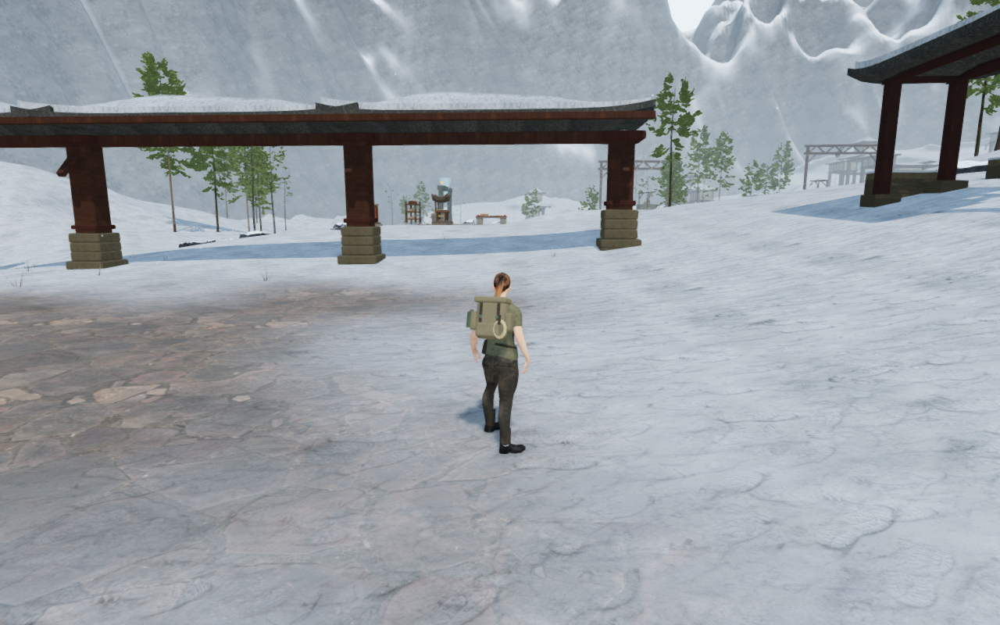
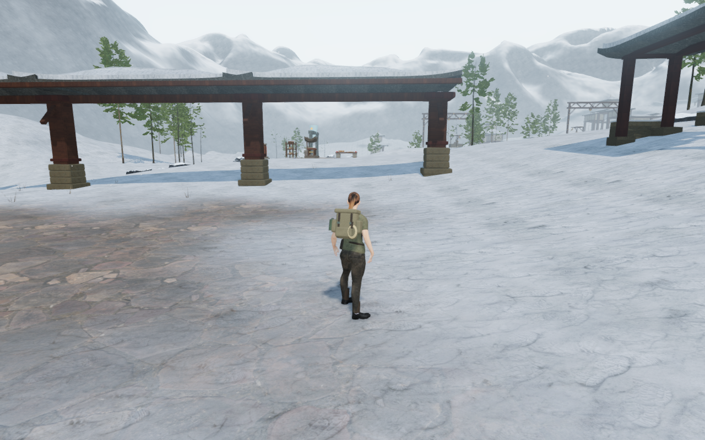
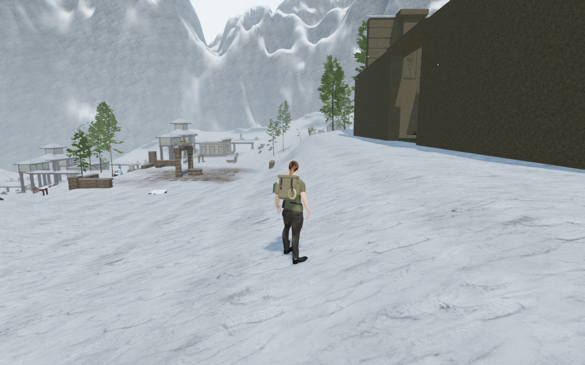
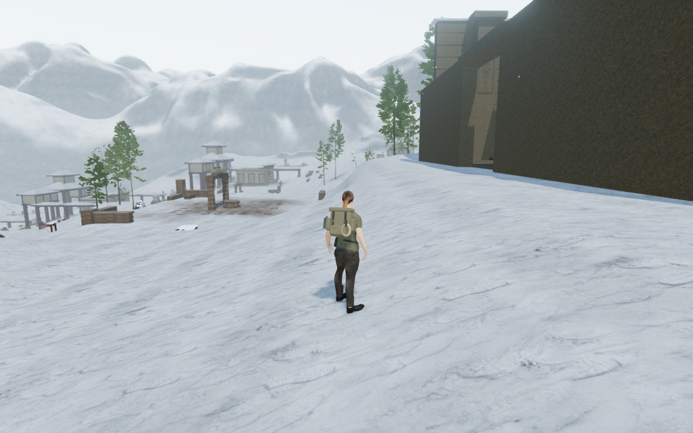
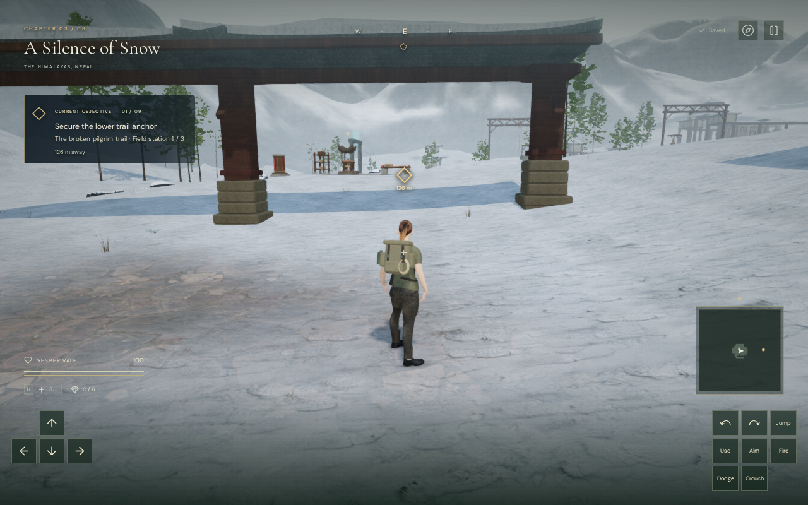
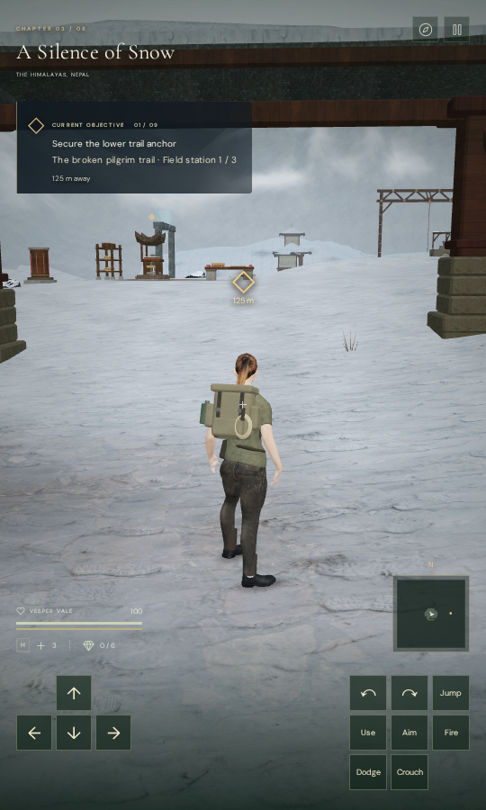

# Alpine horizon composition

The snow chapter now has a wider, lower mountain horizon with broad shoulders
and distinct distant summits. Normal follow-camera views expose more sky above
the monastery, reducing the former near-continuous cliff wall and narrow
branching snow ridges. This addresses the snow finding in the
[current campaign ground review](campaign-ground-review.md).

| Earlier arrival | Revised arrival |
| --- | --- |
|  |  |

The two ranges start at 0.94 and 1.58 times the map extent, rather than 0.73
and 1.26, and each shell spans 640 metres instead of 400. Longer-wave height
variation separates their summits. Broad erosion cuts fall from 98 to 48 metres;
finer cuts fall from 10 to 5 metres and use a longer wavelength. Snow coverage
now favours flatter sheltered faces, revealing more rock on the steeper cuts.

Both aprons remain 18 metres below the world origin. The ranges retain their
continuous height-field normals, exact angular seam joins, compressed background
depth and original rock/normal maps. The original procedural shapes reuse the
maps listed in [asset credits](asset-credits.md).

| Earlier final path | Revised final path |
| --- | --- |
|  |  |

## Verification

All 31 final High views are reviewed: the 23 standing samples from the snow
baseline plus eight arrival directions. Every view has finite pre-bloom input,
linked programs, no GL error, legal grounding, full health, clear camera space
and clear registered body targets. The 23 shared views retain exactly the same
player/camera positions, yaw, pitch, elapsed time, health and grounding as the
baseline. These are prepared standing samples, not continuous traversal.

High, Medium and Low all produce finite output with linked shaders. Low's
normal direct draw is checked in a temporary half-float target. All three
quality captures are reviewed. Four background projections and twelve
foreground depth probes match the conventional long-camera reference exactly.
Oblique clipping differs by more than one byte in three channels at the east
observer, with mean absolute channel error 0.000099691 at 512 × 320; the other
observers differ by at most one byte. Both geometries and the shared material
dispose exactly once when changing chapters.

The final production build passes keyboard/High at 1280 × 800 and actual
CDP touch/Low at 540 × 900: movement, crouch, jump/landing, map access and two
whole-store reload comparisons per case. Both retain full health and zero
relative height after landing. The saved store matches across reloads apart
from visit timestamps. All twelve native captures are reviewed, with the touch
landing also inspected at full size. There is no horizontal overflow,
development hook, failed asset, application error or other console warning;
three screenshot-related driver ReadPixels diagnostics are recorded separately.

The portrait case uses CDP touch events for movement and browser taps for
crouch/jump. Map and pause access use keyboard input at both viewport sizes.

| Keyboard landed | Portrait touch landed |
| --- | --- |
|  |  |

The checked release loads `index-imWkFSpv.js`, `game-JAK1Uy9i.js`,
`three-CMvDqfLf.js` and `index-DQyIEWDa.css`. All six public WebP witnesses are
lossless conversions with dimensions and decoded RGBA bytes matching their
source captures.

All 23 focused tests pass, covering independent Cartesian normal derivatives,
finite geometry, submerged aprons, exact seams, monastery construction, snow
walking/foundation samples, rendering settings, eight world topologies and
local saves. The production build passes with its existing bundle-size advisory.

The two ranges retain 149,186 vertices, 294,912 source triangles, two meshes
and 8,312,896 bytes of source attribute/index arrays. Their shader retains
18 texture reads per shaded pixel. Wider shells increase radial spacing from
about 4.17 to 6.67 metres; smaller high-frequency cuts reduce fine ridges at
that spacing. These figures describe source arrays and shader work, not
measured GPU memory or consumer frame rates.

All expensive checks run through the shared CPU guard, limited to nine of the
sixteen available logical CPUs (56.25%), with at most two test workers and one
browser. Verification profiles and captures stay in ignored workspace staging.
All verification browsers, servers and image workers are closed after their
checks. The final owned-process, verification-port and runtime-profile audit is
clear.

This scoped backdrop change improves the reviewed snow views. Repeated court
massing, sparse intervening areas, complete discovery/underwater/moving traversal
coverage, subjective listening and consumer device acceptance remain open.
