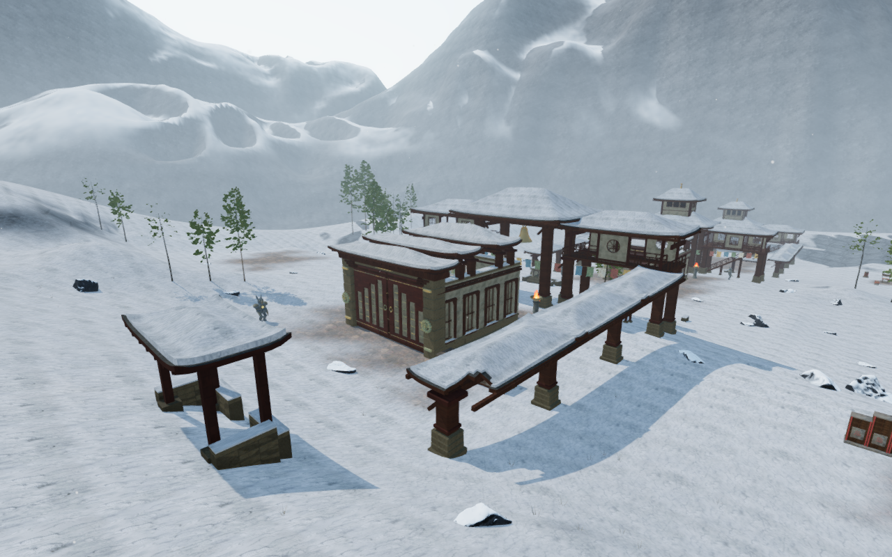
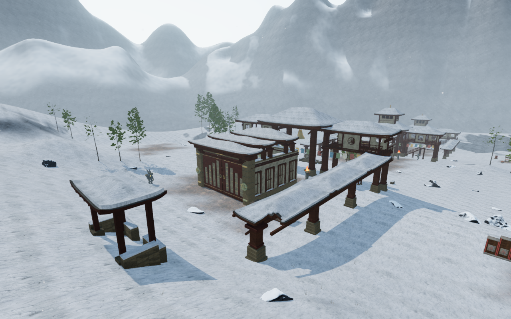
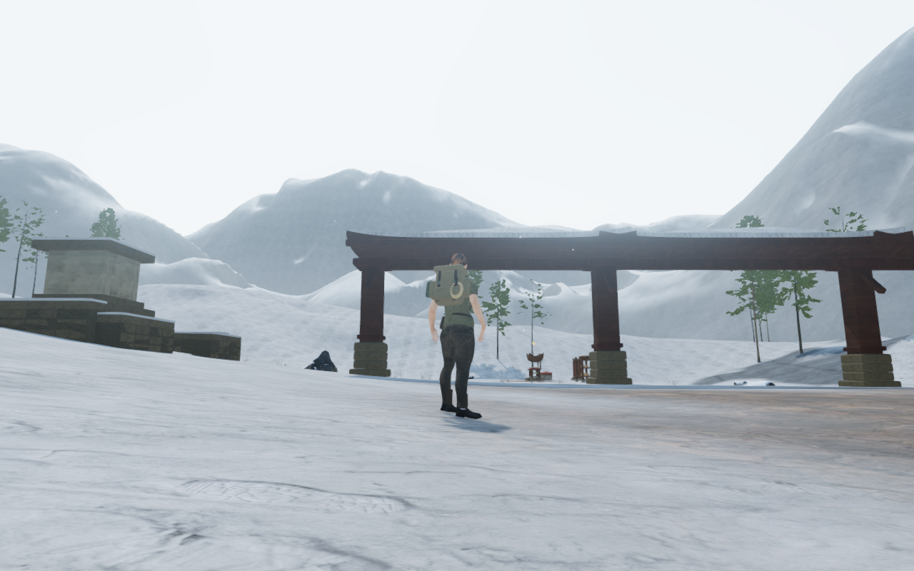
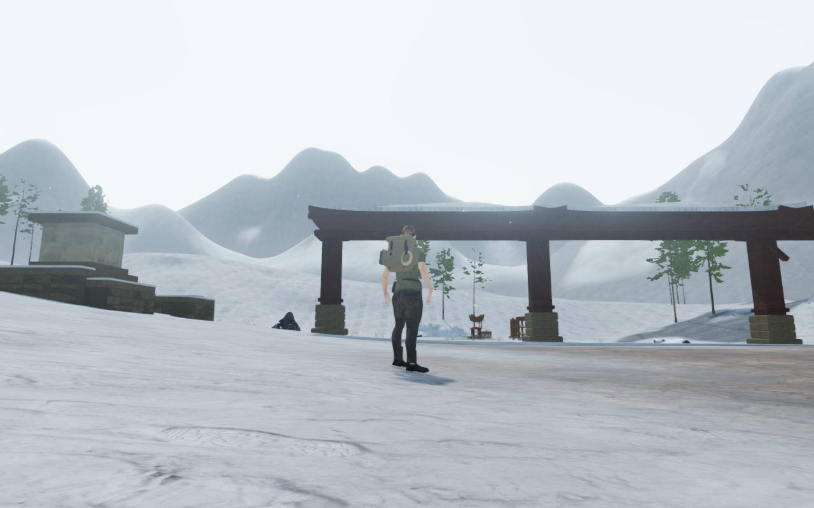

# Defined alpine ridges

The winter range now has more defined summits, asymmetric shoulders and broad
descending ribs. Its previous rounded profile gave the monastery valley a
smooth enclosing wall. The revised height field changes the existing mesh
without adding triangles or moving the playable terrain.

| Published range | Revised range |
| --- | --- |
|  |  |

The High game captures share prepared player/camera coordinates and scene time.
Other animation can differ. The four documentation images retain their decoded
source RGB pixels and 1280 × 800 dimensions through lossless WebP conversion.
Existing [asset attribution](asset-credits.md) applies; no external asset or
texture is added.

The ridge has a rounded cap and different inward/outward slopes. Broad ribs
vary its flanks, while lower-frequency erosion fits the existing tessellation.
Continuous normals still come from the height field, independently of the
triangle diagonal. The material, wind exposure, haze, background depth interval
and terrain-to-range transition remain in place.

## Geometry and verification

The preceding height field could bend between adjacent mesh vertices. An
independent triangle observer finds 23 triangle-corner lighting normals facing
away from their actual faces in the two published shells. The revised shells
have no such opposing normals. Their minimum face/normal dot products improve
from −0.1363 / −0.3389 to 0.7213 / 0.7566 at the delivered 427 m extent.
This is evidence about the delivered mesh, not only its continuous formula.

- All 30 selected checks pass, covering ranges, foreland, snow geology,
  frozen ground, groundcover and monastery construction. Three CPU-budget
  checks and the production build pass; the build retains its existing
  bundle-size advisory.
- The new mesh regression checks all 589,824 faces and 1,769,472 lighting
  corners across both shells at 420 m and 427 m extents. Areas and upward
  winding remain valid; minimum normal alignment exceeds 0.65. Four deliberately
  inverted-normal controls fail the same observer. Existing independent
  Cartesian derivative, angular-seam and submerged-apron checks also pass.
- The delivered old/new comparison retains 74,593 vertices and 147,456
  triangles per shell. All X/Z coordinates, indices and UVs match; 73,055
  vertex heights change in each shell. The foreland retains its 55,593
  vertices, 109,376 triangles and all heights, with boundary normals following
  the adjoining range.
- All terrain geometry fingerprints and height values match before/after
  constructing either range. The builders add no support, camera-collision
  or sound-source records. Materials and temporary comparison geometry are
  disposed after inspection. Existing foreland tests retain 976 exact terrain
  joints, range-edge joins and their removed-triangle negative control.
- Fifteen final development views are reviewed: nine court overviews, four
  ordinary entrance headings, an opposite fourth-court view and a supported
  entrance-bank stance. A foreground tree obscures the original fourth-court
  overview, so the opposite view supplies that landscape coverage. HDR inputs
  remain finite, shaders link and GL errors remain zero.

| Published view from the entrance | Revised view from the entrance |
| --- | --- |
|  |  |

Production keyboard/High at 1280 × 800 and actual portrait touch/Performance
at 540 × 900 crouch and walk on supported snow. Both retain full health and
pass four complete-store reload comparisons in total, apart from chapter
timestamps. All six release images are reviewed. Loaded JS/CSS names match the
current build; the development hook is absent and there is no horizontal
overflow. No page errors, missing resources or unexpected console warnings
are recorded. These checks use a prepared chapter save with guardians defeated
and audio muted.

All 429 runtime hashes match the final reviewed source. The fifteen comparison
views come from published `b269158`, including two supplemental bank/court
views; all prepared player/camera coordinates and scene times match. Owned
browsers and preview servers close after checks. Verification stays within the
shared locked five-of-sixteen CPU set at lower priority, with at most two test
workers and one browser.

## Remaining work

This improves the range profile and corrects the recorded normal disagreement.
Some large flanks still look uniform. Sparse paths and surrounding spaces,
shared court massing, wider discovery/traversal coverage and continuous body
contact remain open. Sound-source placement, falloff and adaptive music are
unchanged. Listening review, consumer-device performance, a complete human
playthrough and AAA parity are not established by these checks.
