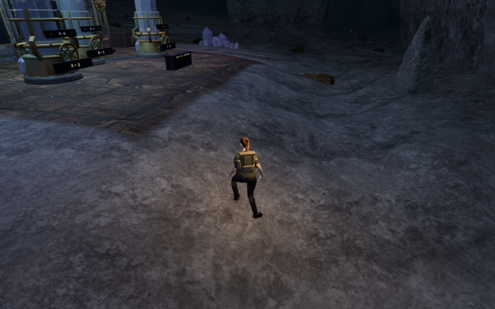
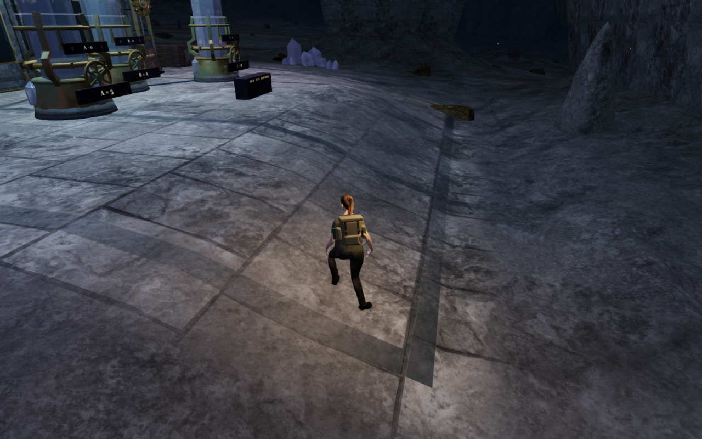
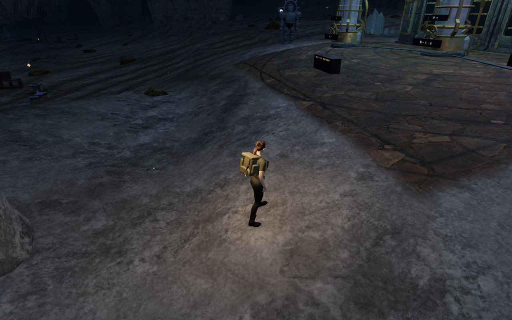
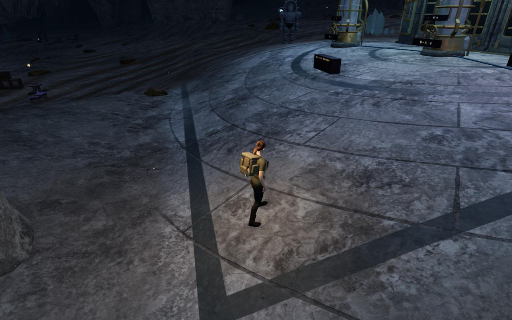
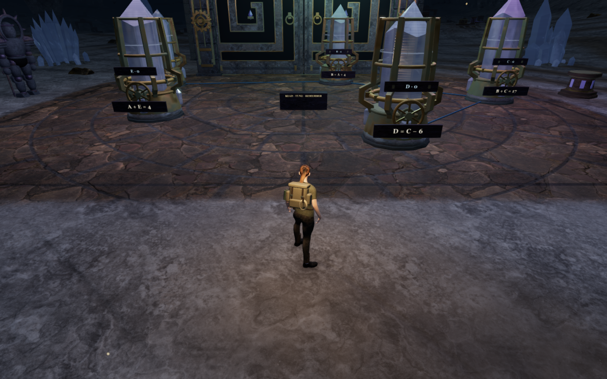
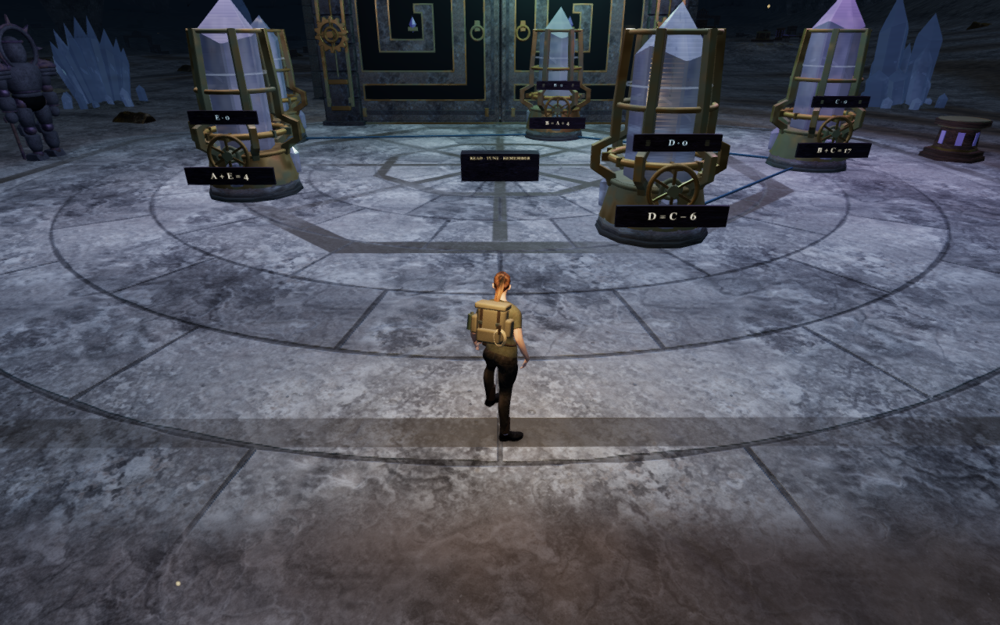

# Limestone archive forecourts

All eight tuning forecourts now have wider limestone paving and broader inlays
that read from the follow camera. The earlier treatment combined faint courses
with an irregular flagstone texture; that texture supplied a second set of joints
beneath the authored slab pattern. The revised surfaces use the existing natural
limestone texture, worn joints, dust and restrained color variation.

| Court | Paving composition |
| --- | --- |
| Guide lights | Receiving lanes and a transverse threshold course |
| Descending echo | Concentric listening rings and radial slabs |
| Mirrored archive | Opposed banks and transverse ties beside a central aisle |
| Ascending chamber | Diagonal rising courses and repeated transverse inlays |
| Violet counterpoint | A fan of channels and a small listening ring |
| Broken conversation | Fractured slabs and interrupted side courses |
| Paired heart | Interlocking rings between the two banks |
| Prism archive | A broad octagonal medallion, inner ring and eight spokes |

Paving follows the existing delivered ground. Its surviving coverage fades on
steeper banks, and its joints and inlays filter against the world-space pixel
footprint. These are shading changes; the walking height and physical control
layout retain their preceding construction. Gentler underlying terrain curves
can still show through the slab courses.

The terrain and worn court-paving materials share one set of floor uniforms.
The cavern terrain also reuses its three owned limestone textures for the paving
and banks, reducing terrain texture allocations from nine to three. No new external
asset or dependency is added. Existing material attribution is retained in the
[asset credits](asset-credits.md).

All 23 selected tests pass. They cover complete tuning-array margins, shared
uniforms through copied material hooks, chapter isolation, the three owned
terrain textures, dry instrument margins and reservoirs, existing court routes,
tuning, focused cameras and the quiet score. The production build passes with
the existing chunk-size advisory.

Native keyboard/High and portrait touch/Performance controls pass from prepared
tablet starts. Each case performs thirteen tuning turns, checks lowering and
reset, solves the array and advances stage 1 to 2. A 5.7 m return retains 100
health. Four comparisons of the complete save after reload pass, excluding only
the save timestamp; all eight release views are reviewed.

The browser review includes sixteen baseline views at published `51aa1b5` and
twenty final views: an approach and working view for each forecourt, two
Performance/Balanced working views and a floor-strength toggle pair. All are
reviewed. Actual drawn terrain programs expose the expected eight sites and floor strength; sampled
programs link, HDR inputs remain finite and no application warning or WebGL error
is recorded. Toggling the layer retains the same recorded geometry buffers and
mesh transforms across 2,526 scene meshes (182,647,908 buffer bytes). Three
tracked floor materials and six unique textures dispose once on chapter change.
Two additional High/Performance field-court views inspect the linked paving and
border shader programs with their shared floor strength.

The six comparison exports retain the actual 1280 × 800 High source pixels.
Prepared player positions, follow cameras and zero elapsed simulation time match
within each pair. Baseline runtime source hashes match published `51aa1b5`;
revised hashes match the new application. Lossless WebP conversion preserves
decoded pixels without cropping or retouching.

The [world audit](visual-audit.md) remains open. Repeated instruments, broader
route scenery, moving and airborne body contact, full routes and listening/device
acceptance still need work.
