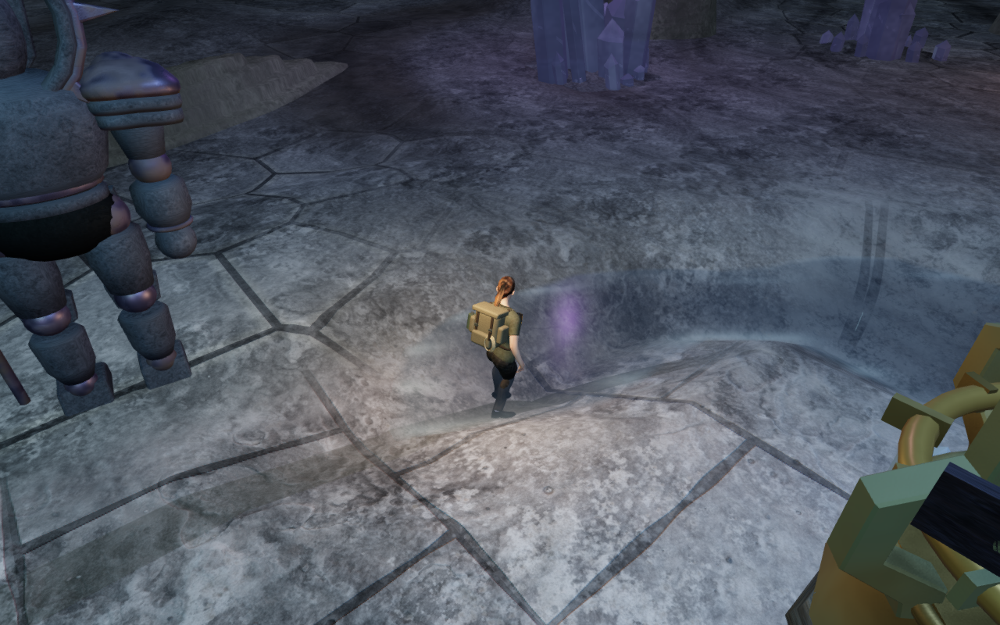
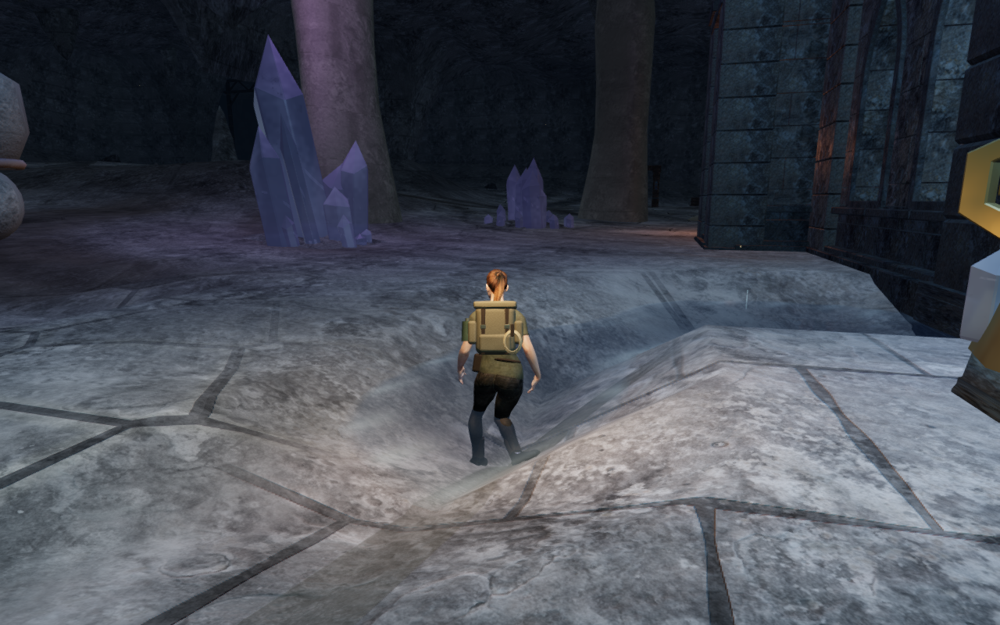

# Lower camera views beside banks

At the violet cavern reservoir, a prepared upward-looking view places the
camera high above the explorer and hides the route behind the foreground bank.
The full-distance lens cannot see the boots past that bank without tilting far
downward. A nearer lens clears the same body at a much lower angle.

Camera recovery now tries comfortable 4.2 m and 3.4 m distances before the steep
overhead options, after the existing nearby full-distance choices. It remembers
the chosen distance during recovery, preventing repeated extension into the
bank. The ordinary view returns when its clearance opens. Every option still
uses the existing swept arm, terrain clearance and posed-body sight checks.
The player's selected heading and pitch remain separate from the camera's
collision response; the save format does not change.

The reproduced live view settles at approximately 4.23 m and a 0.15 radian orbit
pitch, compared with 5.41 m and 0.55 radians previously. All 286 posed-body
sight targets remain clear. A stationary physics update retains the position,
grounded state and selected look; the shallow water does not trigger swimming.
The selected heading is 0.5679 radians and the selected pitch remains −0.45.
These are measurements of this local view, not universal camera limits.

The new regression reproduces the earlier overhead choice on a bank. It checks
continuous clearance, complete sampled body sight, settled distance, unchanged
look, and extension when the bank is removed. All nineteen focused follow-camera
checks pass, including the existing column, bridge, cable, mantle, canal,
aim-transition and water-mode cases.

A live assisted approach/return covers 3.16 m over 48 movement updates and
returns to its starting position. Every recorded body sight check remains clear,
with legal player/lens positions, full avatar visibility and unchanged selected
look. This is local camera coverage, not a full continuous body-contact audit.

All 156 selected regressions, three CPU-budget checks and the production build
pass. The existing build chunk-size advisory remains. All eight chapter-start
solver comparisons retain exactly the same settled camera positions. All
thirteen development images are reviewed, including High/Performance settings,
the reproduced bank view, movement and each chapter start. Sampled shader
programs link, HDR inputs remain finite and no application warning or WebGL error
is recorded. The recorded scene metadata matches, and the other 420 runtime
source files retain their preceding hashes.

Native production controls pass from the prepared bank position: keyboard/High
moves 2.83 m and portrait touch/Performance moves 2.61 m, with crouching, jumping
and 100 health retained. Both complete-store reload comparisons pass, excluding
only per-level timestamps. The selected heading and pitch match the seeded look
after movement and reload; the recovery distance is absent from save data.
All eight production images are reviewed. Loaded release JavaScript/CSS names
match the current build, and the developer hook is absent. All 421 runtime hashes
and 796 frozen code/test/build inputs match the reviewed content. Owned browsers,
previews and workers close after each verification run.

The comparison uses matching prepared player positions, look, High settings
and zero elapsed scene time. The before view uses the preceding camera code;
the remaining runtime sources and scene construction are retained. Two lossless
WebP exports preserve the complete 1280 × 800 rendered pixels without cropping
or retouching. The pass adds no external assets or dependencies and retains
existing [asset attribution](asset-credits.md).

The wider [playable-world audit](visual-audit.md) remains open, including other
constrained views, broader scenery, continuous contact and listening/device
acceptance. All verification shares the locked five-of-sixteen CPU set, with at
most one browser and two test workers. Temporary helpers close after each run.
