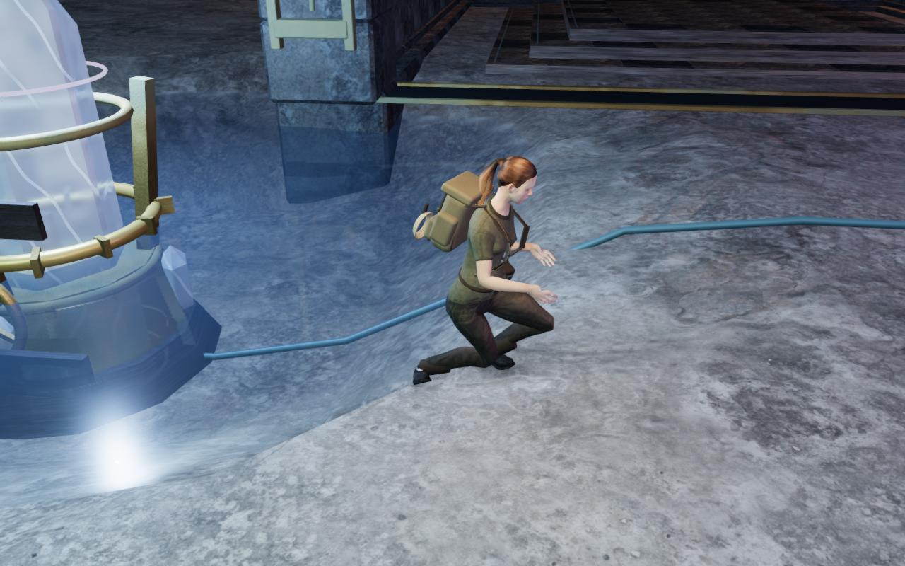
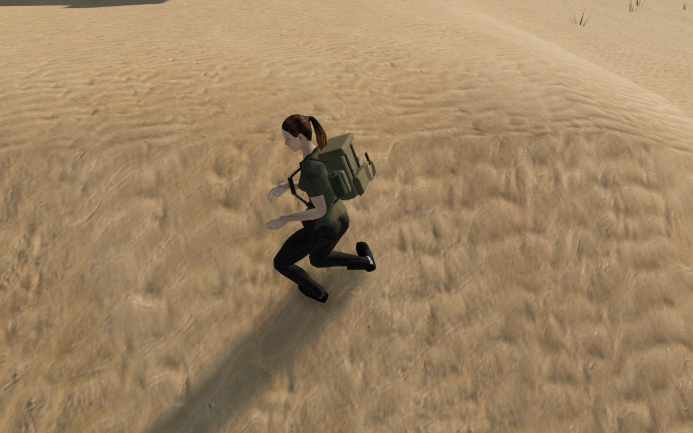
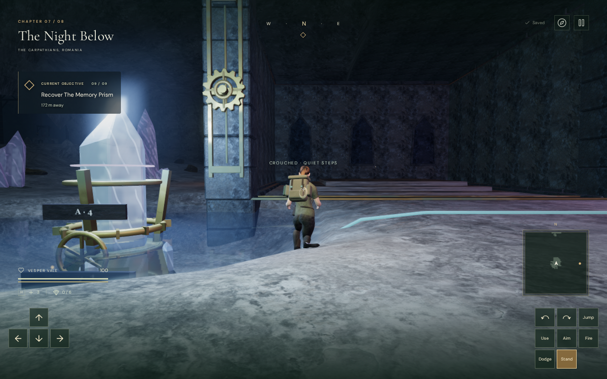
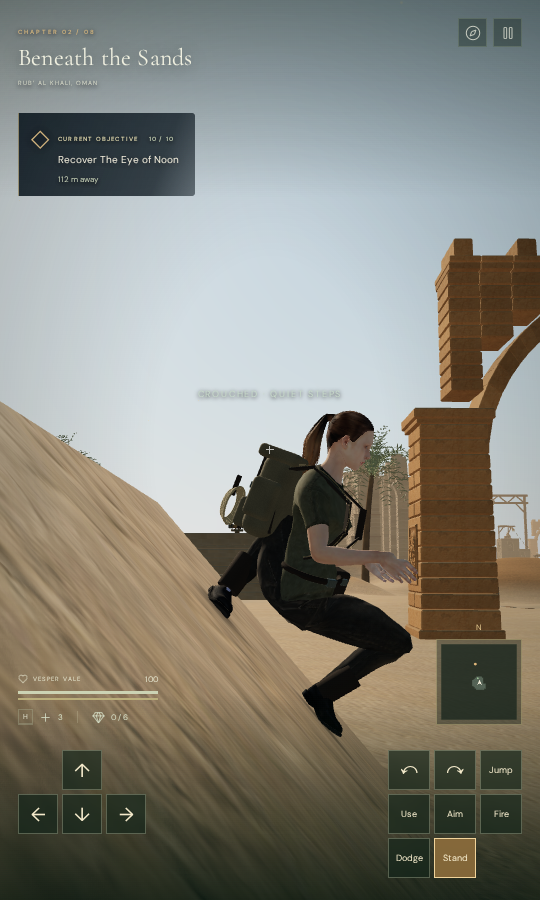

# Contact shadows on terrain banks

Planted boots now retain their ambient contact patches on continuous steep
banks. Patch faces also follow bends in the delivered terrain, repairing
shadows that disappeared below the floor even when their vertices fit it.
This extends the [boot and bank-footing repair](boot-grounding.md); perceived
weight, wider poses and camera framing still need review.

## Reproduced failures and correction

The preceding patch rejected vertices more than 18 cm above or below its centre
and triangles spanning more than 10 cm vertically. Those limits also rejected
continuous slopes. At the recorded desert side stance, one planted boot lost
its entire patch in both standing and crouching states.

At a second cavern corner, fitting just the patch vertices left face interiors
as much as 10.617 mm below the actual terrain triangles. Matching corner heights
does not ensure contact across the terrain's diagonal.

The fitter now compares heights with the local floor continuation. It reads
edge midpoints and face centres, refining a bend when their height differs from
the patch plane by more than 2 mm. Refinement stops after three subdivisions;
remaining unsuitable or unsupported faces are omitted. The 4 mm floor offset,
soft elliptical falloff and fade for lifted boots remain in use.

The coarse corners still use complete support queries. When all three corners
match terrain, refinement reads its existing floor planes directly. Raised
surfaces retain complete support queries, and intervening opaque objects depth
occlude an underlying ground patch. Water, traversal and open-edge checks remain
active. The contact fit does not change the actor's bones or collision root.

The two meshes use fixed buffers with a total capacity of about 0.69 MiB,
including indices. Each patch can hold at most 4,608 triangles; the recorded
poses use at most 295. Only populated attribute ranges are uploaded and drawn.
The geometry and shared material are released when their owner is disposed.

## Geometry and rendered evidence

The independent face observer covers three recorded cavern/desert positions,
two headings and standing/crouching states: twelve poses and twenty-four
patches. Its dense barycentric probes read the rendered patch interiors against
the actual terrain triangles.

| Measurement                    | Preceding fit | Revised fit |
| ------------------------------ | ------------: | ----------: |
| Missing planted patches        |             2 |           0 |
| Interior queries below terrain |           431 |           0 |
| Lowest measured gap            |    −10.617 mm |   +0.917 mm |
| Interior face queries          |        38,556 |      84,532 |

The browser review has four matched comparisons: two cavern positions on High,
and the desert stance on High and Low. It checks 34,776 final patch-face samples,
all above the terrain. All eight pictures have a legal camera origin, full
character opacity, linked shaders and no application errors or warnings.
The six High pictures also have finite HDR output; Low uses the direct renderer.

The comparisons swap only the contact fitter in the current scene and retain
the same character pose, root and fixed documentation camera. Progress is
prepared, enemies removed and world/combat timers are stopped. This does not
establish normal-camera visibility or a full campaign playthrough.

| Cavern corner before                                                              | Cavern corner after                                                             |
| --------------------------------------------------------------------------------- | ------------------------------------------------------------------------------- |
|  |  |

| Desert bank before                                                                | Desert bank after                                                          |
| --------------------------------------------------------------------------------- | -------------------------------------------------------------------------- |
|  |  |

Seventy-five repeated updates at each settled stance, after five warm-up calls,
give these sandbox-only timings. They measure contact fitting rather than a
whole game frame or consumer-device performance.

| View                 | Previous median | Revised median | Revised 95th percentile |
| -------------------- | --------------: | -------------: | ----------------------: |
| Cavern bank / High   |          9.3 ms |         9.0 ms |                 12.3 ms |
| Cavern corner / High |          8.0 ms |         9.8 ms |                 15.0 ms |
| Desert bank / High   |         10.1 ms |        13.5 ms |                 17.3 ms |
| Desert bank / Low    |          9.9 ms |         9.8 ms |                 12.5 ms |

## Verification and limits

All 45 selected JavaScript cases across four files pass. They cover delivered
character poses, locomotion, footstep placement, contact fitting and the renderer.
New regressions require the whole footprint on continuous steep planes, positive
face-interior gaps at a concave crease and the recorded banks, and preserved
raised-deck contact beside an open edge. The preceding implementation fails
the steep-footprint and concave-face controls. Existing traversal, submerged
support, pose-preservation and resource-disposal checks pass. The release build
passes with its existing large-chunk advisory.

The final release also passes keyboard/High at 1280 × 800 and touch/Low at
540 × 900. Both cases use the normal interface for movement, crouch, look, jump
and map access, and compare the complete campaign store through two reloads.
Only each chapter's `lastPlayed` timestamp is excluded. Recorded movement is
1.5 m in the cavern and 2.1 m in the desert. Both finish healthy at ground height,
with no page overflow or application/HTTP errors. Capture-only GPU readback
diagnostics are retained separately. The mix is muted and progress prepared;
these checks do not establish listening quality or human playthrough pacing.

All six delivered character responses match the current GLB's SHA-256, and the
release JavaScript/CSS resources match the final build. The release has no
development game hook. The two release pictures pause through the normal
interface and temporarily hide only the pause panel.

| Keyboard / High                                                                    | Touch / Low                                                                           |
| ---------------------------------------------------------------------------------- | ------------------------------------------------------------------------------------- |
|  |  |

All eight comparison pictures and both release pictures are reviewed. The six
published WebPs preserve their source PNG dimensions and decoded RGBA pixels.
No external asset or dependency is added; existing asset credits still apply.

Checks use the shared CPUs 0–8 of 16, with lower scheduling priority, one test
worker or browser, and two image-conversion threads. Each comparison capture
and completed release case audits its owned threads against the locked CPU set.
Both browser helpers verify that no browser descendants remain after closing,
and exit successfully. The image worker and all temporary server handles are
closed; neither test port remains listening. Raw captures, saves, profiles and
logs stay in ignored project-local staging.

Continuous sole-face contact, convincing weight on every bank, wider slopes,
camera occlusion, sparse scenery, listening and consumer-device performance
remain open. This repairs the reproduced shadow defects and does not complete
the eight-chapter visual target.
