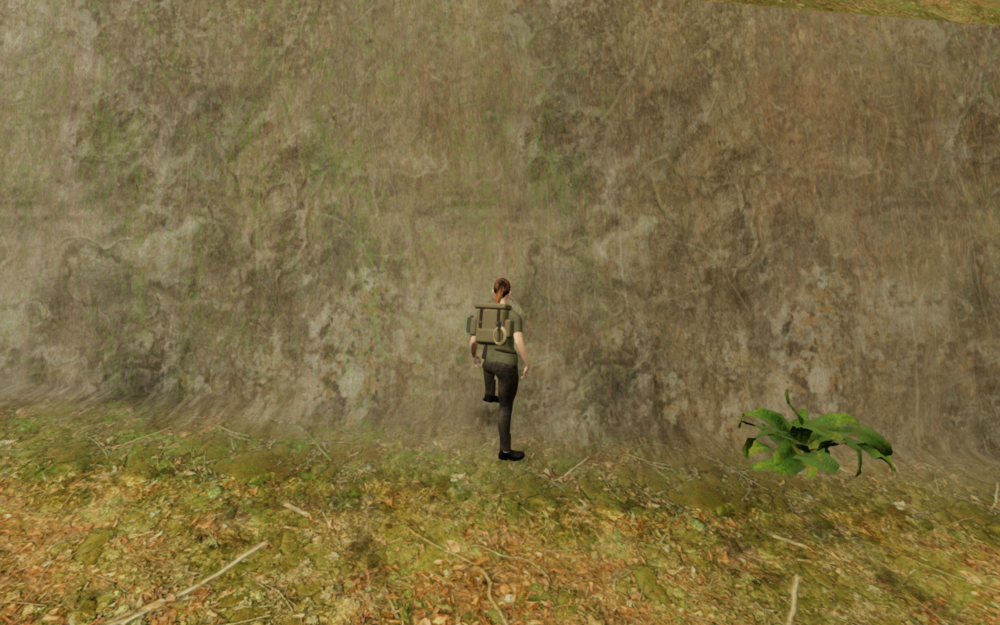
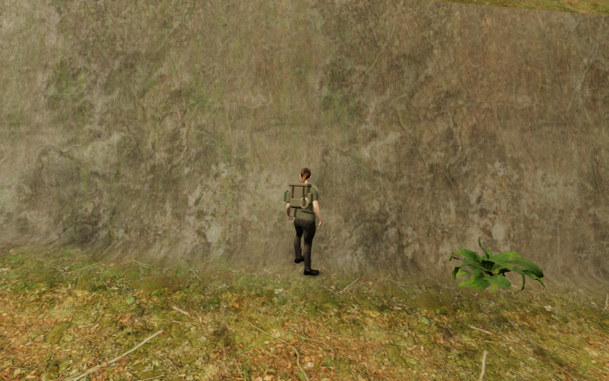

# Bank resting stances

The preceding cliff-footing review left two small boot gaps and a conspicuous
raised idle leg at ordinary jungle banks. The long animation stagger could
put a toe across an abrupt terrain-triangle break even while its ankle was
on lower ground. Near a low cliff bed, the controller could also stand higher
than the actual soil beside both boots, exhausting the visual leg reach.

Resting terrain poses now plan from the delivered sole outlines. A bounded
shorter stagger and small fore/aft adjustment keep the feet on nearby floors.
The visual pelvis can use the same 50 cm downward floor range already accepted
by the support query. Standing trouser clearance participates in the leg fit.
If a downhill boot still exceeds the existing leg length, the solver searches
for the nearest reachable uphill foot placement within 18 cm of the planned
ankle, keeping at least 16 cm between ankles. It retains the original leg
lengths and the player's physical position and velocity.

Small visual hip shifts retain the prop, natural-object and mechanism guards.
Ordinary resting terrain can refine the conservative circular terrain envelope
against its posed clothing instead; physical movement keeps the original
terrain check. A strict-envelope comparison reproduces three clothing overlaps
at the cloud-bank samples. The final posed refinement clears them while keeping
both observed soles in contact. No terrain, rock support index, audio emitter,
render mesh or saved-position schema changes in this milestone.

The idle footprint plan refreshes four times per second. Position, facing and
support changes invalidate it immediately. Current sole and clothing clearance
still run each frame. This avoids repeating the full planning search every
stationary frame without treating a cached plan as contact evidence.

These High frames retain the exact prepared player/camera coordinates, facing,
pitch and scene time. The earlier frame uses published source `b266d0a`.
They are lossless exports of actual game frames without retouching. Guardians
are disabled and audio muted for this local visual comparison.

## Recorded checks

- All 205 focused tests across 29 files pass, as do the release build and three
  CPU-budget tests. The build retains the existing chunk-size advisory.
  Real-asset regressions cover the retained bed-edge rests, ordinary bank stops,
  narrow jungle and winter banks, two cloud banks and a crater bank.
- The preceding published pose code fails the new bed-edge and ordinary-bank
  controls: one boot hovers about 54 mm and the wall-facing stagger remains
  raised. The controls use the actual character and terrain rather than runtime
  contact declarations.
- A geometry-only sweep checks 47 eligible jungle bed sites in four facings,
  both standing and crouched: 376 poses. All have observed low-footwear contact
  on both sides and clear the full delivered body against terrain and closed
  cliff stone. This sweep omits the world's other props and vegetation.
- Four steep ordinary-terrain anchors per chapter, in eight facings, add 256
  geometry-only poses and 12,312,320 delivered body records. All have actual
  footwear contact on both sides and no reported body penetration beyond the
  15 mm observation threshold. The independent foot observer uses the same
  [-15 mm, 20 mm] contact interval throughout; vertex contact count alone does
  not measure support area. These terrain-only checks do not establish that
  every anchor is reachable through the full world's props.

- In the actual browser worlds, 64 jungle and 16 cloud-bank resting poses have
  observed contact on both boots and pass the full delivered-body terrain
  inspection. The jungle poses also pass the closed cliff-stone inspection.
  One geometry-only bed location is blocked by the full world's scenery and
  is recorded separately, not counted as a playable standing position.
- Three assisted approach/jump/stop sequences complete 3,150 controller updates.
  All 42 sampled moving/stopped body inspections pass against terrain and cliff
  stone, and each sequence ends legally grounded. All eighteen jungle discovery
  stances remain legal, reachable and clear to their cameras.
- All thirteen High development views are reviewed. The retained bed and
  near-bed saved-position views retain nearby foliage and broad cliff-shape
  issues. One manually placed cloud inspection camera hides the lower legs
  behind foreground terrain; that image cannot certify the footwear. The
  independent skin/sole observations provide the contact evidence. The run has
  no failed assets or reported console warnings/errors.

- Production keyboard input at High quality and portrait touch input at
  Performance quality both move the character, retain stage 0 and health 100,
  and pass four complete-store reload comparisons. Only `lastPlayed` is omitted
  from equality. The release has no development hook, its loaded script/style
  names match the build, and the portrait viewport has no horizontal overflow.
  All six release views are reviewed. The views use live animation and need not
  match across pauses/reloads; they do not certify every transition pose.

The final browser checks record no failed assets, console errors or application
warnings. Chromium GPU-readback notices are excluded from the warning totals.
Both temporary previews and their browsers close after verification. All 444
runtime source files match the focused checks, build, geometry sweeps and final
world captures. The two public figures preserve every source RGB pixel.

## Remaining acceptance

Continuous movement/airborne contact and freshly reloaded near-bed poses,
foreground occlusion, broad cliff and court composition, sparse surroundings,
and wider route, listening and device
reviews remain open. These selected poses do not establish an uninterrupted
campaign playthrough, subjective audio quality, consumer hardware performance
or AAA graphics. The full playable-world audit remains incomplete.
