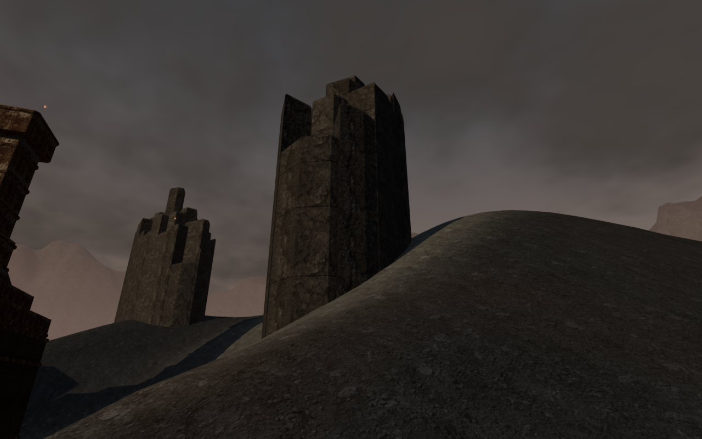
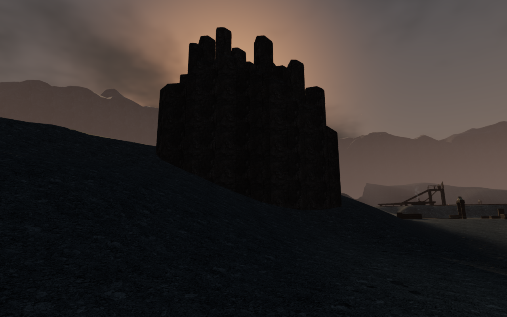

# Cooling-column bases against the ash banks

Two distant return views made the lower outlines of the volcanic cooling columns
look isolated against their sloping banks. Closer views and an independent query
of the actual merged meshes find no exposed underside in the inspected samples.
No game geometry or placement is changed by this inspection.

The observer reads downward-facing triangles from all five delivered column
meshes, including their world transforms. It casts vertical rays against the
actual terrain chunks at unique underside vertices and face centroids. This
checks the merged geometry present in the scene rather than reconstructing
column bounds from planner values. The reusable helper is
[inspect-basalt-foundations-browser.js](../scripts/inspect-basalt-foundations-browser.js).

| Cluster | Columns | Sampled underside positions | Minimum terrain cover |
| ------- | ------: | --------------------------: | --------------------: |
| 0       |      20 |                         252 |               0.575 m |
| 1       |      45 |                         559 |               0.484 m |
| 3       |      54 |                         668 |               0.500 m |
| 4       |      39 |                         487 |               0.497 m |
| 5       |      43 |                         535 |               0.576 m |

All 2,501 sampled positions have a terrain hit and remain below it, with cover
ranging from 0.484 to 3.630 m. Raising the actual merged meshes by 40 m provides
the observer's deliberately exposed control; every sample then reports an
exposed underside. The meshes are restored after that check.

The visual survey reviews two reconstructed route backgrounds and four closer
ground observers at the two suspect clusters. Their viewpoints occupy legal
ground; the explorer is hidden to inspect the bank junctions. Four additional
requested side directions have no legal nearby stance and are recorded as
unavailable. The two documentation images are lossless exports of the actual
near observer captures with identical decoded pixels and dimensions.

All sampled shaders link and High output is finite, with no recorded WebGL
error, application error or warning. Application source remains unchanged from
the preceding vent release. The checks share the locked five-of-sixteen CPU
allowance, use one browser at a time and close owned browsers and previews when
finished.

These are sampled foundation and static-view checks. They do not establish every
possible bank junction, body contact, consumer performance or overall landscape
polish. Broader composition remains open in the
[playable-world audit](visual-audit.md).
