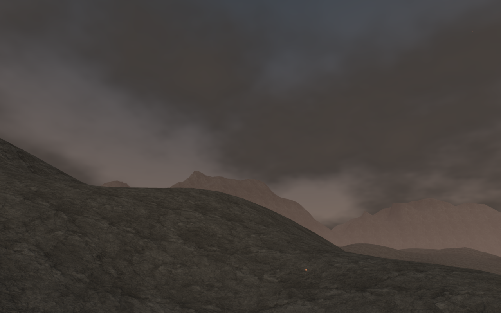
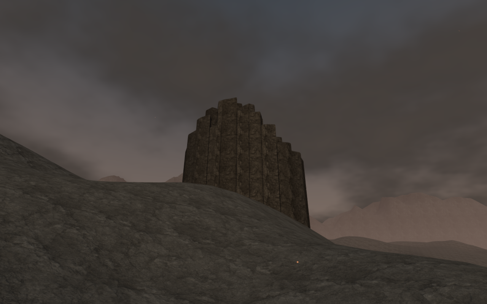
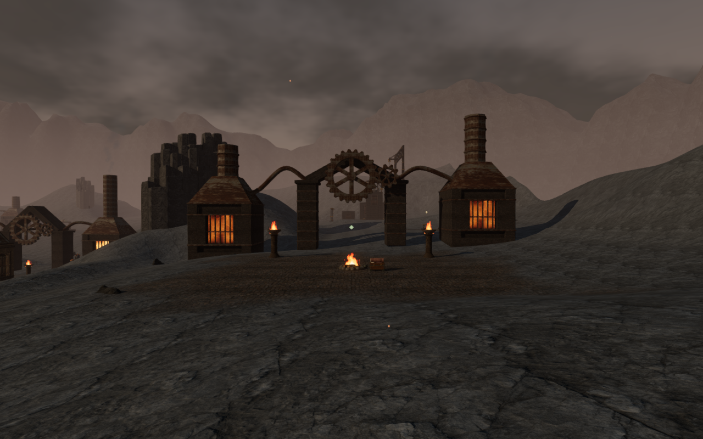
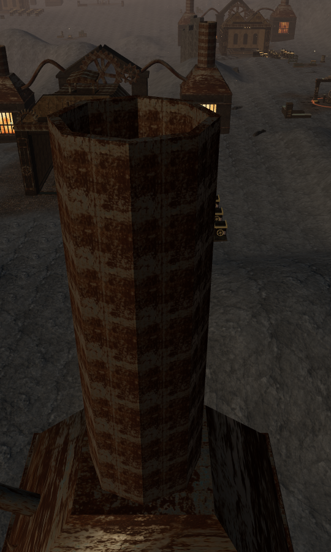
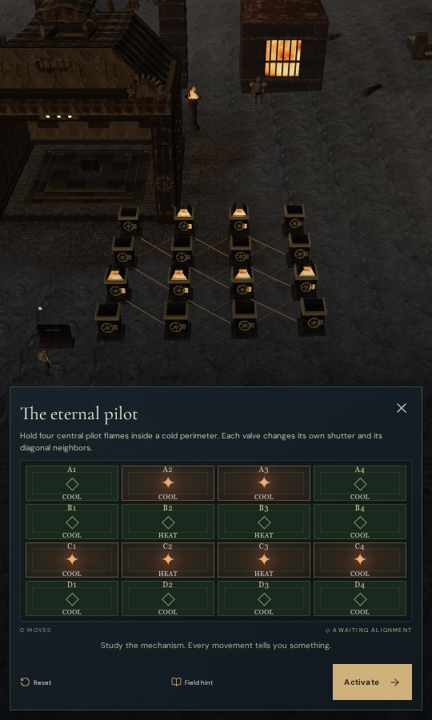

# Columnar basalt in A Heart of Embers

Five outcrops now rise above the volcanic banks. Their fractured columns give
several forge approaches recognizable rock silhouettes and add depth between the
working courts and distant mountains. The formations have different widths,
heights and broken crests, with narrow cooling joints and smaller cross fractures.

| Outcrop hidden | Outcrop visible |
| --- | --- |
|  |  |

These two captures share the current scene, camera and simulation time; only
the new outcrop roots are hidden for the left image. They are not a reconstruction
of the preceding release: the later scanned-rock placement pass can reject
boulders that overlap the new formations.

## Construction and placement

The original generator clips jittered sites into convex cooling cells, shrinks
them to leave open joints, and builds closed columns with beveled caps and
slight changes of width at cross fractures. It uses the existing credited
volcanic stone material with per-column color variation. No downloaded asset,
texture, audio recording, dependency or save-schema change is added.

The five accepted groups contain 181 columns and 27,040 triangles, merged into
five render batches using one shared cloned material. These are geometry counts,
not frame-time measurements. Physical queries retain each closed column's
triangles separately; the camera index retains the individual column bounds.

Placement reserves the existing walking network, objective work areas, water,
discoveries, old obstacles, forge foundations and both desktop and portrait
thermal-focus approaches. Independent sampled boundaries leave more than 6.8 m
between the columns and walking cells. The original terrain heights and map
definitions remain unchanged. The column bases extend below the lowest terrain
lattice corner covering each footprint; ray tests against the rendered Float32
terrain verify buried bases rather than relying only on an analytic height.

## Verification

All 41 selected checks and the production build pass. Ten assisted local
approach/return legs cover 119.71 m in 1,785 controller steps, retaining full
health and full character visibility. These use prepared progress and normal player/camera
physics with combat disabled. All fifteen route captures are reviewed.
Reloading the volcanic chapter preserves the five-group placement manifest;
reload and chapter change each release all five merged geometries and the
shared new material exactly once. The jungle does not retain the outcrop reference.

Release checks use native keyboard input on High at 1280 × 800 near the first
regulator and native touch input on Low at 540 × 900 at the sixth regulator.
Both begin from prepared saves with the corresponding prerequisite field work
complete, turn a valve, crouch, walk, exercise look and jump inputs, and open
the map. Two whole-save comparisons per case preserve the valve result and
subsequent movement across reloads, excluding only the play timestamp. All
twelve release captures are reviewed. The served character model and bundle
names match the built delivery; there is no development hook, page error or
application warning. These automated Chromium checks use muted audio.

All verification workers share the locked five-CPU budget. Owned browsers and
preview servers close after their checks, and their temporary profile directory
is empty before publication.

The construction tests check deterministic placement, separated cells, finite
attributes, closed oriented surfaces, nonzero triangles, positive volume,
rendered terrain contact, cap support, body blocking and the seven other
chapters' allocation guard. All three pass.

Nine current High court fronts and fifteen close/hidden/Low views have been
reviewed. The rendered output is finite, Low framebuffers contain scene pixels,
and sampled shaders link. The close views are legal ground observers with the
character hidden, not normal follow-camera screenshots or a human playthrough.

## Portrait regulator camera

The wider survey exposed a separate defect: a neighboring furnace chimney
filled the sixth regulator's portrait focus view. Its camera now stops 16 m
closer to the working court, in front of that chimney. Desktop placement is
unchanged. The regression first confirms that the old portrait view intersects
actual rendered furnace geometry, then checks unobstructed rays to all 102
chambers and their placement within the desktop/portrait frame. Portrait
machinery stays above the control panel. All eight revised portrait views and
the eight desktop views are reviewed; the release touch case turns a valve at
the previously obscured sixth regulator and restores it after reload.

| Obstructed static survey | Revised release touch interface |
| --- | --- |
|  |  |

These portrait images show different test contexts: prepared progress with the
regulators completed in the static survey and an active sixth regulator in the
built release. They
illustrate the obstruction and repair; they are not matched scene-state images.
All five documentation images are actual game captures exported as lossless
WebP with identical decoded pixels and dimensions.

The broader volcanic composition, sparse ground areas, repeated lower chamber
arrangements and distant mountain geometry remain under review. This local
change does not establish whole-world polish, performance on consumer hardware
or subjective audio quality.
