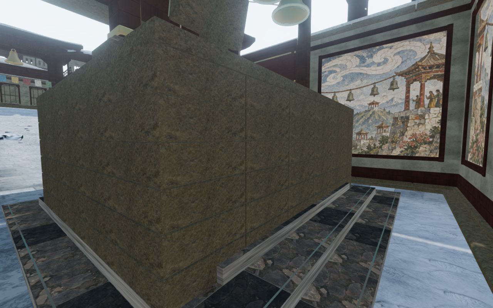
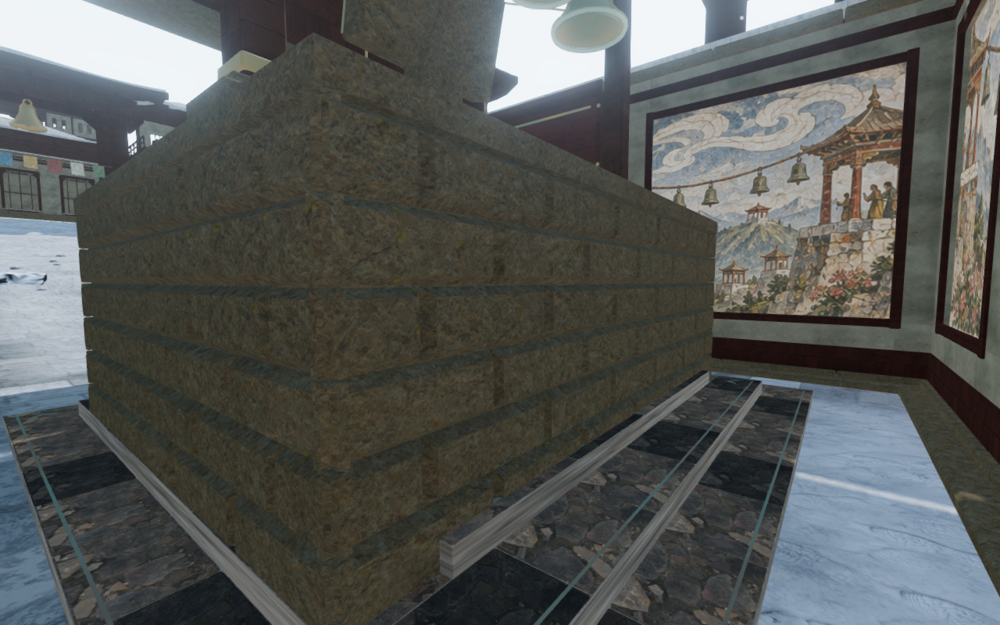
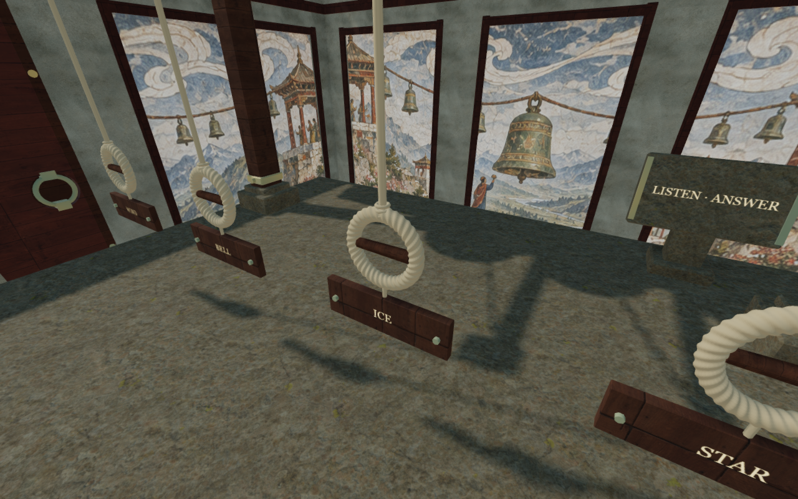
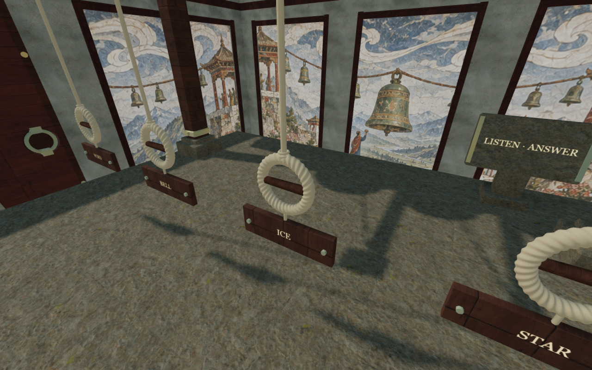

# Dressed stone on the monastery's bell landings

The seven raised bell landings had broad, nearly flat masonry faces and single
unbroken slab tops. Their upper courses now use staggered dressed blocks with
inset shoulders, small clipped corners and subtly hewn faces. Each working deck
has 32 fitted paving slabs. The stone grain retains its physical scale, with
individual offsets that break up identical texture placement.

The construction stays within the existing 7.6 × 6 m footprint. The old basal
course remains, and the backing is recessed behind the new upper shoulders.
The paving's highest faces meet the existing working height; its narrow joints
are sealed by a bed only 2 mm lower. Saved deck elevations and the original
climbing/support rectangle remain unchanged. Finite camera cells follow the
actual stone shoulders and paving, including their sloping faces after batching.

The new geometry is original project work. It reuses the existing credited
[stone material](asset-credits.md); no runtime texture or external asset is added.

The body review found a separate collision defect. The old obstruction allowed
a legal root only 1 cm outside a tall landing, while the character's clothing
and equipment entered the stone. Four recorded poses contained 67,276 vertex
records more than 15 mm inside it, reaching 446 mm. An additional finite body
reservation now keeps the posed body clear beside the masonry. It supplies no
support ledge outside the original deck. Its descent allowance lets a character
walking off the deck reach the lower floor.

A reproduced sound/sight-ray test also found that zero-clearance box and
cylindrical station queries included the movement margin. Those point queries
now use the actual station footprint, as triangle stations already do.
Rays beside the masonry remain clear; rays through it remain blocked.

The new construction checks cover closed outward geometry, finite attributes,
physical UV scale, camera interception through rotated parents and 693 paving
support/render/camera rays across the seven landings. Seven deliberately lowered
decks fail their fixed-height control. All seven original front mantle targets
remain reachable, and walking off each of their four sides and four corners reaches
the lower floor without a blocked body position.

The browser body audit inspects every visible character and equipment vertex
in standing and crouched poses, facing toward and away from all four sides of
each landing. All 112 poses pass: 5,386,640 samples have no recorded intersection.
The six existing bronze rungs at each landing are included. This is stationary
pose coverage, rather than a claim about every possible traversal animation.

The first full-world audit spent substantial time settling the feet against
unrelated obstacles. A conservative observer-only candidate filter now retains
all support footprints intersecting a 20 × 20 m region, plus unknown shapes.
Actual support queries remain within 5.080 m of its center. The reference pose's
48,095 world-space vertices compare exactly between the complete 1,978-obstacle
scene and its 19 candidates. Another 1,200 support comparisons cover padded
edges, empty gaps and a wide cap whose center is outside the region. Closed
mesh inspection also rejects points outside the exact render bounds before
running its existing triangle tests. These changes reduce verification work;
they do not establish faster gameplay on consumer hardware.

The earlier snow-interior coverage gap came from the observer limiting support
to one metre above the lower floor. The actual working decks rise 2.8–3.4 m.
Using their measured height reveals all eight existing room interiors without
selecting roof canopies. Those ground and working-deck diagnosis views are
reviewed separately from the matched landing studies.

All 77 selected regressions across thirteen files pass, together with three
CPU-guard checks. They include bell operation and listening, rope construction,
monastery roofs and doors, field furniture, projectile paths, movement, arrival
recovery, all eight campaign maps, independent saves, audio, rendering settings
and startup cleanup. The production build passes with its existing large-chunk
advisory.

Compared with `abe4b25`, all seven retained timber-runner batches preserve their
attribute/index bytes. The original climbable rectangles and deck dimensions
also compare equal. The frame, fittings, grip and tablet builders retain their
source bytes. All 115 runtime assets retain their preceding bytes.

Fourteen preceding and twenty final masonry/deck/preset/controller images are
reviewed. All fourteen matched observers retain the preceding player/camera
positions and clock at High. Medium and Low repeat the third deck. The normal
follow-camera sequence walks 3.6 m across it, crouches and returns to standing,
retaining full health, legal body/lens positions and an opaque avatar. Crouch
blend reaches 0.999775 and returns below 0.000225. Enemy simulation is not
advanced during this assisted movement.

All final frames have linked shaders and finite buffers, with no recorded
errors or warnings. The final survey freezes 591 source/runtime-asset hashes
and the two public observer hashes. Replacing the monastery with the desert
releases all 22 tracked landing geometry/material/texture resources exactly
once; the replacement retains none of them. The browser and preview close.

Production keyboard and touch checks move 1.8 m and 2.1 m, retain full health
and each pass a whole-store reload comparison, excluding only per-chapter
`lastPlayed`. Keyboard starts from the recorded formerly occupied boundary
position; arrival moves it 0.75 m to a clear lower stance without changing its
stage or field work. Touch starts on the raised third deck and retains its
initial position exactly. The disposable fixtures select stage 3 and mark field
work through that stage complete; the checks do not earn those tasks.

Both production cases use Low at a 360 × 600 CSS viewport and 0.5 pixel density.
All four served JS/CSS response hashes match the build, the development hook is
absent, and requests/console report no errors or warnings. Four small production
UI captures are reviewed, including their pause dialogs. The entry/game chunks
are `index-DrXDpufn.js` and `game-_-3vOGXd.js`. Both browsers and the production
preview close after verification.

The four documentation figures preserve every pixel of their 1280 × 800 source
captures through lossless WebP conversion. Verification shares the locked 5/16
CPU allowance, with at most two test workers and one browser at a time. The final
scoped process audit finds no remaining temporary workers, browsers or servers.

These changes improve a local construction and repair the reproduced body and
point-query defects. The surrounding rooms still repeat large material fields,
block shapes and structural families. Wider landscape/chamber composition,
continuous traversal/contact review, subjective listening quality and consumer
device performance remain open; these checks do not establish whole-world polish
or commercial AAA graphics.
