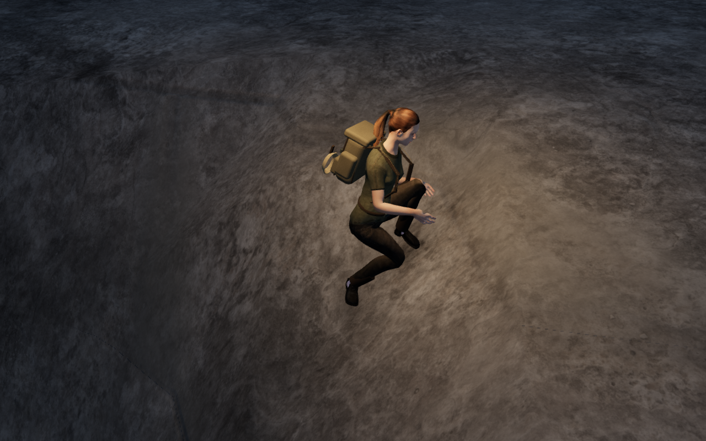
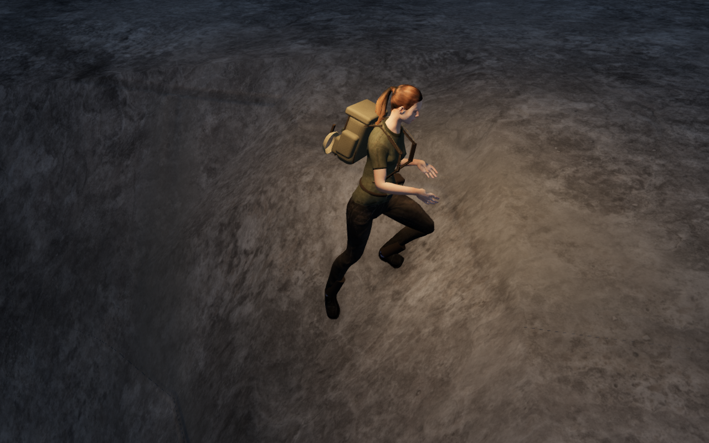
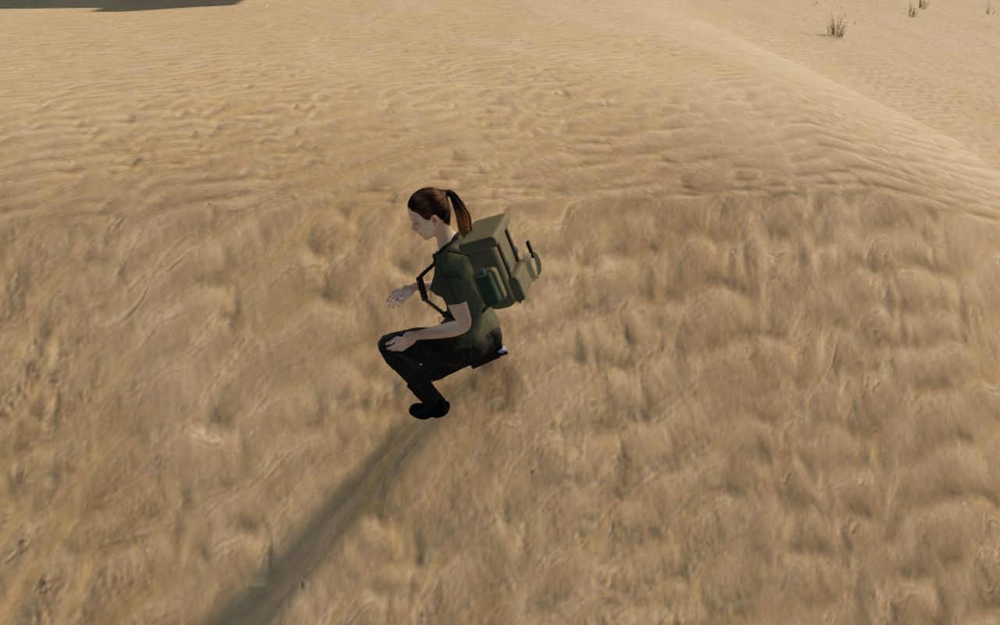
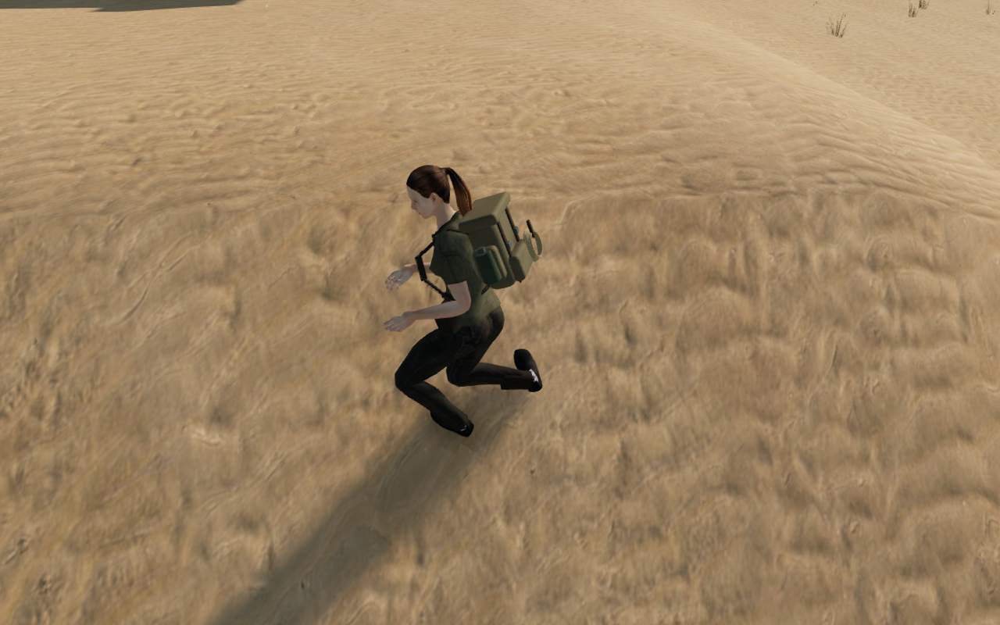
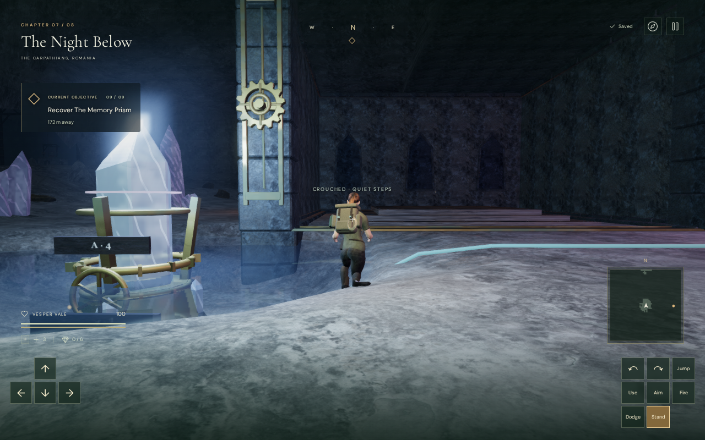
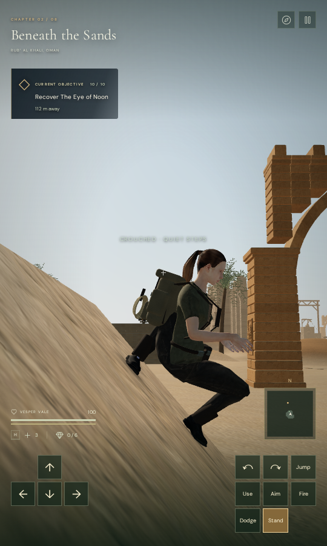

# Boot shape and bank footing

The explorer's resting boots now follow supported banks, and their low heels
remain attached to the foot when the knees bend. This repairs a second cause
of the suspended appearance recorded in the [shared floor review](rendered-terrain-support.md).
Standing on the correct terrain plane alone did not establish convincing foot contact.

## Stiff heels and supported angles

The transferred MakeHuman clothing weights gave some low heel vertices more
than 60% shin influence. Knee bending pulled those vertices away from the
outsole. The offline converter now assigns the stiff sole to the foot and
forefoot joints, with the bend centred at the existing toe joint. Above the
sole, it blends back to the original ankle weights between 4.5 and 13 cm.
The delivered GLB is rebuilt from the retained credited sources.

The previous fitter retained the animated boot angle on slopes above about
28 degrees. A supported bank could therefore touch one edge while leaving
the opposite edge high above it. Resting feet now fit the sampled outsole
orientation to a local floor plane. The plane must have complete nearby
support and agree with the floor probes within 4 cm; discontinuous ledges
retain the animation. Raised moving feet retain their swing and roll.

Stationary crouching also keeps the resting horizontal footprint and removes
the artificial swing-height allowance. It does not change the player's
collision root, velocity or persistent position.

The first broad review found twelve small footwear penetrations, reaching
8.02 mm, which the reduced sole perimeter missed. The bounded final clearance
passes now read every low footwear vertex, including medial points where a
terrain ridge or forefoot bend can enter the outline. The smaller perimeter
remains available for orientation and footsteps.

## Measured shape and clearance

An independent observer reads all 722 low footwear vertices per pose against
the delivered terrain triangles. Twelve recorded standing/crouching poses
cover three positions, two headings and both stances. It also reads the entire
visible posed character and compares 49 heel vertices per boot with their bind
shape. The previous maximum heel-distance distortion was 47.814 mm; the rebuilt
heels retain their dimensions within floating-point rounding. All 8,664 final
footwear queries at these poses have positive gaps, with a minimum of 6 mm.
The highest measured gap is 8.74 cm at the second cavern corner stance.

| Recorded crouched stance           | Previous highest footwear gap | Revised gap |
| ---------------------------------- | ----------------------------- | ----------- |
| Cavern bank, rear heading          | 32.44 cm                      | 6.67 cm     |
| Cavern bank, side heading          | 21.32 cm                      | 6.51 cm     |
| Second cavern stance, rear heading | 16.54 cm                      | 6.46 cm     |
| Second cavern stance, side heading | 15.88 cm                      | 8.74 cm     |
| Desert bank, rear heading          | 19.85 cm                      | 7.21 cm     |
| Desert bank, side heading          | 36.91 cm                      | 7.26 cm     |

These footwear queries include the bevel and do not imply that every point of
a curved outsole should touch uneven ground. A regression bounds their highest
gap below 10 cm and checks heel rigidity, root preservation and full-body
clearance. A separate four-chapter regression requires positive full-body gaps
at the eight positions that exposed the medial contacts. The knee-fit omission
control still drives hundreds of clothing vertices more than 20 cm into its
bank; the corrected final poses must clear it.

The asset comparison covers all 17 meshes, eight textures, 81 nodes and the
skin's bind matrices. Positions, indices, normals, UVs, texture bytes and rest
transforms match. Only the boot joint/weight attributes and three vertical
hip-animation channels change. Their largest height corrections are 5.168 mm
in Idle, 6.810 mm in Walk and 29.818 mm in Run. Animation rotations, times and
horizontal hip motion remain unchanged.

## Rendered review and release checks

The final current-world browser survey covers six legal dry bare-floor positions
per chapter, two headings and standing/crouching states: 192 settled snapshots.
Two complete stance-change sequences add 240 intermediate frames in the cavern
and desert. All 20,777,040 checked posed vertices have positive terrain gaps,
with a minimum of 5.94 mm and no missing or invalid floor queries. The check
requires a positive minimum rather than accepting penetration inside the
observer's existing 15 mm reporting tolerance. Player roots remain legal,
supported, healthy and at the recorded coordinates.

Progress is prepared, enemies are removed and combat/world timers are not
stepped. The eight chapter views and four paired views have linked shaders and
finite HDR output. The matched comparisons reconstruct the preceding
character asset and grounding functions in the current unchanged scene, with
the same recorded player root and a fixed documentation camera. They do not
establish normal-camera visibility along every route.

| Cavern before                                                                             | Cavern after                                                                           |
| ----------------------------------------------------------------------------------------- | -------------------------------------------------------------------------------------- |
|  |  |

| Desert before                                                                           | Desert after                                                                         |
| --------------------------------------------------------------------------------------- | ------------------------------------------------------------------------------------ |
|  |  |

All 317 selected JavaScript cases across 36 files pass with one worker, together
with the release build and its existing large-chunk advisory. They include
delivered-character, movement, camera, traversal, raised scenery, mechanisms,
water, persistence and visibility checks. The moving-sole regression retains
running flight and passes its slip limits; quiet and positioned footfalls retain
their coverage. This is a selected suite rather than a claim that every test
file was run.

The final release has no development game hook. Keyboard/High at 1280 × 800
and touch/Low at 540 × 900 both exercise movement, crouch, look, jump and map
access, then compare the complete stored campaign through two reloads. Only
each chapter's `lastPlayed` timestamp is excluded. Position, input look, settings
and progress persist; both cases finish healthy at ground height with no page
overflow or application/HTTP errors. Recorded movement is 1.8 m in the cavern
and 2.7 m in the desert. Progress and starting positions are prepared, and the
mix is muted; these are input/save checks rather than listening or playthrough evidence.

All six character responses match the rebuilt delivery GLB's SHA-256, and the
release's JavaScript/CSS resources match the final build. The release pictures
pause through the normal interface and temporarily hide only the pause panel.

| Keyboard / High                                                                            | Touch / Low                                                                                   |
| ------------------------------------------------------------------------------------------ | --------------------------------------------------------------------------------------------- |
|  |  |

All twelve world/comparison captures and both release pictures are reviewed.
The six published images preserve their source PNGs' decoded RGBA pixels and
dimensions through lossless WebP conversion. Early comparison captures with
an accidentally hidden character were rejected; the final pairs explicitly
require full character coverage and a legal camera origin.

## Resource enforcement

A full thread audit caught a native GPU worker expanding its inherited CPU set.
Those threads were restricted, and the browser was stopped and restarted with
a stronger launcher. After selecting the shared set, the launcher installs a
kernel filter that refuses further affinity changes. Threads and descendants
inherit the restriction, so a library cannot unpin its workers. This uses the
kernel's documented [seccomp filter inheritance](https://docs.kernel.org/userspace-api/seccomp_filter.html).

Three launcher checks verify denial in threads and descendants, retained
allowance in nested launches, and the original command's exit status. The
current sandbox uses CPUs 0–8 of 16, with lower scheduling priority. Expensive
checks remain serial, with one test worker or browser. The converter also
limits image conversion to two threads. The final browser, helper and preview
processes are closed. A process audit finds no live tracked verification jobs
and neither temporary test port listening. Saves, profiles, raw captures and
logs remain in ignored project-local staging.

Wider slopes and poses, continuous sole-face contact, contact lighting, camera
occlusion, sparse cavern scenery, listening and consumer-device performance
remain open. This milestone does not complete the eight-chapter visual target.
