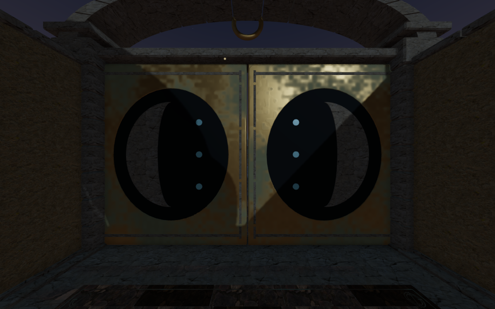
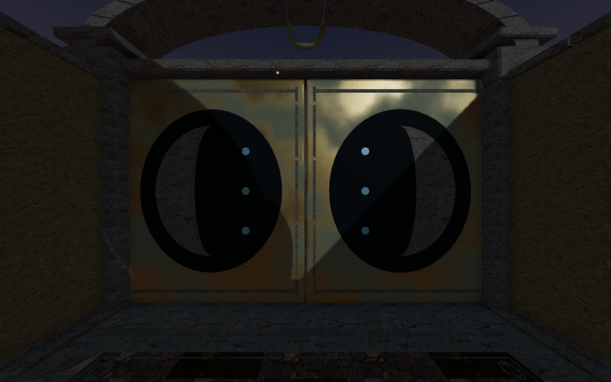
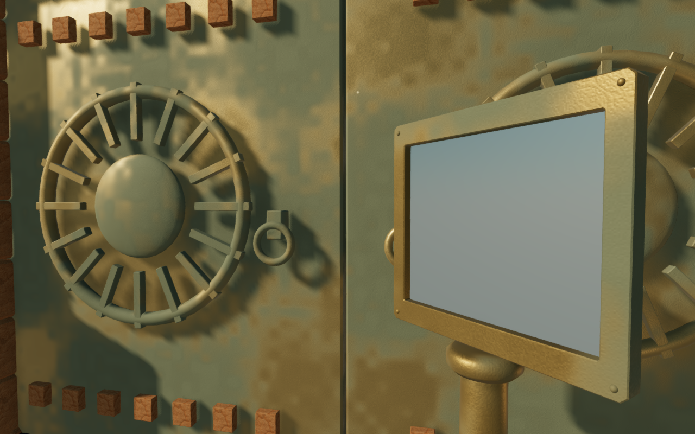
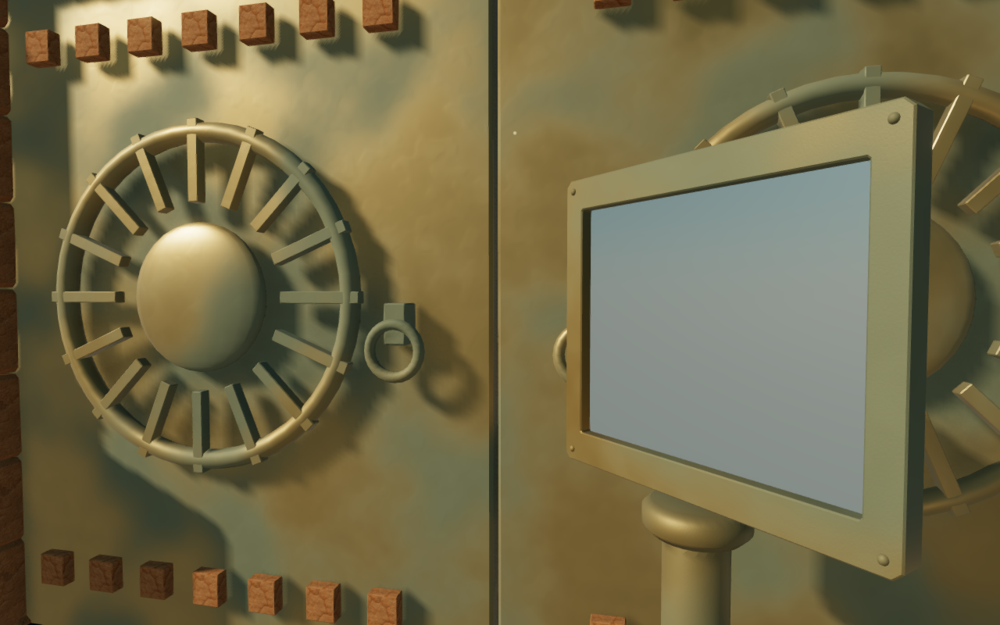
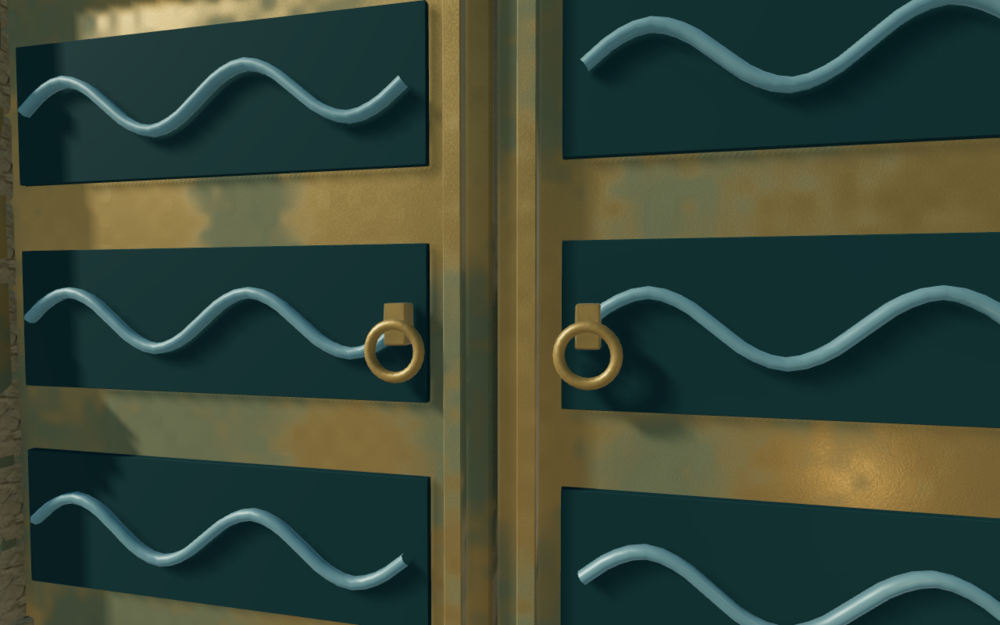
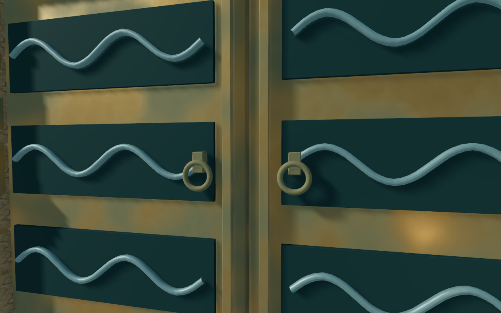

# Smoother bronze weathering and highlights

The shared bronze now uses rotated gradient noise with smooth cell boundaries
and two weathering scales. Broad oxidation controls most of its roughness;
smaller variations contribute more gently. Fine grain fades toward its average
as its cell spacing approaches two screen pixels; shallow pitting remains present.
The bronze and green oxidation palette is retained.

The preceding material's square patches were most conspicuous in the rear
Meridian door highlights. Controlled renders largely removed them when holding
roughness constant; removing shadows, environment lighting, metalness variation
or fine grain left them visible. The isolated mottle field showed an aligned
cell pattern. The revised field and roughness response address that recorded
appearance without changing the light rig or removing weathering.

In the rear comparison's unshadowed upper-right bronze band, a fixed 230 × 12
pixel region has luminance variation of 15.32 before and 5.66 after, measured as
the RMS difference between 3 × 3 and 17 × 17 local means. Mean luminance rises
from 117.10 to 138.41 on a 0–255 scale; variation divided by that mean falls
from 0.131 to 0.041. This supports the visible reduction in that selected band,
not a whole-scene quality score.

The 68 chapter comparison captures cover High and Performance settings across
all eight worlds. They include gate contexts, selected instruments or props and
an additional observatory crown view. All are reviewed. Some prop contexts expose
only small portions of bronze; this is sampled material coverage rather than
an exhaustive inspection of every object. The volcanic and sky gates retain
their separate metal shaders while shared bronze appears on other props.

Each comparison switches the exact published `60c0505` shader recipe and the
revised recipe in the same paused world. All 34 pairs retain identical hashes
of actual position, normal, UV, index and instance buffers, object transforms
and visibility. The inspection cameras are distinct from ordinary gameplay
follow views. Geometry, navigation, sound anchors, puzzle rules and saved states
are unchanged by this material pass.

A GPU field observer samples 16,384 positions per recipe, including 256
cell-boundary triplets. The revised values remain finite and within the unit
range. The maximum sampled finite-difference slope jump falls from 0.01956 to
0.000536. These figures describe the selected field samples and do not establish
universal smoothness or motion acceptance on all devices.

The local panel timing comparison uses the same geometry, lighting, environment
and 1280 × 800 canvas, with legacy/current/current/legacy material order. Eight
samples per recipe report median render times of 16.28 ms for the preceding
shader and 24.12 ms for the revision. Each sample draws one call and twelve
triangles. The device is ANGLE with Mesa/Vulkan llvmpipe, a software renderer,
constrained to five of sixteen CPUs. The additional shader work has a measurable
cost here; these are isolated local panel timings, not consumer GPU frame rates.

All 24 selected tests pass, including the actual bronze shader's composition
with projected gameplay warnings and restoration of its original hooks when
those warnings retire. Camera, observatory, door and rendering-setting checks
also pass. The production build passes with its existing chunk-size advisory.

The production bundle passes the lunar mechanism check with keyboard controls
at 1280 × 800 High and touch controls at 540 × 900 Performance. Each prepared
stage-two start exercises coupled turns, reset, alignment, submission and stage
advancement. Five full-store reload comparisons pass across partial progress,
completed progress and an older soil-height arrival, excluding only per-level
last-played timestamps. Native return movement covers 9.0 m and 9.6 m with
health retained at 100. The older arrival retains its horizontal position on the
0.549 m threshold support. All eight production captures are reviewed; there
are no application errors or warnings or horizontal page overflow. These
prepared checks do not establish a complete chapter playthrough or listening
acceptance. The owned browser and preview processes are closed afterward.

Across the eight chapter transitions, 85 tracked bronze materials and 2,282
tracked geometries each dispose exactly once. The diagnostic visibility mask's
optional-texture warnings were traced to ignored undefined arguments; explicit
null defaults preserve the same properties and a clean GPU mask fixture passes.
All captured scene shaders link and their HDR buffers remain finite.

The six actual 1280 × 800 High comparison exports preserve decoded source pixels
and dimensions without cropping or retouching. Both recipes use the revised
application at matching prepared cameras and zero elapsed simulation time.
Existing [asset attribution](asset-credits.md) is retained. No external asset,
texture, material or dependency is added.

The [world audit](visual-audit.md) remains open. Repeated main structures,
broader route composition, continuous body contact, consumer device performance
and listening acceptance still need work.
