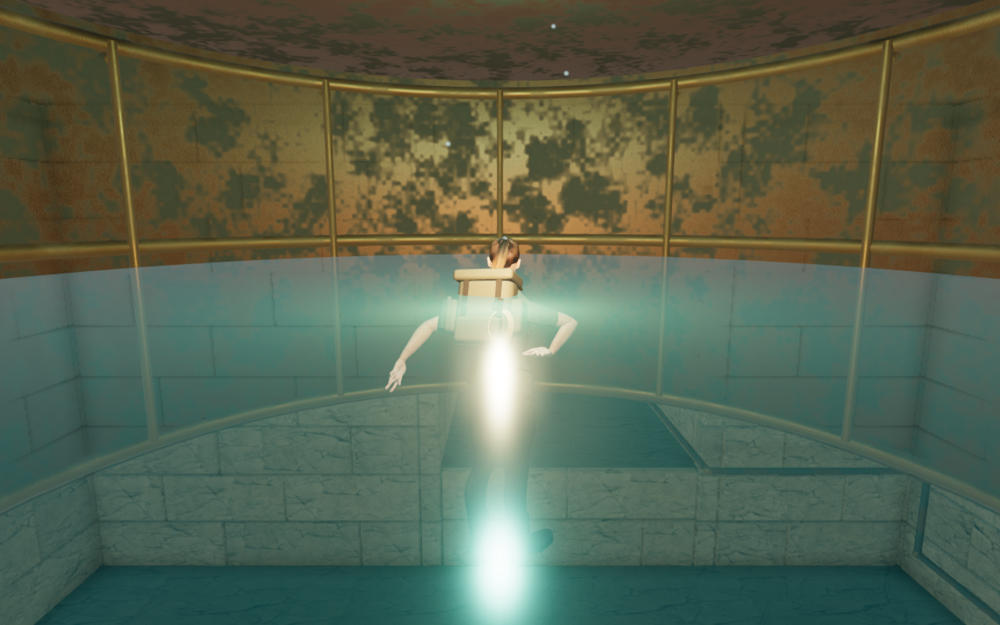
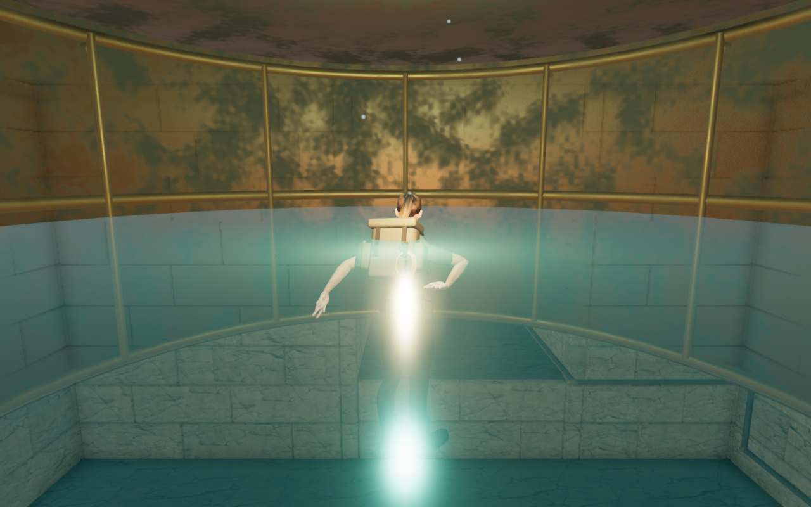
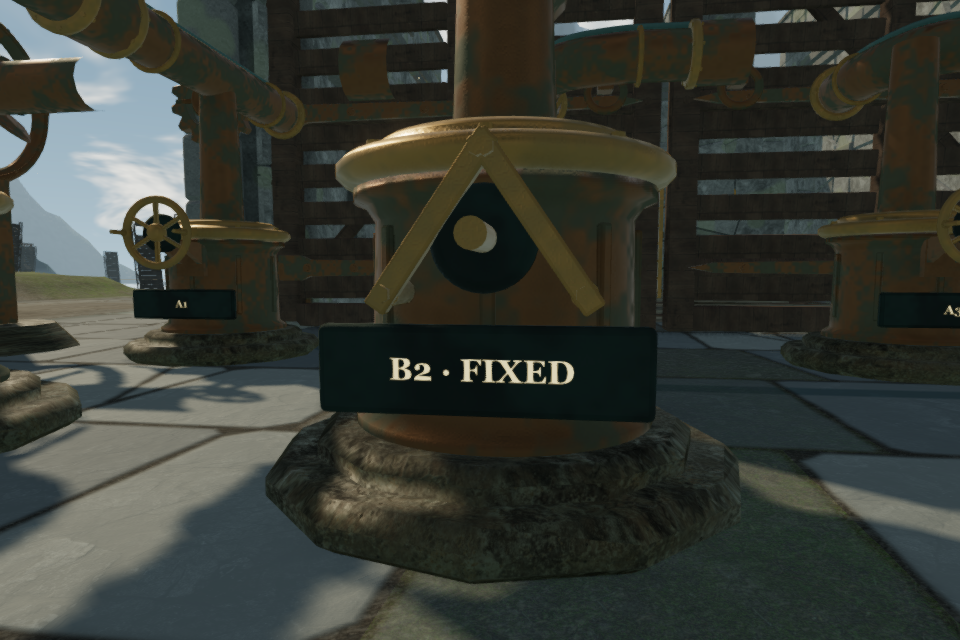
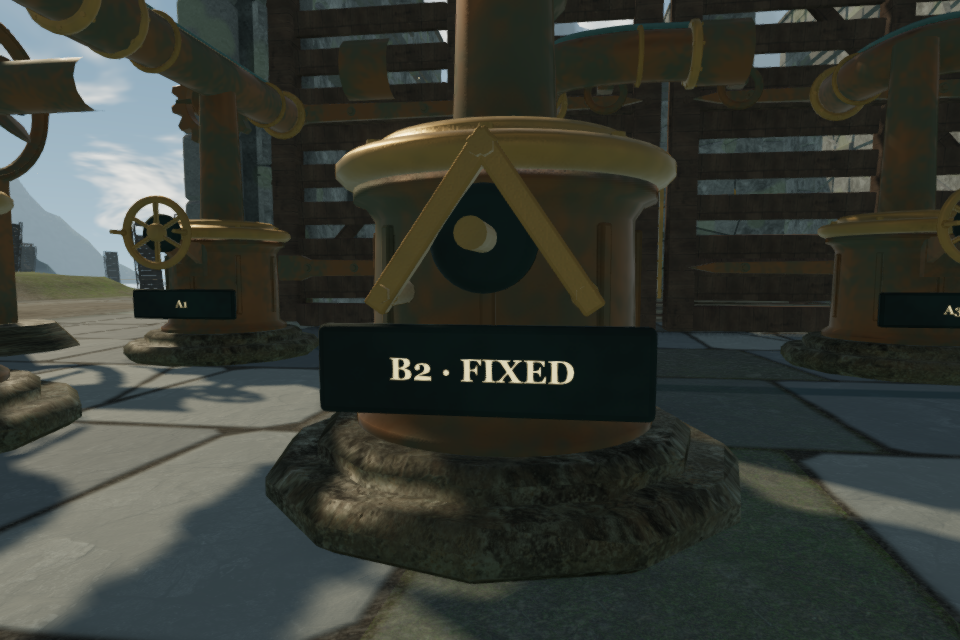

# Softer weathering on cast metal

The air-bell skirts showed square-edged patches of oxidation in close views.
The shared cast-metal shader now uses a smoother noise transition, a rotated
sampling basis and a gently warped detail layer. Softer color and roughness
variation retain the dark cavities and fine casting grain.

All three detail scales fade with their screen footprint. The normal calculation
filters the first height derivatives directly, keeping the footprint weights
out of those derivatives. Casting coordinates remain local to each piece through
merging, instancing and movement. The shader retains three noise evaluations
and uses a new program-cache version.

Cast bronze, worn bronze and bearing iron keep their base material properties.
Puzzle pressure plates retain their state-dependent colors and emission. The
revision changes fragment shading; it adds no model, texture or dependency.

## Matched game views

The second air bell at High quality, 1280 × 800. Both captures retain the same
player position, camera, world time, field of view and quality. The preceding
material is replayed on the same geometry for the first frame:

A fixed sky-engine bearing at High quality, 960 × 640, with the same matched
view conditions and an inspection camera:

## Verification

Twenty scene captures are reviewed across all eight chapters. They include
counterweights under each region's lighting, both air bells, the gallery wheel
at two rotations, and the sky bearing, wheel and full court. The first bell is
checked at High, Medium and Low. Three before/after pairs retain identical pose
and camera records. The regional and machinery samples use stopped inspection
cameras. High/Medium bloom inputs have no non-finite samples, and all checked
programs link without graphics errors.

Six separate material studies cover the three finishes before and after the
change. Thirteen half-float diagnostics cover all three finishes at 3.6, 12 and
24 metres, plus oblique cast-bronze and iron views. All contain zero non-finite
samples and report no graphics errors. These are rendering checks on the
verification backend; consumer-device performance remains unverified.

All 135 selected regressions across eleven files pass, together with three
CPU-budget checks and the production build. Existing large-bundle advisories
remain. The exported kit and three duct curves retain identical bytes across
16 shapes, 72 attribute arrays and 85,881 vertex records. Base properties match
for all three finishes; their program-cache version advances to
`wind-casting-v2`.

Production checks load a prepared second-bell save through the normal launcher.
Touch and keyboard dives reduce the air meter to 31 seconds; rising restores
32 seconds at health 100. Two complete-store comparisons pass across initial
restoration and the final reload, apart from the designed initial checkpoint
position and last-played timestamp. All four release captures are reviewed.
These functional checks use Low quality at a 360 × 600 viewport and half pixel
density (180 × 300 captures). The checked release assets match the production
build, with no development hook or recorded application/resource errors.
The browser, context and preview server close after verification.

## Remaining work

Strong gallery-light glare still crosses the resting explorer in the High and
Medium air-bell views. Its light, water and postprocessing contributions still
need diagnosis. Plain floors and ceilings, repeated structures, sparse
surroundings, wider contact, continuous camera timing, device testing and
listening acceptance also remain part of the unfinished whole-world target.

Existing [asset attribution](asset-credits.md) applies. The four figures are
complete game captures; no retouching or external imagery is used. Verification
keeps the locked shared 5/16 CPU allowance, at most two test workers and one
browser. Private profiles, saves and reports remain in local staging.
