# Camp body clearance and recovery

Camp movement now follows the delivered supply chest, bedding and kettle. A
finite keepout covers the stone hearth and flames. These pieces cannot become
standing platforms; sufficiently high jumps can still pass above them.

The previous narrow chest box omitted its overhanging bedding and kettle, and
allowed standing inside the fire ring. A preceding-collision control reproduces
455 embedded character vertices in the first occupied jungle pose, with a
maximum sampled depth of 6.30 cm. The current checks read the actual delivered
character and rendered camp meshes independently of the movement kernel.

## Contact and motion

The furniture kernel copies transformed triangles before render batching,
including the kettle's tilted spout and scaled fittings. Its temporary buffer
copies are disposed after extraction. A measured 0.8 m body margin covers the
sampled standing, crouching and moving silhouettes. The hearth radius follows
its actual outer stones and has a finite flame height. The keepout does not
muffle its own positioned fire source or become an opaque camera wall.

Descending into low furniture triggers a short outward rebound through the
normal collision substeps. Destinations must also be legal on the ground,
including beside adjacent supplies. The rebound briefly settles before
releasing held movement. An earlier prototype jumped sideways by 1.348 m in
one update; the six revised recorded jumps have a maximum horizontal update of
0.100 m at 60 updates per second. Resting requires clear grounded feet.

Older occupied saves move to nearby legal ground while retaining their saved
look. Manual checkpoint return and combat recovery use the same arrival rules,
and rewrite an occupied checkpoint to the recovered position. Discoveries and
field progress remain intact. The left airborne ankle target also moves up
5 cm to remove the measured below-root heel extension; model assets and
animation clips are unchanged.

## Selected regression evidence

Ninety-three selected cases across seven files pass in three serial batches:
58 camp, field-station, movement and explorer cases, one added running-body
case, and 34 camera/persistence cases after the saved-look correction.
This is a selected suite, not the full repository suite.

- 192 standing/crouched pressure poses cover four approaches to three props
  at the first camp of each chapter: 9,234,240 delivered vertex queries.
- Six ordinary jumps in the sky and eclipse chapters include 72 sampled poses
  and 3,462,840 vertex queries. Every airborne update also checks the complete
  low-footwear vertex sets against the collision root. All return to ground.
- Forty-eight occupied-save recovery poses cover the three props in eight
  chapters and both stances: 2,308,560 vertex queries.
- Twelve running approaches in the sky chapter include 63 sampled poses and
  3,029,985 vertex queries, including the running clip and stopping transition.

These samples have no embedding beyond the stated 15 mm threshold and no
flame-cylinder entries. All 28 generated camps retain legal approaches,
rest/torch access and their existing source, pause, distance-detail and graphics
retirement checks. Deliberate preceding-collision, horizontal-snap and airborne
heel controls each fail on the corresponding actual contact or motion defect.
The observer tests delivered vertices; it does not prove all face interiors,
unsampled poses or every continuous route.

## Rendered review

Twenty High-quality captures at 1280 × 800 cover standing and crouching at the
first camp in every chapter. Four old-collision controls cover the recorded sky
and eclipse hearth centres. The sixteen revised views require clear delivered
body vertices, positive queried floor gaps, no flame-cylinder entries, full
character opacity, a legal camera and zero sampled opaque camp obstruction.
All sixteen pass, with 769,520 visible-body vertex queries and 4,392
independent body rays; the smallest queried floor gap is 6 mm. Shaders link,
HDR pixels remain finite, and no application errors or warnings occur.
The settled camera medians range from 1.3 to 5.65 ms across these samples;
these are camera-only sandbox timings, not a whole-frame or device benchmark.

The controls restore the preceding narrow chest footprint and omit the hearth
and kettle obstacles inside the current scene. Their finite chest height is
derived from current furniture bounds; they do not reconstruct every old
collision detail. The revised root moves to nearby legal ground; requested position and
input look are retained. The invalid old centre gets one normal camera update,
since trying to settle that physically occupied position exceeded a bounded
60-second camera check. Each revised camera settles for 120 normal updates.
These compare physical placement rather than identical camera trajectories.
No documentation orbit or opacity override is imposed. Progress is prepared,
enemies removed, audio muted and timers stopped. Instanced foliage is outside
the opaque-mesh ray observer. This is an assisted scene survey, not complete
chapter playthroughs.

| Sky, preceding collision | Sky, recovered ground |
| --- | --- |
| 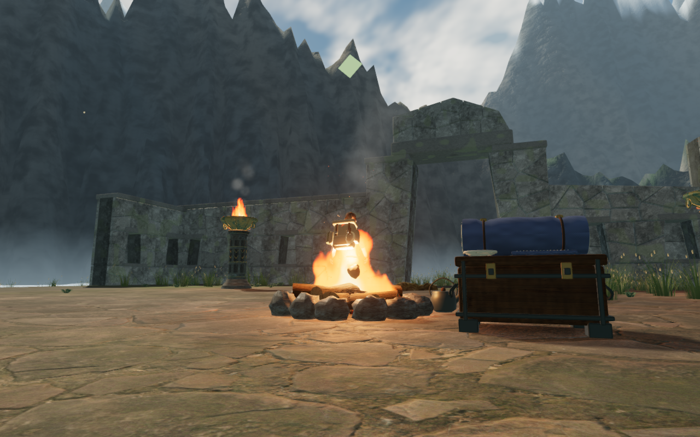 | 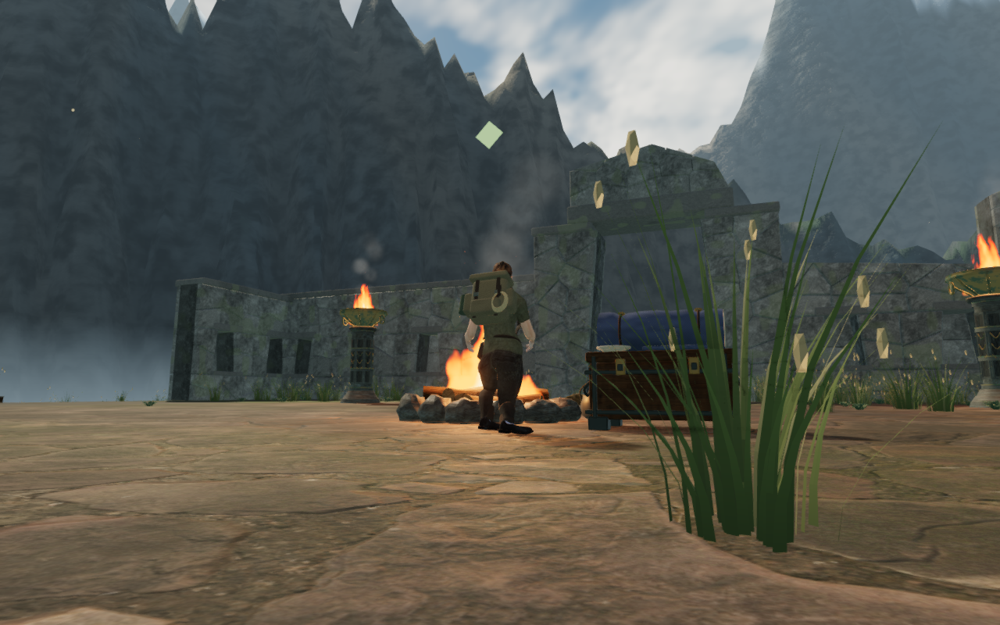 |

| Eclipse, preceding collision | Eclipse, recovered ground |
| --- | --- |
| 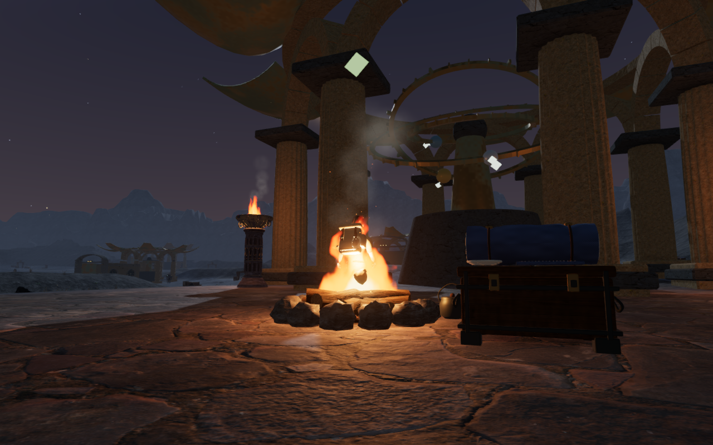 | 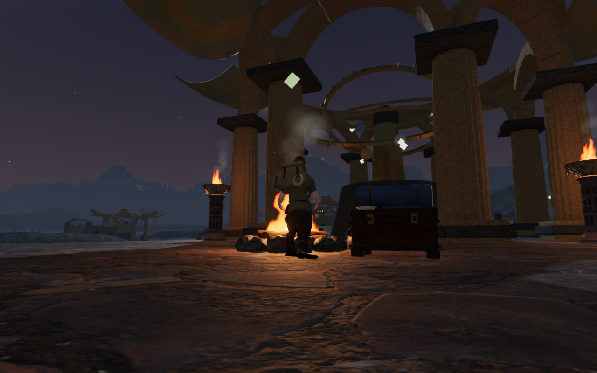 |

| Jungle | Desert |
| --- | --- |
| 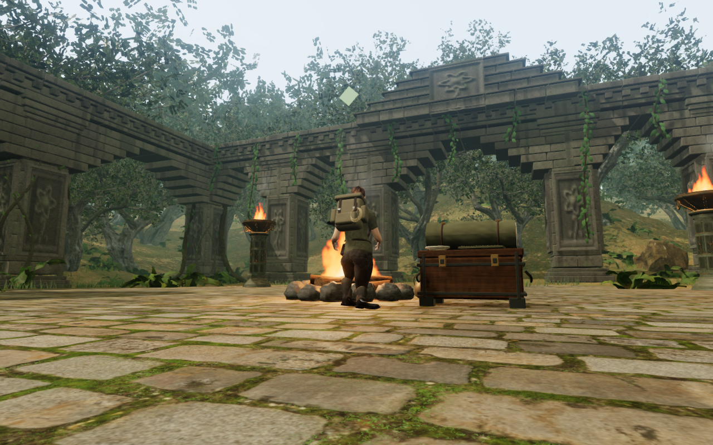 | 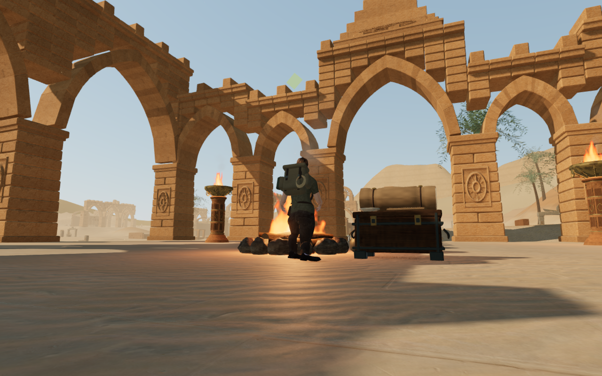 |

| Mountain | Coast |
| --- | --- |
| 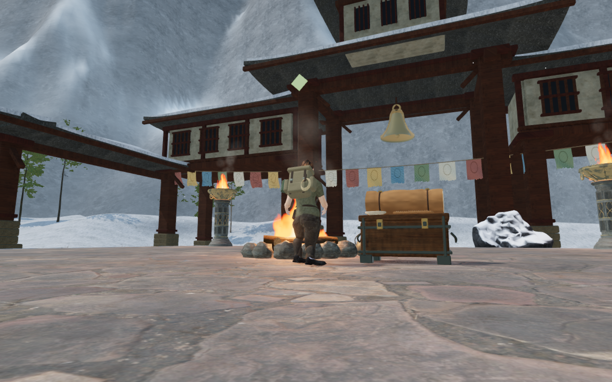 | 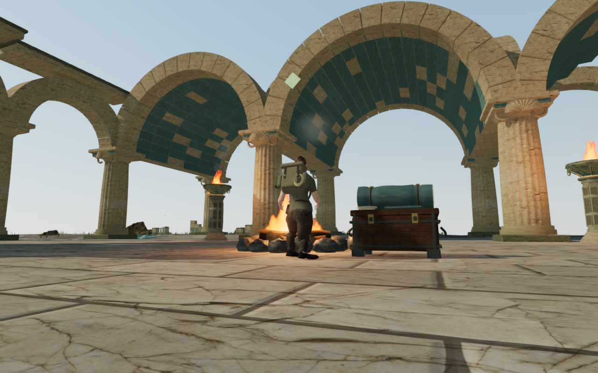 |

| Volcano | Cavern |
| --- | --- |
| 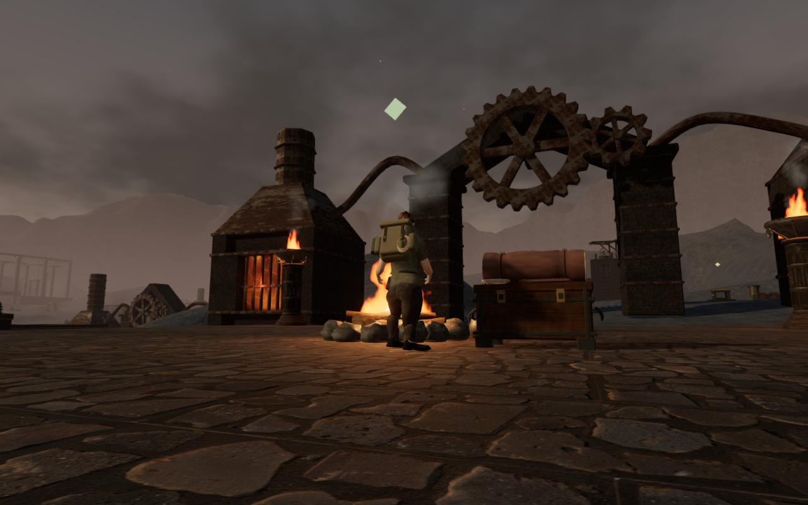 | 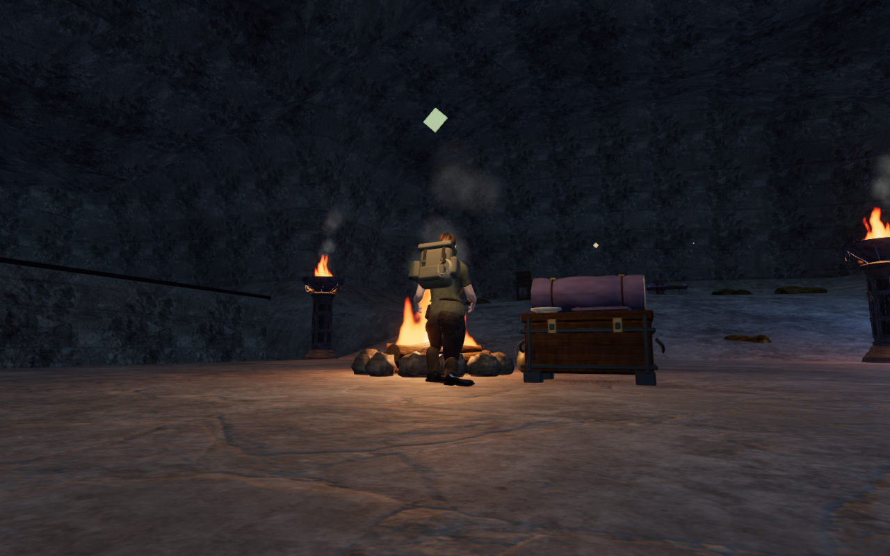 |

## Built release controls and saves

The release build passes with its existing large-chunk advisory. The actual
interface passes keyboard input on High in the sky chapter at 1280 × 800,
and touch input on Low in the eclipse chapter at 540 × 900. Each occupied save
recovers 2.25 m from the old hearth centre while retaining its exact saved
input look. Walking covers 1.5 m and 2.1 m respectively. Both exercise crouch,
manual look, jump/landing and map access, then return through the pause menu to
the old occupied checkpoint. That checkpoint is rewritten to the clear stance.

Health stays at 100 and saved roots settle at ground height. Discoveries and
field progress survive return. The entire campaign store survives two reloads
per case, excluding only the expected `lastPlayed` timestamp changes. Neither
viewport overflows. The development hook is absent, resource filenames match
the current build, and all six model responses match the unchanged delivered
explorer's SHA-256. No application errors, HTTP failures or warnings occur.
The native screenshots are reviewed; prepared saves and muted audio limit the
scope of these checks.

| Sky keyboard / High | Eclipse touch / Low |
| --- | --- |
| 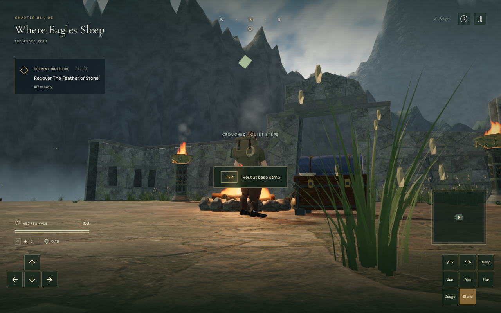 | 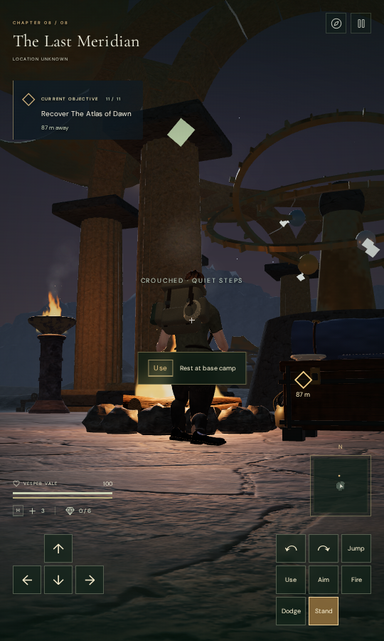 |

All twenty survey captures and both native captures are visually reviewed.
Twelve public documentation images are lossless WebP conversions, verified to
retain decoded RGBA pixels and original dimensions.

## Verification limits

The existing camp artwork, bundled explorer, environmental audio and scores
are retained. This repair does not establish full eight-chapter visual
acceptance, subjective spatial listening quality, chapter pacing or consumer
hardware performance. Wider moving-camera routes, foliage obstruction,
perceived weight, continuous surface contact and landscape composition remain
under review.

Heavy verification uses the locked shared allowance of nine out of sixteen
available CPUs, serial heavy jobs, one test worker and one browser. Temporary
scripts, saves, profiles and logs stay inside ignored checkout-local staging.
Owned browsers and temporary servers are closed after their checks.
