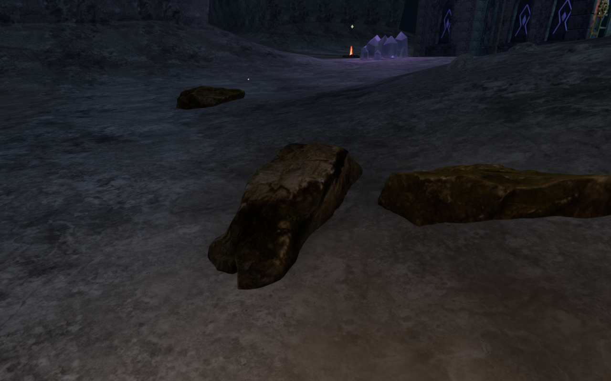
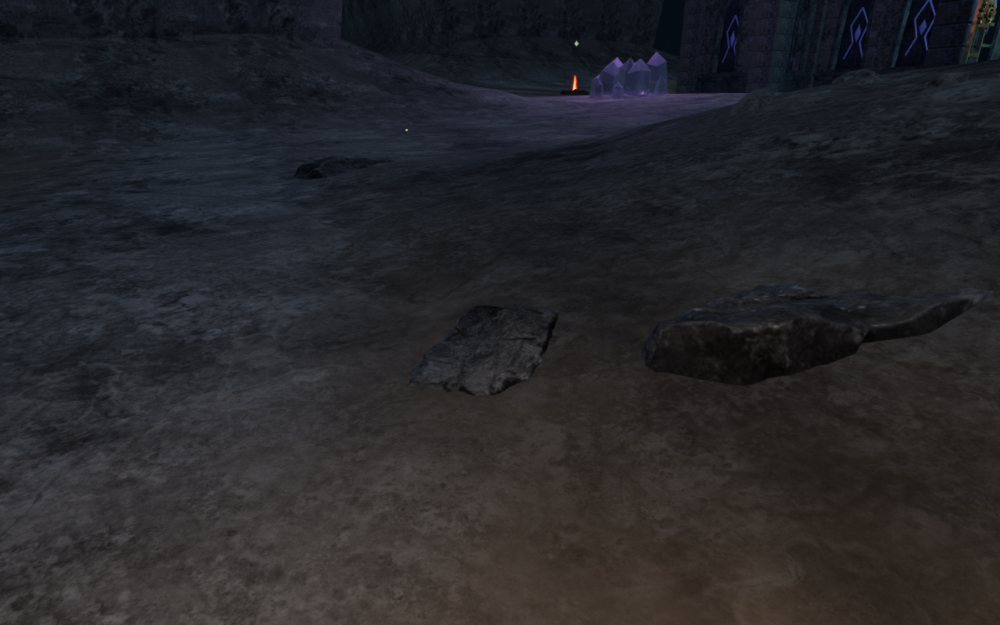
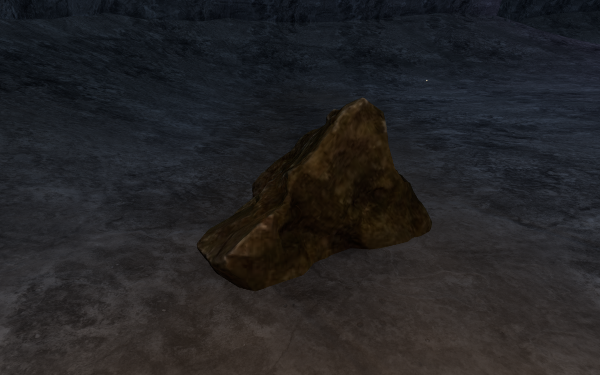
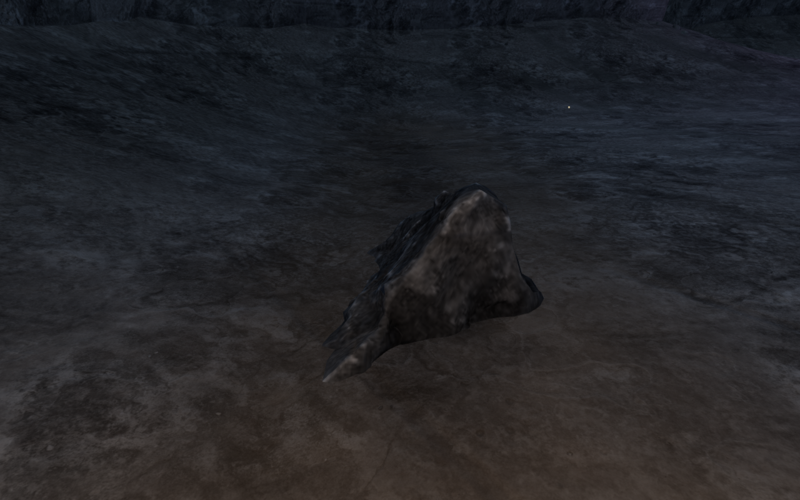
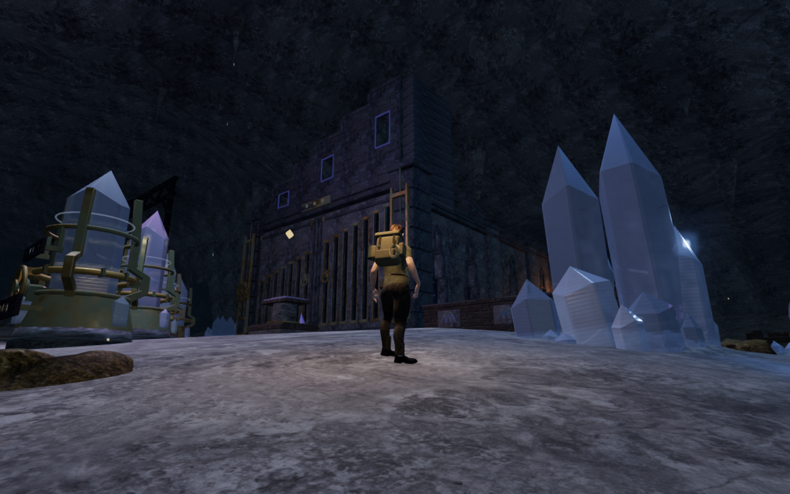
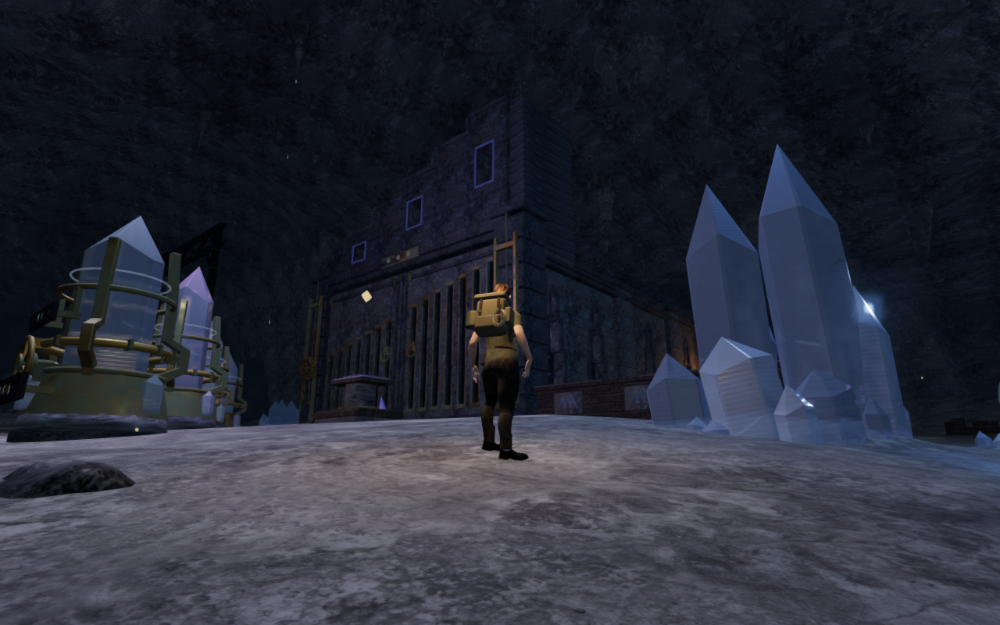

# Seated limestone boulders

The cavern's six scanned boulder shapes now use grey limestone shading with
restrained dampness and calcite deposits. The existing Rock Moss Set 01 scans
retain their grain, maps and geometry. Their chapter material uses each placed
instance's actual world position, so mineral bands follow the cavern rather than
the unplaced source mesh. It allocates no additional textures.

The close inspection also found narrow scan edges hanging above the cave floor,
with an independently measured maximum gap of 0.779 m. Detailed underside fitting
now samples vertices and downward triangle centres as well as the original grid.
When needed, placement tries alternative headings, then a bounded search within
2.1 m. The search keeps spawn, feature, structure and water reservations, and
shifted sites also leave the tuning courts clear.

The revised cavern retains 314 of the previous 320 rocks across all six shapes.
Six additional unsupported sites are omitted. Independent upward rays against
the actual revised meshes sampled 73,698 underside points; none exceeded the
rendered floor, and the least buried sample remained about 39 mm below it.
This is sampled contact evidence, rather than an exhaustive geometry proof.

Dry saved arrivals now settle onto the current supported surface after the
asynchronous scans finish loading. This handles lowered or removed caps while
retaining supported earned decks. Restored swimming, diving and gallery arrivals
keep their existing handling. A reproduced older cap drops 0.312 m onto its
current surface, remains stable on repeated restoration, and permits a local
assisted jump and walk-off with 100 health.

The 62 selected tests pass, covering delivered scan grounding, collisions,
arrivals, tree supports, traversal, tuning, LOD behavior and spatial sound.
The expanded eight-test arrival file also passes. The production build passes
with its existing chunk-size advisory.

Production keyboard/High and portrait touch/Performance controls each pass
thirteen tuning turns, lowering, reset, a stage 1-to-2 solve and a 5.7 m return
with 100 health. Their four complete-save reload comparisons pass, excluding only
the timestamp. A separate production older-cap save settles onto the lowered
surface, passes another complete-save reload comparison and permits a keyboard
jump and walk-off with 100 health. These starts use prepared progress and do not
establish a complete chapter playthrough. All ten release captures are reviewed.

Nine baseline and nine final High views inspect all six scan shapes and three
court contexts; all are reviewed. The final geometry and placement manifest
matches the independently sampled revision. A GPU observer compares the material's
world coordinates with 1,802 actual mesh-ray intersections across all six shapes,
with a maximum difference below 0.4 mm. Deliberately omitting the instance transform
produces an error exceeding 216 m in the same observer.

A comparison with the preceding placements retains all 1,110 previously clear
sampled path centres, all 33 instrument fronts, 46 feature fronts and 591 sampled
sound-landmark approach positions. Six tracked rock materials, their three shared
textures and all 241 rock instance buffers dispose exactly once on chapter change.
Owned browsers and previews close after verification, with their threads constrained
to the shared five-of-sixteen CPU allowance.

The six comparison exports retain actual 1280 × 800 High source pixels at matching
prepared player positions, cameras and zero elapsed simulation time. Two pairs
use ground-observer detail cameras; the court pair uses the follow camera.
Baseline runtime source hashes match published `5cbf7e5`; revised hashes match the
new application. Lossless WebP conversion preserves decoded pixels without cropping
or retouching. Existing [asset attribution](asset-credits.md) is retained; no external
model, bitmap, recording or dependency is added.

The [world audit](visual-audit.md) remains open. Repeated installations, broader
route composition, continuous body contact and listening/device acceptance still
need work.
