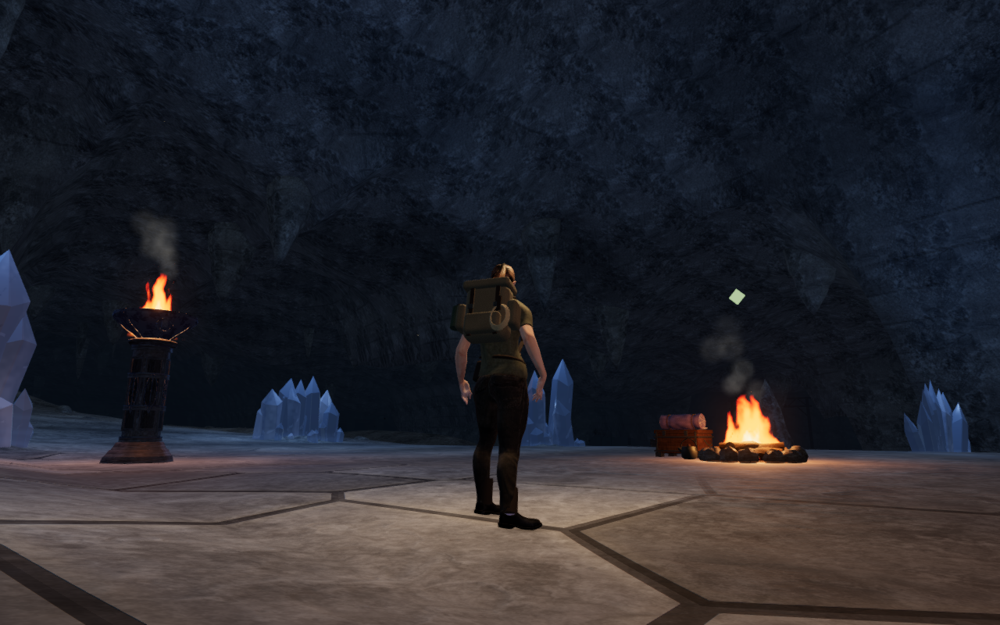
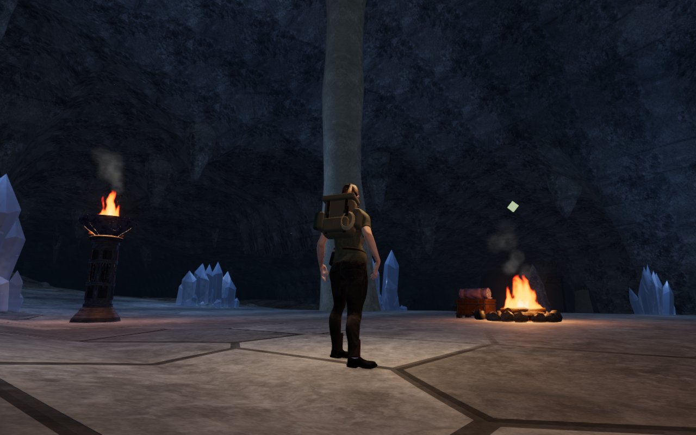
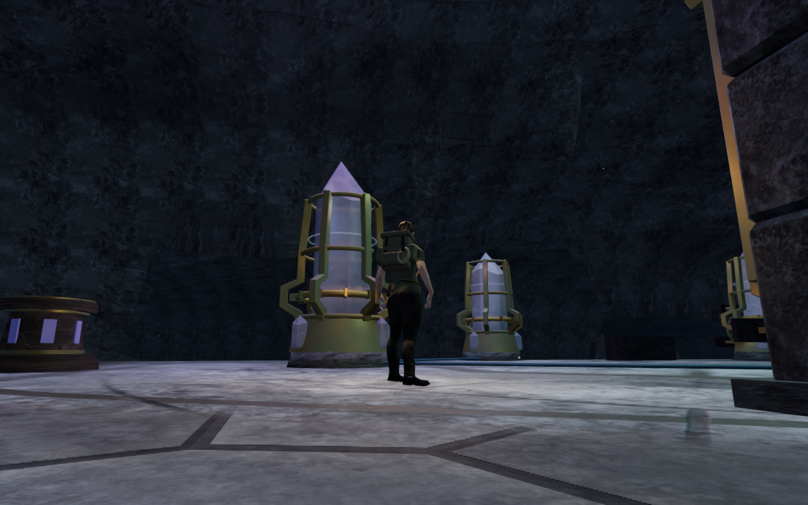
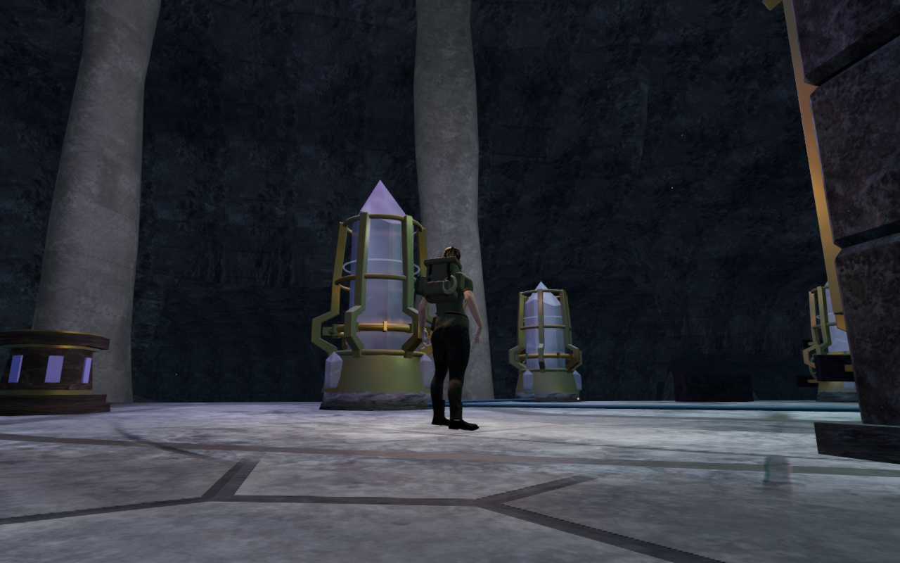

# Cavern limestone columns

Eighteen floor-to-ceiling calcite columns give all nine cavern chambers vertical
structure between their archives, mineral fields and working areas. Wider roots
and crowns, uneven trunks and three broad folds vary their silhouettes. Their
subdued limestone treatment reuses the [credited rock textures](asset-credits.md);
no external asset or dependency is added.

Placement reserves complete footprints around the continuous segments of every
map path, controls, climbing stations, discoveries, enemies, water, mineral beds,
sound sources and existing construction, including overhead structures. The
new solids are built before scanned nature placement and saved-position recovery.
An older save inside a new column can move to nearby clear ground before play.
This is a local scenery milestone; broader composition and full-world acceptance
remain open.

Each closed mesh extends beneath the lowest touched floor triangle and above
the highest touched ceiling triangle. Its physical triangle copy survives
regional render batching. Seventeen fitted convex camera bands follow each
column's actual changing width and lean; a single enclosing box would block
empty space beside the narrower trunk. Buried upper caps do not become walking
platforms. Existing ray queries also give the new stone finite sight, projectile
and sound obstruction.

The live chapter has 31,104 closed column triangles. Geometry tests cover
closed winding, fitted floor/roof joins, extreme height variants, continuous path
reservations, legacy relative-height obstacles, rendered contact and camera
clearance beside the narrower waists. The isolated geometry fixture checks
16,416 buried join samples and 4,104 rendered/physical/camera rays; it does not
represent the complete populated chapter's placement count.

Independent containment checks inspect 3,462,840 actual character vertices in
72 supported standing/crouched poses, facing toward and away from the new
stone. No sampled vertex is inside a column; eighteen deliberate interior
samples confirm that the observer detects real penetration. Eighteen local
controller legs travel 32.4 m over 324 physics updates with legal positions.
All 2,586 path-centre and midpoint comparisons match with the new collision
records enabled or omitted, retaining the 2,301 previously clear positions.
These samples do not establish continuous moving or airborne body contact.

All 89 selected regressions, three CPU-budget checks and the production build
pass. The existing build chunk-size advisory remains. All 187 sound-source
positions match the preceding release. Live surface checks cover another 1,440
physical/rendered rays, with a maximum difference of 0.020 mm. All eighteen
occupied-root arrival queries recover to clear positions 2.25–3 m away. Chapter
replacement disposes all nineteen tracked resources exactly once: fifteen
geometries, one material and three textures. It also clears the chapter's column
records.

All 32 development images are reviewed, including High/Performance settings,
matching visibility comparisons and wider inspection lenses. Two original
inspection views are obstructed by masonry and one follow-camera detour hides
its intended target; those three images are excluded from column coverage.
Additional views show the corresponding silhouettes, while some bases remain
behind furniture or foreground roofs. No application warning, shader-link failure,
nonfinite HDR input or WebGL error is recorded in these captures.

Native production checks pass from prepared positions: keyboard/High movement
covers 3.59 m and portrait touch/Performance movement covers 3.60 m, with jumping,
crouching and 100 health retained. An older save inside a new column recovers
2.25 m away while retaining its later-stage progress and collected note. Because
the crouched body needs additional clearance, that arrival steps back 2.40 m
before crouching. Three complete-store reload comparisons pass, excluding only
per-level timestamps; all twelve production captures are reviewed. The loaded
release JavaScript/CSS names match the current build, and its developer hook is
absent. All 421 runtime source hashes and 796 frozen code/test/build inputs
match the reviewed content. Owned browsers, previews and workers close after
each check.

These comparison images toggle only the new scenery in the revised application,
using matching prepared positions and follow cameras. They are not captures of
an older release binary. Four lossless WebP exports retain the actual 1280 × 800
rendered pixels without cropping or retouching. Separate wider inspection views
use an independent camera and are not ordinary follow-camera coverage.

The [playable-world audit](visual-audit.md) still includes wider repeated scenery,
continuous body and camera contact, complete campaign routes and listening/device
acceptance. Checks share the locked five-of-sixteen CPU set, use one browser at a
time, and release previews and browser workers after each run.
