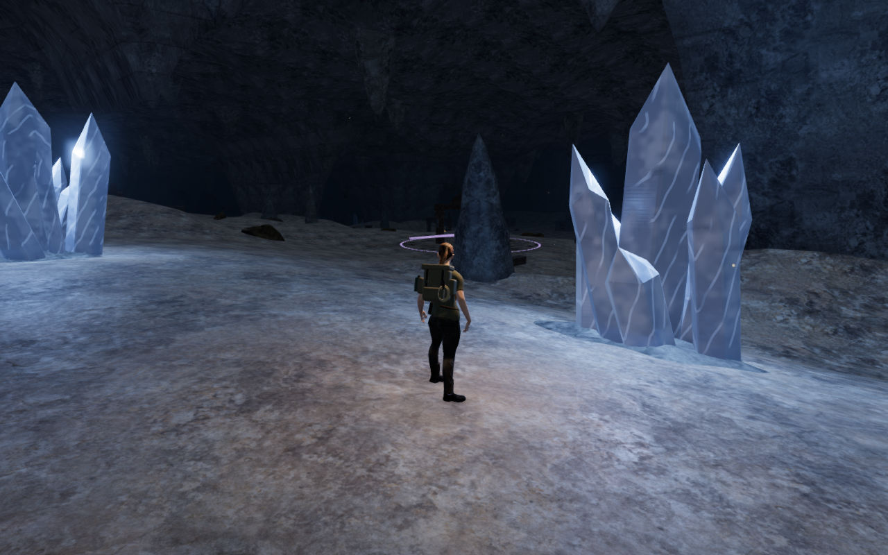
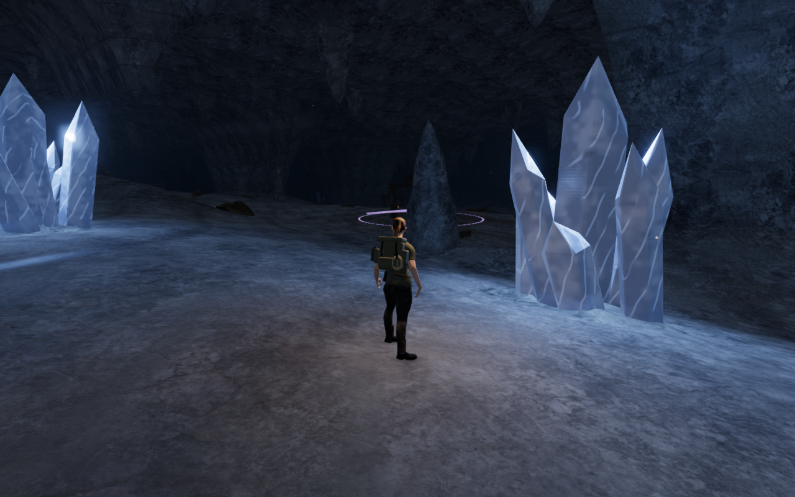
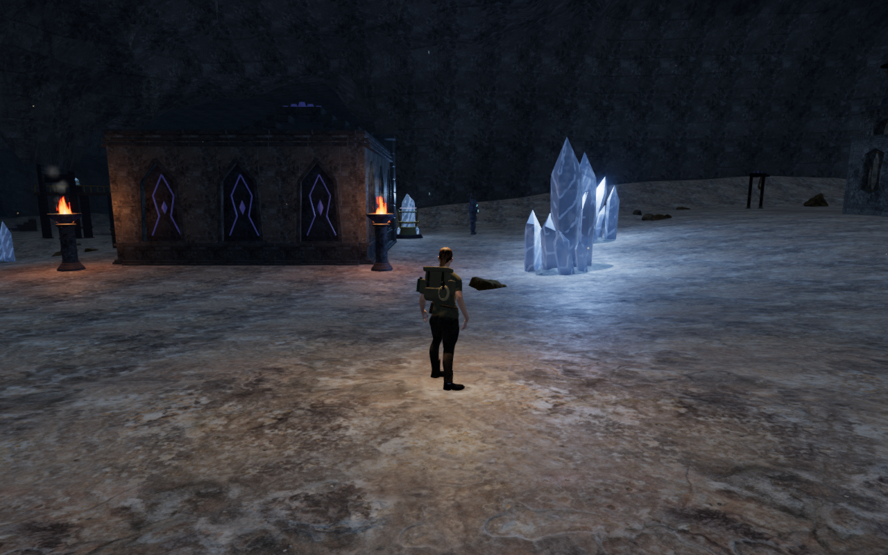
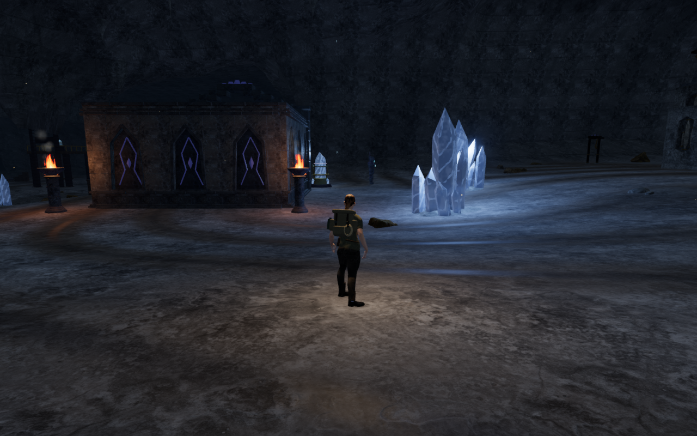
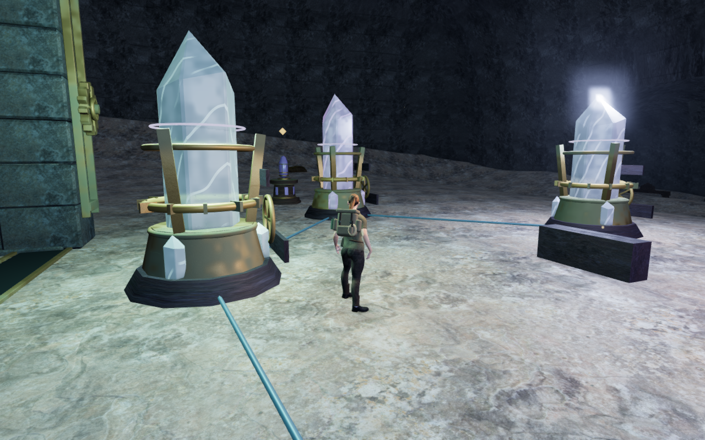
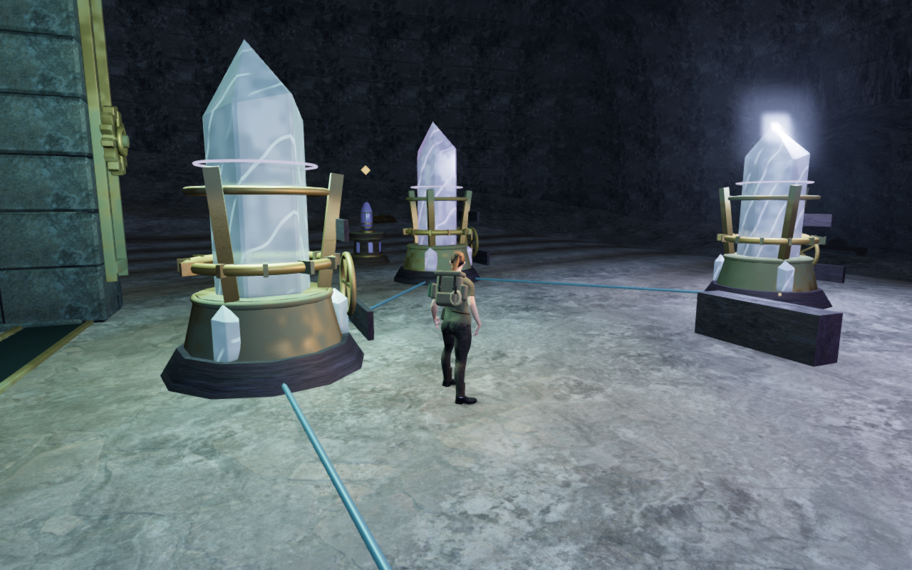
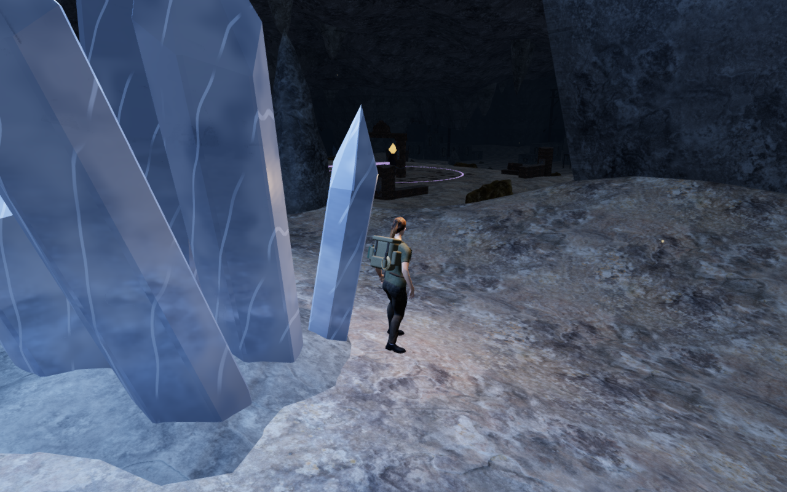
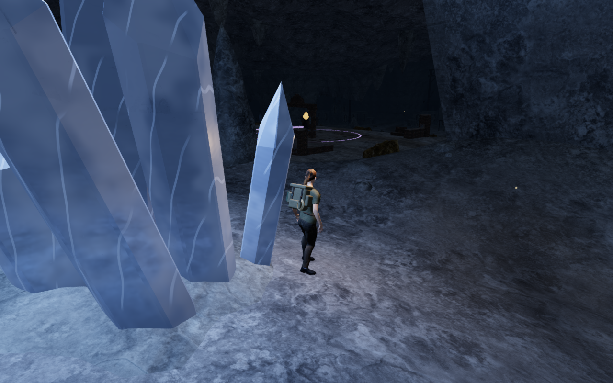
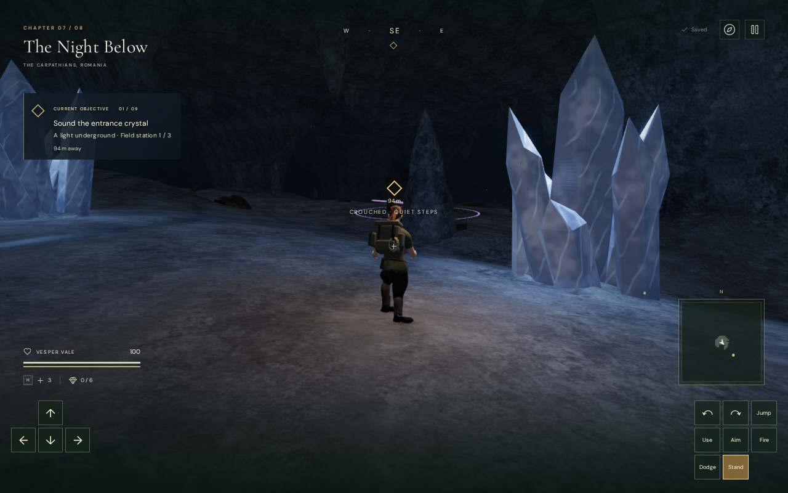
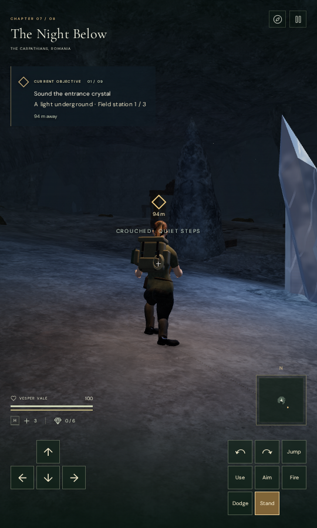

# Cavern sediment and limestone fragments

The Night Below now has irregular sediment bands across its flatter floor,
with darker damp channels and a matte granular response. The bands follow
warped world coordinates rather than repeating a room-centred decal. Their
edges widen with the pixel footprint. Shallow limestone fragments collect in
pockets at the foot of the enclosing banks.

The delivered layout contains 683 fragments in 70 regional groups and 71
meshes. The closed surfaces contain 32,784 source triangles; their delivered
geometry arrays occupy 3,129,824 bytes. They reuse the existing credited rock
material and textures. The floor layers use existing samples and procedural
detail, with no additional texture asset or rendering pass.

Every fragment follows the rendered terrain's triangle sampler. Buried
perimeter rings close beneath the floor. Candidate footprints exclude walking
cells, water, climbing stations, objectives, guardian spawns, mineral sound
fronts, the Listening Gallery, resonance courts and the Echo Causeway. The
fragments add camera surfaces and introduce no movement obstacles. Chapter
changes clear their layout references and release their world geometry.

The comparison control replaces the new terrain shader layers with the
preceding layers and hides the debris inside the current application. Explorer
pose, position, input look, follow camera and simulation time stay identical
within each pair. These are assisted in-game comparisons, rather than captures
of the preceding production release. Prepared progress opens the chapter's
gates, enemy simulation is disabled and audio is muted for this visual check.

The final checks pass 62 selected cases across ten files. They include 49,176
buried perimeter probes for the 683 fragments, closed outward topology, finite
normals, deterministic placement, protected discovery approaches, cavern
mechanisms and 54,324 unchanged standing/crouching/jumping movement queries.

An assisted circuit covers 908.127 metres through three selected chambers and
back to arrival, using 13,649 ordinary controller updates in 115 recorded
batches. All four legs arrive without stalls or health loss. Seventeen revised
views render successfully, including High, Medium and Low arrival settings.
High/Medium HDR buffers contain no nonfinite values; Low's direct RGBA8 output
and all linked shaders pass their graphics error checks. On changing chapters,
all 71 debris geometries dispose exactly once and layout references clear.

Eight final paired views reconstruct legal circuit stances and one prepared
bank approach, with the explorer settled into an idle pose. Both controls
refresh water reflections; ordinary reflection caching made the preliminary
consecutive render counts unsuitable for incremental cost comparison. In the
refreshed views the new geometry adds 9–162 draw calls and 3,168–78,336 submitted
triangles, depending on view and quality. At High arrival, the complete revised
frame submits 3,023 calls and 3,773,056 triangles versus 2,861 calls and 3,694,720
triangles for the control. This measures work in those captures, rather than
frame rate on consumer hardware.

The production build passes in 3.39 seconds, with the existing large-chunk
advisory. Native keyboard/High at 1280 × 800 and touch/Low at 540 × 900 pass
movement, crouch, look, jump, landing and map access from the original chapter
arrival. Measured movement is 1.5 and 2.1 metres respectively. Health stays at
100, landed save height is zero and neither layout overflows horizontally.
Each case preserves the complete store through two reloads, except its expected
last-played timestamp. All loaded build filenames match the current output;
six actual explorer-model responses match the unchanged runtime model hash.

All seventeen revised circuit views, sixteen final comparison images and eight
native views are reviewed in contact sheets; selected arrival, bank and native
views are also reviewed at full size. Ten public images are verified lossless
WebP conversions with identical decoded RGBA pixels and dimensions.

| View | Preceding floor layers, debris hidden | Revised floor and debris |
| --- | --- | --- |
| Arrival |  |  |
| Middle chamber |  |  |
| Final chamber |  |  |
| Prepared bank approach |  |  |

The built interface at High and Low:

Verification is serial, with one browser and one Node test worker. All owned
threads stay inside the shared nine-CPU allowance out of sixteen available
CPUs. Each browser closes before its helper exits; both development and
production preview ports are closed afterward. Staging and saves stay in the
ignored project-local directory.

This is a local improvement to the sparse cavern floors. Repeated
installations, broad room composition, continuous camera framing and consumer
device performance remain open. It does not establish human playthrough
duration, listening quality or commercial AAA fidelity.
