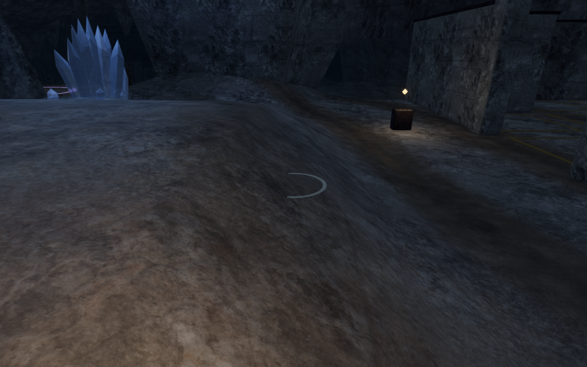
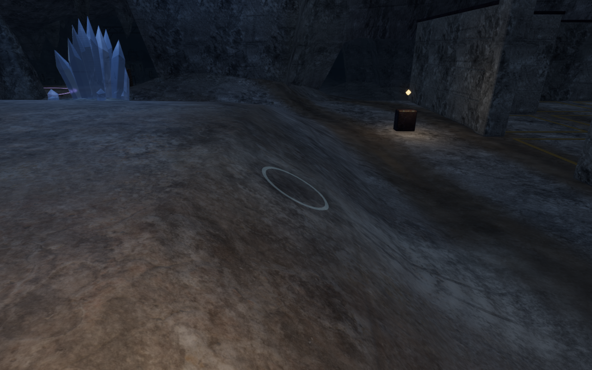
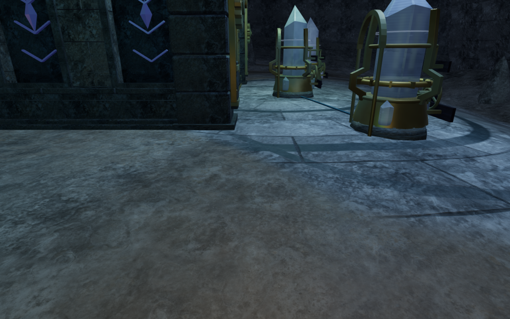
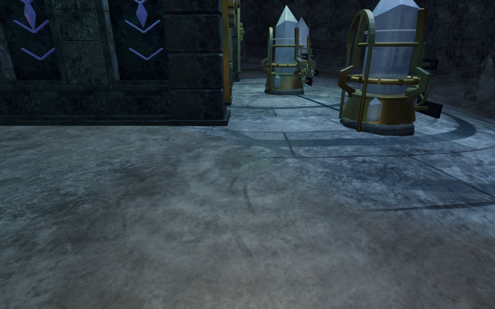

# Cavern receiving ground and fitted ripples

The Night Below now has pale mineral fans, damp impact centers and fine broken
runnels around its nine dripping stalactites. The patterns use the actual drip
positions and follow the local downhill bearing. Terrain and the worn paving
above it share the same composition, so deposits continue across their joins.
Five impacts fall onto dry ground; four lie in the existing reservoirs.

The entrance inspection also reproduced a partly buried ripple: its horizontal
plane cut through a sloping bank. All nine expanding rings now fit their own
vertices to the receiving ground or water. Eighty segments give the curved
effects a smoother outline. Dry rings keep a 25 mm surface skin; water rings
retain their preceding 60 mm clearance above the animated waves. The impact
center, falling streaks and sound origin use the same receiving height.

This is a local surface treatment and ripple repair. It adds no new floor
height, collision, texture, dependency or rendering pass. All eight chapters'
terrain and paving vertex shaders and texture sets match the preceding
`121a79c` version. The other seven chapters also retain their paving fragment
shaders and program keys. The floor material adds color, roughness and
millimeter-scale normal detail; only the ripple's visible geometry changes.

All 23 selected cavern, reservoir, paving and material checks pass. The ring
regression reads independently constructed terrain triangles at 90,720 samples
across all nine sites, three expansion phases, and dry/flooded/drained fixtures.
No sampled ring point enters the receiving surface. The largest dry/drained
gap is 55.619 mm. Reconstructing the published 40-segment flat rings reproduces
327 buried vertices in the dry fixtures. The existing water/sound alignment
test retains the water clearance and checks the revised dry impact height.

The isolated GPU check executes the production field and noise functions at
180,224 half-float sample positions. All nine fields remain finite and within
their bounded footprint; damp maxima remain within 0.442 m of their impacts.
Disabled-strength and vertical-wall controls produce no deposit. Measured
normal-detail values stay between -0.801 mm and 0.958 mm. This diagnostic does
not establish consumer frame rates or subjective material quality.

All 22 current baseline views and 32 final images are reviewed in labeled
sheets, with selected comparisons inspected at full resolution. The final set
contains eighteen paired impact inspections, four Performance inspections,
three High follow-camera views and seven other-chapter startup views. The
follow views retain legal positions and full character opacity. HDR output is
finite, shaders link, and no application errors or warnings are reported.
The inspections use independent cameras and hidden avatars. The cavern's four
reservoirs remain filled under ordinary progress; their images show wet
receiving surfaces. Drained-ring behavior is verified by the controlled
geometry fixtures, rather than claimed as a normal cavern mission state.

Chapter replacement disposes all 103 tracked terrain/ripple resources once:
ninety geometries, ten materials and three textures. The production build and
three CPU-guard checks pass; the build retains its large-chunk advisory.
Verification jobs share the locked five-of-sixteen CPU allowance, use at most
two test workers and one browser, and close owned helpers when finished.

The built application passes prepared keyboard/High and portrait
touch/Performance cases near two dry impacts. Native crouch, jump and movement
cover 6.18 m and 6.6 m at full health. Two complete-store reload comparisons
preserve saved data apart from `lastPlayed`, including chapter stage and the
retained discovery. All eight native images are reviewed at full resolution.
The release loads the expected JS/CSS assets and exposes no development hook.
No application errors or warnings occur. All 417 runtime hashes and 788 frozen
source/test/script/build inputs match after the checks, and the browser and
preview server close.

The comparison controls disable the new ground field and reconstruct the
preceding flat, 40-segment rings in the revised application. They preserve the
chosen viewpoint, time, graphics setting and surrounding scenery. They are
not screenshots of the preceding release binary. The new materials and ring
geometry are original code; existing [asset attribution](asset-credits.md)
applies to the retained character, scenery, textures and audio.

| View           | Flat-ring/preceding-ground control                                                         | Fitted rings and receiving ground                                                         |
| -------------- | ------------------------------------------------------------------------------------------ | ----------------------------------------------------------------------------------------- |
| Entrance slope |                  |       |
| Echo forecourt |  |  |

The four lossless WebP figures retain their source pixels and dimensions.
Prepared visual fixtures use muted audio. These views and local input checks
do not establish a campaign playthrough, continuous body contact, consumer
performance or subjective listening quality.

Broader floor expanses, repeated buildings and instruments, continuous campaign
contact, other browsers/devices and subjective listening still need review.
The overall game-polish goal remains incomplete.
