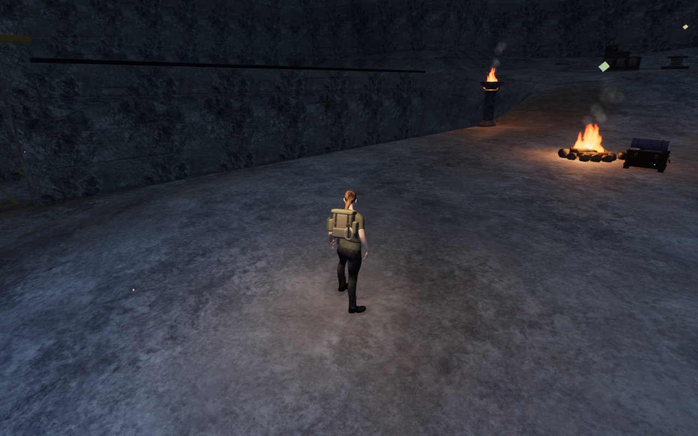
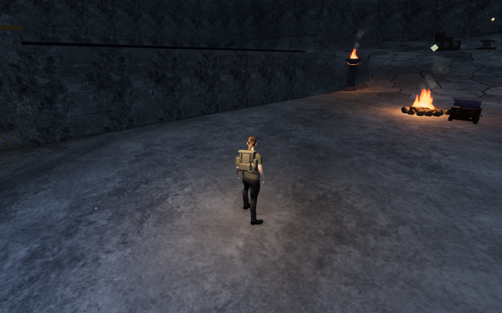
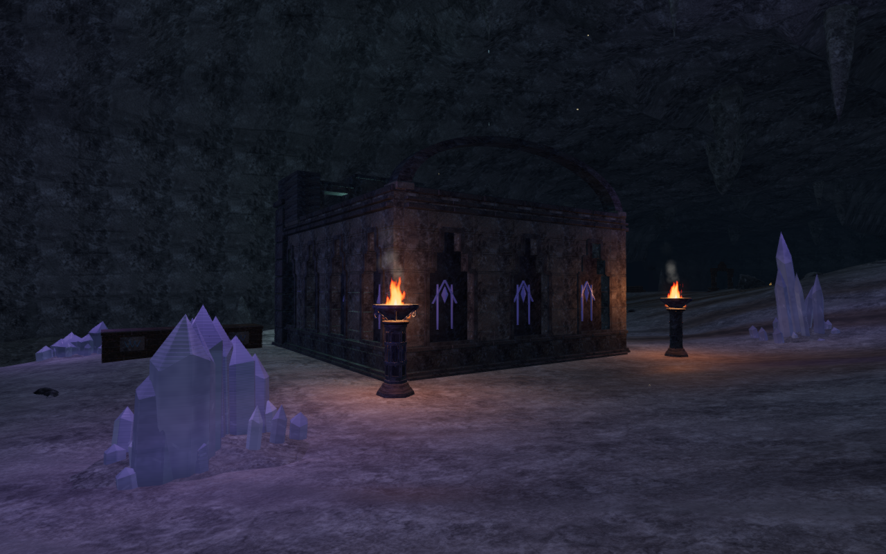
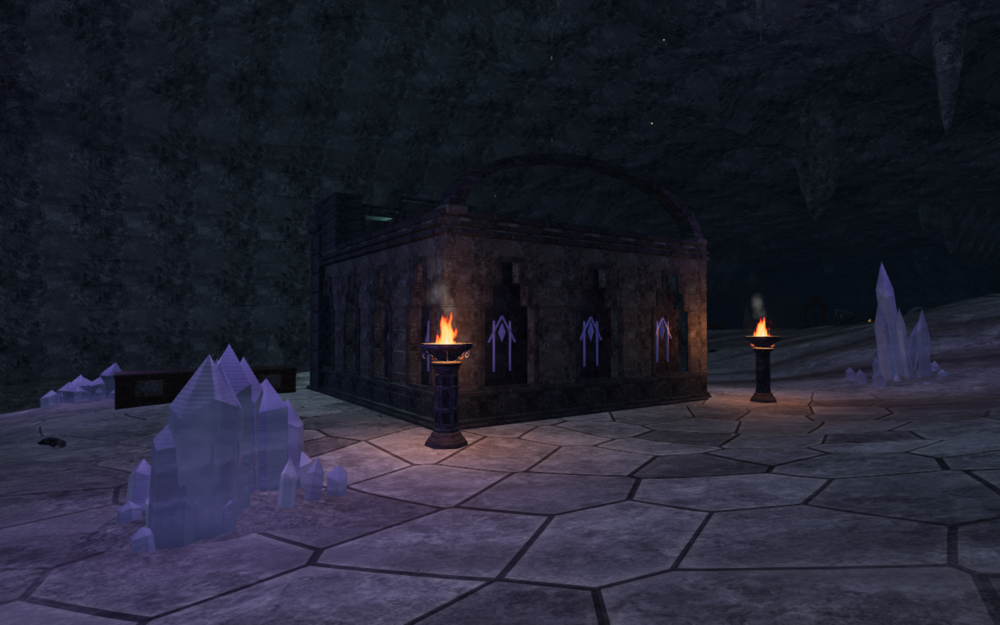

# Limestone plates across the cavern floor

The Night Below now has irregular limestone plates, narrow solution joints and
soft sediment pockets across its exposed floor. The patterns add variation to
the broad approaches and chamber backs identified in VA-178. Distorted cells
vary each plate's outline and tone, with pale worn lips beside the joints.
Sediment softens or covers the plates in broader patches, leaving quieter
areas between exposed stone. The existing archive floor coverage takes
precedence, and the localized drip deposits remain above this treatment.

Terrain and the worn paving meshes share one world-space field and strength
control. The change adds color, roughness and shallow normal detail. It adds
no texture, asset, dependency, geometry, collision or rendering pass. All eight
chapters' terrain and paving vertex shaders and texture sets match `5311507`.
The other seven chapters' paving fragment shaders and program keys also match.
No walking surface, puzzle position, sound source or saved-game rule changes.

All 27 selected cavern, material, reservoir, deposit and floor regressions pass,
as do the three CPU-budget checks. The production build passes with its
existing large-chunk advisory. The render review contains 53 images: 44 matched
before/after captures from four entrance headings and both sides of all nine
courts, two Performance follow views, and seven other-chapter startup views.
All images are reviewed in nine labeled sheets, with the four figures below
also inspected at full resolution. Application shaders link, High HDR buffers
remain finite, and the render checks report no GL errors.

The isolated GPU check runs the production field and color functions at
245,760 half-float sample positions. It covers all nine courts and disabled
strength, fully retained paving, vertical-wall and distant-footprint controls.
Values remain finite and within the tested color and mask domains. Disabled,
wall and paving controls produce zero coverage and relief; disabled color
retains the supplied substrate. Measured material relief ranges from
-4.004 mm to +1.490 mm. This is normal detail, not a geometric floor offset.
The coarse-footprint check does not establish temporal anti-aliasing or
consumer frame rates.

The first diagnostic attempt omitted a vertex varying in its private test
shader, preventing that isolated program from linking after the 44 successful
application captures. Correcting the diagnostic preserved those captures and
their source hashes; the subsequent GPU and remaining nine views pass without
application errors or warnings. Chapter replacement disposes all 129 tracked
terrain/paving resources once: 116 geometries, four materials and nine textures.
The browser and preview server close after the render checks.

The built application also passes prepared keyboard/High and portrait
touch/Performance cases. Native crouch, jump and movement cover 6.21 m and
6.60 m at full health. Two complete-store reload comparisons preserve the
saved data apart from `lastPlayed`, including chapter stage and a retained
discovery. All eight native screenshots are reviewed at full resolution.
The release loads the expected JS/CSS assets, has no horizontal overflow,
and exposes no development hook. All 418 runtime hashes and 789 frozen
source/test/script/build inputs match after verification. No application
errors or warnings occur in these production cases. Verification shares the
locked five-of-sixteen CPU allowance, uses at most two test workers and one
browser, and releases owned helpers when finished.

The controls disable the new field in the revised application. They retain
the viewpoint, player pose, graphics setting and elapsed time; they are not
screenshots of the preceding release binary. The new field is original code
and reuses the existing [credited assets](asset-credits.md).

| View | Field disabled | Limestone plates and sediment |
| --- | --- | --- |
| Entrance camp approach |  |  |
| Guide court rear |  |  |

The four lossless WebP figures preserve the source pixels and dimensions.

Broader cavern silhouettes, repeated main installations, the gallery's dark
upper wall edges, crystal optics, continuous campaign contact, device coverage
and subjective listening remain under review. Prepared visual fixtures use
muted audio. These local material checks do not establish a full campaign
playthrough, human pacing, listening quality or AAA graphics. The overall
game-polish goal remains incomplete.
