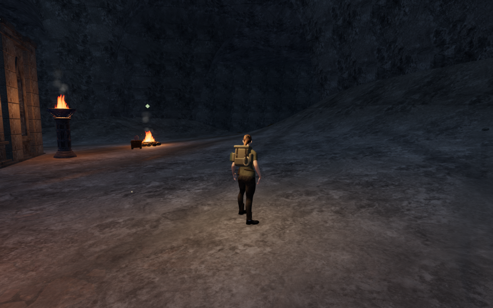
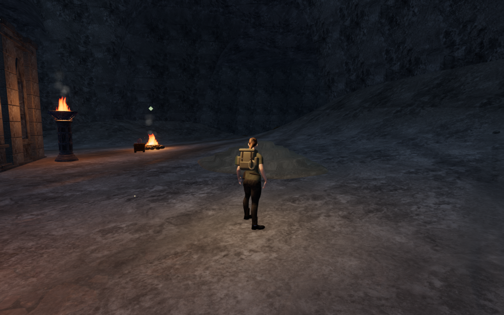
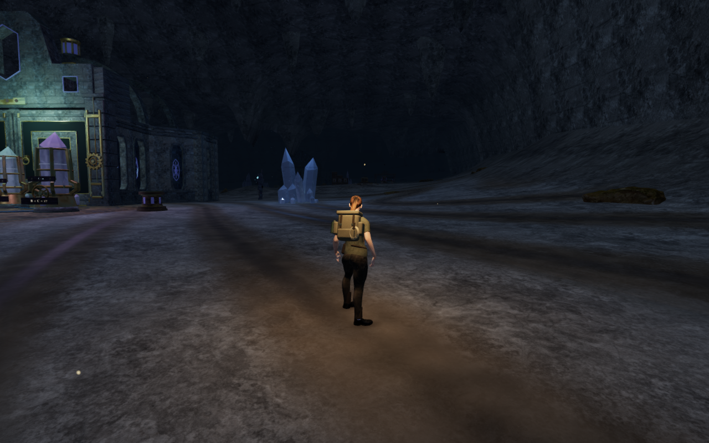
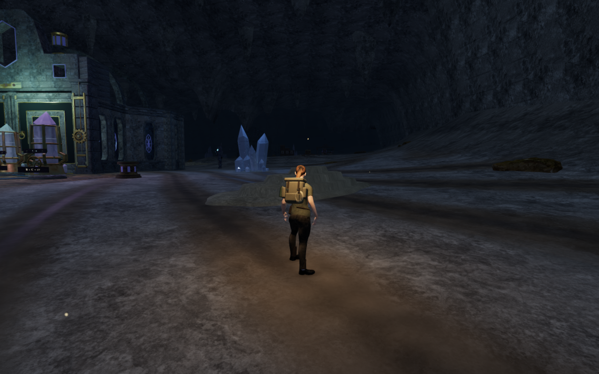

# Cavern limestone terraces

Low flowstone aprons give some of the broad cavern margins a stepped silhouette
and a warmer calcite surface. Their elongated, offset shelves follow the
surrounding floor and leave the working forecourts, path centres, mineral beds,
water, discoveries and sound landmarks clear. This is a local scenery pass;
large parts of the cave floor and repeated installations still need composition
work.

The terraces have closed undersides, buried perimeter walls and finite triangle
contact for standing, body movement, sight and sound. Camera bounds are captured
in twelve narrow sectors before the render pieces are batched by region. Their
material reuses the credited rock textures with a calcite color treatment.
No external asset or dependency is added.

Eleven aprons occupy six of the nine chamber areas. The placement search leaves
the first three chambers unchanged to keep their working spaces and routes
clear. The formations do not fill the large central forecourts visible in the
archive-front views.

All 31 selected tests pass. The new geometry checks cover 10,560 closed triangles,
6,864 buried perimeter samples and 2,058 physical/rendered rays against the
actual batched pieces. The maximum observed batching difference is 0.053 mm,
within the 0.1 mm allowance; a deliberate 10 mm render displacement is detected.
Reservations reject controlled path, control, water, obstacle and source
intrusions. Existing cavern, resonance, terrain, focused-camera and quiet-score
checks also pass.

All thirty development views are reviewed: eleven matched scenery-toggle pairs,
three archive approach pairs and Performance/Balanced views. Sampled programs
link, HDR inputs remain finite and no application warning or WebGL error is
recorded. The live scene retains all 1,110 previously clear sampled path centres.
Eleven assisted walk/jump legs cover 2,420 physics updates with legal body
positions. Ten tracked render geometries and their shared material dispose once
on chapter change, and the flowstone records retire. The production build passes
with the existing chunk-size advisory.

Native production controls pass from prepared nearby starts: keyboard/High
travels 11.9 m with a jump, and portrait touch/Performance travels 12.49 m.
Both retain 100 health. A separate older-floor save starts within a new apron,
recovers to a supported position 2.25 m away and preserves its progress. Three
comparisons of the complete save after reload pass, excluding its timestamp;
all nine release captures are reviewed. Guardian attack warnings project onto
the new receiving surfaces. The collision-responsive camera can choose a steep
view at the far side of a formation; this is not a claim of complete camera or
body-contact acceptance.

The comparisons toggle only the new scenery's visibility inside the paused
revised application. They use matching prepared ground positions, follow
cameras, High quality and zero elapsed simulation time. Four lossless WebP
exports retain the actual 1280 × 800 decoded pixels without cropping or
retouching. They are not screenshots of an older release binary.

The [playable-world audit](visual-audit.md) remains open, including wider scenery,
continuous moving/airborne body contact, complete routes and listening/device
acceptance. All verification uses the shared locked five-of-sixteen CPU budget;
temporary browsers and previews close after each run.
