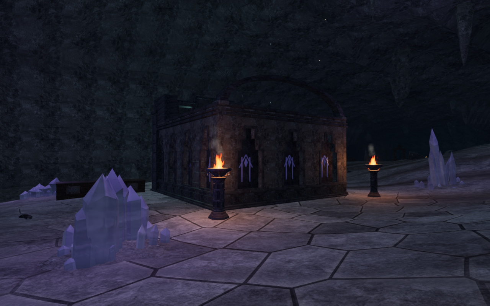
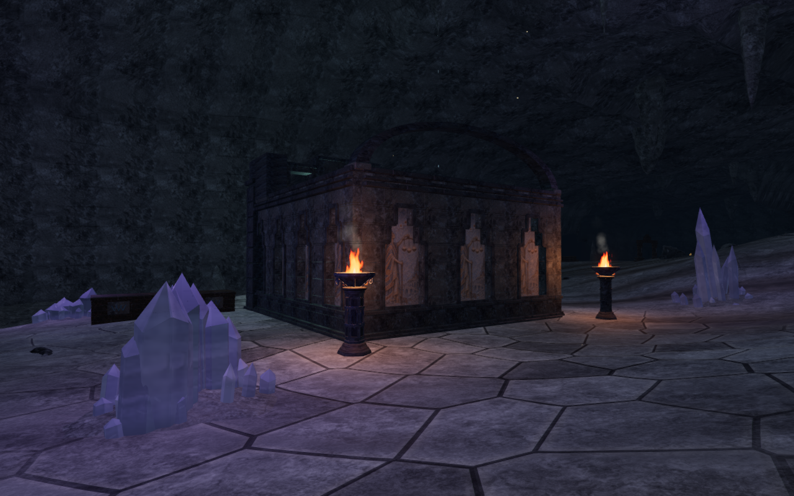
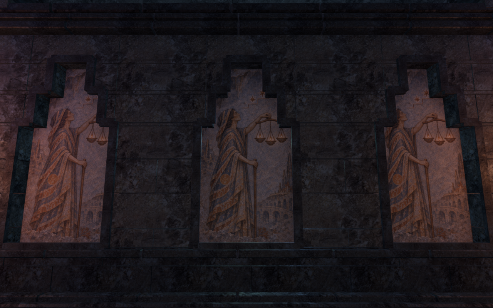
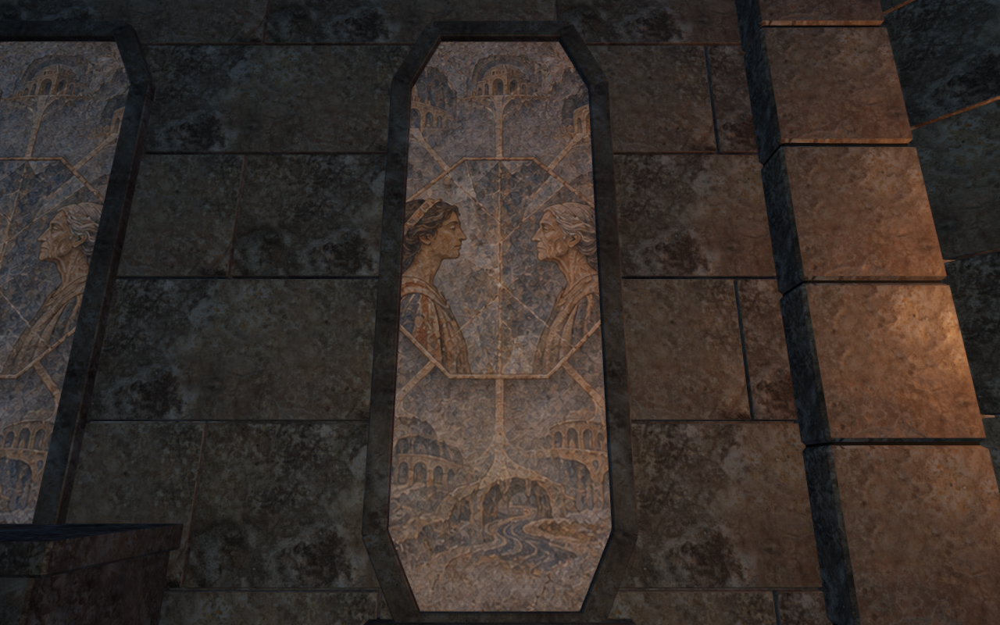

# Painted cavern archives

Eight weathered fresco stories replace the repeated purple line emblems in the
cavern archive walls. The paintings belong to the existing recessed limestone
panels, with the original grain, normal maps and roughness maps. They respond to
the scene's lighting. Stone frames, sealed backing, room outlines, doors and
working controls retain their preceding construction.

| Archive | Painted memory |
| --- | --- |
| Guide lights | A wayfinder and three lamps |
| Descending echo | A traveler and successive descending silhouettes |
| Mirrored archive | Two archivists beside a reflected stone |
| Ascending chamber | A lamp-bearing procession climbing stone steps |
| Violet counterpoint | Musicians and branching waves |
| Broken conversation | Reaching hands and fragments of a vessel |
| Paired heart | Intertwined rhythms around a standing figure |
| Remembered prism | A woman and an older reflection |

These are fictional paintings, generated with the built-in image generation
tool. The [exact prompt](art-prompts.md#cavern-fresco-atlas) and
[source manifest](../asset-sources/cavern-records/sources.json) preserve their
provenance. The source is 1254×1254; the padded 1320×1286 lossless WebP is
2,619,576 bytes. Seven cells retain their original generated pixels. The
guide-light figure's extra arm was corrected with the image tool using the
[correction prompt](art-prompts.md#cavern-fresco-correction); only that
edited cell is selected, with its other seven edited regions discarded. The
selected corrected cell also retains its source pixels. Narrower
cells repeat one edge column, and eight-pixel copied gutters separate the cells.
The optional source images are ignored; the playable atlas is checked in.

The artwork keeps its physical proportions on each panel. Narrow bays crop
their story rather than compressing the figures; the interior face reverses its
horizontal coordinates so the painting reads toward its viewer. Side returns
and embedded backs retain plain stone. Some existing instruments and display
rails naturally obscure parts of the inner paintings.

## Captures

The published `8a62f72` comparison and revised court view have matching player,
camera, heading, pitch and elapsed time. The close views use independent,
supported legal inspection positions with the explorer hidden. These are actual
game captures, exported losslessly with matching decoded pixels and dimensions.

| Published archive wall | Painted archive wall |
| --- | --- |
|  |  |

## Verification

- All 25 selected atlas, archive enclosure, vault, shutter, resonance and audio
  tests pass, together with three CPU-budget checks and the production build.
  The build retains its existing large-chunk advisory.
- Packing compares every original cell pixel with its delivered region. The
  retained atlas regression checks all 122,496 gutter pixels and detects a
  deliberately damaged edge. The physical-scale regression covers 30 outer and
  inner panel combinations.
- An isolated GPU check uses the production atlas expression for 16,384 samples
  across all eight stories. All 49,152 color-channel comparisons pass against
  independently decoded delivery pixels, within one 8-bit linear-channel unit.
  A one-story offset control produces 45,646 channel errors. This check uses
  base-level nearest sampling; the game's texture filtering is restored afterward.
- Independent old/new gate construction retains all 483,864 remaining triangles
  at their preceding positions. The 76,352 removed triangles belong to the
  retired decorative material. All wall plans, sixteen gate sound anchors and
  1,936 sampled movement queries match. On the delivered batches, 1,437 painted
  triangles retain equal physical texel scale within 0.053%.
- The full scene retains all 1,902 remaining obstacle records and its features,
  paths, mineral formations and sound-anchor records. Seven decorative collision
  kernels retire with the old emblems. The initial private observer incorrectly
  required those kernels to remain; the corrected comparison uses the independent
  geometry/movement evidence above and retains the initial 22 captures as earlier
  evidence. The full final set is regenerated after the painting correction.
- All 22 published-baseline views, three draft views and 43 final development
  images are reviewed. The final set includes four native entrance headings,
  both sides of nine courts, representative outer/inner paintings in every
  archive, four Performance repeats and chapter replacement. Programs link,
  rendered HDR values are finite, and no browser errors or application warnings
  are recorded. These views do not inspect every panel or continuous route.
- Chapter replacement disposes all eight tracked painted geometries, their one
  shared material and the one atlas exactly once. All 420 runtime hashes and
  794 frozen verification inputs match.
- Two prepared production cases use keyboard/High at the guide-light wall and
  portrait touch/Performance at the prism wall. Native crouch, jump and movement
  travel 6 m and 5.7 m, retaining health 100 and their original supported arrivals.
  Both complete stores survive reload, excluding only `lastPlayed` from the
  comparison. Their saved main stages remain zero and seven. All eight production
  images are reviewed; the atlas and expected release assets load, the development
  hook is absent, and no horizontal overflow, failed requests, browser errors or
  application warnings occur. These are local prepared cases, not complete
  objective or campaign playthroughs.
- Those two input cases precede the localized figure correction. Rebuilding
  preserves the exact JavaScript/CSS bytes used by both cases. A final additional
  portrait/Performance case loads the corrected texture, verifies its exact
  delivery hash, exercises crouch and retains its complete store through another
  reload. Its three current-art images are reviewed, giving eleven production
  images and three complete-store reload comparisons in total.

All work uses the shared five-of-sixteen CPU allowance, at most two test workers
and one browser. Temporary captures, profiles, stores and helpers remain under
ignored local staging; owning wrappers close their browsers and preview servers.

This improves local wall imagery. Broad cavern margins, repeated installations,
roof construction, continuous body contact and broader world composition remain
open. These checks do not establish consumer frame rates, subjective audio
quality, human playthrough duration or commercial AAA parity. The
[production audit](production-status.md) remains incomplete.
