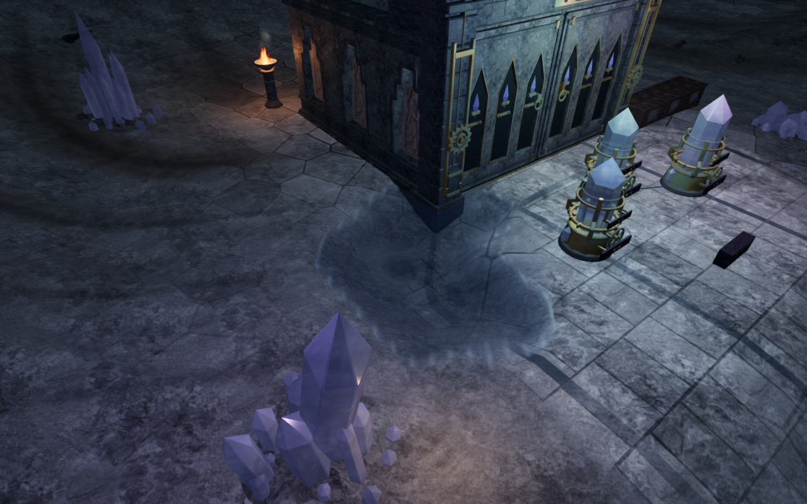
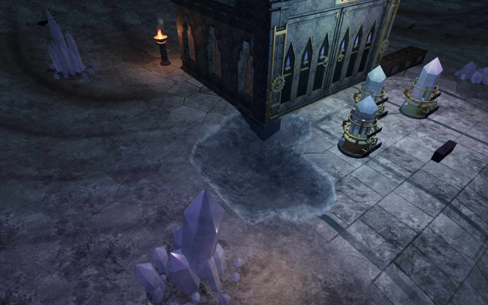
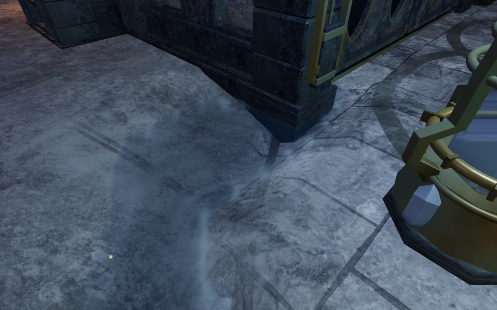
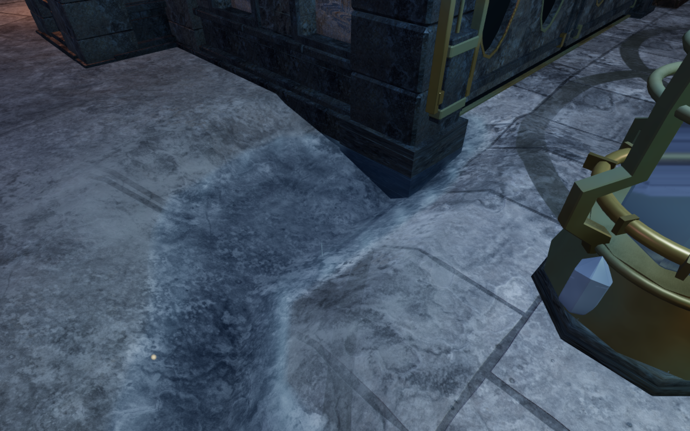

# Limestone beds in the cavern reservoirs

The four cavern reservoirs previously carried the archive paving pattern down
their curved beds. Straight slab joints bent with the excavation, making the
pools resemble tiled depressions. Wet ground now uses the existing limestone
texture with fine sediment, broken calcite veins and a narrow deposit near the
waterline. The four beds have subdued neutral, ochre, grey-green and earth
sediment variations.

The treatment follows the four delivered water-plane heights and rectangular
bounds. Terrain and decorative paving share the same references, including
paving created before the terrain profile is available. The paving fades out
where wet limestone takes over. The mask fades inside the water bounds, leaving
nearby dry controls alone. The small relief affects shading only; it does not
move vertices. The water shader, geometry, ground support, mechanisms, sound
sources, controls and save format are retained.

These are matched layer-off/on comparisons within the revised application,
using the same prepared player, camera and lighting state. They include the
existing planar reflection. They compare material appearance rather than two
complete release binaries. The four lossless WebP exports preserve the full
1280 × 800 rendered pixels without cropping or retouching.

An independent GPU observer samples the actual shader at 13,504 ground
positions: 4,601 dry points, 247 shoreline points, 928 wet points, 4,224
instrument-footprint points and 3,504 points away from the pools. The mask is
fully active at the retained wet samples and zero at all dry, instrument and
outside samples, within one RGBA8 step. All sampled fields are finite and
bounded. Disabling the layer clears its mask. Deliberately raising the supplied
water planes by two metres paints 843 instrument samples, confirming that the
observer detects incorrect height bindings. The first boundary draft painted a
few controls outside the water rectangle; moving the fade inside the delivered
bounds fixes those observations.

A local assisted approach and return covers 48 actual movement, character and
camera updates beside the violet pool. All recorded player and lens positions
are legal, every sampled body-sight check is clear, health remains 100, and the
player returns to the exact starting position with the selected look retained.
This establishes local movement and camera coverage, not full continuous body
contact across the campaign. Replacing the chapter disposes all thirteen
tracked affected resources exactly once: four materials and nine textures.

All 57 selected regressions, three CPU-budget checks and the production build
pass. The existing build chunk-size advisory remains. The nineteen final
development images are reviewed: all four pools in matched wide and close
views, two High/Performance follow views and the movement view. The violet close view is
partly occluded by an instrument; its wide and follow views provide additional
coverage. Sampled shader programs link, HDR inputs remain finite and no
application warning or WebGL error is recorded. Terrain positions, triangle
indices and court attributes match the preceding version exactly, as do the
four pool heights/bounds, recorded scene metadata and all 187 sound anchors.

Native production controls pass from the prepared bank position: keyboard/High
moves 2.83 m and portrait touch/Performance moves 2.61 m, with crouching,
jumping and 100 health retained. Both complete-store reload comparisons pass,
excluding only per-level timestamps. The selected heading and pitch are
retained. All eight release images are reviewed. Loaded release JavaScript/CSS
names match the current build, and the developer hook is absent. All 422 runtime
hashes and 798 frozen code/test/build inputs match the verified content. The
other 419 preceding runtime files retain their hashes. Owned browsers, previews
and workers close after each check.

The shader comparison retains all eight chapters’ vertex shaders and texture
requests. The other seven retain their active terrain/paving shading pipelines,
uniform names, defines and program cache keys. The treatment adds no external
assets, texture downloads or dependencies; existing
[asset attribution](asset-credits.md) remains applicable.

Verification shares the locked five-of-sixteen CPU set, with at most two test
workers and one browser. Owned helpers close after each check. Broader scenery,
continuous contact, the complete playable-world audit and listening/device
acceptance remain open.
