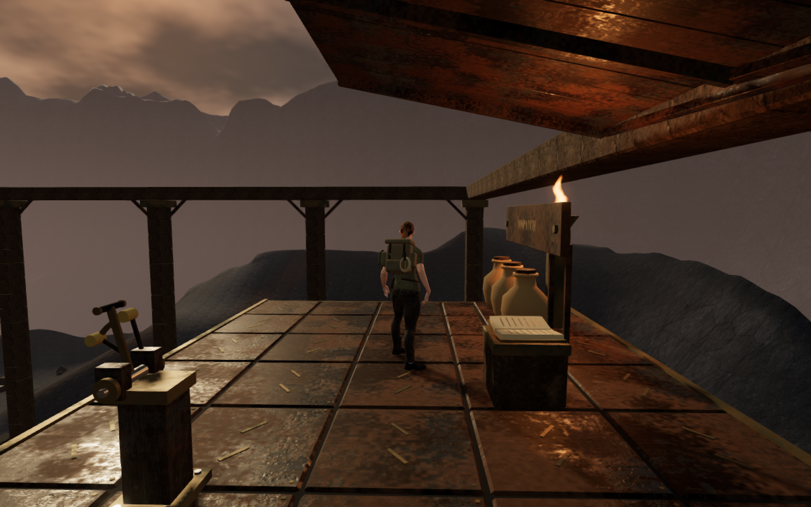
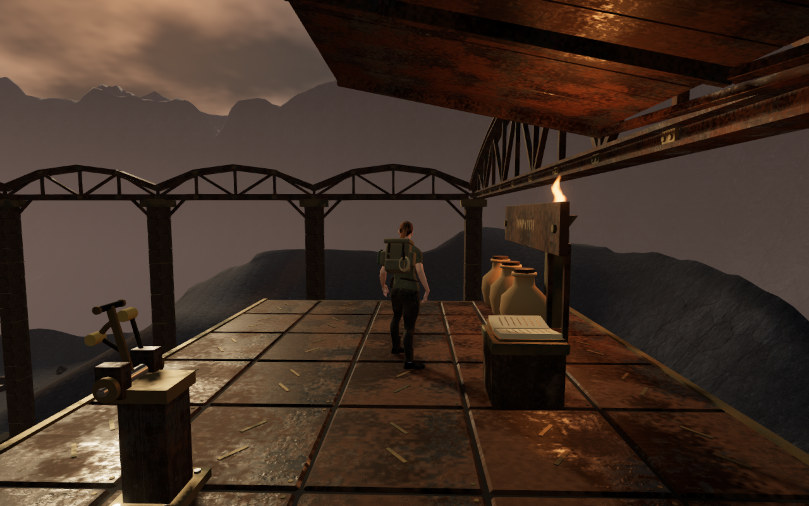
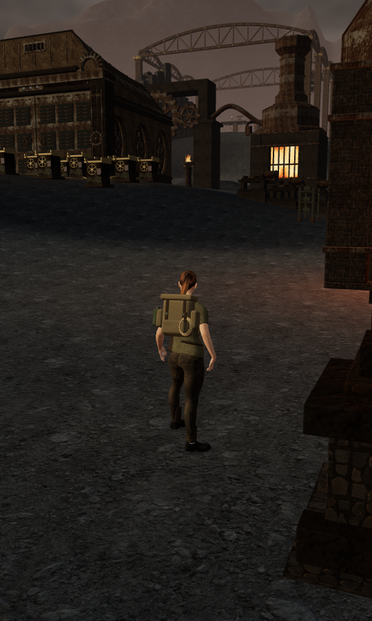
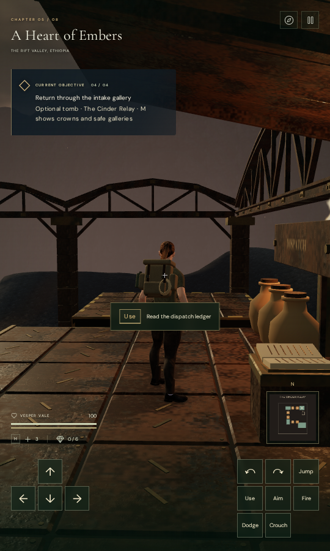

# Cinder Relay crown

The volcanic relay's four long rectangular top beams now form an open iron
crown. Two broad arches cross the end walls; three smaller arches follow each
side's existing pier bays. Diagonal webs, joint plates, rivets on both faces and
seated bearings give the foundry a recognizable silhouette from the surrounding
walking courts and its elevated galleries.

Before, from the dispatch gallery:

After, from the same player and camera positions:

The three strips in each girder use closed, mitered cross-sections. Neighboring
side bays share their end posts and fittings; the side lower chords meet the
end chords without overlapping coplanar flanges. Bearing plates rest at the
existing capstone height. Camera bounds follow individual members and leave
the spaces between webs open. Eight finite overhead body bounds begin at
27.1 metres above the relay floor.

The new crown contains **15,312 triangles in two static material batches**.
The complete relay fixture contains **148,472 triangles**. This increases
geometry cost; it does not establish a consumer-hardware frame rate. The iron,
bronze and their credited maps are reused, with no additional textures or lights.

The same crown from the neighboring court, through the normal follow camera:

## Checked behavior

All **15 focused relay tests pass**, including the continuous six-piston ascent,
ledger recovery and return-lift route through the ordinary character controller.
New checks cover the bearing height, finite geometry, material batching, visible
girder nodes, captured camera transforms and a genuinely open web bay. The
existing gallery supports, valve and lift actions, pause behavior and saved
arrivals also pass.

The visual review contains eight matched before/after views, two additional
gallery orientations and a distant portrait walking view. Every matched view
retains the same player and camera positions. High and Performance images are
included. All eleven revised frames are reviewed, and their shader links and
pixel checks pass without application errors or warnings. The two obstructed
intake images described below remain in that evidence; they are not counted as
successful views of the crown.

The 38 preceding physical bounds remain, with eight new overhead bounds. All
20 relay positional-source records match the preceding build, including their
positions, ranges, gains and activity. The quiet volcanic score is unchanged.
These checks establish retained source configuration, not subjective listening
quality. The two crown geometries and their two shared materials each dispose
once when the chapter reloads.

The production build passes with Vite's existing large-chunk advisory. Tests,
build and browser work use the shared locked five-CPU allowance, no more than
two test workers and one browser. The affinity inheritance, nesting and exit
status tests also pass.

Native production checks use a prepared dispatch-gallery save: keyboard at
1280 × 800 High and touch at 540 × 900 Performance. Both exercise movement,
Jump and Use, reopen the dispatch ledger, retain full health and finish on the
24.2-metre gallery. Measured walking distances are 1.009 and 1.800 metres.
Each complete localStorage save restores exactly twice, excluding last-played
timestamps. The production development hook is absent, served bundle names
match the built assets, and the explorer model matches its repository hash.
All eight native captures are reviewed; there is no horizontal UI overflow or
application error/warning in the completed cases. Readback-related graphics
driver diagnostics are recorded separately. Owned browsers and previews close
after verification.

## Remaining observations

At the intake, the supported local position `(14, 0.18, 10)` with yaw `0.9` and
pitch `-0.18` produces a view obstructed by nearby relay machinery. It occurs
in both the preceding and revised builds, in High and Performance, despite a
legal player position and full avatar opacity. Another intake orientation is
clear. The subsequent [furnishing clearance pass](relay-furniture-clearance.md)
identifies the uncaptured intake chest and repairs this view, along with nearby
body-boundary contacts and older-save recovery.

The wider court survey also retains broad sparse ground and repeated lower
chamber arrangements. This crown pass does not close those composition findings,
moving or airborne body contact throughout the world, listening acceptance,
hardware performance or the full [visual audit](visual-audit.md). Captures use
software Mesa through ANGLE/Vulkan and assisted preparation; they do not
establish a human playthrough or AAA graphics quality.
