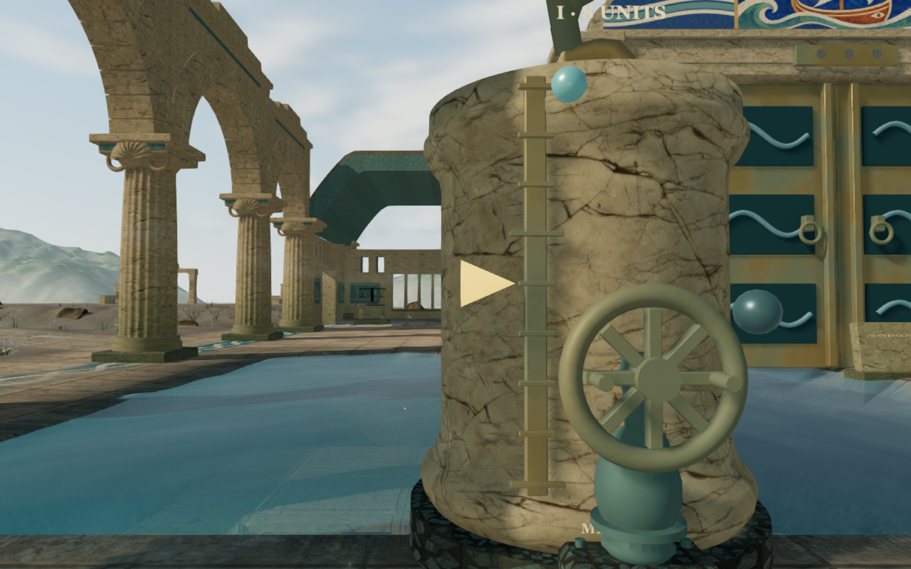
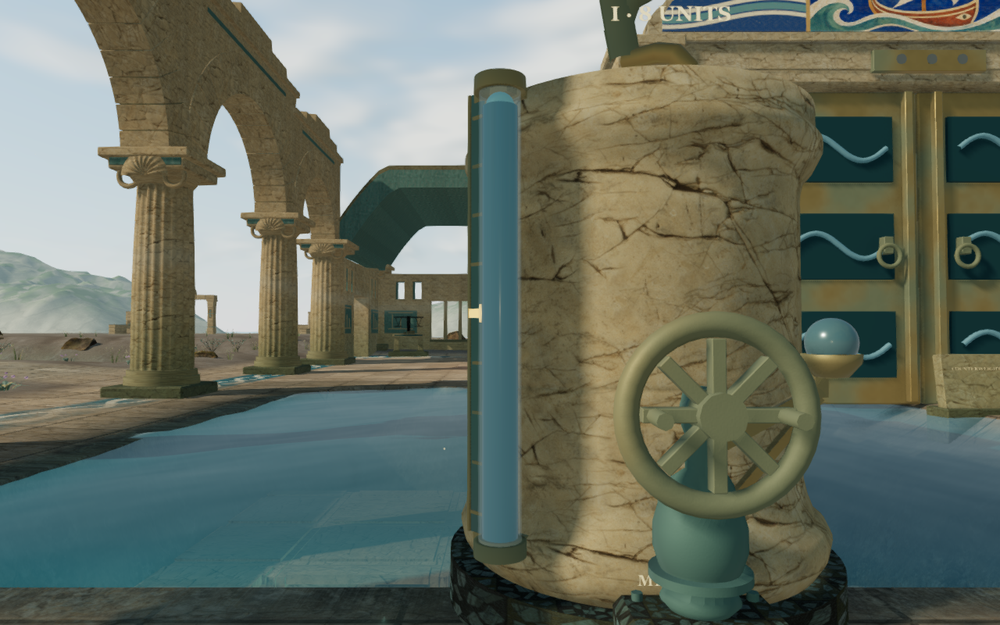
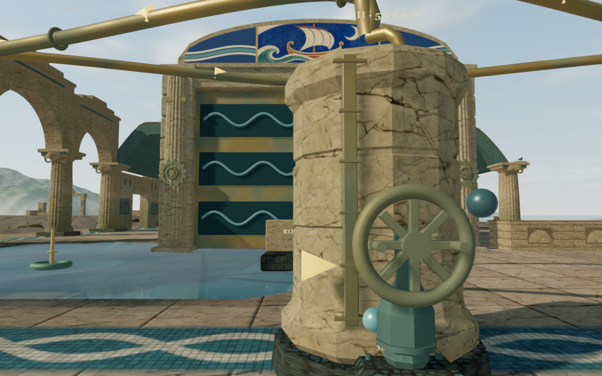
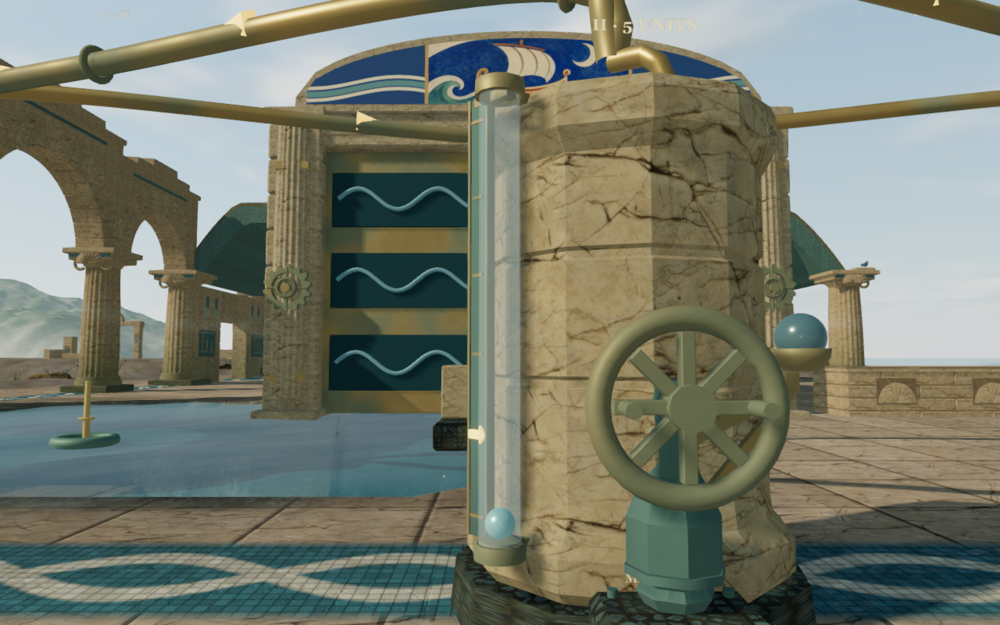
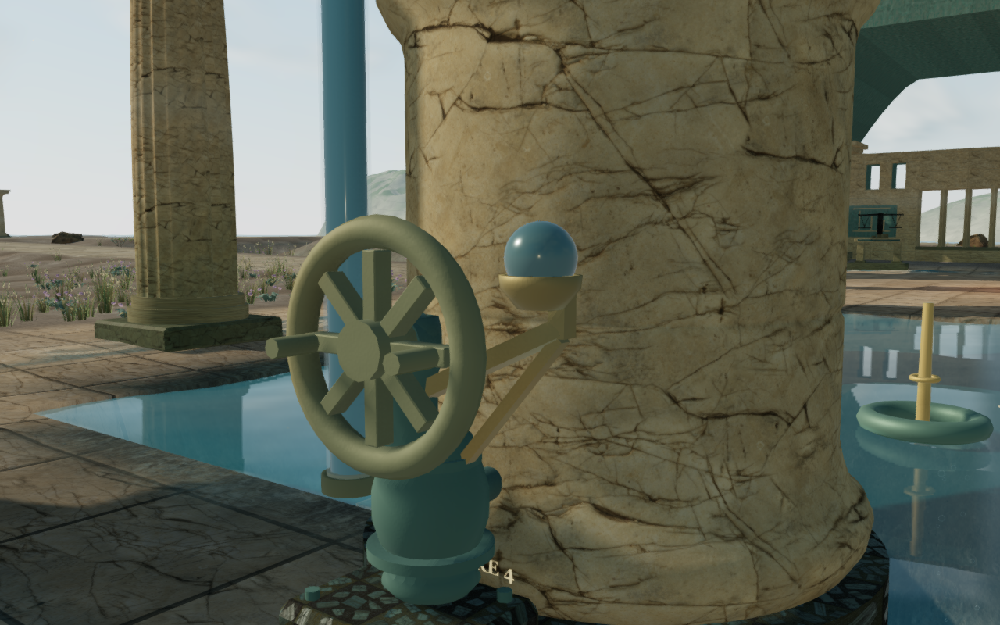

# Cistern sight gauges and mounted status lamps

The coastal cisterns previously used bare rulers, exposed spherical indicators
and large target cones. Each of the 27 bowls now has a mounted sight gauge:
a glass sleeve, visible liquid column, smaller ceramic float, graduated backing
and seated target arrow. The separate blue status lamps beside the handwheels
now sit in bronze sockets carried by braced arms.

The pairs retain identical numeric player/camera positions, scene time and High
settings. The six documentation figures preserve their complete 1280 × 800
capture pixels and dimensions after lossless WebP conversion.

## Construction and animation

The gauge sits on the front diagonal of each bowl. Its glass clears the widest
stone mouldings, while two bronze bridges enter the actual bowl wall. The
assembly stays inside the tank's existing movement reservation and below its
existing height limit. A small sealed seat supports the empty float. The liquid
column and float center follow the same mean level as the cistern water; the
column hides when empty. The target arrow is seated into the dark scale backing.

Five geometry templates and three materials are shared across the gauges;
each gauge has its own graduated frame geometry. The glass uses a transparent
clear-coated surface, and the colored column is opaque for a readable level.
This is an approximation of absorption rather than a refractive fluid model.
The instruments follow the courts' existing 105/115 m detail hysteresis;
a focused hydraulic court remains visible.

Each lamp retains its position and selection/balance feedback, with a smoother
lens and a bronze socket. The arms seat into the pump casting. Twenty-seven
new finite triangle bodies and camera bounds cover the brackets and lenses;
the brackets do not provide walking platforms. The old controls, handwheels,
pipe paths, sound origins and pre-existing numeric obstacle records retain
their recorded values. Removed ruler construction still consumes its original
seed steps, preserving later stonework variation.

All new geometry and material adjustments are original project code. Existing
[asset attribution](asset-credits.md) is retained; no external asset or dependency
is added. Additional instrument draws and glass blending add rendering work.
These checks do not establish consumer frame rates.

## Verification

All 79 selected tests across ten files pass, together with three CPU-guard
checks and the production build. The existing large-bundle advisory remains.
Regressions cover closed finite geometry, actual bowl/bracket support, glass
clearance across capacities 3–17 and all three profiles, existing movement
reservations, liquid/float alignment and the empty stop. Lamp socket and brace
checks retain their connection to all three pump castings. The hydraulic suite
executes all 157 authored transfers and retains access to all 36 controls;
station solids, camera, startup, settings, water sound, audio and campaign checks
also pass.

The assembled-world observer reads the delivered buffers. All 216 bracket-end
probes meet stone, 2,592 glass rays clear the bowls by at least 14.99 mm, and
27 downward lamp probes meet their sockets. At nine sampled levels in every
gauge, all 243 liquid-top/float-center comparisons match the cistern plane
within 1 µm. All 45,441 represented float-vertex rays meet the inner glass,
with at least 27.99 mm measured clearance and no intersections. Attributes
remain finite. The observer restores the original mechanism presentation.
An early boundary probe used a nominal decimal endpoint just above its
Float32 ring; the final observer samples inside the delivered end rings.
The application source stays unchanged through the final checks.

The final visual review covers three preceding views and sixteen current
views: three matched gauge studies, two lamp studies, Medium/Low repeats,
a court view, the seventeen-unit gauge, three transfer views, three controller
follow views and a crouch. Labelled 640 × 400 panels cover every view; selected
close and transfer figures are also reviewed at full capture resolution.
Observed programs link, render buffers stay finite and no GL errors are reported.

A real first-court command transfers five units from I to II. Its midpoint
displays `5.5 / 2.5 / 0`, then settles at `3 / 5 / 0`; the two columns move in
opposite directions with the conserved volume. Three local controller walks
and the crouch retain legal body and camera positions, full health and character
opacity 1. Chapter replacement disposes all 118 tracked gauge/lamp resources
once, retains none in the next chapter, and clears the gauge asset references.

Two isolated production cases pass a keyboard transfer to `3 / 7 / 0` and
simulated-touch movement of 2.1 m. Each state survives one complete-store
reload comparison, ignoring only `lastPlayed`, with full health. The cases use
Low quality at a 360 × 600 CSS viewport and 0.5 device scale; four 180 × 300
captures cover transfer, pause and restored-world presentations. Served scripts
and stylesheet match the build hashes, and the development hook is absent.
Accepted cases record no browser errors or unexpected warnings. Verification
audio is muted, so these checks do not establish subjective sound quality.

This improves local machinery construction and readability. Repeated larger
installations, broad terrain forms, material repetition and wider continuous
contact, listening and device acceptance remain open. Commands share the locked
5/16 CPU allowance, at most two test workers and one browser. Test browsers and
preview servers close after verification. Private captures, profiles, saves,
toolchains and generated builds remain excluded from publication.
