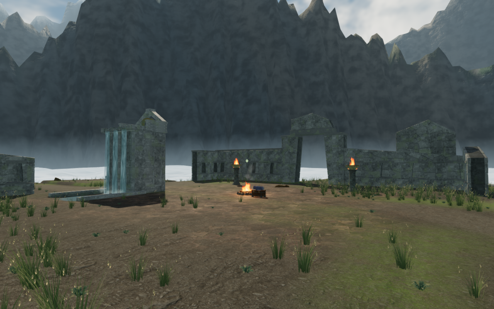
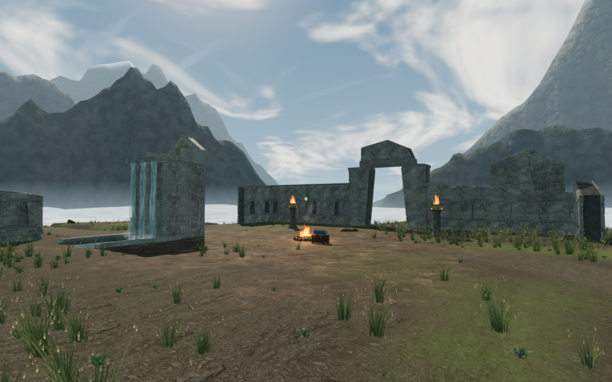
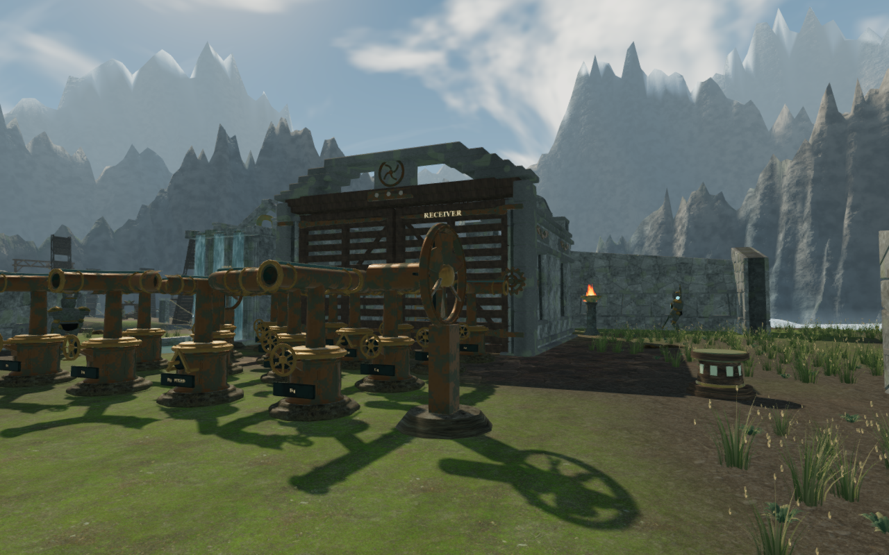
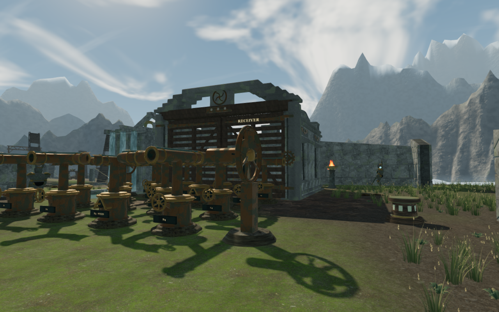

# Cloud valleys between Andean massifs

The current court survey showed a dense, jagged mountain wall behind the cloud
city. Actual scene rays identify the nearest Andean range in fifteen of seventeen
opaque hits sampled across the camp background. Moving or lowering that range
alone reveals another continuous ridge behind it, so the revision coordinates
the composition across all three ranges.

Each range now has three broad, slightly staggered passes. The ranges move
farther from the city by 140, 200 and 260 metres respectively. Their finest
geometric fracture fades near the crests, while the flanks retain their gullies,
spurs and bedding. High side massifs, snow, forest shading, rock detail, baked
sun visibility and valley clouds continue to use the existing construction and
materials. No new asset, material, shader or dependency is added.

The comparison images use the same recorded player position, camera, High
quality and simulation time, with the explorer hidden for the scenery review.
Each image is a lossless export of its actual game capture with identical
decoded pixels and dimensions.

## Verification

All 33 selected cloud-city, architecture, geology and bridge tests pass. The
composition regression reads the delivered geometry: three central camp rays
that previously hit the near mountain now reach clear sky, while both side rays
still meet massifs. Position, normal and baked-light arrays from the implemented
Node builder match the reviewed three-range prototype exactly.

Conservative projected bounds of every mountain triangle clear the complete
427 m square map by at least 231.88, 553.86 and 908.80 metres for the three
ranges. The triangle and vertex counts retain their preceding totals: 112,640
triangles and 57,791 vertices. Existing seam, upward-normal, baked-light,
sun-direction and parallax regressions pass. Horizon construction retains the
map, terrain height field and local water positions, and keeps the mountains
excluded from contact. The production build passes with its existing large-chunk
advisory.

All 35 High and six Performance captures from the final game source are
reviewed. Twenty-nine High court and rear-offset observers retain their recorded
eyes and targets; six new east/west overlooks broaden the directions inspected.
The rear offsets give useful views of all nine objective-chamber exteriors that
the previous outer-wall observers obscured. Sampled shader programs link, HDR
output remains finite and Performance output is populated. No application error,
warning or WebGL error is recorded.

Production keyboard/High and portrait-touch/Performance cases pass from prepared
fifth-engine saves. Each operates a real working duct, reloads its earned turn,
then exercises movement, crouching, camera look, jumping, landing and map input.
Each compares the complete local save through three reloads, excluding its play
timestamp. All twelve release captures are reviewed; served bundles and the
character model match the production build. No application error or warning is
recorded; software-driver readback diagnostics are retained separately. These
cases do not close broader framing around nearby machinery.

The earlier naive hide-range control also skipped the required depth clear and
is excluded from visual evidence. The corrected control clears depth after the
last remaining opaque range. Temporary geometry restores and disposals pass;
restoration does not claim pixel identity between captures.

All verification uses the shared locked five-of-sixteen CPU allowance, at most
two test workers and one browser at a time. Owned previews, workers and browsers
close after their checks.

The new rear coverage exposes repeated flat chamber crowns. The subsequent
[wind-chamber pass](wind-chamber-crowns.md) gives all nine upper assemblies
different entrance, rear and return profiles. Final-court side overlooks also show a very straight
grass/cloud boundary. The subsequent [bank and cloud inspection](cloud-contact.md)
finds actual descending terrain at the sampled edge and softens hard cloud
intersections on its lower face. The later [island-outline pass](sky-island-outlines.md)
extends the upper edge into varied shelves. Wider field, discovery,
traversal and water routes, moving-body contact and the full
[visual audit](visual-audit.md) remain open. These measurements do not establish
consumer-device performance, subjective audio quality or complete visual
acceptance.
