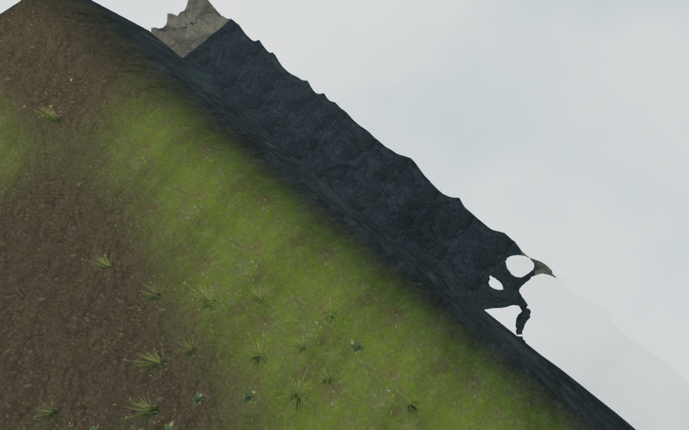
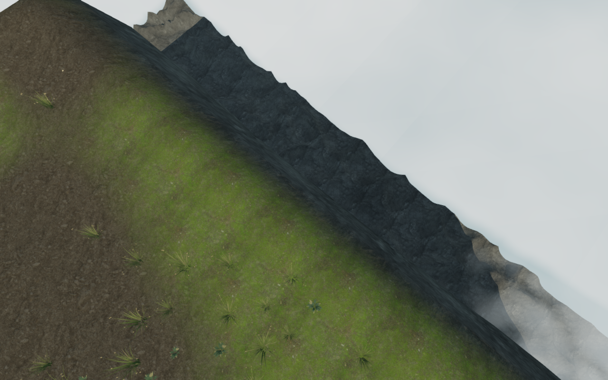

# Soft cloud contact below the sky city

The lower valley clouds crossed the jagged island banks with hard white
cutouts. The cloud sheet now fades as it approaches the actual terrain surface,
leaving a softer transition across the exposed rock.

These images use a diagnostic camera ten metres above the recorded standing
observer. They expose the lower bank and are not presented as playable standing
positions. The before control removes only the new opacity factor; the camera,
terrain, cloud movement, lighting and graphics quality are shared.

The shader reads a float height texture sampled from the delivered terrain
vertices and interpolates their actual two triangle planes. Cloud opacity rises
smoothly over sixteen metres of vertical clearance. The fade continues beyond
the terrain boundary so the much wider cloud sheet has no abrupt rectangular
mask at that boundary. The texture occupies about 0.91 MiB and belongs to the
chapter's existing material cleanup.

This changes cloud opacity. The terrain, walking support, bridge decks, water
surfaces, mechanisms and positioned sound sources retain their construction.
The preceding straight grass/cloud silhouette is a separate terrace-shape
finding: ten screen rays, a double-sided control and twenty-nine bank-profile
rays found actual descending terrain. Cloud-hidden views retain the straight
cap outline. The subsequent [island-outline pass](sky-island-outlines.md)
varies that upper edge; broader composition remains open.

All forty selected cloud-city, architecture, geology and crossing tests pass,
as does the production build with its existing bundle-size advisory. Every
delivered terrain vertex in the geometry regression matches the cloud texture,
including chunk seams and boundary vertices. Existing route, water and terrain
preservation checks pass.

The browser shader observer checks 420 height/opacity samples against actual
terrain rays, plus 140 samples just inside, on and outside the map edges.
Maximum height errors are approximately 0.107 mm and 0.041 mm respectively;
maximum opacity-factor errors are 0.000011 and 0.000004. These checks exercise
the actual shader interpolation and smooth fade, including both halves of
terrain cells and the boundary extension.

All twenty-two final captures are reviewed: ten court fronts, two prepared
follow-camera overlooks, bridge views, the elevated diagnostic comparison and
four Performance views. The late-chapter fixture deploys the bridges; each
prepared bridge root has real deck support. The sampled shader programs link,
HDR remains finite and no WebGL error or application warning/error is recorded.
The initial view job stopped because its starting save had no deployed bridges;
its partial output is excluded from the final capture count.

Reloading the chapter and changing to the jungle each dispose the outgoing
cloud texture, geometry and material exactly once. The new texture is 956,484
bytes; the chapter change also retires the cloud-city state. All browser
helpers run sequentially under the shared locked five-of-sixteen CPU cap and
close their owned browser and preview resources.

Production keyboard/High and portrait-touch/Performance cases each turn a real
wind duct and retain the earned turn after reload. They also exercise movement,
crouching, camera look, jumping, landing and map input. Each compares the complete
local save through three reloads, excluding the play timestamp. All twelve
production captures are reviewed; served bundles and the character model match
the production build. There are no recorded application errors or warnings;
software-driver readback diagnostics are kept separately. These prepared
fifth-engine cases do not establish complete campaign or device acceptance.

The two comparison images are lossless exports retaining the source captures'
pixels and dimensions. The subsequent [wind-chamber pass](wind-chamber-crowns.md)
varies the nine repeated upper assemblies. Wider bank composition,
field/discovery/traversal/water coverage, moving body
contact and listening/device acceptance remain part of the open
[visual audit](visual-audit.md).
