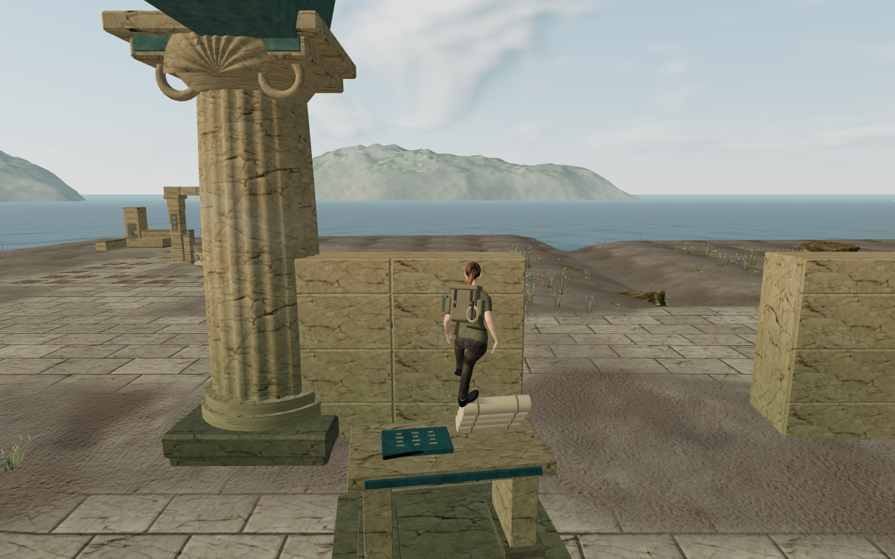
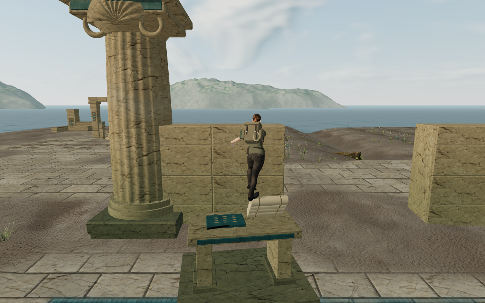
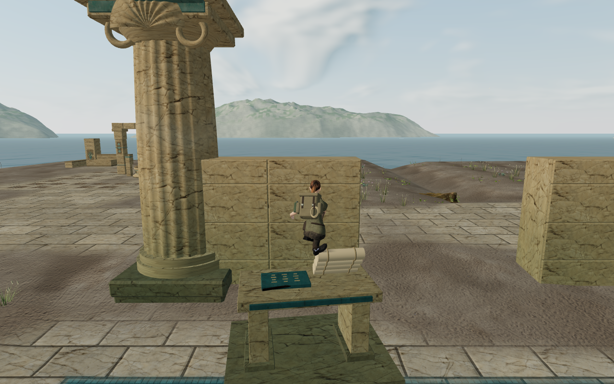
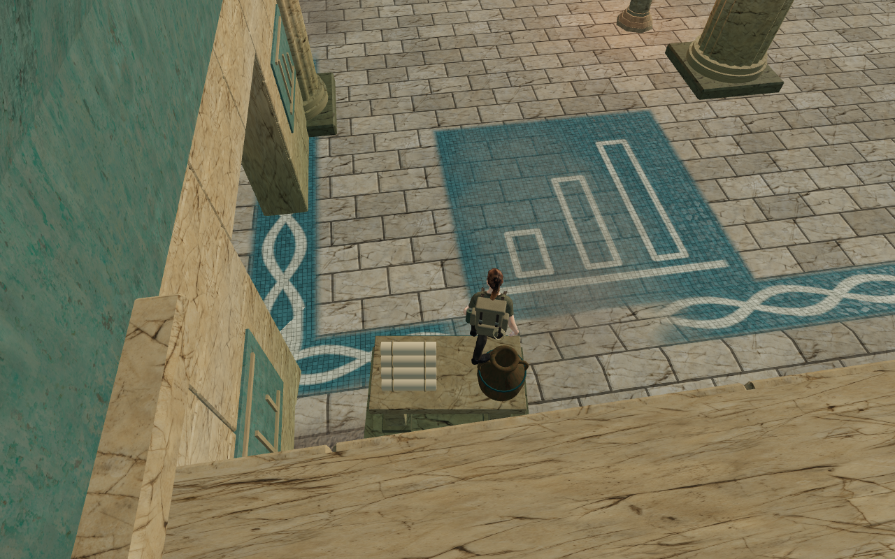
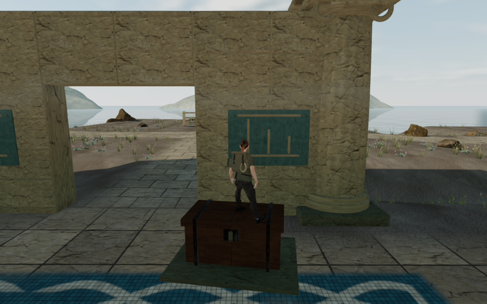

# Coastal resting poses

The explorer now balances over the fitted ankle on the coastal archive props,
and crouches lower on the retained scroll stack and chest. Boots and clothing
clear the sampled furnishings while at least one sole retains contact. The
player's physical position is unchanged by the visual fit.

The balance target previously used a point on the toe or sole edge. It now uses
the planned ankle, retaining the existing 60 cm shift cap, collision guard,
blending and takeoff easing. Actual outsole contact on the same tread also
stops an unnecessary weighted-toe correction from pulling a boot through a
curved rim.

Low cuffs need a separate fit. A folded cuff can enter a chest lid while the
sole still contacts it; raising the whole pelvis then cancels the crouch.
Three bounded ankle corrections now fit sampled cuffs before the pelvis fit,
preserving the 15 mm contact skin and limiting each correction to 3 cm.
Authored layered props also use the nearest-surface boot escape used for
natural scans. The crouch fitter checks bounded deeper folds before raising
the body. Conservative terrain and knee/thigh clearance remain active.

| Recorded defect | Before | Verified result |
| --- | --- | --- |
| Archive balance | Four of eight retained poses exceed the 11 cm hip/ankle bound, reaching 14.783 cm. | Sixteen High poses across four headings pass; maximum offset is 7.308 cm. Four Performance repeats pass too. |
| Scroll-stack crouch | Published `09a07e9` raises the hips by 17.415 cm at the retained root and heading. | Every retained archive crouch lowers the hips by at least 31.799 cm. |
| Chest standing after one second | Published grounding reproduces 78 boot vertices embedded beyond 15 mm, reaching 5.219 cm. | The recorded High stance has no embedded or invalid body records, and retains sole contact. |
| Chest crouch after one second | The intermediate ankle/boot repair still raises the hips by 1.649 cm. | The two High controller-settled crouches lower the hips by 20.738 cm and 32.062 cm. |

All 1,199 campaign tests pass without failures or skips. All 627 frozen
source/test inputs match after completion. The retained 39-pose regression
includes four archive headings, eight chest poses and both one-second chest
stances. The original 11 cm archive bound, rendered sole contact, independent
body containment, unchanged player root, visual standing envelope and takeoff
bound remain strict. Archive crouches must lower the hips by at least 10 cm,
and chest crouches by at least 5 cm. Three CPU-guard checks pass; verification
jobs share five of sixteen CPUs with affinity locked for their children. The
build passes with its existing large-chunk advisory. Minimal roof fixtures
still emit existing mixed-attribute merge advisories during the suite; the
constructed game views have no application errors or warnings.

A geometry preflight passes 80 poses at twenty furnishings, two headings and
both stances. All 3,847,600 rendered body records pass the 15 mm intersection
threshold against their furnishing's closed pieces. Both soles remain clear,
and at least one retains contact. Every crouch lowers the hips by at least
20.737 cm. This uses a constructed palace and the delivered character.

The assembled-world replay passes 28 dedicated poses and 96 controller-settled
poses. It inspects 5,963,780 delivered body records against the selected
furnishing assemblies, with no invalid points or intersections beyond 15 mm.
Rendered sole rays, legal supports, actual crouch state and full character
opacity pass. The dedicated poses preserve their requested physical roots.
All captures retain finite HDR output and linked shaders without WebGL errors.
The 414 runtime source hashes match before and after the replay. Thread audits
confirm the five-CPU allowance, and the browser and preview server close when
the replay finishes.

The production build passes five prepared cases: keyboard/High at the chest,
scroll stack and jar, and portrait touch/Performance at the vessel and pipe.
Native crouch, vertical jumps, supported landings and lateral departures pass.
Fifteen complete-store reload comparisons preserve all saved data apart from
`lastPlayed` timestamps, including health, chapter stage and hydraulic progress.
Independent constructed-geometry rays confirm the saved raised supports. All
25 native captures are reviewed at full resolution. The release has no
development hook, loads the expected built JS/CSS assets and matches the same
414 runtime source hashes. No application errors or warnings are reported;
thread and cleanup audits pass and the browser and preview server close.

All 92 development images are reviewed: sixteen baseline Performance captures
and 76 final captures (64 High, twelve Performance), including all twenty
furnishings in both stances. Selected scroll, vessel and chest captures are
also inspected at full resolution. No new placement defect is observed in
these sampled views. Sparse surroundings and repeated large masonry forms
remain visible and are still part of the broader composition audit.

The sixteen baseline captures match published `09a07e9` across all 414 runtime
files and the delivered character. The archive pairs below use matching
Performance settings, roots, headings and animation phases. The follow camera
tracks the fitted body, so they preserve the chosen look rather than identical
camera positions. The High chest baseline substitutes the published grounding
and terrain-pose code with only isolated import paths changed; its standing
capture is valid. All eight lossless WebP figures decode exactly to their
source capture pixels.

| Pose | Before | After |
| --- | --- | --- |
| Scroll, standing — Performance |  |  |
| Scroll, crouched — Performance |  |  |
| Vessel, reverse heading — Performance |  |  |
| Chest, standing — High |  |  |

The character, scenery, textures and dependency set are unchanged. Existing
[asset attribution](asset-credits.md) applies. The browser fixtures use prepared
progress and muted audio. These settled poses and local input checks do not
establish continuous chapter contact, a human campaign playthrough, consumer
performance or subjective listening quality. Broader landscape composition,
sparse and repeated surroundings, other browsers and devices, and listening
acceptance remain open. The overall game-polish goal is incomplete.
