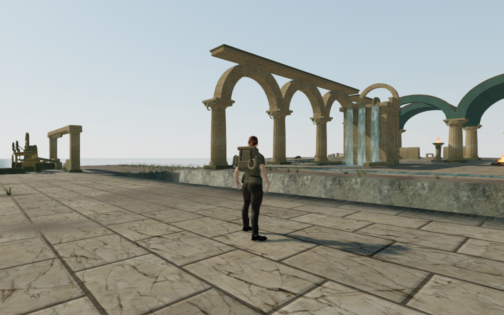
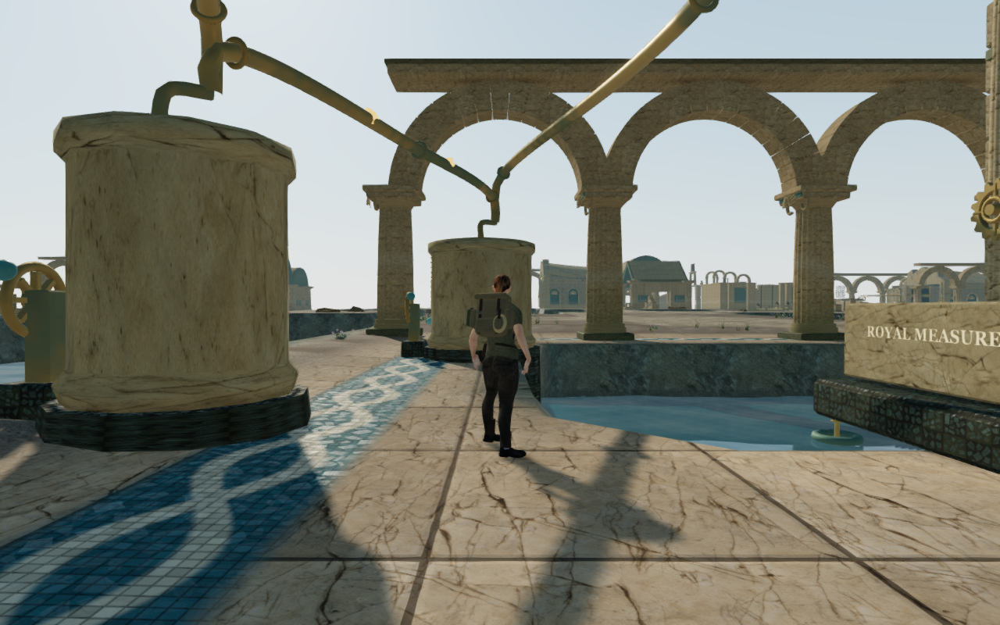
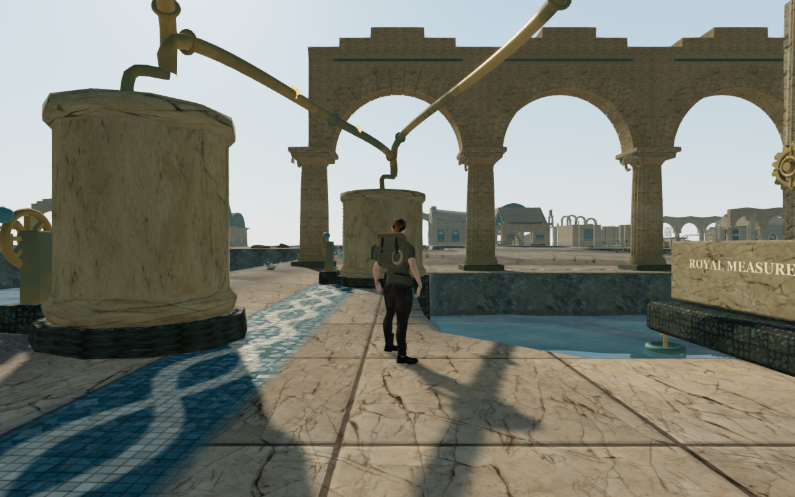

# Coastal side arcades

The Drowned Kingdom's thirteen side galleries now have supported stone heads,
varied upper profiles and narrow blue friezes. The fifty-two arches retain their
existing column feet and opening dimensions. Flat parapets, pediments, stepped
attics and wave profiles extend the identity of the adjoining courts into the
side galleries.

These are actual 1280×800 High browser captures. Both pairs retain identical
player position, camera position, yaw and pitch, with prepared progress,
hidden guardians and muted sound. Four lossless WebP files preserve exact
decoded RGBA pixels and dimensions.

The previous cap underside sat about 8.2 cm above the actual arch crest. Its
only apparent central bearing was separated by air. The new closed stone fill
joins the arch to its upper coping, with a recessed backing behind the dressed
radial joints. Both rendered geometry and physical collision now occupy those
former gaps. The facing and coping overlap their supporting stone; body and
camera queries retain the open space beneath the arches.

The new geometry reuses the existing palace stone, dark masonry and blue
plaster. Upper pieces use an independent seed sequence. Preserving the replaced
cap calls' original seed consumption keeps later column, roof and perch
construction stable. The measured bird-support positions remain exactly equal
to the preceding version.

## Construction and rendering checks

Eight palace tests pass, including closed edges, outward winding, positive
volume and finite nondegenerate faces across all authored profiles. The tests
query actual rendered roof surfaces against physical support, check upper
blocking, and verify camera and body clearance beneath all fifty-two heads.
The bank-access check uses the real finite body volume, allowing overhead stone
to overlap a bank's plan without making a false ground blocker. Fourteen
collision and foothold regressions also pass.

The initial implementation captured every cell separately and kept internal
faces between fill cells. Combining the closed outlines removes those hidden
faces, while short camera bounds follow groups of cells. The final measured
camera count is 1,809 versus 1,549 previously, within the existing 2,600 bound.
The world adds 4,640 structural triangles. The largest individual court changes
from 59,796 to 60,756 triangles, so its bounded construction allowance increases
from 60,000 to 61,000. These counts describe construction cost; consumer device
frame rates remain unmeasured. The build passes with its existing large-chunk
advisory.

All thirty-nine final High/Low walking views pass and are reviewed, together
with the corresponding baseline views. Player position and chosen look are
preserved; the actual camera positions also match exactly. Views retain full
health, legal grounding and complete sampled body
visibility. Shaders link and output checks pass. Inner views can crop the upper
crest; front approach views show the full gallery silhouette. Progress is
prepared, guardians are hidden and the mix is muted.

Separate matched ray queries find no stone at all fifty-two preceding bearing
gaps and find stone at every revised position. These queries use actual render
buffers, alongside the new physical-bearing assertions.

All thirty-six hydraulic controls, fifty-four ready/completed field cases and
139 previously available dry sound-source ranges retain access. Bird supports
and their emitters remain attached. These are radial placement and gain checks,
not subjective listening.

Both complete coastal climbing loops pass their supported walking approach,
mantles, jump, rope crossing, summit, return cable and ground return. Together
they cover 547.27 m and 7,606 controller/camera updates with full health and no
character fading. All 103 route captures are reviewed, including wider court
and upper-route views. These are assisted routes on prepared progress, with
guardians removed and sound muted; they do not establish a human playthrough.

Three local gallery round trips also pass, covering 42.52 m through 639
controller/camera updates with full health and no fading. All nine captures
are reviewed. These use the normal movement controller with assisted route
selection beside the arrival, Queen's and basilica galleries.

## Input, persistence and resources

Four production-build cases pass with keyboard/High and portrait touch/Low
controls. They cover puzzle source selection and a committed water transfer,
crouching, walking, look, jumping/landing, map access and twelve paused
whole-save reload comparisons. Sixteen release captures are reviewed; sixteen
character-model responses match the delivered asset hash, and loaded bundles
match the build. The development inspection hook is absent from the release.
Both older saves inside a column recover 0.75 m with progress and chosen look
preserved, then retain their subsequent walking position on reload.

Private fixtures, reports and raw captures stay under ignored
`local/staging/`. Verification shares the locked five-CPU allowance and uses
one browser at a time. All three affinity-guard checks pass; the release
browser's thread/descendant audit remains within that shared set. Owned
browsers, workers and preview servers close after their runs. Both verification
ports are released, and the temporary runtime directory is empty.

The broader world-composition, moving-body, continuous-route and listening audit
remains open. This gallery pass does not establish full campaign graphics
acceptance or commercial AAA parity.
