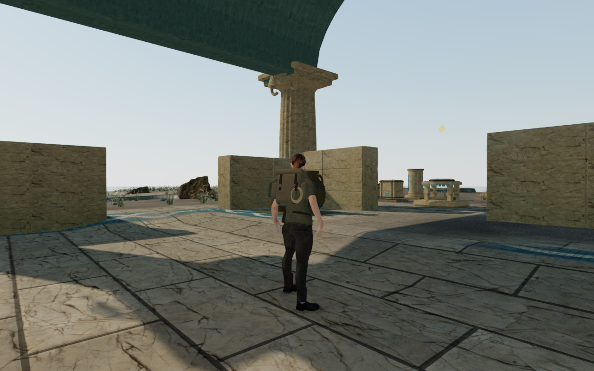
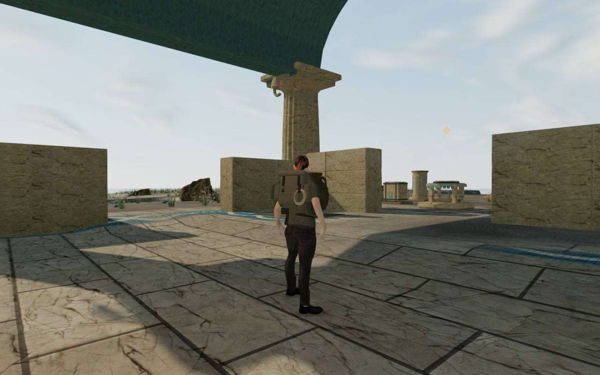

# Coastal marine sky

The Drowned Kingdom now has slowly drifting marine clouds above its courtyards.
Soft banks and stretched upper wisps add detail to the previously uniform pale
sky. The chapter retains its warm sunlight, coastal haze and material lighting
settings.

These are actual 1280×800 High browser captures with the same player position,
camera position and chosen look. Progress is prepared, guardians are hidden and
sound is muted. The lossless WebP exports preserve the exact decoded pixels and
dimensions of their source captures.

## Rendering

The original cloud shader extends the existing Three.js daylight sky. It combines
a bounded four-octave field, a soft sun-facing edge and thinner upper wisps. The
clouds fade into the horizon haze. Their clock follows the chapter's existing
elapsed-time updates, so movement stays slow at ordinary frame rates.

The visible dome and the initial filtered environment capture use the same cloud
shader and calibrated daylight radiance. The material-lighting environment remains
a static capture; the visible sky continues drifting. Existing water reflections
render the live scene. No new image, model, audio asset or dependency is required.

## Verification

Twenty-four prototype comparison captures cover walking and upward views at the
arrival quay, workshop and basilica, in High and Low. All are reviewed. The
delivered chapter repeats the twelve selected views and adds two captures after
advancing the cloud clock by 600 seconds. All fourteen are reviewed, with exact
player, camera, yaw and pitch agreement against the references. Sampled High
output is finite; Low output is populated; shaders link without GL errors.

An actual deep-pool camera probe hides the sky underwater and restores its
visibility, original background and exact fog on surfacing. Reload reconstructs
the coastal shader. Both reload and chapter change dispose the preceding sky
geometry, material and environment target exactly once. The jungle does not
receive the coastal shader. These checks have no browser errors or warnings.

All fourteen existing cloud-city, diving and rendering-setting tests pass, and
the production build passes with its existing chunk-size advisory. Two production
scenarios cover desktop keyboard/High and portrait touch/Low. Both preserve puzzle
source selection and a committed water transfer, then exercise crouching, walking,
chosen look, jumping/landing and map access. All eight save comparisons pass.
All twelve production captures are reviewed, with no observed interface overflow.
Ten character-model responses match the delivered asset, loaded bundles match the
build, and the development hook is absent.

Private helpers, captures and reports stay under ignored `local/staging/`.
Verification shares the locked five-CPU budget and uses one browser at a time.
All owned browsers, workers and preview servers close after their checks; both
preview ports are released and the temporary runtime directory is empty.
Broader court and landscape composition, campaign-wide visual acceptance and
subjective listening remain open.
