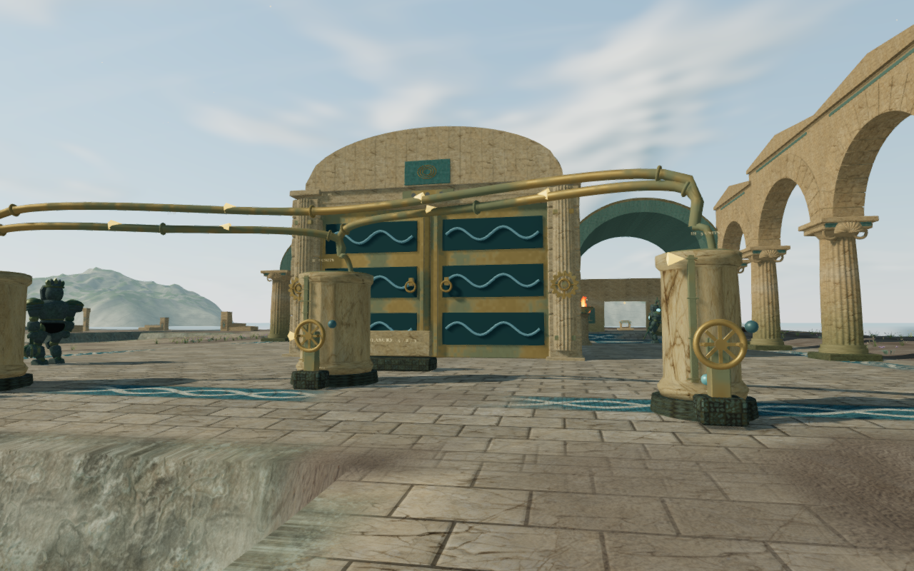
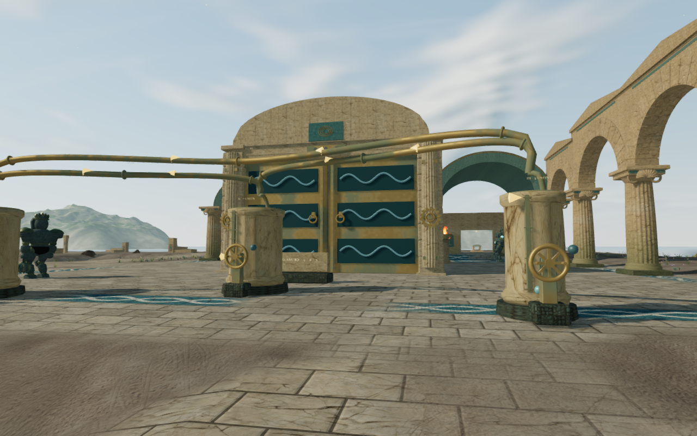

# Coastal limestone shoulders

The coastal court review exposed steep rectangular lips between the paving and
the surrounding ground. Actual terrain rays locate the reproduced face outside
the walking grid, beyond the second objective court. It is not a reservoir cut:
the old shoreline drop falls most of its seven metres at the first 1.75 m terrain
sample, producing faces with grades of 2.924–2.930 m per horizontal metre.

The shoreline now eases into a limestone shoulder with a smoothly varying width.
Its drop starts at zero at the walking-cell boundary and joins the preceding
deep seabed between twelve and eighteen metres out. It uses the existing terrain
vertices, materials and textures. The repair adds no mesh, asset or dependency.

## Measured scope

The three reproduced face grades fall to 0.237–0.240 m/m. Browser rays against
the actual delivered triangles agree with the standing-height sampler at those
points. The comparison images retain the same recorded player, camera, High
quality and simulation time; the explorer is hidden for the terrain review.
Each documentation image is a lossless export of its game capture with identical
decoded pixels and dimensions.

All 35,341 vertices supporting the complete walking-cell footprints retain their
preceding heights, including the outer boundaries. The 956 vertices under the
rendered basin footprints and their enclosing interpolation cells also retain
their heights. Regression digests record the preceding terrain from `97a6ecb`.
Water metadata, feature-centre heights and the submerged gallery layout match
the preceding profile. The surrounding shoreline changes; movement still uses
the existing walking grid.

All 35 selected coastal ground, terrain, hydraulic, water and swimmer-clearance
tests pass, including three new bank regressions. Changed source and test
formatting passes. The production build passes with its existing large-chunk
advisory.

All twenty High court fronts/rears and four Performance views are reviewed.
Recorded cameras, player positions, look and simulation time match the preceding
survey exactly. Inspected shader programs link, sampled HDR output is finite and
Performance output is populated, with no recorded application or WebGL error.
Rear observers at courts one and four still need offset views for broader hall
coverage.

Four legal anchors beside the changed banks pass 24 standing/crouched resting
poses and 88 sampled moving poses. Inspection reads 5,386,640 actual posed body
vertices against the delivered terrain triangles, with no missing, invalid or
embedded samples at the 15 mm tolerance. The smallest measured gap is 5.92 mm;
each resting pose has a point within 4 cm of the ground. Across those snapshots,
14,130 vertex queries reach the reshaped terrain rather than the preceding field.

Eight assisted local controller legs cover 31.38 m over 472 updates at full
health. The sampled camera states retain full character visibility; all four
return captures are reviewed. This is local edge coverage, not a continuous
campaign or whole-shore body-contact proof.

Production keyboard/High and portrait-touch/Performance cases pass from prepared
mid-chapter saves. Each operates the actual hydraulic controls, retains a
selected source through reload, commits a water transfer and retains that
transfer through another reload. Movement, crouching, camera look, jumping,
landing and map input pass. Each case compares the complete local save through
four reloads, excluding its play timestamp. All twelve release captures are
reviewed, and the served bundles and character model match the production build.
No application error or warning is recorded; software-driver readback
diagnostics are retained separately.

All work uses the shared locked five-of-sixteen CPU allowance, at most two test
workers and one browser at a time. Owned browsers and previews close after their
checks. Broader coastal composition, continuous route and body-contact coverage,
and the full [visual audit](visual-audit.md) remain open. These measurements do
not establish consumer-device performance or subjective audio quality.
