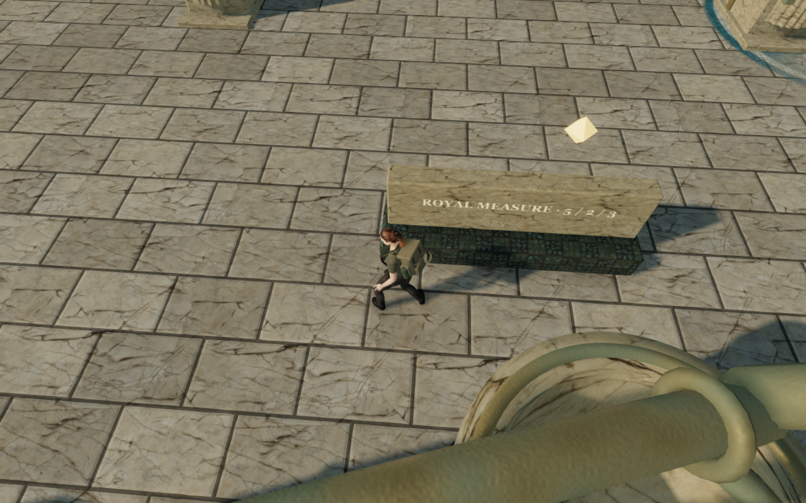
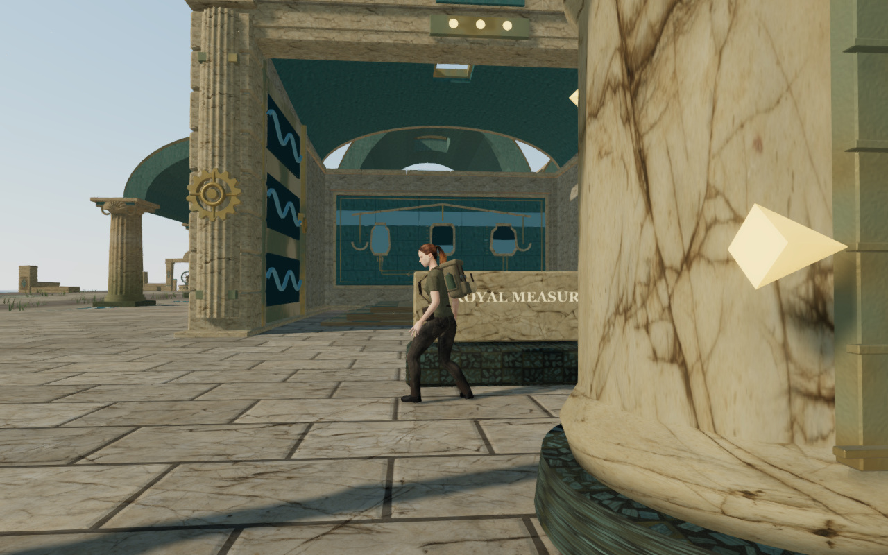
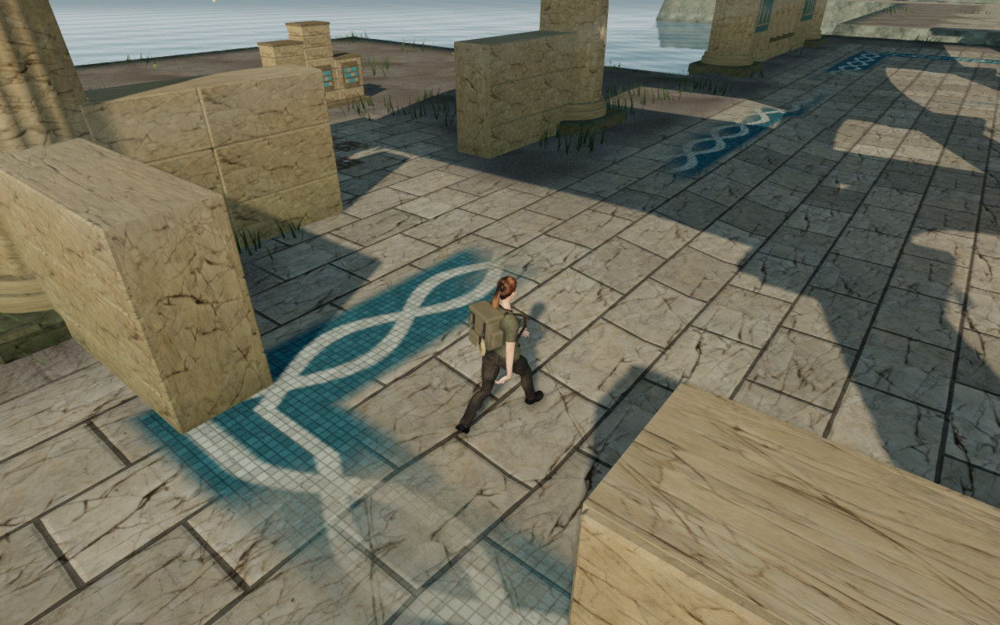
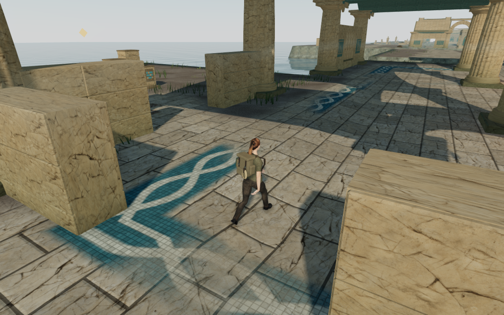

# Lower coastal follow views

The follow camera now tries clear moderate sideways views before larger upward
detours. The player keeps their chosen yaw and pitch, while collision response
can select a nearby camera position. An established upward detour yields when
the lower neighborhood becomes available. Actual arm constraints, body sight
and anticipation still govern every candidate.

The recorded coastal views and the selected route, chapter and release checks
now pass. Wider camera framing remains under review.

## Recorded views

These are actual 1280×800 High browser captures from the recorded controller
cases, with the mix muted and guardians hidden. The four lossless WebP files
retain their captured dimensions and exact decoded RGBA pixels.

The arrival court's western doorway return replay reproduces the previously
recorded player position, camera position and chosen look exactly. Its baseline
retains a 0.4-radian upward offset and produces a steep view over the doorway.
The final ordinary-controller route repeat preserves the same feet and chosen
look. Its measured return-view pitch falls from 0.5165 to 0.3641 rad, opening
more of the doorway and surrounding court. Wider moving-view framing remains
under review.

The harbor-tablet case uses a deterministic replay of ordinary movement, look
and jump controls from the prepared native-release fixture. Both versions have
identical player positions and chosen yaw/pitch at arrival, before the jump,
at the sampled apex, after landing and after settling. No enemies are stepped,
and the mix is muted. The camera receives every ordinary controller update.

| Sample | Previous camera pitch | Revised camera pitch |
| --- | ---: | ---: |
| Before jump | +0.8473 rad | −0.0603 rad |
| Sampled apex | +0.8619 rad | −0.1518 rad |
| Landed | +0.9429 rad | −0.0551 rad |
| Settled | +0.9400 rad | −0.0600 rad |

Pitch here is measured from the actual camera arm after removing its normal
0.2 m lift. The chosen input pitch stays at −0.06 rad. The previous search
retains `[-0.3, 1]`, even though a lower moderate sideways view clears both the
rendered obstacles and posed body. The revised search selects `[-0.45, 0]`.
Across all 318 replay updates, the revised character-fade uniform stays at 1;
the highest measured pitch falls from 1.0017 to 0.0547 rad. These measurements
describe this recorded case, rather than all camera motion in the campaign.

## Regression evidence

The new tall-column regression places an actual closed support in front of
the requested arm and independently verifies a clear lower sideways view.
It starts from an upward detour, requires legal camera space, a clear arm and
posed feet on every update, and requires the settled pitch to return within
0.2 rad of the chosen look. The published `0ba4288` camera fails its final
framing assertion; the revised camera passes.

All 49 selected camera, explorer visibility, guardian, terrain sight and
collision tests pass. The build passes with its existing large-chunk advisory.
The runtime adds no external asset or dependency. All 76 final palace walking
legs pass across 393.94 m and 5,910 updates, with no stalls, damage or character
fading; all 114 route captures are reviewed. All 90 hydraulic local route legs
also pass across 914.72 m and 13,732 updates, with no fading, damage or stalls;
all 99 route captures are reviewed. The hydraulic sweep reached its 40-minute
supervisor limit after 58 successful legs, closed its owned resources, then
resumed the remaining legs on unchanged source. These are assisted local
routes with prepared progress and hidden guardians, rather than a continuous
campaign playthrough. All 128 representative High stance cases pass across
eight chapters: arrival and middle positions, four headings, standing and
crouching. Settled body probes, legal camera space, grounding and full health
pass in each case; all 32 corresponding captures are reviewed. These positions
do not cover every obstacle or continuous camera motion.

Four built keyboard/High and portrait touch/Low cases pass transfer selection,
earned transfer, crouch, movement, look, jump/landing, map controls and older
occupied-column recovery. Both occupied saves recover 0.75 m with progress
and chosen look preserved, then permit walking away. Twelve paused whole-save
reload comparisons pass, excluding only `lastPlayed`. All sixteen native
release captures are reviewed, including the lower keyboard landing view.
Sixteen character-model responses match the delivered asset, the release
bundles match the build, and the development hook is absent. No application
warnings, errors or failed responses remain in these final checks.
Verification shares the locked five-CPU allowance; each owned browser and
preview server closes after its check. Private fixtures, raw reports and
profiles stay under ignored `local/staging/` storage.

The first chapter survey passed the jungle poses, then the development preview
exhausted its default Node heap and subsequent asset requests failed. That
server failure is retained separately from camera evidence. Dependency
discovery now uses only the app entry point, and the development watcher
excludes local toolchains, review archives and downloaded source assets.
The new build passes and its delivered JavaScript/CSS bundles remain identical
to the preceding camera build. All seven remaining chapters subsequently load
and pass their stance checks without another preview heap failure.

All final owned browser, worker and preview resources are closed. Both preview
ports are released and temporary profiles are removed. Publication retains
the camera regression, scoped preview configuration, attribution and four
intentional comparison images; private fixtures and raw reports remain local.

The broader visual, continuous-route, encounter and listening audit remains
active. This camera pass does not establish full campaign graphics acceptance,
comfortable framing at every obstacle, device frame rates or subjective mix
quality.
