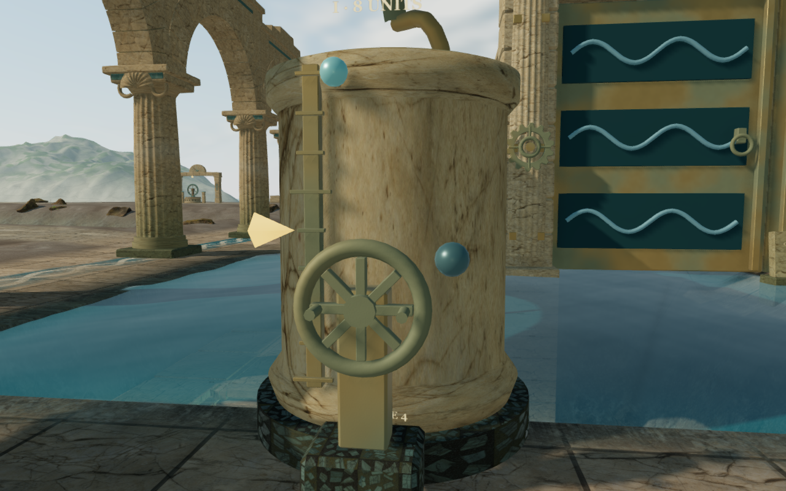
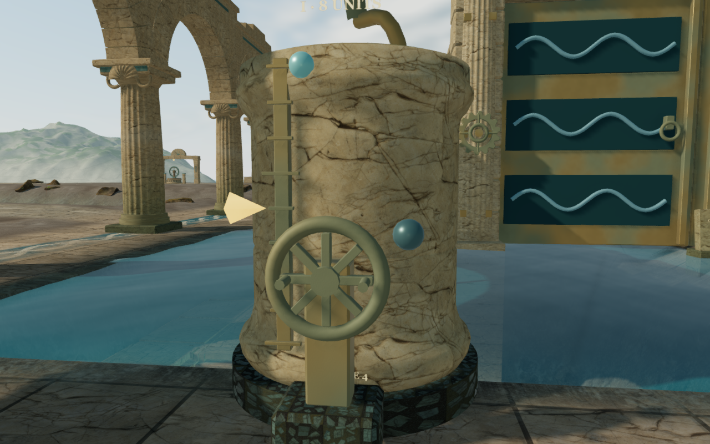
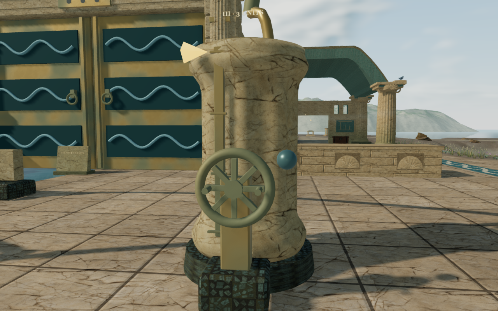
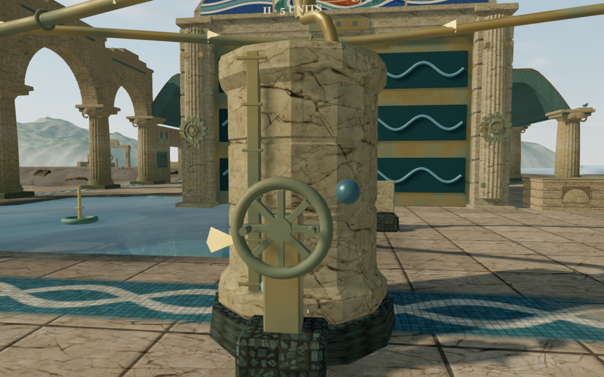
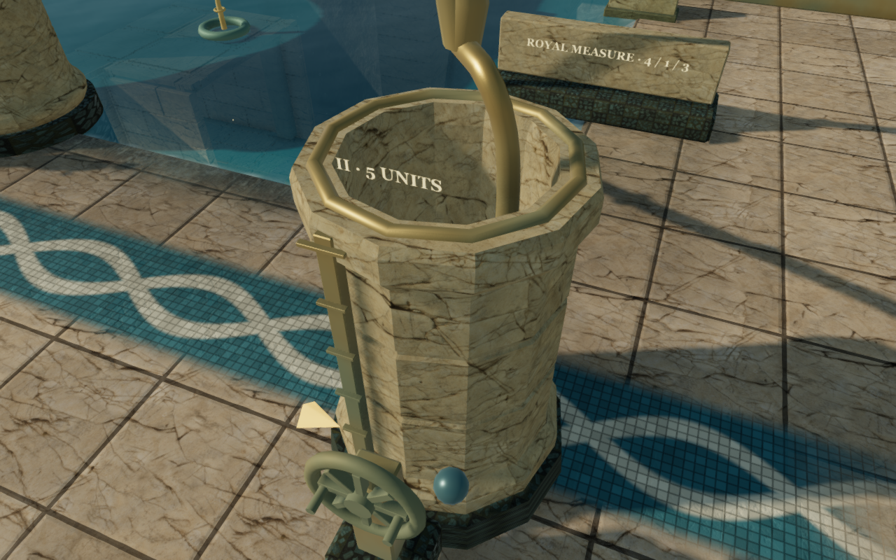

# Coastal cistern stonework

The coastal cisterns had long, stretched stone markings and three similar-looking
casings. Their wall UVs assigned one tenth of a texture repeat to most of the
bowl height. The revised geometry gives the round bowls moulded feet and
capitals, the twelve-sided bowls flat faces and recessed courses, and the
fluted bowls eight broad carved channels.

The before/after pairs use the same numeric player and camera positions and
fixed scene time. Each documentation image retains the capture's dimensions
and decoded pixels after lossless WebP conversion.

## Geometry and texture mapping

All 27 bowls retain their measured inner walls, floors and angular water
boundaries. The outer stone stays inside the existing foundation and body
collision envelope. The gauges, pump controls, water surfaces and sound-source
construction use their existing positions and behavior.

Vertical texture coordinates follow the profile's physical arc length at two
metres per repeat. An integer number of repeats wraps around each shaft,
approximating the same scale and closing the texture seam behind the bowl.
Horizontal beds, rims and floors use planar coordinates. The faceted bowls
use flat face normals; the round and carved bowls retain smooth shading.

Each bowl remains one material batch. The final geometry compacts vertices
while retaining the UV and normal seams; temporary construction geometries
are disposed immediately. Across all 27 bowls, the submitted triangle count
grows from 25,200 to 54,072, and retained vertex
records from 14,157 to 37,561. A topology check confirms every bowl remains
closed with outward winding.
These counts describe geometry cost and do not establish frame rates.

The revision uses original project geometry and the existing credited
[stone textures and other assets](asset-credits.md).

## Verification

All 59 selected tests across seven files pass, together with three CPU-guard
checks and the production build. The existing large-bundle advisory remains.
An independent geometric regression probes all 27 chambers at five heights
and twelve directions: 1,620 rays retain the required regular-polygon inner
walls. Physical texture-scale and planar-floor checks accompany the existing
closed-wall and equal-water-unit checks.

The hydraulic checks execute all 157 transfers in the nine authored solutions,
retain clear access to all 36 controls, and cover saved selection, transfer,
paused presentation, float height and distance-sensitive source behavior.
Camera, startup, rendering settings, audio and campaign checks also pass.

The visual review includes four preceding captures and twelve current views.
Four pairs use identical numeric poses; seven current views use legal ground
observers, two compare Medium and Low presets, and three inspect the interiors
from elevated cameras. All listed images are reviewed at capture resolution.
Observed programs link, buffer values remain finite and no GL errors are
reported. Actual chapter replacement disposes 27 bowl geometries and their
four shared material/texture resources once each. The next chapter contains
none of those bowl geometries or materials.

The production build passes a keyboard hydraulic transfer to `3 / 7 / 0`
and a simulated-touch movement of 2.1 m. Each committed state survives one
complete-store reload comparison, ignoring only `lastPlayed`, with health
remaining full. The two cases run in separate browsers at Low quality with a
360 × 600 CSS viewport and 0.5 device scale. Four 180 × 300 captures are reviewed,
including the transfer, pause and restored-world views. Served script/style
bytes match the build hashes, and the development hook is absent. No browser
errors or unexpected warnings are recorded in either accepted case.

This is a local surface and construction improvement. Material repetition,
other machinery, court and landscape massing, sparse margins, continuous
contact and timing remain under review. Listening and device acceptance remain
open; verification audio is muted. These checks do not establish a complete
human playthrough or AAA graphics.

Commands use the shared locked 5/16 CPU allowance, at most two test workers and
one browser. Owned browsers, workers and preview servers close after their
checks. Private captures, saves, browser profiles, toolchains and generated
builds remain excluded from publication.
