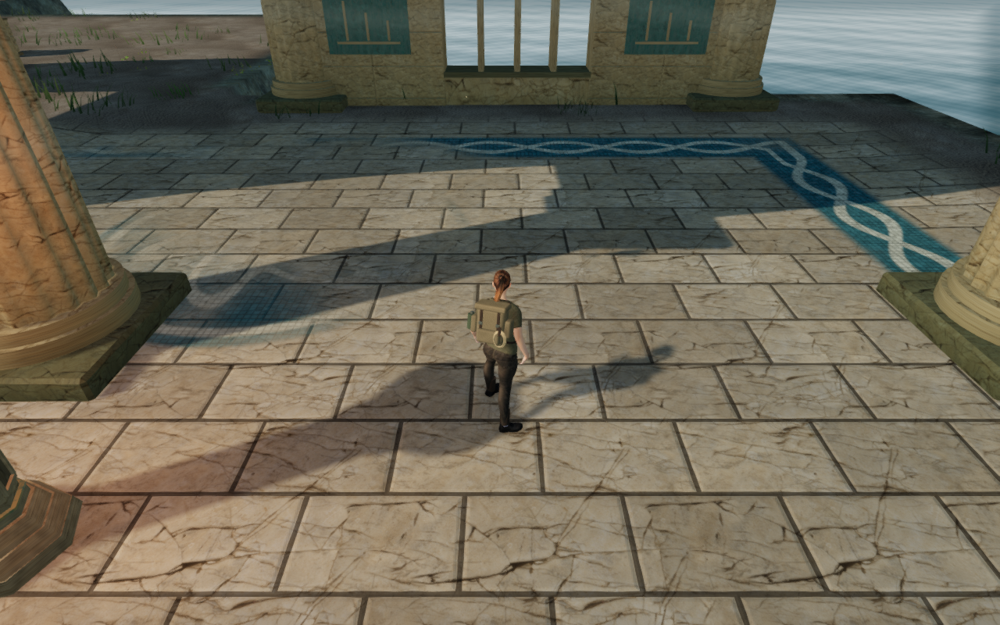
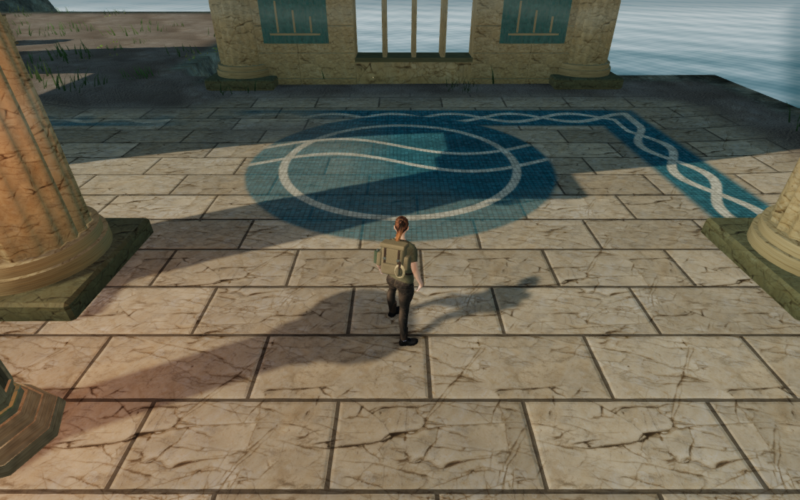
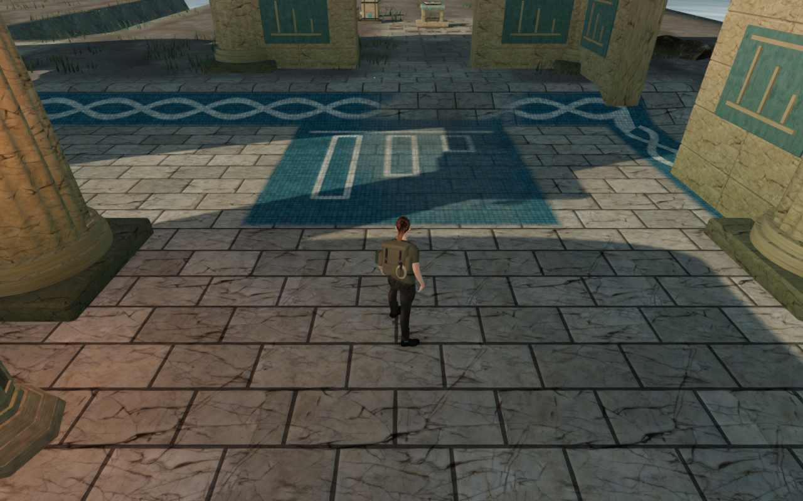
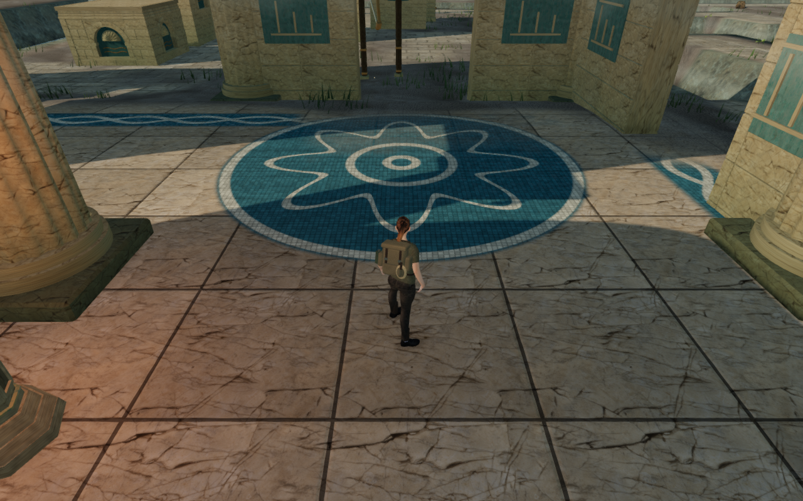

# Coastal court floors

The ten Drowned Kingdom courts now use authored limestone dimensions, bonds,
orientation and color, with a separate mosaic in each eastern rear bay. The
designs refer to the court's work: waves at the quay, balances at the exchange,
measures at the counting house and a spiral at the final lock.

These are actual 1280×800 High browser captures. The quay comparison holds
player position, camera position, chosen look and world state fixed while
changing the terrain material. The other two views use their normal follow
camera beside the new panels. Progress is prepared, guardians are hidden and
the sound is muted. Lossless WebP delivery preserves exact decoded RGBA pixels
and dimensions; these are selected views rather than complete route coverage.

The stone uses the existing credited palace color, normal and roughness maps.
Grout and tessera detail soften when they become smaller than a pixel. Tile
bevels affect shading. Terrain vertices, standing heights, collision, water
placement and saved progress retain their existing implementation.

| Court | Limestone arrangement | Mosaic |
| --- | --- | --- |
| Arrival quay | Broad rectangular running bond | Paired waves inside a ring |
| Counterweight exchange | Square straight bond | Balanced receivers |
| Harbor counting house | Narrow rectangular running bond | Three measured bars |
| Coral pump workshops | Alternating three-strip baskets | Nested square channels |
| Tidekeeper return gallery | Turned rectangular running bond | Opposed vertical currents |
| Isolated intake | Diagonal square bond | Nested lozenges |
| Counterflow crossing | Diagonal three-strip baskets | Crossed chevrons |
| Queen's circulation hall | Broad square straight bond | Eight-lobed rosette and rings |
| Pressure reserve cloisters | Turned rectangular running bond | Three measured rings |
| Abyssal lock basilica | Diagonal square bond | Double spiral inside a ring |

The bars and reserve rings use the actual hydraulic capacities. They are visual
records alongside the existing working diagrams; puzzle input remains on the
tablets. The floor selects its court from world position for each fragment,
keeping discrete profiles stable across terrain triangles and chunk borders.
The causeways blend back to their shared paving.

An initial panel position overlapped low cover walls and chamber columns.
The final panels sit in the dry eastern rear bays. The larger ceremonial
panels were also reduced to fit the paving inside its worn edge. Placement
checks compare their actual circular or rectangular boundaries with column
feet, bay walls, cover walls, water footprints and existing court coverage.
Weathering leaves the central designs legible while retaining worn borders.

## Verification

All thirty final High/Low panel and rear-aisle views pass, along with two
matched predecessor views. All 32 captures are reviewed. Both material
comparisons retain exactly the same player position, camera position, yaw and
pitch. Shaders link, High output is finite, Low output is nonempty, and legal
grounded positions retain full health and character visibility. These are
assisted static views with prepared progress and hidden guardians.

Six coastal tests pass: independent profile data and hydraulic measurements,
dry paved panel placement, actual causeway coverage, unchanged terrain heights,
chunk seams and live drainage. The material bindings use the actual ten court
frames and all authored profiles. The production build passes with its existing
large-chunk advisory. The CPU launcher's three inheritance and exit-status
checks also pass.

Four built-game cases pass using keyboard/High and portrait touch/Low controls.
They exercise source selection, a saved hydraulic transfer, crouch, movement,
look, jump/landing and map controls. Older occupied-column saves recover
0.75 m, retain progress and chosen look, then allow walking away. Twelve paused
whole-save reload comparisons pass, excluding only `lastPlayed`; all sixteen
release captures are reviewed. Sixteen character-model responses match the
delivered asset, the loaded release bundles match the final build, and the
development hook is absent. No application errors, warnings or failed
responses occur in the final browser checks. The mix stays muted for this pass.

The checks use the shared locked five-CPU allowance and one browser at a time.
Owned browsers, workers and preview servers are closed; both preview ports are
released and temporary browser directories are removed. Private captures,
fixtures, profiles and raw reports stay excluded under `local/staging/`.

The wider visual, moving-contact, continuous-route and listening audit remains
open. These floor changes do not establish full campaign graphics acceptance,
device frame rates or subjective sound quality.
