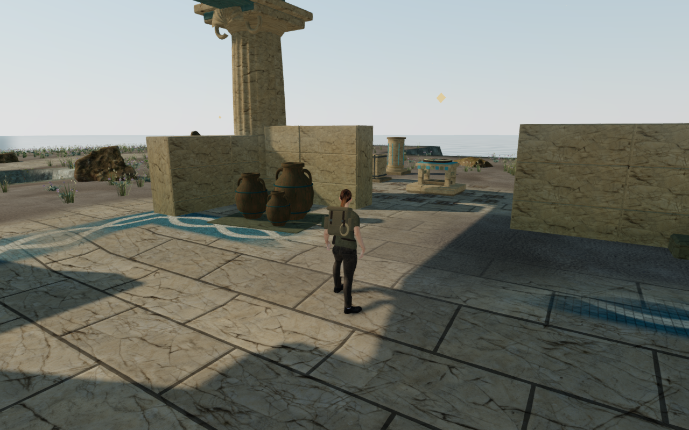
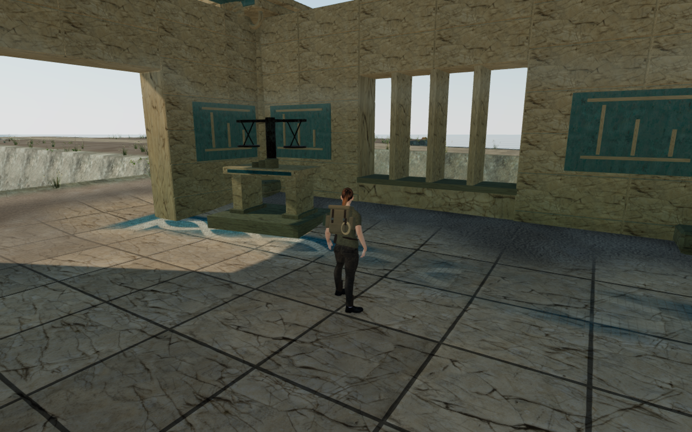
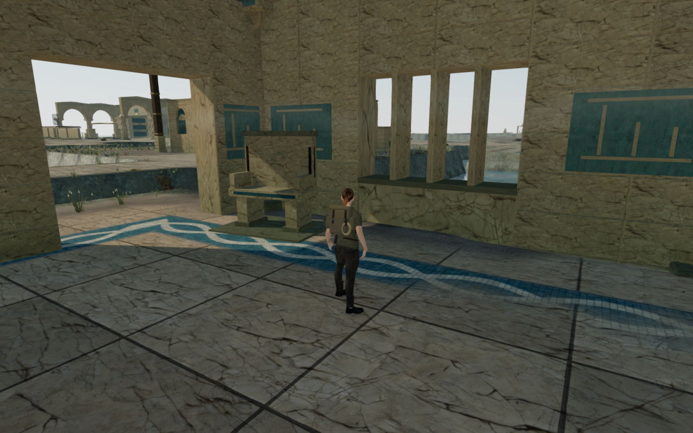
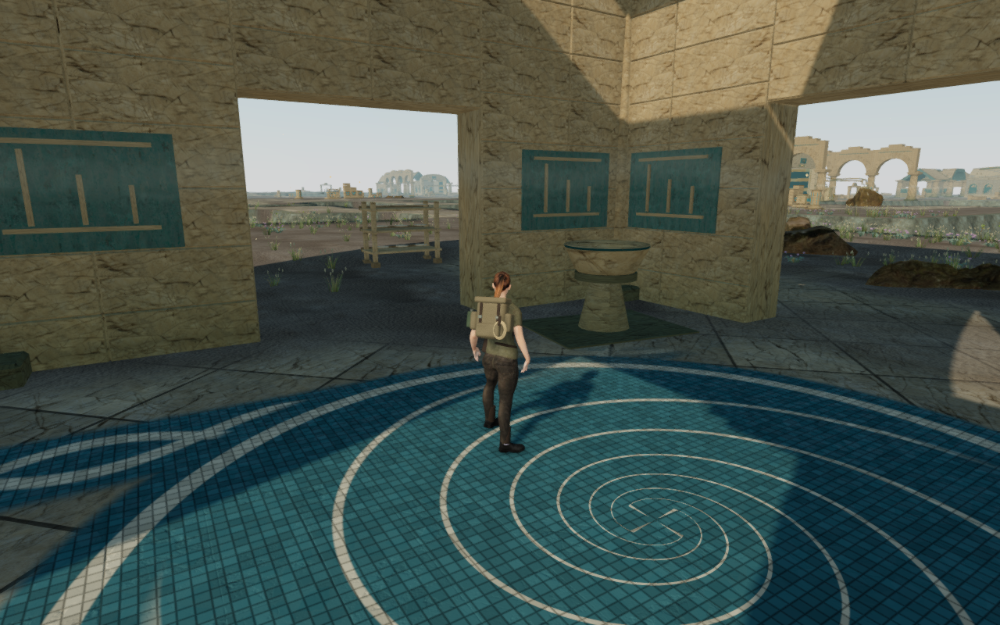

# Coastal hall furnishings

The ten Drowned Kingdom halls now have twenty authored furnishing groups in
their rear corners. Storage, measurement, record keeping, pump maintenance and
ceremony give the halls a purpose beyond their roofs and floor patterns.
The groups use original geometry and existing attributed material maps.

| Hall | Furnishings |
| --- | --- |
| Arrival quay | Three handled storage jars and coiled rope; shell-carved bench |
| Counterweight exchange | Suspended weighing pans and weights; strapped storage chest |
| Harbor counting house | Inscribed record table and stylus; scroll and jar archive |
| Coral pump workshops | Flanged pipe section on stone trestles; braced tool rack |
| Tidekeeper return gallery | Shell-carved bench; backed memorial stele |
| Isolated intake court | Ribbed filter drum; three lidded measuring vessels |
| Counterflow crossing | Flanged pipe assembly; connected paired vessels |
| Queen's circulation hall | Armrest seat with shell carving; stone wash basin |
| Pressure reserve cloisters | Lidded reserve measures; scroll archive |
| Abyssal lock basilica | Shell offering table; stone wash basin |

These are actual 1280×800 High browser captures with prepared progress, hidden
guardians and muted sound. The offset walking observers show each furnishing
beside the explorer; the matched context views can hide low pieces behind her.
The four lossless WebP exports preserve exact decoded pixels and dimensions.

## Construction

The vessels include inner walls and sealed floors. The basins have real hollow
bowls on supported stems. Small fittings, pan suspension, pipe flanges, lids,
bindings and carved faces are seated in their supporting pieces. Each setting
has a level stone bed extending below the lowest terrain under its footprint.
The lower terrain and existing architecture retain their original geometry.

Every closed part contributes its actual triangles to one physical union per
setting. Tilts and unequal scales are baked into the render geometry before
the physical kernel is copied, leaving upright placement transforms. Open
shell carvings use backing from their supporting stone. Camera queries use
separate part bounds, preserving the open spaces between table and bench legs.
These camera bounds are conservative primitives rather than triangle queries.

Material batching leaves ninety rendered meshes across the twenty settings.
The first draft used 65,340 triangles. Reduced small-ring, cylinder and vessel
subdivisions bring the final total to 47,372, within the new 50,000 furnishing
bound. The isolated palace camera count increases from 1,809 to 2,143, retaining
its existing 2,600 limit. These are construction counts; consumer frame rates
remain unmeasured. No new dependency or external asset was added.

## Verification

All twenty-six selected construction/collision tests pass. Four new tests
inspect sealed, outward, finite geometry
for all physical parts, the declared beds, baked transforms, doorway aisles and
dense rendered-surface versus physical-support queries. Other chapters do not
construct these furnishings. The build passes with its existing chunk-size
advisory.

All thirty matched High/Low context views and twenty-four offset detail views
pass and are reviewed, together with thirty baseline views. The matched player,
camera, yaw and pitch differences are exactly zero. Shaders link, output is
finite, and sampled feet remain legal and grounded with full health and body
visibility. These are prepared observers rather than a human playthrough.

An independent observer reconstructs closed parts from the actual rendered
buffers. All ninety-six sampled front-boundary poses pass, covering twenty
settings in High and four repeated in Low, with standing/crouched stances and
two facings. None of the 4,617,120 visible character vertex records embeds more
than 15 mm. Interior calibration points remain inside the actual floor beds.
This covers sampled static approaches rather than every moving or elevated pose.

All eighty inspected bed-bottom vertices have rendered terrain above them;
the highest gap is −120 mm. Reload repeats the grounding check and preserves
the hash of geometry, vertex colors and world transforms. All ninety-eight
tracked geometry/material resources dispose on reload and again on chapter
change. The jungle constructs no palace furnishings.

Forty ordinary-controller walking legs beside all twenty settings pass over
158.30 m and 2,380 controller/camera updates, with full health, no stalls and
no character fading. All sixty route captures are reviewed.

All thirty-six hydraulic controls, fifty-four ready/completed field cases and
139 previously available dry sound-source ranges retain access. These are
placement and radial gain checks rather than subjective listening.

Both complete coastal climbing loops pass their walking approach, mantles,
jump, rope crossing, summit, cable exit and ground return. Together they cover
547.27 m through 7,606 controller/camera updates, retaining full health and no
character fading. All 103 route captures are reviewed. Progress is prepared,
guardians are removed and sound is muted.

A separate predecessor check proves that a position now occupied by the quay
storage group was previously legal: the prior version restores its requested
feet exactly, while the new construction blocks it. Four production-build
keyboard/High and portrait touch/Low cases pass twelve paused whole-save
reload comparisons. They cover puzzle source selection and a committed water
transfer, crouching, walking, look, jumping/landing and map access. Both older
storage-area saves recover 0.75 m onto supported feet, retaining progress and
chosen look. Subsequent walking positions persist on reload. All sixteen
release captures are reviewed, sixteen model responses match the delivered
asset hash, loaded bundles match the build and the development hook is absent.

Private fixtures, raw captures and reports remain under ignored
`local/staging/`. Verification shares the locked five-CPU allowance and uses
one browser at a time; thread/descendant audits remain inside that shared set.
All owned browsers, workers and preview servers close after their checks.
Both verification ports are released and the temporary runtime directory is empty.

Broader surroundings, moving/elevated body contact, campaign routes and
subjective listening remain open. This furnishing pass does not establish
full campaign graphics acceptance or AAA parity.
