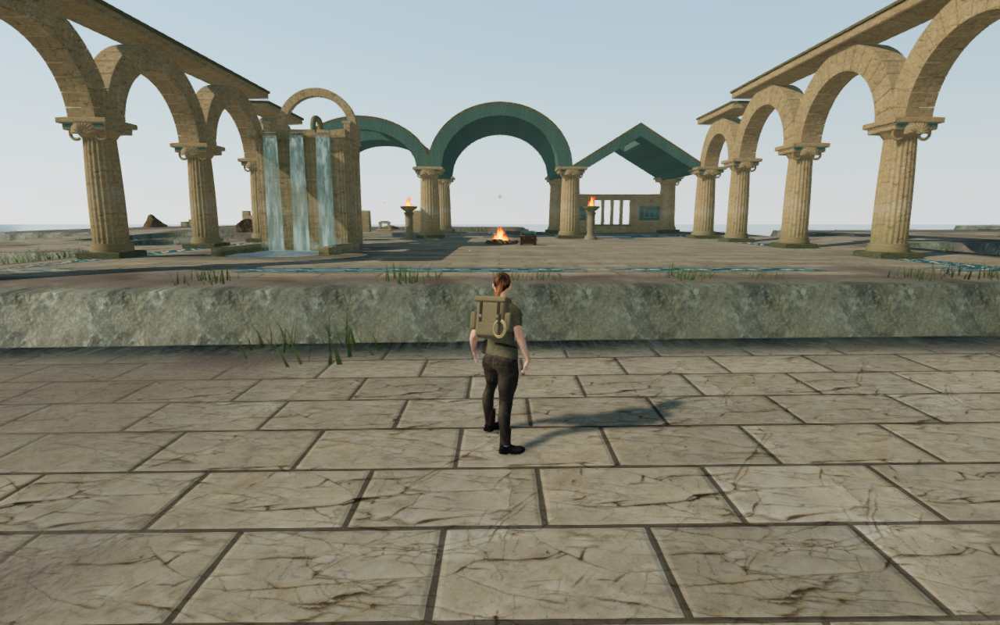
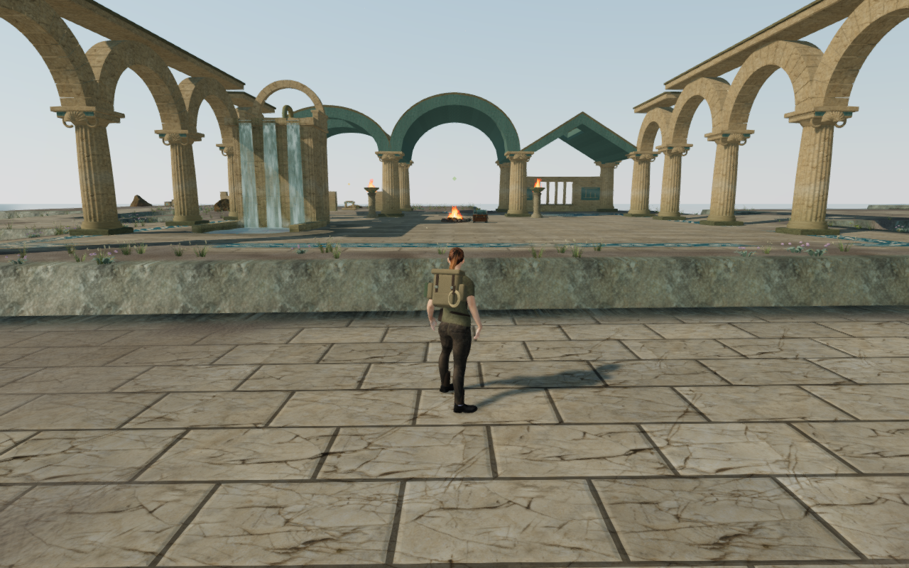
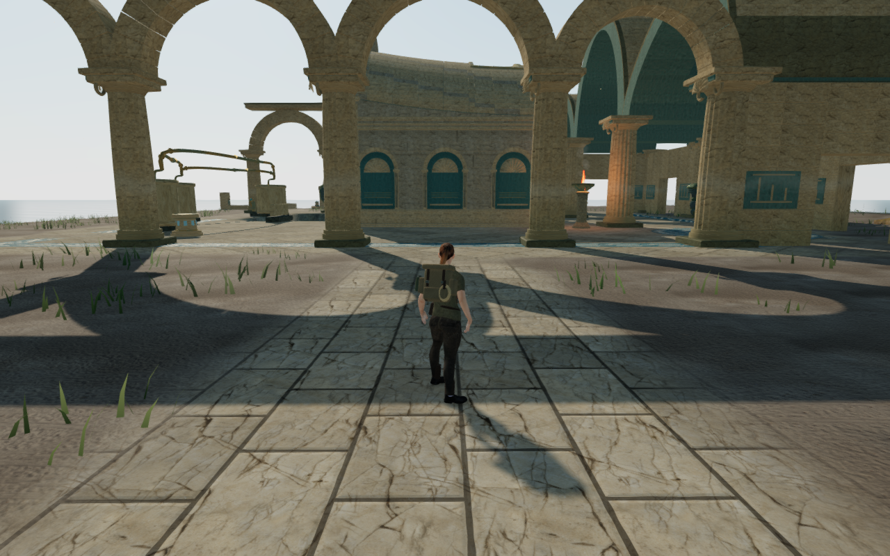
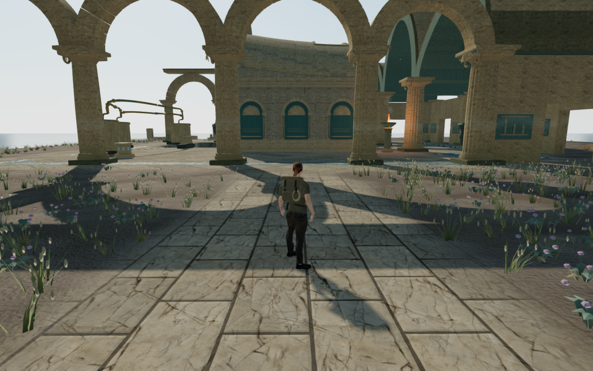
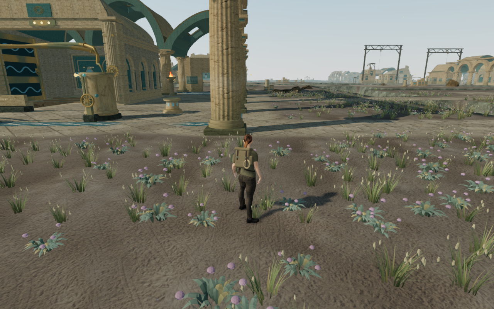

# Coastal ground cover

The Drowned Kingdom now has low salt grass, dry seed-bearing stems and
flowering cushions beside its ruined courts and causeways. Three original
specimens replace the coastal use of the shared short-grass generator. A low
continuous fringe joins denser sheltered clusters, breaking up the bare soil
while leaving the court paving and working lanes clear.

These are actual 1280×800 High browser captures. Both comparisons keep the
player position, camera position, yaw and pitch identical. Progress is prepared,
guardians are hidden and sound is muted. The fifth view uses the normal follow
camera beside the basilica's growth. The five lossless WebP files preserve
exact decoded RGBA pixels and dimensions.

The current world places 15,024 plants: 6,403 green grasses, 5,369 dry grasses
and 3,252 flowering cushions, distributed in 282 batches. These counts describe
the generated placement, rather than how many plants render at once. Plants
use three detail tiers and distance culling; High, Medium and Low keep the same
root transforms. Their leaves bend gently in the coastal wind, with fixed roots
and conservative bounds for their full reach.

The folded leaves, attached seed/flower heads and vertex colors are original
code-generated geometry. Existing palace, terrain and environmental assets
retain their attribution. This pass adds no external asset or dependency.

Placement fits each specimen's roots to the terrain and rejects unsupported
shelves. Whole plant footprints reserve the authored route lanes, traversal
courses, water, court paving, arcades and foundations, hydraulic operator
areas, gates, field sites and discoveries. The scene's existing rock bounds
also keep leaves clear of large stones. Candidate randomness is consumed before
these reservations, so local exclusions do not shuffle the rest of the coast.

## Verification

Fourteen selected ground-cover, coastal-floor and instance-detail tests pass,
including independent terrain-ray root queries, wind bounds, reservations,
stable placement through gate state/quality changes, and disposal of instance
buffers and template geometry. The production build passes with its existing
large-chunk advisory.

All thirty matched final High/Low court views pass and are reviewed, together
with the thirty baseline views. Player positions and chosen look match the
baseline, with legal grounded positions, full health and visible body targets.
Shaders link and output checks pass. The first plant distribution left several
foreground shoulders too bare; the final distribution retains a low fringe
between the denser beds. Some broad working areas remain visibly open.

The full-world observer queries all 2,874,720 root records from the three
delivered detail tiers, using float32 instance transforms and the actual
terrain vertex/index buffers. Every root has supporting terrain and stays
buried; the highest root is 23.17 mm below its triangle. Placement reservations
also pass for all 15,024 plants. The observer is retained in
`scripts/inspect-coastal-groundcover-browser.js`.

Six assisted local walking legs pass beside planted ground at the quay,
workshops and basilica: 20.46 m and 309 normal controller/camera updates, with
the character-fade uniform at 1. The checks use prepared progress, hidden
guardians and muted sound. Nineteen corresponding High/Low walking-position
and route views pass rendering, grounding, health and legal-position checks;
all nineteen are reviewed. These short walks do not establish complete campaign
route coverage.

Reloading after prepared restoration retains an identical hash of all plant
transforms, and all root queries pass again. Each of the 2,548 tracked template,
wrapper geometry, material, depth material and instance objects receives its
disposal event on reload. The same complete disposal check passes when
switching from the coast to the jungle, which has no coastal ground cover.

Four built-game keyboard/High and portrait touch/Low cases pass source
selection, a saved hydraulic transfer, crouch, movement, look, jump/landing,
map controls and older occupied-column recovery. Twelve paused whole-save
reload comparisons pass, excluding only `lastPlayed`, and all sixteen native
captures are reviewed. Sixteen character-model responses match the delivered
asset, the loaded bundles match the final build, and the development hook is
absent. No application errors, warnings or failed responses occur in the final
checks. The mix remains muted for this graphics pass.

Private reports, fixtures and raw captures remain under ignored
`local/staging/` storage. Verification uses the shared locked five-CPU allowance
and a single browser at a time. All owned browsers, workers and preview servers
are closed. Both preview ports are released and temporary browser directories
are gone.

The wider side-arcade composition, larger bare spaces, continuous routes,
moving body contact and listening review remain open. This ground-cover pass
does not establish complete campaign graphics acceptance or device frame rates.
