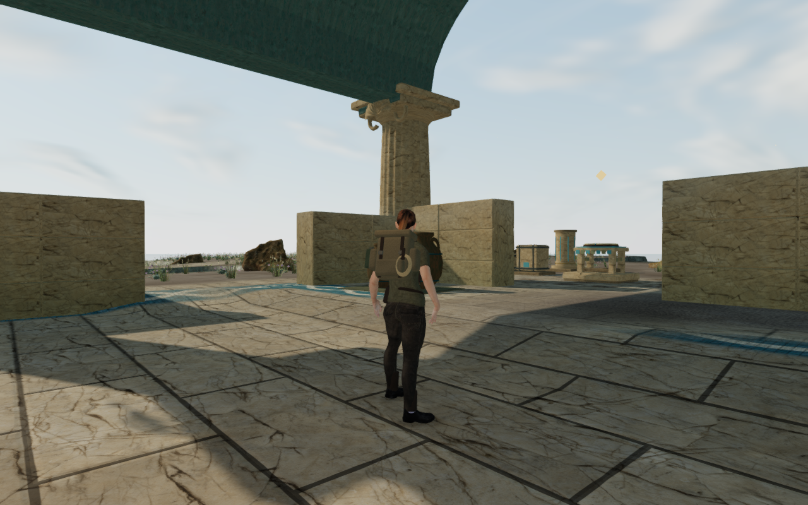
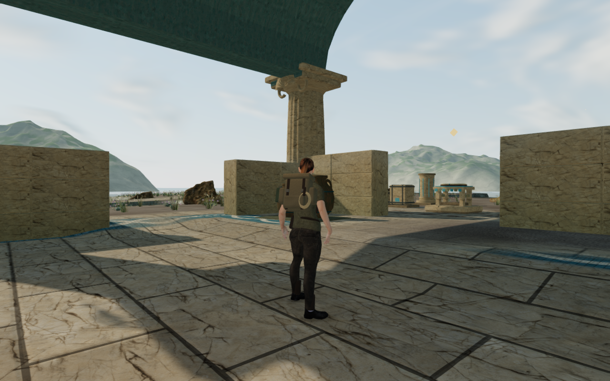
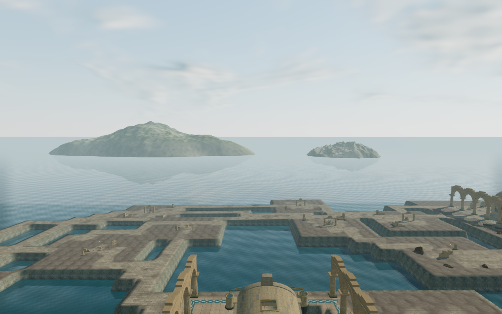

# Coastal islands and open sea

Eight distant islands now give the Drowned Kingdom a varied limestone horizon.
Their authored positions, sizes and orientations leave open sea channels between
low skerries and taller ridges. Eroded slopes, interrupted rock layers and patches
of scrub replace the previously empty backdrop.

These are actual 1280×800 High browser captures. The first pair retains the exact
player position, camera position and chosen look; the baseline hides the distant
islands. The third image uses an elevated inspection camera, not a walking route.
Progress is prepared, guardians are hidden and sound is muted. All three lossless
WebP exports preserve the exact decoded pixels and dimensions of their sources.

The islands sit entirely outside the playable map. They share one geometry and
one material, adding 73,728 triangles before the existing gameplay scene. Their
background depth is cleared before nearby terrain and architecture render. The
shader preserves the reflection camera's clipping plane, and the islands are
excluded from shadows, contact occlusion and gameplay collision.

A separate visual sea surface continues beyond the ordinary ocean rectangle and
camera far limit. It shares the existing water shader's wave, fog and reflection
uniforms, and draws only where the nearby sea ends. This adds 8,192 triangles;
the playable water volumes, excavated beds and movement bounds remain unchanged.
Both new surfaces hide when the camera submerges and return when it surfaces.

The initial island draft had bulky smooth cliffs and overly regular horizontal
bands. The revised field uses lower eroded ridges and broken strata. A boundary
audit then found apron edges reaching 9.04 m above datum; extending the sampled
field places every open boundary below sea level. Elevated browser views also
exposed the old sea's far-plane cutoff, motivating the sea continuation.

The geometry and shading code are original. Rock detail reuses the coastal
terrain's existing credited texture. No external asset or dependency was added.

## Verification

Twenty-nine selected tests cover the island geometry, submerged open boundaries,
background ordering, diving, water reflections, gallery visibility, existing
cloud-city rendering and rendering settings. All pass. The apron-boundary
regression fails on the preceding island field. The production build passes
with the existing large-chunk advisory.

The final browser review covers six supported ground-level views in both High
and Low, plus four High inspection overlooks. All sixteen captures are reviewed.
Player/camera positions and chosen look match the earlier ground-level references;
the observers remain grounded, legal and at full health. Shader linking, finite
High output and populated Low output checks pass without console errors or
warnings. The overlooks verify the repaired island bases and sea join.

During development, the sea extension first sampled its own reflection target,
then painted over the island slopes. It now hides during reflection capture and
blends before the opaque islands. Retained tests cover hidden/restored visibility
on successful and failed captures, and the required background draw order.

Immersion hides the islands and their sea child; surfacing restores them. Reload
and chapter change each dispose both geometries and both materials exactly once.
Reload reproduces the island positions, and the jungle receives no coastal
backdrop. Source hashes remain unchanged throughout the completed browser check.

Two production scenarios pass: desktop keyboard at 1280×800 in High, and touch
at 540×900 in Low, starting from prepared coastal saves. They exercise hydraulic
selection and transfer, crouching, movement, turning, jumping/landing and the map.
Eight whole-save reload comparisons retain earned state. All twelve production
captures are reviewed; the served bundles match the build, the development hook
is absent, and no console errors or warnings are recorded.

Verification uses the shared five-of-sixteen CPU allowance. Both browser phases
audit inherited thread affinity, close their browsers and preview servers, and
leave the phase's temporary runtime directory empty.

This improves the coastal backdrop. Broader ground composition, moving character
contact and the complete eight-chapter visual and listening review remain open.
Software-rendered captures do not establish consumer-GPU performance or AAA parity.
