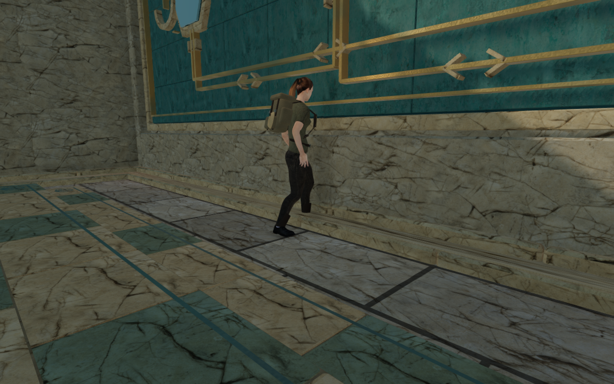
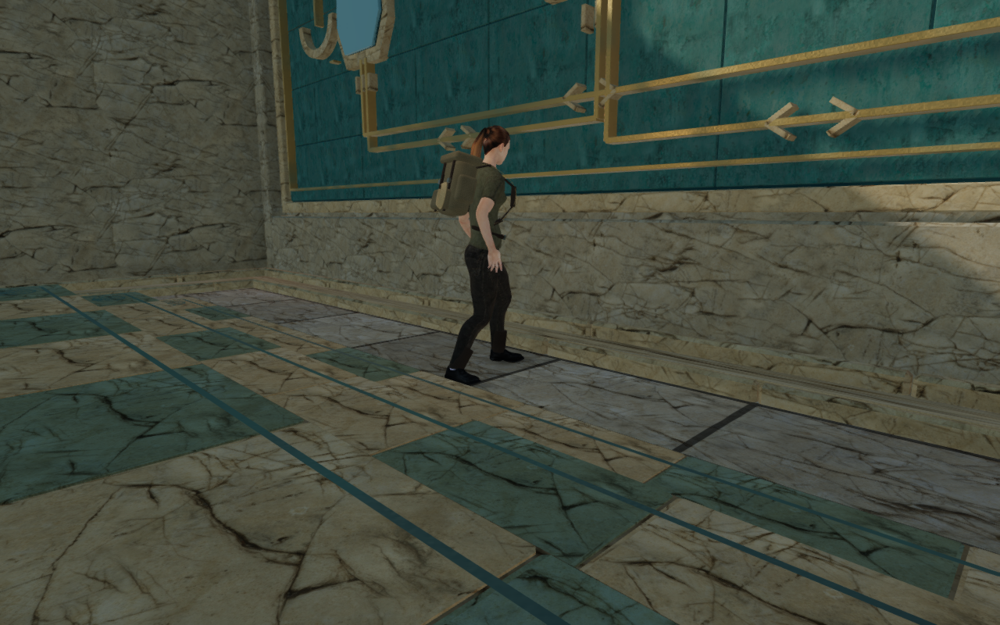
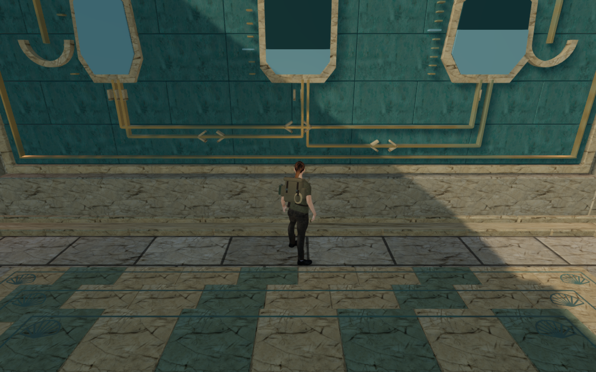
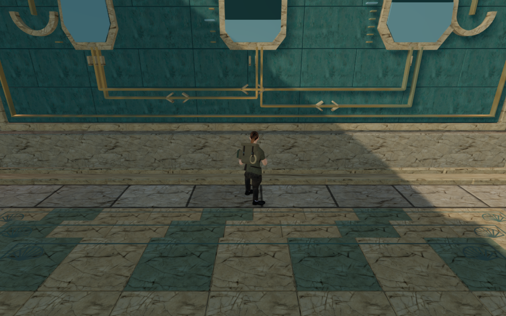

# Coastal foundation clearance

The explorer now stops before the low wall and jamb foundations in all nine
coastal sluice chambers. Standing and crouching use the same body margin; the
sampled supported poses keep clothing and footwear outside the closed stone.
Older saves at the recorded occupied boundary use the existing nearby recovery
search.

## Recorded defects and repair

At the preceding wall-record milestone, a legal standing root at world X=350,
Z=64.374 put clothing into the harbor chamber's rear foundation. Repeating that
pose against commit `5b57b52` found 658 embedded visible vertex records, reaching
72.15 mm. The earlier observation counted 659 records at the same maximum
depth. All twelve retained witnesses lie inside the actual closed foundation
core, below the new wall artwork.

A first 0.40 m body margin cleared this rear approach but left a genuine
diagonal crouch contact at the first chamber's western jamb: 866 footwear
records entered its low stone by up to 46.18 mm. The final shared margin is
0.65 m.

The old generic obstacles tested the player root. The repair uses 45 finite
field-station solid boxes around the 27 walls and 18 jambs, including their
buried foundations. They protect the posed body and have no walking support
surface. Their upper and lower bounds remain finite. No visible construction,
material, gate leaf, sound source or save schema changes in this repair.

## Independent body inspection

The observer reads the delivered merged render triangles and actual instance
transforms. A material batch may include both closed masonry and open shell
ornaments. Feeding that whole batch into a closed-volume winding test produced
a false east-wall contact, with reported witnesses approximately 70 cm from
the closed wall face.

`closedComponentMeshes` now groups triangles by shared geometric edges and
retains components with balanced oriented edges. Quantization identifies seams
without changing the retained world coordinates. Instance matrices expand
before classification. Open ornaments are reported and omitted from this
closed-solid test; their surfaces need separate visual review.

Calibration retains all twelve genuine foundation witnesses at their original
depths, while rejecting all twelve retained false east-wall witnesses. Three
focused tests cover the mixed open/closed batch, transformed instances and
touching closed blocks. This observer never consults the gameplay movement
kernel to decide whether a body point is inside rendered stone.

## Verification

- All 61 selected sanctuary-gate, hydraulic, counterweight and field-station
  solid tests pass. They include all eight counterweight puzzles through actual
  walking and grip motion, all 36 hydraulic controls, 157 solution transfers,
  finite wall bounds, the recorded rear approach and nearby save recovery.
- All 69 full gate geometry sets, 69 leaf sets and 69 drive-source sets match
  their preceding hashes. Only the nine coastal gate-generated obstacle
  snapshots intentionally change; the visible models remain identical.
- All 184 final body poses have zero embedding beyond the 15 mm inspection
  tolerance in 8,849,480 visible vertex records. High covers all 45 static
  pieces, facing toward and away while standing and crouching. Low repeats
  four harbor rear-wall poses. Each sampled root is legal and supported.
- All 90 assisted local route legs finish through the nine chambers and their
  tablet/pump approaches, using ordinary player and follow-camera updates.
  They cover 914.72 m and 13,732 controller frames. All 99 High endpoint/start
  captures are reviewed; recorded roots are legal and grounded, health remains
  100, and shaders and HDR samples pass. Completed progress and hidden guardians
  isolate these local movement checks; this is not a continuous chapter
  playthrough. The supervisor closes at its 40-minute deadline after 82 legs;
  a second owned run resumes the remaining eight from the captured endpoint.
- All 36 control neighborhoods, 27 pump sight lines and mounted wheel anchors
  pass. Radial probes around 72 actual emitters compare the same scene with
  current and reconstructed preceding coastal bounds: all 139 previously
  available dry distance ranges retain an approach. The margin removes some
  individual positions near stone. All 27 pumps and 18 gate drives retain at
  least two clear approaches with positive, decreasing distance gain.
  Direct outlet sight lines are often blocked at the sampled idle water heights
  with both bounds; eighteen outlets have none at the three tested radii.
  This does not establish their active-flow mix or audibility: occluded voices
  are filtered and attenuated rather than necessarily silent. Those states and
  actual listening remain under review.
- The production build passes. Its existing large-chunk advisory remains.
- All three CPU-guard tests pass. Verification workloads and their native
  threads share a locked five-CPU allowance on this sixteen-CPU sandbox, with
  lower scheduling priority. Browser thread audits retain that shared set.
- The rebuilt release passes keyboard/High at 1280 × 800 and emulated portrait
  touch/Low at 540 × 900. The keyboard case uses a touch-capable browser.
  Selected pump sources and an earned I-to-II transfer of 3 / 7 / 0 units
  survive reloads; movement, crouch, chosen look, jump/landing and map access
  pass without viewport overflow. Two additional occupied-save cases recover
  0.75 m from X=350, Z=64.374 to Z=65.124, preserving the chosen yaw/pitch and
  progression, then walk and reload again. All twelve paused whole-store reload
  comparisons match except `lastPlayed`; all sixteen release captures are
  reviewed. Sixteen model responses match the delivered GLB hash, loaded
  bundles match `dist/`, and the production development hook is absent. No
  HTTP, page or application console errors are reported.
- Each owned browser and server closes after its check. Both verification
  ports are closed and the staging runtime directory is empty at publication.

The sampled poses and local input checks pass. They do not establish clearance
for all moving, airborne, underwater or interacting body faces. Wider palace composition,
continuous campaign routes, listening and device coverage remain open.

## Contact views

The standing inspection pair uses the same relative lateral camera placement,
with the current explorer farther from the foundation. These are construction
inspection cameras. The follow and crouch images use the game's walking
camera. All four images are actual High game captures, encoded as lossless
WebP with decoded pixel and dimension parity against their source PNGs.

No external model, texture, recording, score or dependency was added. Existing
character, palace material and environmental attribution applies. This pass
does not establish human playthrough duration, subjective audio quality,
consumer hardware performance or full-campaign visual acceptance.
