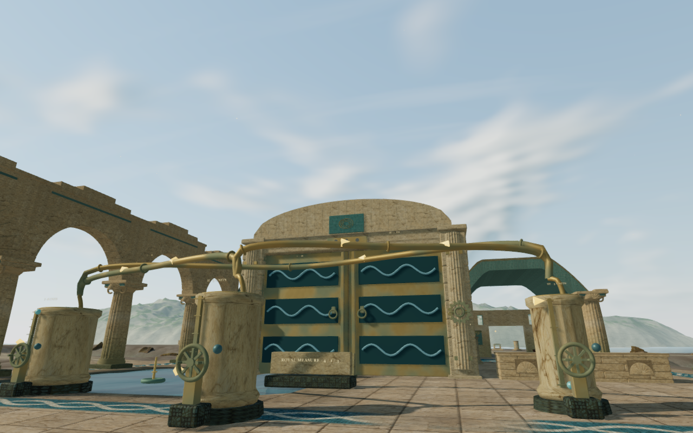
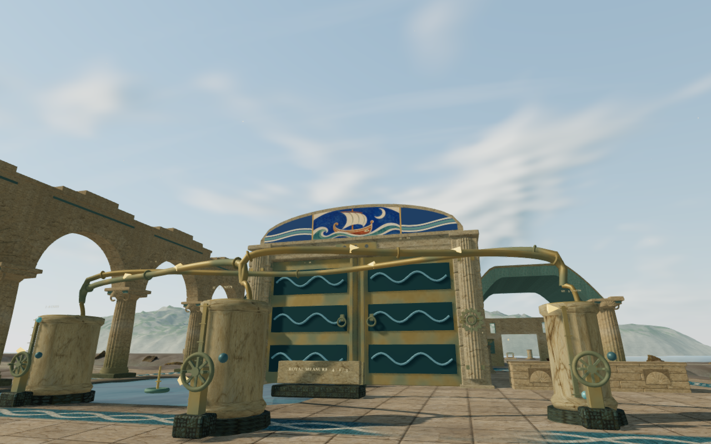
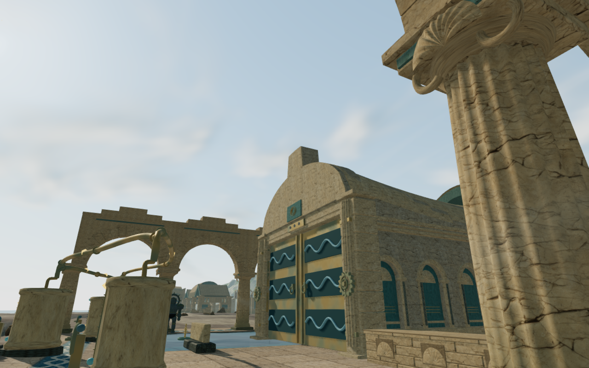
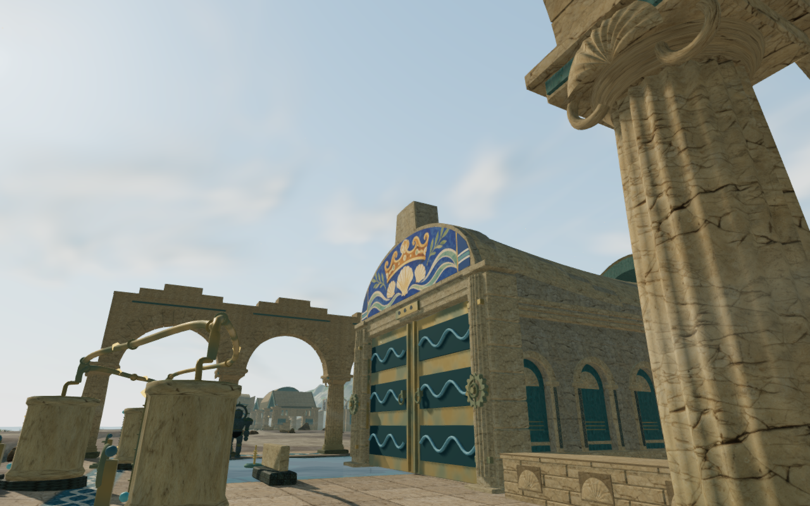
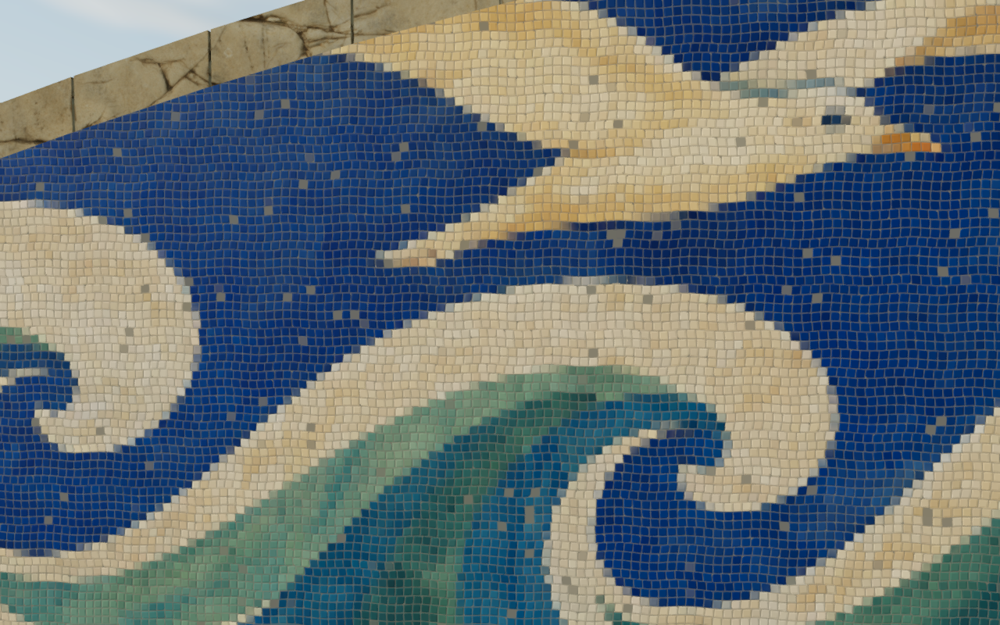

# Maritime pediment mosaics

The nine coastal gate pediments now carry different maritime scenes: a sailing
boat, balanced harbor vessels, coral, returning tides, an aqueduct, dolphins,
the coastal crown, stored measures and an opening sea gate. They give the
working courts more visual identity above the existing blue sluice doors.

One original atlas was generated for this project with OpenAI's built-in
`image_gen.imagegen` tool, without reference images. The [source record and
final prompt](../asset-sources/coastal-pediments/sources.json) retain its
provenance. The playable [2172 × 724 atlas](../public/assets/art/coastal-mosaic-atlas.webp)
is a 2.29 MB lossless WebP; decoded source and delivery pixels match.

The material shades 3.2 cm stone and glass tesserae with uneven spacing,
selected chipped corners, quiet glaze and exposed mortar. Pixel derivatives
fade the small detail with distance. Shallow pediments receive wave bands
beside a central scene whose proportions stay intact. The existing stone
shoulders, towers and restoration lights remain in place.

These complete before/after game captures use the same numeric camera/player
positions and fixed scene time. Their exported WebP figures retain the source
PNG dimensions and decoded RGBA pixels.

## Construction and rendering

Each field follows the delivered front's straight contour segments, with a
22 cm upper margin. Its closed mortar bed overlaps the continuous masonry
backing and projects 26 mm beyond the dressed face. The camera uses the field's
convex planes, preserving the real air above the low curved corners. Movement,
sight and roof support use the delivered triangles.

The nine fields share one texture and one material. Each roof adds one material
draw, taking its bounded material count from four to five. Replacing the old
small plaque and three rings reduces the roof geometry by 9,660 triangles in
total. These counts describe resource changes and do not establish frame rates.

This is an elevated material inspection within the current scene. Normal and
roughness detail shades the tesserae on the fitted panel surface.

## Verification

All 120 selected regressions across fourteen files pass, including coastal
vaults, gate motion, hydraulic state, startup, camera clearance, palace art and
lights, arrivals, material presets, campaign state and sound behavior. Three
CPU-guard checks and the production build also pass. The existing large-bundle
advisory remains.

The geometry regression checks 285 front-vertex seating probes against actual
backing triangles. Moving each field outward detects all 285 lost-contact
controls. Another 1,008 zero-radius camera rays agree with the rendered fields,
including 320 misses in the empty upper corners. Closed winding, finite
attributes, genuine roof openings and more than 150 existing roof-support
observations remain covered.

A factory comparison across all eight chapters retains the other seven gate
assemblies exactly. In the coastal gate factory, all 170 surrounding non-vault
meshes and 6,410 retained roof pieces keep their geometry, transforms and
material properties. Drive-source records, all eighteen leaves and normalized
progress match the preceding implementation.

A fragment-program diagnostic checks the selected atlas cell across all nine
fields: 188,324 visible pixels retain the expected cell. Restoring unrounded
interpolation selects the wrong cell in 12,750 pixels. Rounding the categorical
index before decoding its row prevents the observed horizontal image bands.
The existing ground-cue shader decoration remains in use.

The development review includes nine preceding views and 22 current captures.
The court, nearby, follow-camera and preset views are reviewed in labeled
sheets, and four close/grazing material studies at capture resolution. The
normal follow views retain a visible, opaque explorer at legal positions.
High, Medium and Low settings are included; intervening plumbing still obscures
parts of some close fronts. Buffer and program checks report no GL errors.
Replacing the chapter disposes all nine field geometries, the shared material
and the atlas once, without retaining the old map in the next world.

The production build was exercised with keyboard and simulated touch in
isolated runs against the same frozen assets. Both use Low quality, a 360 × 600
CSS viewport and 0.5 device scale, producing 180 × 300 captures. Selecting a
cistern, transferring water to `3 / 7 / 0` and moving the explorer each survive
a complete-store reload comparison: six comparisons in total, ignoring only
`lastPlayed`. Recorded movement is 1.5 m with the keyboard and 2.1 m with touch;
health remains full. All eight production captures are reviewed.

The served script/style set matches the build, the atlas response matches the
recorded delivery hash and the development hook is absent. No browser errors
or unexpected warnings are recorded in the accepted input cases. These checks
cover the sampled interactions and saves; they do not establish continuous
performance or a complete human playthrough.

## Remaining work

This improves one visible coastal surface family. Repeated pump and gate
arrangements, broad court massing, sparse margins and wider continuous
geometry/body contact remain under review across the eight worlds. Continuous
timing and listening/device acceptance also remain open. Verification audio
is muted; these checks do not establish subjective sound quality or AAA graphics.

All work uses the locked shared 5/16 CPU allowance, at most two test workers and
one browser. Expensive checks run sequentially, and owned browsers and preview
servers close afterward. Private captures, profiles, saves, raw generation
output and installed dependencies remain excluded from publication. Existing
[asset attribution](asset-credits.md) is retained.
