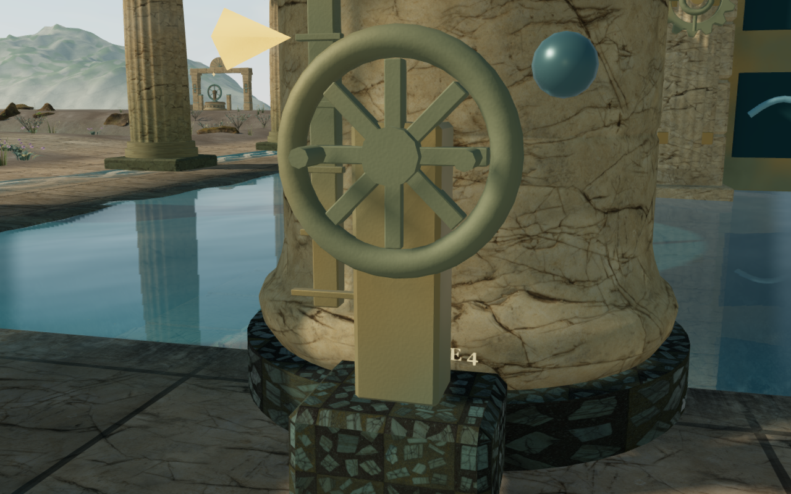
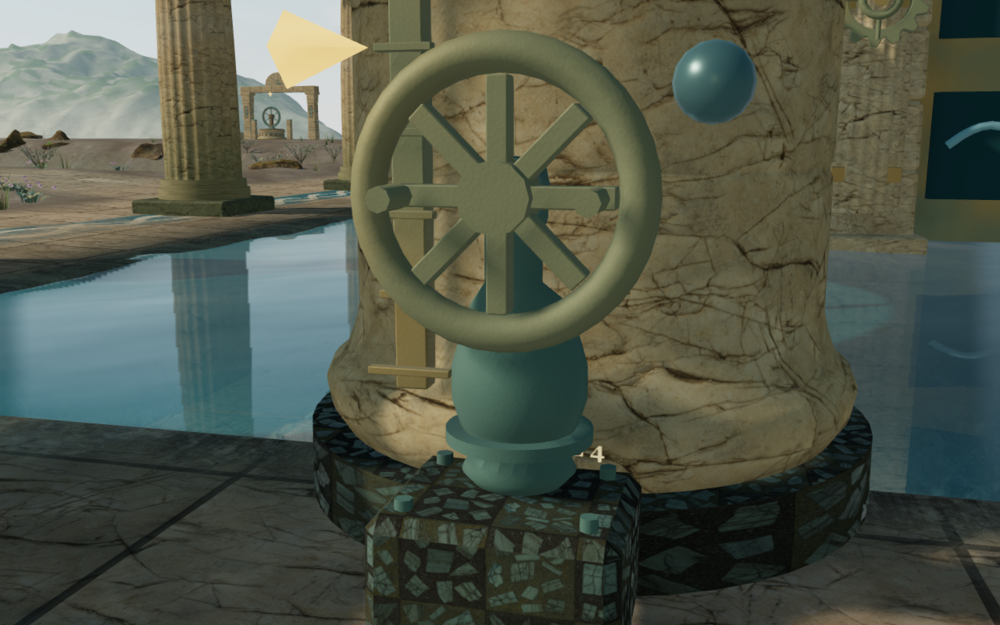
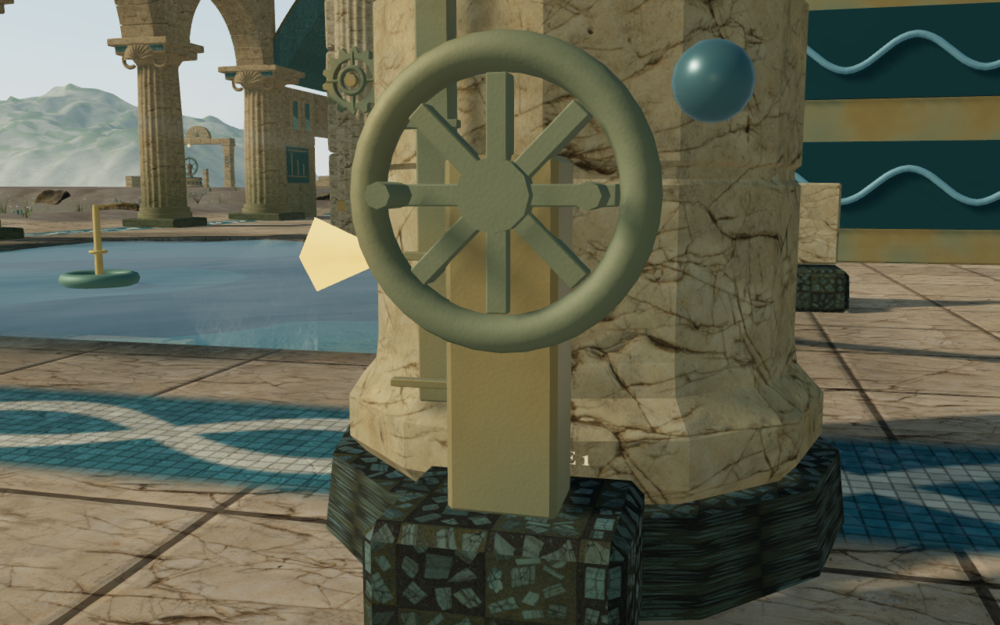
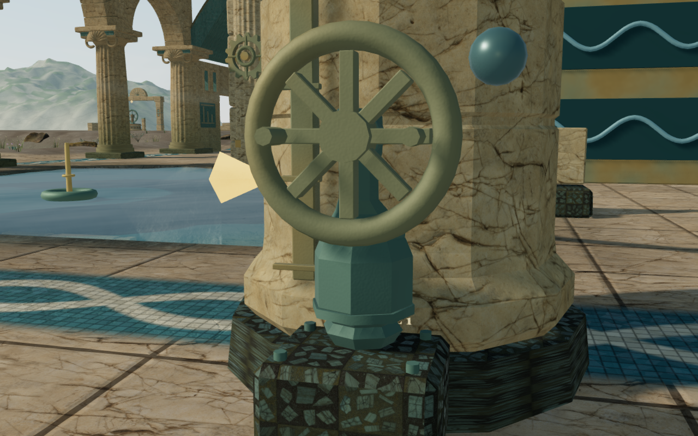
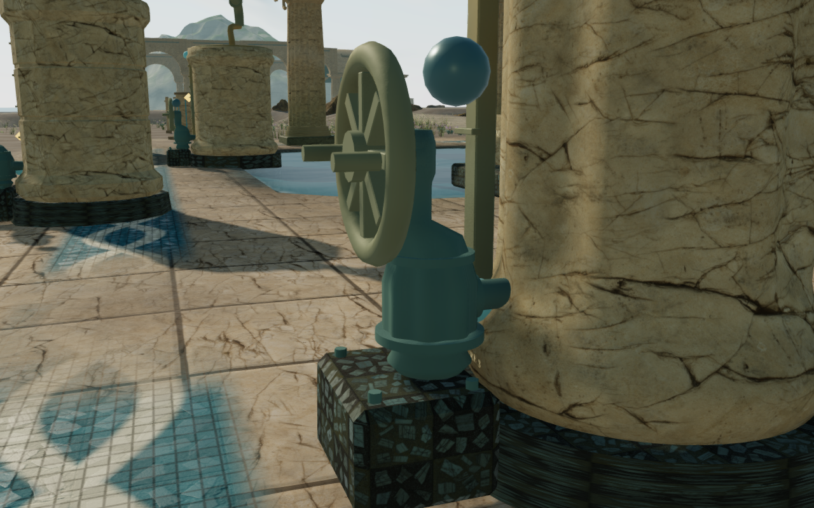
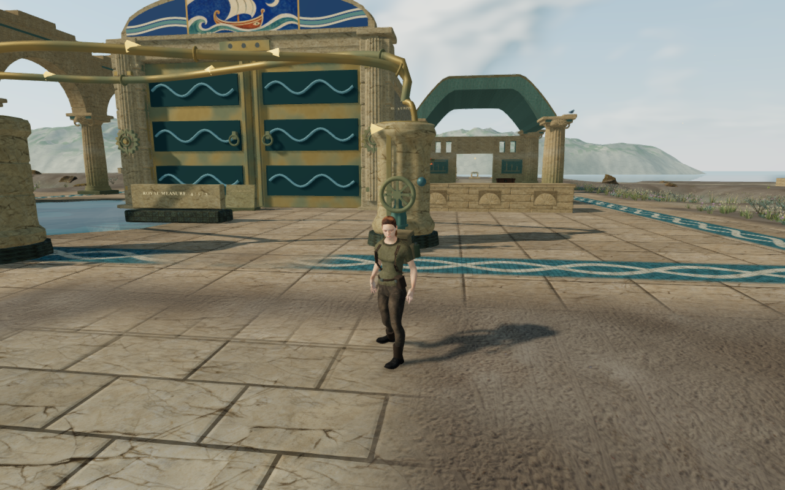

# Coastal pump castings

The 27 cistern handwheels previously stood on identical rectangular bronze
posts. Their new castings have round, octagonal and fluted barrels, joint
flanges, four mounting bolts, a bearing and axle, and a short rear connection
entering the cistern wall. A shared darker bronze finish distinguishes the
casings from their retained handwheels.

The pairs retain identical numeric player and camera positions, scene time and
High settings. All six documentation images preserve the complete 1280 × 800
capture pixels and dimensions after lossless WebP conversion.

## Construction and placement

The barrel sits behind the rotating rim and spokes; its short axle joins the
existing hub. The low body stays within the existing pump and adjoining tank
body reservations. The upper neck fits the former post's envelope. The wheels,
grip anchors, plinths, gauges, pipes, controls and positional sound origins keep
their recorded positions. Construction retains the removed post's seed step,
so later stonework keeps its previous variation.

The first casting draft exposed an actual support defect. Its wide foot
overhung the stone plinth's beveled rear edge, leaving some underside points
as much as 13.5 cm above the next surface. The final bearing footprint is
narrower and the bolt heads sit deeper. An independent browser observer finds
support at all 2,007 underside records across the 27 delivered castings; the
least-buried point sits 4.68 mm into the actual stone top. A retained regression
raycasts sixteen differently chipped plinths and reproduces the former wide
foot's overhang.

Each casting uses one geometry and the same shared material. Its continuous
body and attached closed flanges, pipe, bearing, axle and fasteners are merged
before delivery. Temporary construction geometries are disposed immediately.
The castings add 27 material draws and replace 1,188 post triangles with 55,872
casting triangles across the whole chapter. The material reuses the existing
filtered bronze weathering shader; no external asset or dependency is added.
These counts describe rendering cost and do not establish frame rates.

## Verification

All 63 selected tests across eight files pass, together with three CPU-guard
checks and the production build. The existing large-bundle advisory remains.
The new regressions cover finite geometry attributes, closed surfaces,
outward volume, existing body reservations, actual plinth support, and rim
and spoke clearance through sixteen wheel phases. The intended axle/hub
connection is retained.

The hydraulic suite still executes all 157 transfers in the nine authored
solutions, preserves access to all 36 controls, and covers saved selection,
transfers, paused presentation, float height and distance-sensitive sources.
Camera, startup, rendering settings, water sound, audio and campaign checks
also pass.

The delivered-buffer observer casts 3,456 rays across four heights around
every pump. All meet the new bodies within their expected range. All casting
attributes are finite, and every pump sound origin lies outside its casting's
bounding box, with at least 12.2 cm clearance. Numeric mechanism observations
match the preceding world: body reservations, hydraulic source descriptions,
site/tank transforms, pipe paths, handwheel/grip positions, nozzles and controls.

The final visual review covers three preceding views and thirteen current
views: three matched close studies, three side studies, Medium and Low
repeats, one court view, three controller follow views and a crouch. The three
matched current close views and the published side view are also reviewed at
full capture resolution; all views are inspected in labelled comparison
panels. Observed programs link,
render buffers remain finite and no GL errors are reported.

Three local controller walks and the recorded crouch retain legal body and
camera positions, full health and character opacity 1. Chapter replacement
disposes all 27 casting geometries and their shared material once, retaining
none of those resources in the next chapter.

Two isolated production cases pass a keyboard hydraulic transfer to
`3 / 7 / 0` and simulated-touch movement of 2.1 m. Each state survives one
complete-store reload comparison, ignoring only `lastPlayed`, with full health.
The cases use Low quality at a 360 × 600 CSS viewport and 0.5 device scale.
Four 180 × 300 captures cover the transfer, pause and restored-world views.
Served scripts and stylesheet match the build hashes, and the development hook
is absent. Accepted cases record no browser errors or unexpected warnings.
Verification audio is muted; this does not establish subjective sound quality.

This improves one repeated machinery family. The large court installations,
terrain forms, material repetition and wider continuous contact, listening and
device acceptance remain open. Commands share the locked 5/16 CPU allowance,
with at most two test workers and one browser. Test browsers and preview servers
close after verification; private captures, profiles, saves, toolchains and
generated builds remain excluded from publication.
