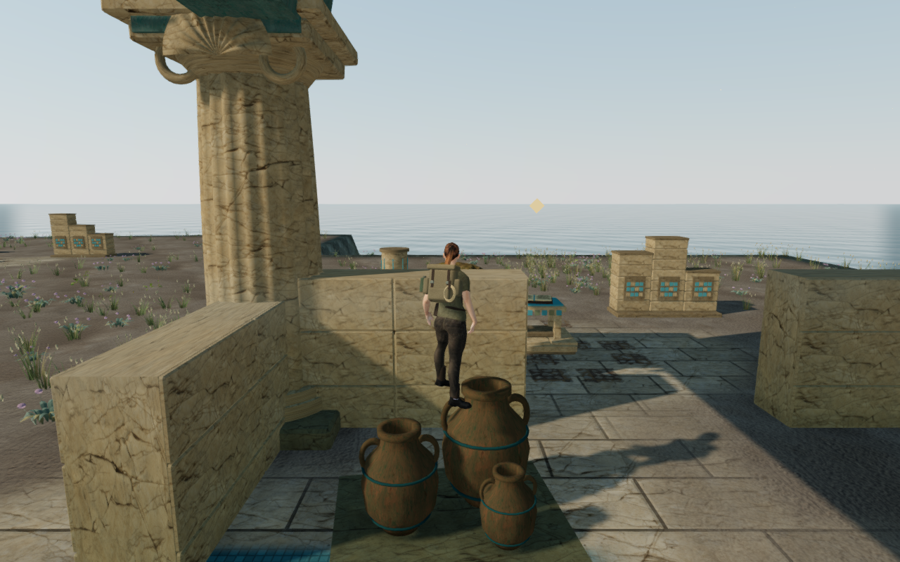
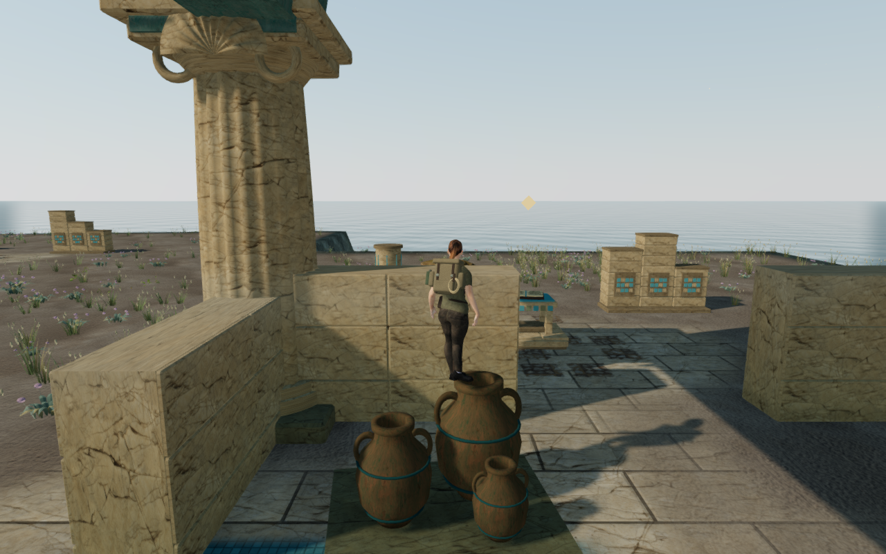
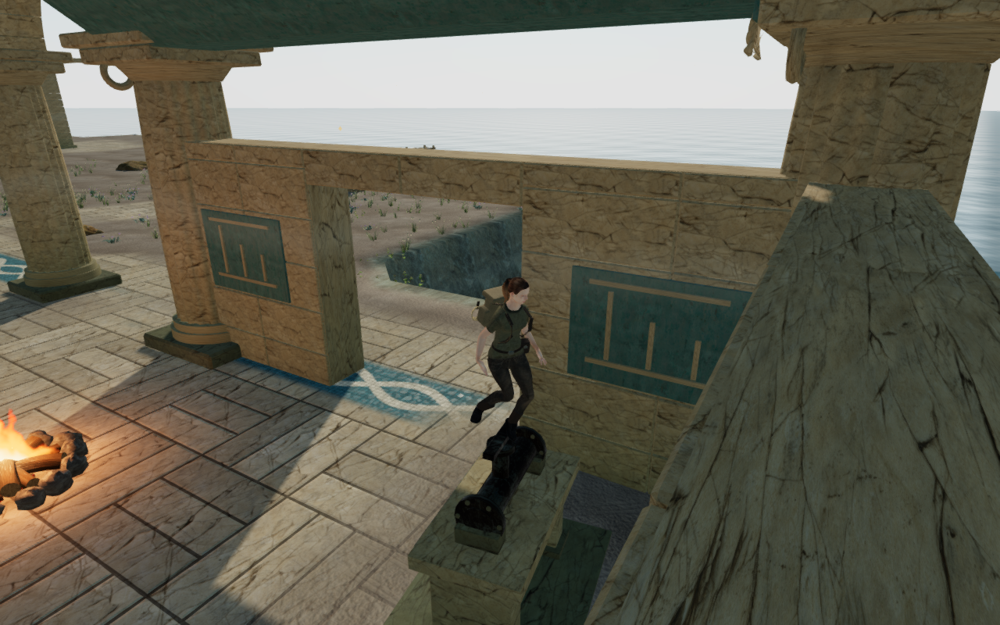

# Coastal furnishing contact

The elevated-contact review found two defects missed by the earlier ground-level
furnishing checks. Of 96 raised standing/crouched poses, 42 reported grounded
while both boots missed the rendered surface. Seven poses embedded trouser fabric
more than 15 mm in benches, a filter or pipework, reaching 31.855 mm. Some poses
had both defects. These are sampled findings, not exhaustive chapter coverage.

An ordinary falling approach also reproduced the quay-jar hover in four cases.
The controller caught a neighboring jar rim while the visible boots stayed beside
it. Requiring support directly beneath the root exposed a second problem: the
narrow support footprint could drop the wider body into gaps between parts.
Forty-four original poses then finished inside a collision margin. That approach
was discarded before publication.

## Support and pose fitting

The twenty furnishing assemblies now use a 0.65 m support footprint matching
their side collision margin. A resting-foot adjustment projects the nearer ankle
onto a real upward triangle close to the supported height, within a 0.55 m
horizontal reach. It aligns the boot with that tread and retains the target while
the root, facing and reach remain stable. Hollow rims use their actual faces.

This changes the visible limb pose without moving the gameplay root or saved
position. Crouch fitting reads nearby raised support as well as terrain, retaining
ankle targets and keeping the visual pelvis below the standing height limit.
Grounded height changes must clear the collision body; descending contact uses
the full side margin and checks support again after correction.

A first browser pass exposed another problem: on the archive scroll stack and
vessel, a planted boot still left the torso hanging beside it. The pose now carries
the visual hips toward the supporting ankle when only one foot has support, with
a bounded 0.60 m shift, collision clearance and a small bend in the free leg. It
blends out through walking and takeoff without moving the gameplay root. Sixteen
focused browser poses pass across the jar, scrolls, vessel and pipe; all sixteen
captures have been reviewed. A measured 54 cm lateral takeoff snap is corrected
by easing the visual offset; the retained regression limits the first frame's
lateral hip displacement to 15 cm. The production keyboard and touch checks also
land back on the jar after an ordinary jump. These selected checks do not cover
every moving or airborne contact.

The furniture artwork, material batches and camera bounds are unchanged. The
repair adds no external assets or dependencies.

These are actual 1280×800 High browser captures with prepared progress, muted
sound and guardian simulation disabled. The jar comparison reuses the original
player root; visual fitting changes the body pose. The lossless WebP exports
preserve each source image's decoded pixels and dimensions. They illustrate
selected resting poses, not full chapter acceptance.

## Verification

The current code passes a 236-pose delivered-character survey with actual sole rays
and independent closed-render containment. The integrated code passes twenty-three
retained character poses, including standing/crouching transitions with a cached
foothold, plus real hollow-rim projection and retained walking-exit regressions.
The root stays at the requested coordinates during visual fitting, and the visual
origin stays below the standing height limit.

Before the visual balance addition, the full suite ran 1,015 checks: 1,014 passed
and one old failure-control assertion failed. That observatory test deliberately
disables a column cap and expected the
character to finish embedded beneath it. The revised descending contact instead
clears the side and lands on legal soil. All 32 ordinary supported jumps passed.
The control now verifies the safe soil landing, the disabled support and the real
cap still covering the original target. All six observatory tests pass after that
test-only correction. The controller is unchanged from that run. After the
balance and takeoff changes, all 69 affected character, terrain, camp, landing and
foothold tests pass. This is an affected-suite result, not a second full-suite run.

The controller survey passed 39 roots in both stances and sixteen directions,
including collision checks through stopping. The production build passes. Before
the takeoff blending change, the focused balance browser pass checked 769,520
visible body records with no contact findings, linked shaders and finite High
output. Its owned resources closed and both preview ports were released.

The current production build passes six native-input scenarios, using desktop
keyboard/High and portrait touch/Low. Sixteen save comparisons preserve the chosen
look, chapter progress and supported positions. The hydraulic puzzle restores
both its selected source and its committed transfer. Two old saves whose positions
are occupied by the new storage jars recover 0.75 m to clear ground. Two elevated
jar saves retain their original positions, complete a jump and supported landing,
then move 0.50 m before saving again. All 22 successful production captures are
reviewed; no interface overflow or character/furnishing overlap was observed in
those views. There were no browser errors or warnings, and the browser and preview
closed after the check.

The final browser replay passes all 96 original raised poses. It covers both
stances and two facings on all twenty settings in High, with four settings
repeated in Low. None of the 4,617,120 visible body records is invalid or embeds
more than 15 mm in the furnishing. Each pose finishes legal and grounded without
character fading, with at least one sole within 30 mm of a rendered surface and neither
sole penetrating more than 15 mm. All 24 contact captures and four direct Low
framebuffer captures are reviewed. Captured High output is finite; the four Low
framebuffers are populated, shaders link and GL reports no errors.

The completed replay has no browser errors or warnings. Source hashes remain
unchanged throughout the final production and contact checks. Both preview ports
are released, browser descendants are closed and the temporary runtime directory
is empty. Earlier reports remain private; the model and browser checks use
prepared game state and do not establish campaign-wide visual or listening
acceptance.

Private fixtures, captures and reports remain under ignored `local/staging/`.
Verification shares the locked five-CPU allowance, uses one browser at a time
and closes owned resources after each check. Broader moving/airborne contact,
campaign composition and listening acceptance remain open.
