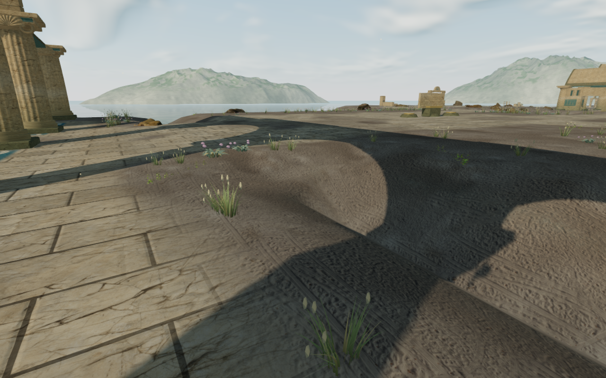
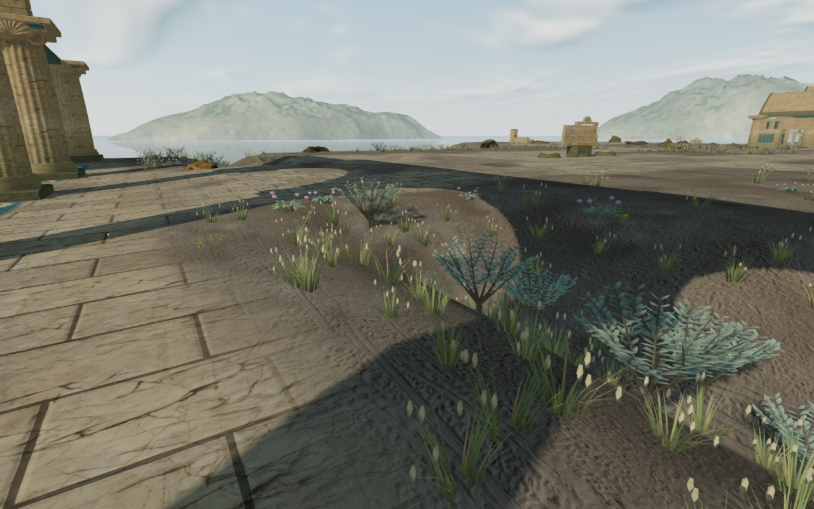
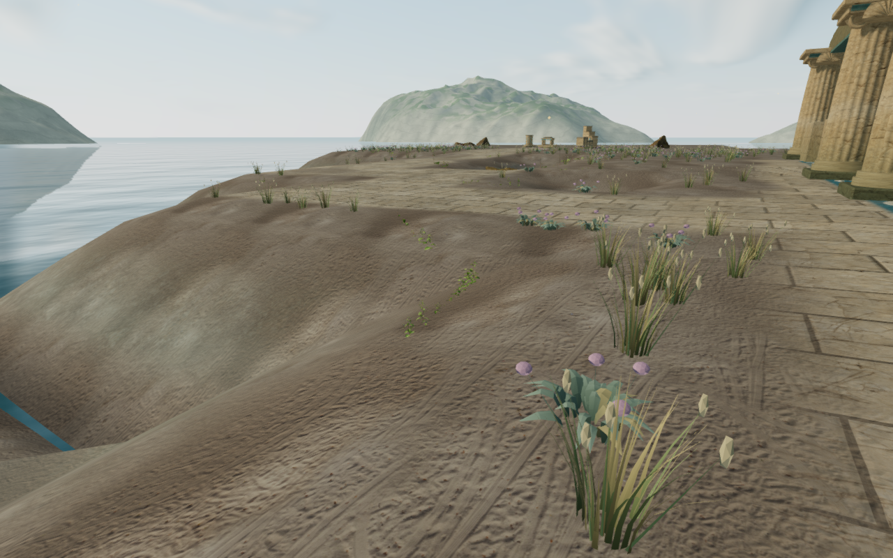
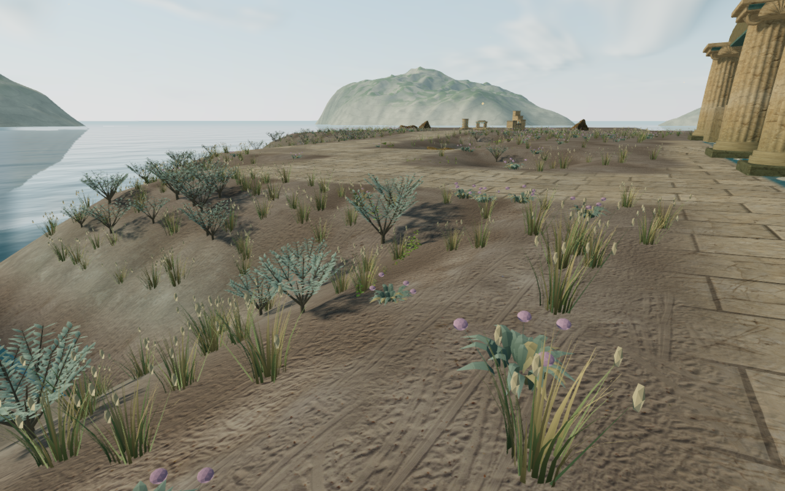
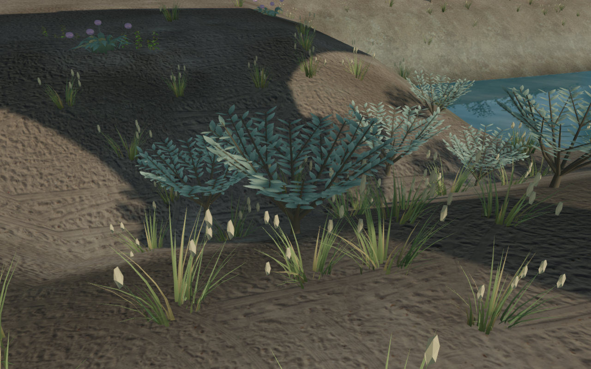
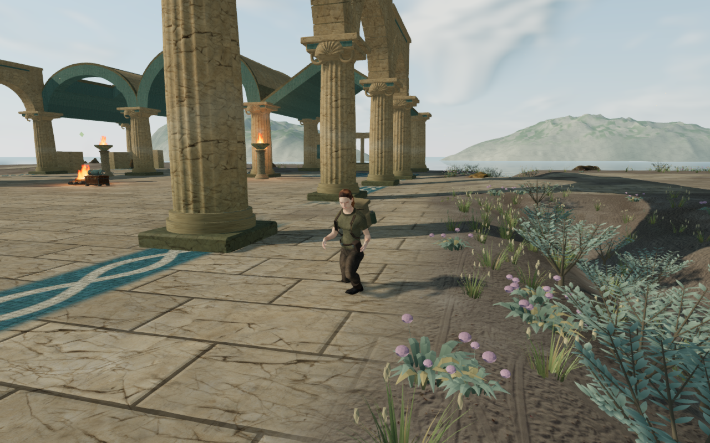

# Coastal shore growth

The dry banks beyond the palace paving had almost no vegetation. The previous
planting rule discarded every candidate outside the walking grid, including
the visible shoulders between the court and the sea. A narrow shore fringe
now carries salt grass, seed stems, flowering cushions and silver saltbush.

These are controlled component comparisons in the same world. The preceding
published planting component is rebuilt for the before views; all 15,598
original plant transforms match its earlier captured output exactly. Both
versions use identical numeric observers, scene time and High settings. The
documentation images retain their complete 1280 × 800 capture pixels after
lossless WebP conversion.

## Planting and geometry

The new fringe extends at most five metres beyond the actual seven-metre
walking-cell footprints. Existing paving, hydraulic work areas, routes,
architecture, discoveries and rock reservations still constrain placement.
Shrubs require their whole conservative spread to stay off the walking cells,
with additional dry-ground and slope checks. The coastal world contains
30,182 plants across 397 instance patches: 14,584 new shore plants, including
2,371 shrubs, plus the original 15,598 plants at unchanged transforms.

The original saltbush geometry has eight branching arms and 384 leaves arranged
in pairs. Three distance tiers retain progressively fewer leaf sections and
paired leaves, sharing a rooted woody structure, muted silver-green vertex
colors and the existing wind material. Shrubs cast shadows; the small grasses
retain their existing shadow behavior. Conservative patch bounds include the
larger shrubs and wind displacement.

Shore plants use the rendered terrain triangles for seating. The movement
height sampler blends all four cell corners; on a saddle that blend can fall
below the visible diagonal and bury the lower branches. A separate shore
sampler follows the delivered triangle split. Woody plants also have a tighter
root-height spread limit than flexible grass. The shared seating helper keeps
its previous default for other plants and chapters.

The revision adds original project geometry and placement code, with no new
external assets or dependencies. Existing [asset attribution](asset-credits.md)
continues to apply.

## Verification

All 106 selected tests across seventeen files pass, together with three
CPU-guard checks and the production build. The existing large-bundle advisory
remains. Regressions include independent triangle raycasts, a narrow ridge
that rejects an excessively buried woody stem, walking-footprint clearance,
root and wind bounds, determinism, disposal, shared plant callers, hydraulic
behavior, camera, startup, settings, campaign and audio.

An observer reads the actual delivered terrain buffers and Float32 instance
transforms. All 2,447,016 new root records have support, stay buried and pass
the placement reservations. Across all three shrub tiers, 107,109,925
represented vertex/wind queries find no missing terrain, buried above-root
geometry or walking-cell intrusions. Identical position/bend tuples are
queried once; the intentionally buried lower 10 cm root zone is excluded from
the branch-clearance check. Minimum measured branch clearance is 6.89 cm,
walking-footprint clearance 23.08 cm, and root clearance above the maximum
modeled sea surface 50.54 cm. These are recorded-scene checks rather than a
proof of every continuous animation state.

The final visual review covers four preceding views and twelve current views:
four matched High bank studies, two shrub close studies, Medium and Low
repeats, and four controller-settled standing/crouching frames. Wide and preset
views are reviewed in labelled 640 × 400 comparison panels; both shrub close
studies and the published crouch frame are also reviewed at full resolution.
The close-view observer confirms the selected shrub is actually present in
the uploaded High-tier draw. Observed programs link, render buffers remain
finite, and no GL errors are reported. Early static captures used foliage
culling from the previous camera; the final captures correct that inspection
order. The application's frame order already updates the camera first.

Two local controller walks cover 5.856 m over 140 updates with legal body and
camera positions, health 100 and character opacity 1. Both recorded crouches
also retain those checks. An early inspection helper used the wrong crouch
key; the corrected run invokes the actual crouch action. Chapter replacement
releases all 3,586 tracked coastal-cover resources once, retains none in the
next chapter, and removes the coastal-cover component.

Two isolated production cases pass a keyboard hydraulic transfer to
`3 / 7 / 0` and simulated-touch movement of 2.1 m. Each state survives one
complete-store reload comparison, ignoring only `lastPlayed`, with full health.
These use Low quality at a 360 × 600 CSS viewport and 0.5 device scale; four
180 × 300 captures cover the transfer, pause and restored-world presentations.
The served scripts and stylesheet match the final build hashes, and the
development hook is absent. Accepted cases record no browser errors or
unexpected warnings. Verification audio is muted.

Some shoulders remain bare where terrain and architecture reservations reject
plants, including parts of the later recorded court studies. Broad
terrain forms, material repetition, court massing, machinery variety and wider
continuous contact remain open. Listening and device acceptance remain open;
these checks establish neither consumer frame rates nor whole-world completion.

Commands use the shared locked 5/16 CPU allowance, at most two test workers and
one browser. Browsers and preview servers close after verification; the final
process audit finds no remaining test browser or project verification worker.
Private captures, profiles, saves, toolchains and build output stay excluded.
