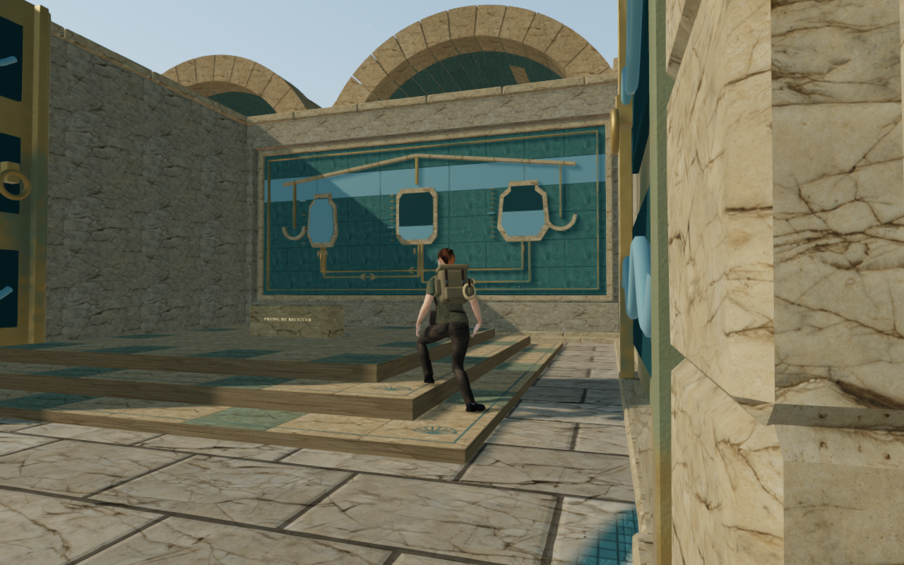
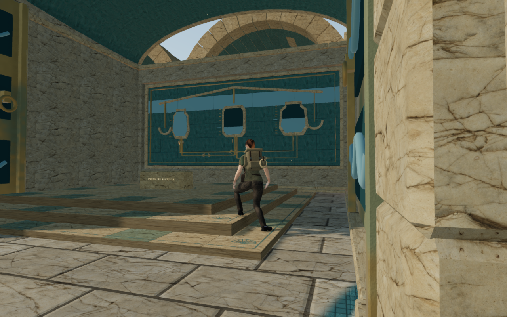
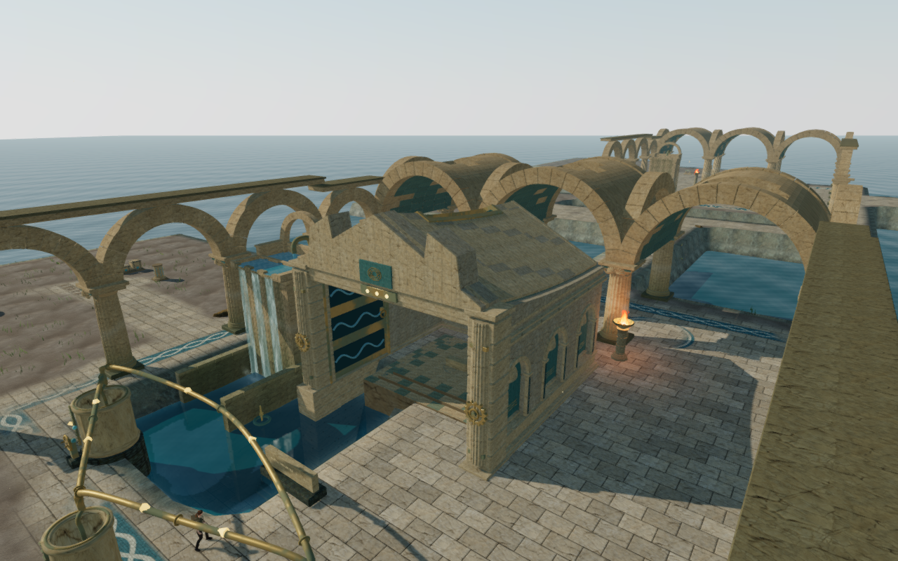
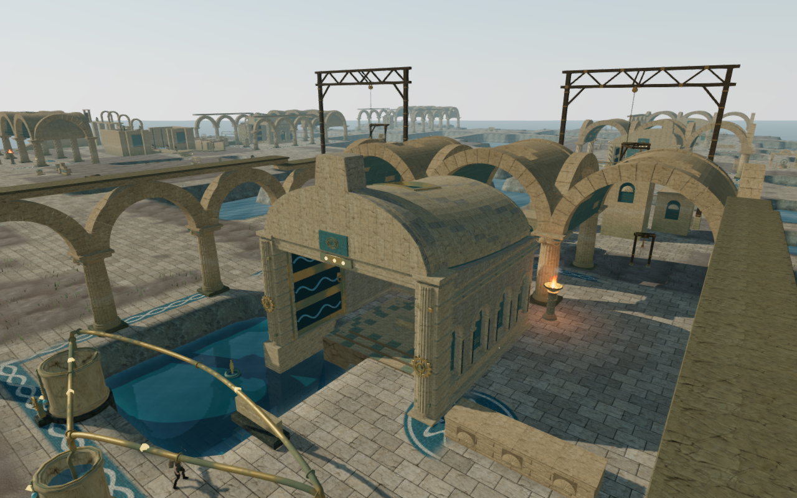
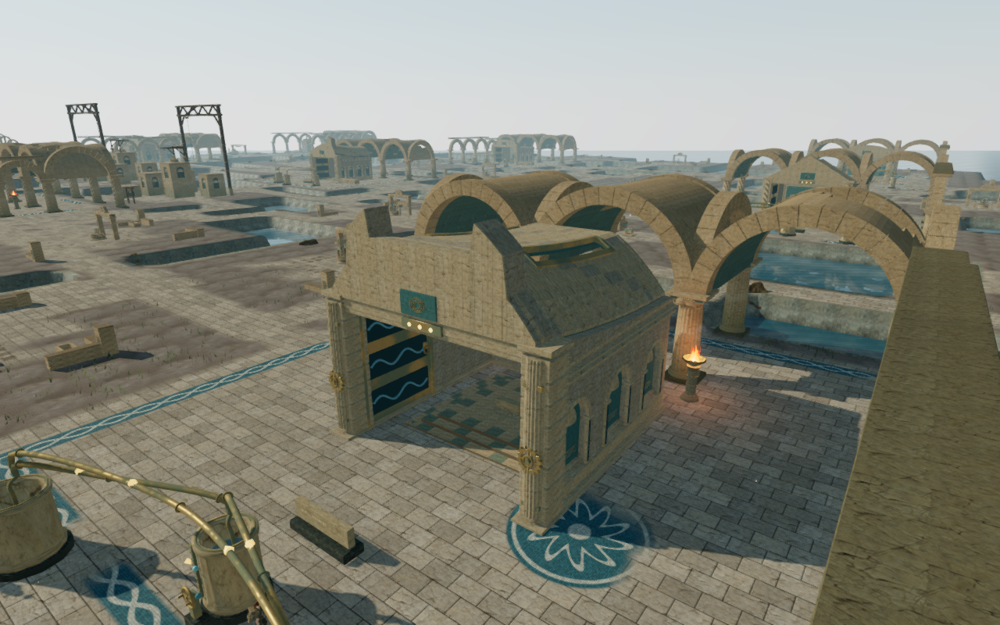
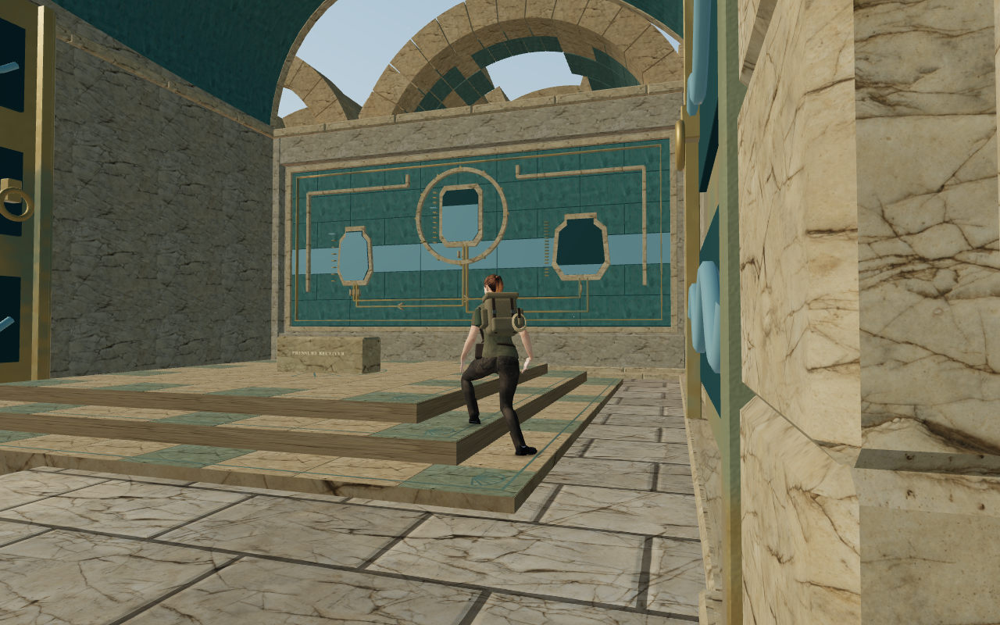

# Coastal chamber vaults

The nine sluice chambers now have distinct upper volumes, rather than the same
open front arch repeated across the palace. Dressed roofs, stepped façades and
real roof lights give the hydraulic rooms stronger silhouettes and shaded blue
interiors. The ground plans and wider palace landscape remain under review.

| Chamber | Upper construction |
| --- | --- |
| Counterweights | A shallow covered portico, leaving the board chamber open |
| Harbor balance | A rounded hall with a small central roof light |
| Coral pump | A gabled gallery with paired shoulders and a long ridge opening |
| Tidekeeper return | An asymmetric wave vault and eastern register |
| Isolated intake | A taller pediment with a western light slit |
| Arcade counterflow | A rounded nave with an open central roof section |
| Queen circulation | A broad crossing vault with a raised central façade |
| Pressure reserve | A flatter upper roof, paired registers and two light strips |
| Abyssal lock | A higher asymmetric vault with a western register and rear opening |

The roofs use closed, outward-wound cells with a continuous blue bed and
jointed stone skins. Openings pass through both layers. Curved sections use
angular spacing near their springing points; narrow skin margins remain finite.
Authored opening coordinates replace arithmetic copies of the same seam, fixing
an initial zero-width cell at 3.5 versus 3.500000000000001.

Graded side risers bear on the existing cornices and jamb caps. Transverse end
bands and fitted bronze rims follow the roof grid. The front bed overlaps the
old lintel, and three stems mount the retained restoration lights. New static
material batches supply copied triangle collision and roof support after camera
surfaces are captured. There are at most four batches per roof. Existing shared
palace materials, ground masonry, moving leaves, drives and saved puzzle state
retain their construction.

The nine new roof assemblies contain 88,836 triangles across 2,349 roof cells
and 36 material batches; the largest assembly contains 11,572 triangles. The
rendered-support test samples 297 cell positions against the actual copied
collision. These are geometry counts, not a consumer-device frame-rate claim.

## Walking camera finding

An expanded per-frame walking check found a brief complete character fade near
the first hydraulic tablet. A separate replay of published commit `d548a37`
reproduces the same witness exactly: player X=211.959183, Z=84.318036; camera
X=212.050881, Y=1.666585, Z=83.986176. The visible-character uniform falls to zero
at controller update 685. The new roofs did not introduce this recorded case.

A focused regression isolates a blocked projected movement path while a clear
view remains available at the current position. If forecasting rejects every
candidate and the ordinary arm enters the fade range, the solver now searches
the current position again. Actual walls, terrain and body sight still govern
that fallback. Player position and chosen look remain intact. The regression
fails with the previous function and passes with the repair.

## Verification

- All 68 selected vault, sanctuary-gate, hydraulic, counterweight and
  field-station tests pass after the joint refinements. They check closed
  geometry, real roof openings, rendered roof support, finite collision,
  clear ground aisles, original masonry margins and actual puzzle movement.
- All 21 selected camera-follow, collision, body-frame and guardian-camera
  tests pass, including the new failing-before/passing-after forecast case.
- Full geometry for the other 60 gates retains its hash; the nine coastal
  geometries change. All 69 moving leaf sets and 69 drive-source sets match
  their preceding hashes. A public coastal fixture retains the moving-art and
  emitter references.
- All 27 current baseline captures and 54 final scene captures are reviewed.
  The 27 corresponding High player/camera/yaw/pitch states match exactly.
  High includes front, interior, oblique and elevated skyline views; Low
  includes front and interior views. Every recorded root is legal and grounded
  at full health, shaders link, and HDR/GL checks pass.
- The recursive independent body observer now includes all delivered gate
  meshes, including nested roof groups and actual instance transforms. All 184
  sampled supported wall/jamb poses have zero embedding beyond 15 mm across
  8,849,480 visible vertex records. High covers 45 pieces with two facings in
  standing/crouched poses; Low repeats four harbor rear poses. Genuine old
  foundation witnesses remain visible to the observer, and old open-relief
  false witnesses remain rejected. These poses do not prove every roof, moving,
  airborne or interacting body contact.
- All 90 assisted local walking legs finish across the nine chambers and their
  tablet/pump approaches: 914.72 m and 13,732 ordinary player/camera updates.
  Every recorded camera update keeps the character-fade uniform at 1, with zero
  hidden frames. All 99 High start/endpoint captures are reviewed; roots remain
  legal and grounded at full health, with linked shaders and finite HDR.
  Prepared completed progress and hidden guardians isolate these local checks.
  One owned run reaches its 40-minute deadline after 63 legs; a second resumes
  the remaining legs from the captured endpoint. This is not a continuous
  campaign playthrough.
- All 36 control neighborhoods, 27 pump sight lines and wheel mounts pass.
  Radial geometry probes around all 72 hydraulic/drive emitters retain all
  139 dry distance ranges available at published commit `d548a37`. All 27
  pumps and 18 drives retain at least two clear positions with positive,
  decreasing distance gain. Eighteen idle outlets remain occluded at the three
  sampled radii, as before. Occluded voices receive filtering and attenuation;
  these muted geometry probes do not establish their active-flow audibility.
- The production build passes with its existing large-chunk advisory.
- Built keyboard/High at 1280 × 800 and emulated portrait touch/Low at
  540 × 900 pass pump selection, earned I-to-II transfer, movement, crouch,
  chosen look, jump/landing and map access without viewport overflow. The
  keyboard browser is touch-capable. Both additional occupied-save cases
  recover 0.75 m to legal ground, preserving the chosen yaw/pitch and
  progression, then move and reload again. All twelve paused whole-store
  reload comparisons match except `lastPlayed`. All sixteen native captures
  are reviewed. Sixteen character-model responses match the delivered GLB;
  loaded bundles match `dist/`, the development hook is absent, and no HTTP,
  page or application console errors are reported.
- Browser thread audits retain the shared locked five-CPU allowance. Each
  owned browser and preview server closes. Both verification ports are closed
  and the staging runtime directory is empty before publication.

This is an upper-construction pass; lower room plans, repeated main palace
arcades, sparse surroundings, wider campaign coverage, active-flow listening
and device acceptance remain open. The keyboard
landing view beside the harbor tablet is steep, with a pump pipe filling the
foreground; the preceding native capture shows the same composition. Wider
follow-camera framing also remains under review.

## Rendered views

The balance pair uses the same High walking view before and after construction.
The coral, queen and reserve images use elevated inspection cameras to show
their complete roof forms. The abyss interior uses Low and the walking camera.
All six images are actual game captures, encoded as lossless WebP with decoded
pixel and dimension parity against their PNG sources.

No external model, texture, recording, score or dependency was added. Existing
palace, character and environmental attribution applies. The checks do not
establish human playthrough duration, subjective audio quality, commercial AAA
quality or consumer hardware performance.
