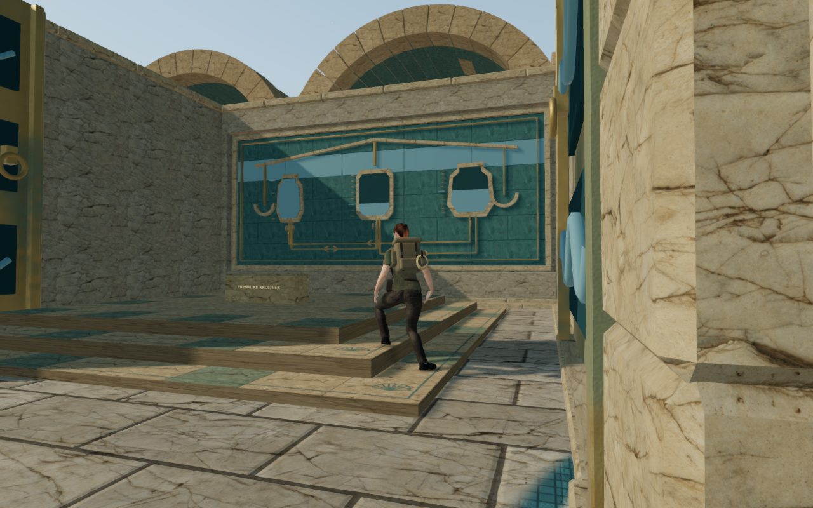
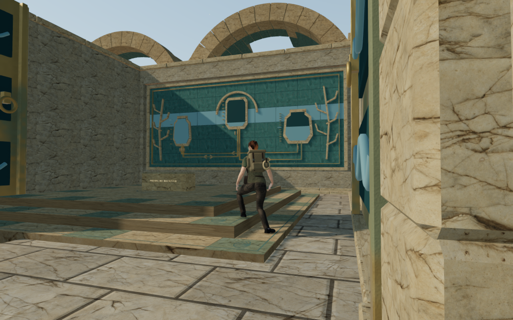
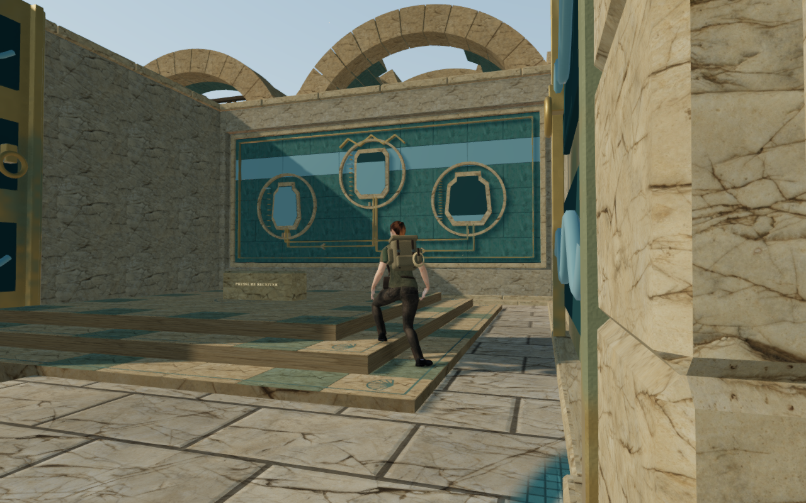
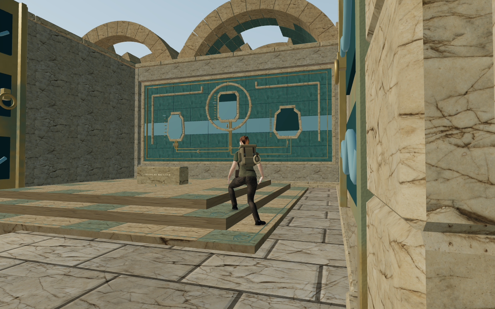

# Coastal hydraulic wall records

The eight later sluice chambers in The Drowned Kingdom now carry different
ceramic and bronze records of their hydraulic circuits. A fresh 36-view
survey at `215e6e0` showed the same empty rear interior repeated across these
rooms. The records give that broad masonry a purpose and connect its artwork
to the working cisterns outside.

| Circuit | Record motif | Vessel arrangement |
| --- | --- | --- |
| Harbor balance | Suspended balance and paired bowls | Three level measures |
| Coral pump | Branching coral and a central arch | Raised central vessel |
| Tidekeeper return | Tide bands and a round central register | Lower central vessel |
| Isolated intake | Descending stepped channel | Descending measures |
| Arcade counterflow | Three stone arcades | Lower central arch |
| Queen circulation | Crown and three circular registers | Raised central register |
| Pressure reserve | Two graduated pressure staffs | Lower central register |
| Abyssal lock | Central toothed seal and returned shoulders | Raised central seal |

Each record reads its capacities, target quantities and permitted transfer
directions from `HYDRAULIC_TRIALS`. Roman stems identify I, II and III; one tick
marks each real unit, and the target tick and ceramic fill describe the required
measure. Closed vessel silhouettes clip their fills. Joined channels carry
arrowheads for every allowed direction, including the missing return valves
and the final one-way circuit. These are passive engravings; they do not animate
with the current water quantity or introduce another control.

A continuous bed joins a recessed masonry backing. Jointed ceramic courses,
dressed borders and shallow stone/bronze motifs sit 0.30 m into the old core;
every decorative vertex stays behind the original inner face at local Z=-0.41.
Four dressed margins retain the surrounding wall, while a continuous backing
keeps the original outer recesses sealed. Camera surfaces are captured from
individual parts before they join the gate's existing material batches. Each later gate gains one static material batch, rather than
retaining the individual decorative meshes.

The first chamber retains its counterweights and original wall art. The room
footprints, dais, side walls, gate machinery, terrain, live cisterns, water and
save format retain their construction. This is an interior artwork milestone;
the repeated lower plans and upper palace chambers remain part of the broader
composition work.

## Verification

- All 35 selected wall-art, sanctuary-gate and hydraulic tests pass. Coverage
  includes finite geometry, the movement envelope, joined backing, 280 rendered
  backing/camera probes, all 36 hydraulic controls, and all 157 transfers in the
  nine authored solutions with saved target quantities.
- The before/after comparison retains exact full-gate geometry hashes for
  61 of 69 gates; the eight intended coastal rear rooms change. All nine coastal
  gate-generated obstacle snapshots, all 69 leaf-geometry sets and all 69 gate
  drive-source sets match their baseline hashes. This comparison describes those gates, rather
  than every object in the campaign.
- The production build passes. The existing large-chunk advisory remains.
- The three CPU-guard checks pass. Verification uses the shared five-CPU
  allowance, one test worker and one browser; staging and browser profiles stay
  under the ignored `local/staging/` directory.
- All 192 sampled High/Low relief poses pass at the 15 mm inspection threshold,
  with zero embedding or invalid records across 9,234,240 visible character
  vertex records. These cover three rear-wall approaches in all eight rooms,
  both facings, and standing/crouched poses. The observer reconstructs the closed
  relief parts with their authored generator and actual world placement; it
  queries the posed character independently of the movement collision system.
- The initial 36-view survey and 44-view first implementation are reviewed.
  After the recess repair, all 24 final views are reviewed: eight High interiors,
  eight High construction perspectives and eight Low interiors. All retain
  legal grounded roots, full health, linked shaders and zero reported GL errors;
  the High HDR reads remain finite. The final player, camera, yaw and pitch
  match the corresponding pre-recess states exactly. These static views use
  prepared field progress, hidden guardians and muted audio.
- The rebuilt production interface passes keyboard/High at 1280×800 and
  emulated touch/Low at 540×900. Both begin at a prepared harbor tablet, select
  cistern I, retain that selection through reload, and earn the I → II transfer
  to 3 / 7 / 0 units. That committed quantity survives another reload. Movement,
  crouch, chosen look, jump/landing, map access and viewport layout pass.
  Eight paused whole-store reload comparisons match except `lastPlayed`; all
  twelve release captures are reviewed. Ten actual character-model responses
  match the delivered GLB hash, and loaded bundles match the rebuilt `dist/`.
  There are no reported browser, HTTP or application console errors.
- Each owned browser and preview server closes after its check. Both check
  ports are closed and the staging runtime directory is empty at publication.

An initial close crouch placed 3,709 visible character vertex records inside the
harbor panel, reaching 52.18 mm at the 15 mm inspection threshold; recorded
witnesses include the ponytail. The recess repairs that new intrusion without
changing the existing movement obstacles. The final sampled relief poses,
scene checks and rebuilt native input/save checks pass.

A separate standing check against the entire harbor gate found 659 embedded
vertex records, reaching 72.15 mm, with recorded clothing witnesses in low
masonry below the new relief. The surrounding foundations retain their original
construction at this milestone. The subsequent [coastal foundation clearance
repair](coastal-masonry.md) reproduces and repairs this lower contact with finite
body bounds. The relief checks alone do not establish clearance against every
part of the chamber.

No external model, texture, recording, score or dependency was added. Existing
palace material, character and environmental attribution still applies. This
pass does not establish human playthrough duration, subjective audio quality,
consumer hardware performance or full-campaign visual acceptance.

## Reviewed captures

These four images use the normal walking camera, with the visible explorer.
The balance, coral and circulation views use High settings; the abyssal lock
uses Low. WebP encoding preserves the source PNG pixels and dimensions.

