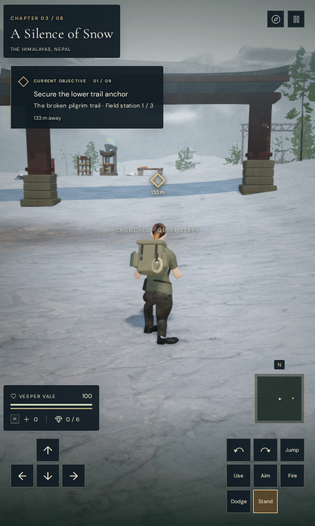
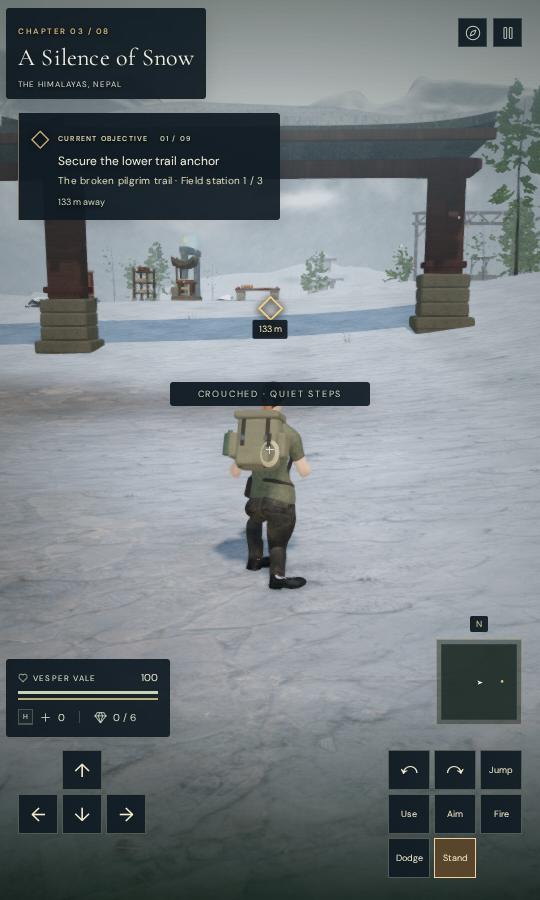
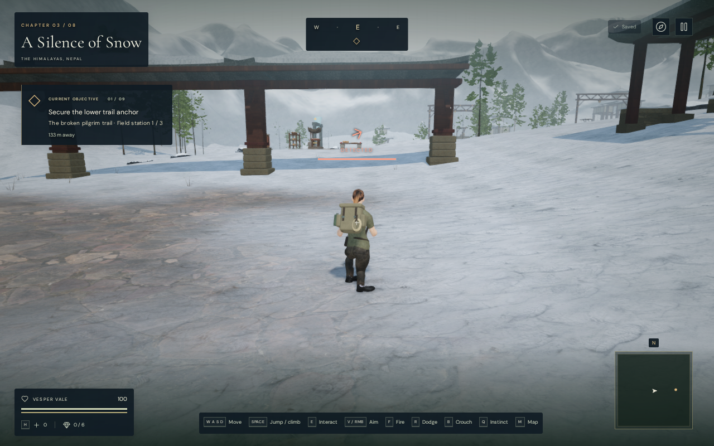
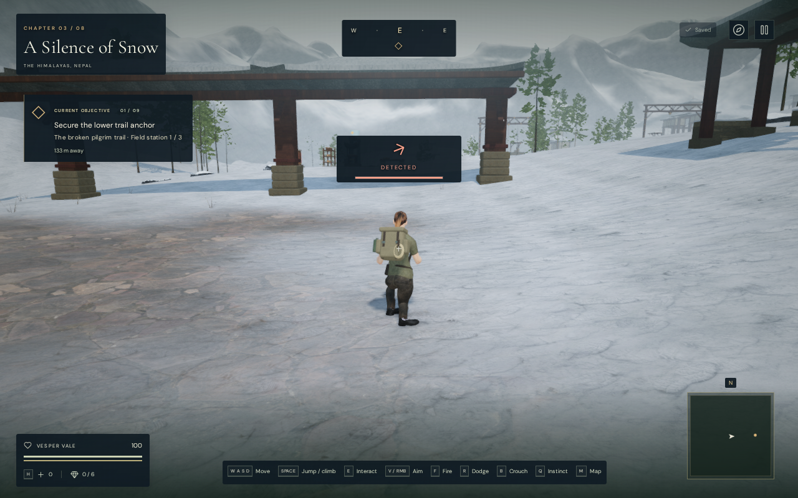
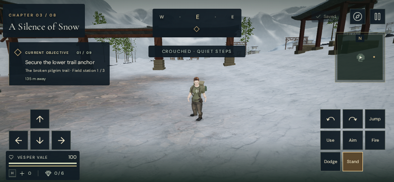

# Contextual status and waypoint visibility

VA-167's crouch message was faint over bright snow. Quiet movement, wind bracing
and guardian-alert status now share the dark HUD backing. The existing colors,
arrow rotation, awareness meter and text sizes remain intact. Status paints
above projected world markers; a short landscape layout places it below the
compass. Compact landscape views also separate the movement pad, action buttons,
objective, minimap and vitals. Air and torch status sit beside health instead of
enlarging its panel over the movement pad. The objective detail uses an ellipsis
when space is limited; the full objective remains available in the map.

Waypoint-distance text also receives backing. A waypoint now hides as a whole
when its marker or label backing intersects a HUD panel or clips the viewport's
two-pixel inset. It reappears when clear. Visible markers retain their projected
positions. This removes label fragments behind the compass or warning panel.

These are actual prepared High-preset captures. Each pair shares a frozen
world, camera and crouched pose. The control restores the preceding stylesheet;
both variants use the current marker-visibility rules. The detected state is
a UI-state fixture, not a combat encounter. CSS transitions are frozen and the
pause dialog is hidden. Lossless WebP exports preserve source pixels and
dimensions without cropping or retouching.

## Evidence

Eight current High chapter entrances cover quiet-status comparisons, with
detected-state comparisons in snow and the cavern. Snow also has 540 × 900 and
360 × 740 quiet views. White-background controls cover quiet, braced,
suspicious, searching and detected states at five sizes: 360 × 740,
540 × 900, 812 × 375, 900 × 540 and 1280 × 800. Black and checkerboard controls
repeat all five states at the largest size.

The observer hides foreground text and shadows, then samples the backing
beneath actual text-run rectangles. All 47 revised observations pass alongside
37 preceding-style controls. Across 105,695 sampled revised background pixels,
the minimum linear-luminance ratio is 7.073:1 against a project target of
4.5:1. The wide snowy quiet view improves from 1.055:1 to 10.054:1. These are
foreground/backing measurements, not measurements of every anti-aliased glyph.

Text, arrow and marker rectangles remain unchanged between styling variants,
except for the deliberate short-landscape status shift. In that layout the
arrow and caption move together, retaining their internal geometry and meter
values. The corrected panel clears the compass. Hidden-state checks confirm
that the status leaves no visible box when inactive, and the backing leaves
camera input routed to the canvas.

Seventy-two independent marker probes across six sizes add 667 × 375 to the
five contrast sizes. They cover clear space, screen edges, major HUD panels,
the vitals backing margin and reappearance after status, air or torch panels
clear. All pass. These latest projection probes use the Performance preset;
the contrast and world captures retain their recorded High preset. Visible
marker centers remain within 0.015625 CSS pixels of the projected point; the
check allows approximately 0.016 pixels for browser layout rounding.

The contrast set retains earlier observations outside the short-landscape media
rule and replaces the ten affected white-background observations after the
layout revision. The current eight world captures also fall outside that rule.
World-side source hashes match; the only later application changes are scoped
HUD CSS and waypoint blockers for the floated air/torch panels. The recorded
normal and crouched scenery fixtures do not expose those two panels.

Additional compact-landscape observations cover 667 × 375 and 812 × 375, each
with normal, air, critical-air and torch states. They inspect permanent labels,
panel clearance and actual button-center hit targets. All eight pass; the lowest
sampled permanent-label ratio is 6.374:1. All eight full captures are reviewed.
The opacity-faded idle “Saved” acknowledgement is outside this permanent-label
contrast criterion.
The helper requires nonempty text samples and a finite contrast result; an
earlier empty root-clipping sample is excluded. Earlier overlap and fixture
failures are retained privately, outside the accepted results.

All 47 revised status/marker panels are reviewed in diagnostic contact sheets,
alongside selected full views. The eight current High world entrances are
reviewed separately in the [entry baseline](entry-review.md).

The production build passes, retaining its existing chunk-size warning.
Native keyboard at 1280 × 800/High and touch at 540 × 900 and 812 × 375/Performance
exercise movement, crouch/stand, map and pause. Backward movement covers 1.2 m
on keyboard and 1.8 m in each touch case. The landscape case also moves 1.8 m
forward using the formerly covered button. Six complete-store reload comparisons
pass, excluding only per-chapter `lastPlayed` timestamps. Health remains 100.
The release exposes no development hook; served bundles match the build, with
no page errors, unexpected console warnings or horizontal overflow. All 22
release captures are reviewed.

This last image is an actual 812 × 375 production Performance capture after
native touch input. The game is paused and its pause dialog is hidden to expose
the HUD. All five contextual-HUD images and both entry-review images retain
their source pixels and dimensions in lossless WebP, without cropping or
retouching.

All three CPU-budget checks pass, including blocked thread/child affinity
expansion and nested launch inheritance. Verification uses the shared locked
five-of-sixteen CPU allowance, with at most two test workers and one browser.
Expensive jobs run sequentially; owned browsers, workers and previews close
after their checks.

## Remaining review

This repairs the recorded crouch-status problem and the reproduced marker
overlaps/clipping. It does not establish every contextual prompt, a complete
accessibility audit or full moving-view coverage. The [current entry review](entry-review.md)
also retains sparse volcanic/final-chapter approaches as composition work.
Broader world, body/solid contact, listening and device acceptance remain open.
