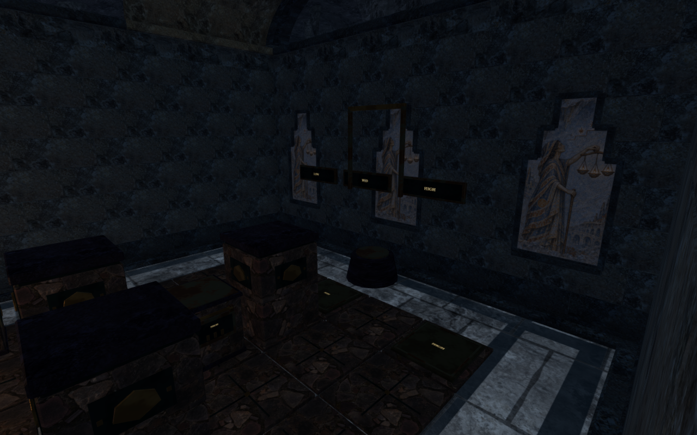
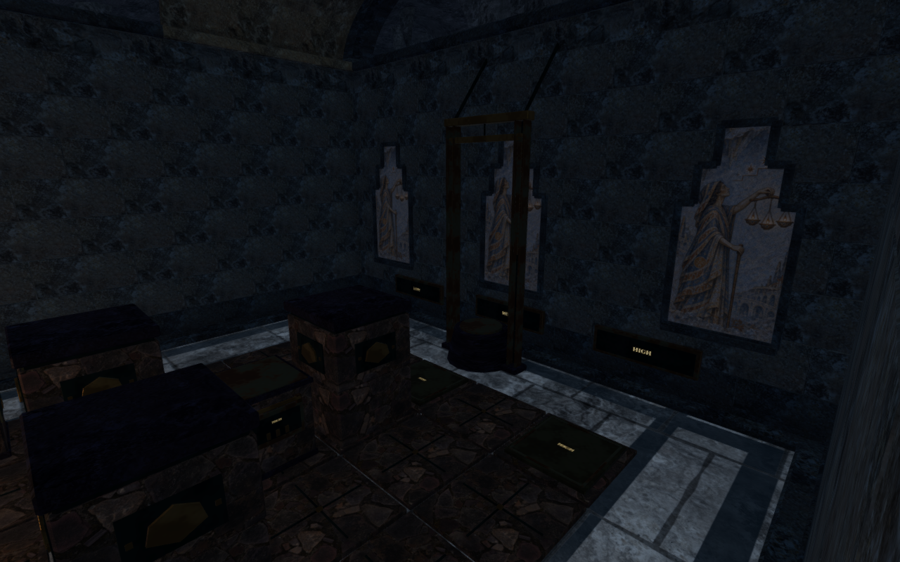
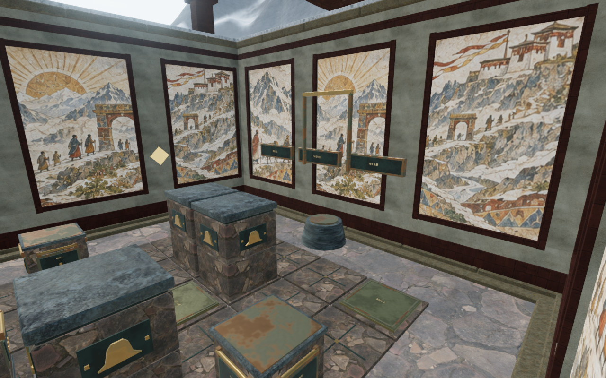
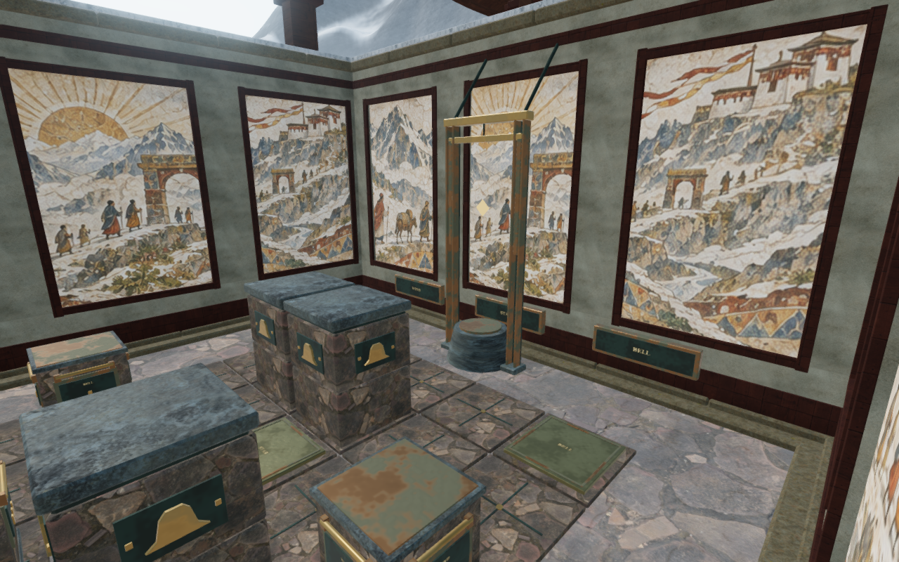

# Counterweight receiver mounts and lifting guides

The first counterweight chamber in each chapter now mounts its receiver names
on the solid lower rear wall band. The lettering aligns with the corresponding
floor plates; short buried anchors connect the plaque backs to the masonry.
This leaves the painted recesses clear, including the cavern memory scenes.
Plaque widths fit the spacing between neighboring receivers. The receiver
names, weights, board layouts and saved puzzle states are retained.

The sanctuary guard now slides inside grounded metal channels. A fixed head
beam, two diagonal ties into the rear cornice and a taut cable give its raised
pose visible support. The cable shortens as the guard lifts. Its moving header
has finite physical bounds and follows the rendered height; camera surfaces
follow the moving frame and cover the fixed guides and ties. The thin cable
remains decorative. This pass reuses the existing credited materials and adds
no audio voices or downloaded assets.

These are matching prepared High construction views at 1280 × 800, exported
as lossless WebP without cropping or retouching. The guard poses are assigned
for inspection; these comparisons do not represent complete playthroughs.
Their lighting is retained from the preceding review setup. Separate follow
views use the normal player-relative lighting and camera.

A full-world route check also found two existing furnace ducts occupying
required counterweight cells in the first forge hall. The board target remains
blocked with the new guard solids removed, and clears when the interior
furnishings are omitted. Those two ducts are removed; the hall keeps its board
and elevated wall lamps. The other seven forge service halls retain their
machinery. A regression samples all 25 board cells and twenty outer grip
stances against the delivered interior solids.

The descending contact repair lets a finite box explicitly request the same
bounded escape search already used for triangle furniture. The header opts in
so a falling explorer can leave its narrow upper face. Other boxes retain their
existing escape allowance. The rear control remains accessible after the guard
lifts; it does not require standing inside the closed header.

All 68 selected regressions, three CPU-budget checks and the production build
pass. The existing large-chunk advisory remains. The new bearing test follows
the actual rendered plaque, anchors and rear masonry as a closed union across
all eight themes. Another 1,032 rendered strip rays reject overlapping
plaque fronts; the preceding forge row deliberately fails that check. A second
regression checks the cable endpoints and the moving
header's rendered, physical and camera heights in six opening/closing states.
The retained cases cover complete walking/grip solutions, descending contact,
nearby control access, safe arrivals and existing audio behavior.

The paired browser inspection retains identical chapter origins, board layouts,
stone starts, control coordinates and sound-source positions. All sixteen
preceding and sixteen revised images are reviewed. Two forge images in each
set are obscured by an existing foreground structure and are excluded from
mount coverage. A clear alternate current interior view inspects the forge
guard and rear wall.

The original desert inscription planner also rejected the existing raised
threshold because it queried only soil-height stances. It produces the same
partial route with the new guard solids omitted. The private verifier now uses
the movement controller's supported floor height for that approach; accepted
routes still walk through normal continuous movement and collision.

The all-eight browser run completes all 121 stone moves, with 9,754 walking
updates retaining legal root positions and 6,413 grip/slide observations.
Sixteen prepared resting poses beside the guides check 769,520 rendered
character vertices against the counterweight furniture. All have legal feet,
clear sampled lenses, full avatar visibility and no invalid coordinates or
body overlap beyond the 15 mm observer tolerance. These are local resting
poses; the walking observations do not establish continuous full-body contact.

The final forge adjustment narrows its two closely spaced plaques. A separate
construction comparison confirms identical vertex attributes and mesh
transforms in the other seven themes. All 68 selected regressions pass after
that adjustment. The final forge browser repeat completes all fourteen moves,
repeats both resting body checks and inspects the closed and raised receiver
row. All nine all-chapter images and four final forge images are reviewed;
follow views cover gameplay framing and crop the upper supports. Prepared
construction views inspect the full frame. Sampled shaders link, HDR values
stay finite and no application warning or WebGL error is recorded.

Chapter replacement releases all 32 tracked cable/frame geometries exactly
once in the all-chapter run. The final forge repeat releases its four tracked
geometries once. These counts cover the tracked cable and three moving frame
pieces per chamber, rather than every world resource.

The first release attempt exceeded its helper's 30-second screenshot deadline
without recording an application error or warning. That browser and preview
closed. Repeating with 180-second observation/capture deadlines passes native
keyboard/High in the jungle and portrait touch/Performance in the desert. Each
case grips, moves and releases a stone, walks 1.50 m at 100 health and
restores the complete local-storage save after reload, excluding only per-level
timestamps. The keyboard case settles one board move; held touch settles two.
All eight release captures are reviewed. These views focus on the
working board rather than the new rear fittings. Loaded JavaScript/CSS names
match the current build, and the developer hook is absent.

All 423 final runtime sources and 800 frozen code/test/build inputs match the
verified publication content. The last width adjustment changes only the
forge's rendered construction; the seven other themes retain the compared
vertex attributes and transforms. Owned browsers, previews and workers close
after each run. This evidence establishes the recorded local behavior rather
than full human playthroughs, consumer-device performance or subjective audio
acceptance.

The broader [playable-world audit](visual-audit.md) remains open, including
continuous moving contact, repeated architecture, wider scenery and listening
and device acceptance. The shared CPU allowance remains five of sixteen cores,
with at most two test workers and one browser.
