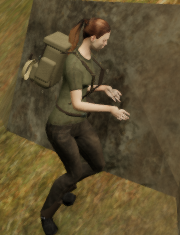
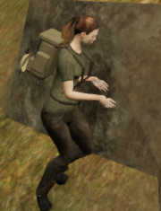

# Crouched hand clearance beside cliff beds

The post-save transition review found a hand defect beside the southern jungle
cliff. Both boots had real contact and the controller remained legal, but the
relaxed crouch pose sent the fingers through a nearby rock face. The actual
browser repeat reproduces 54 overlapping crouch updates in a 150-update local
sequence. Resting sole checks alone had not exposed this upper-body contact.

Crouched hands now fit their final blended skin against nearby closed collision
surfaces and the current terrain. Cached skin extrema are grouped by hand joint,
so fingers participate in the query. The existing arm solver adjusts wrist
targets by at most 4 cm per correction, with an 18 cm total limit from their
ordinary reach. Each trial starts from the same base animation and reapplies the
relaxed finger pose and crouch blend. Clear poses finish after the first trial.
The player's physical position, leg targets, arm lengths, terrain and cliff
geometry retain their preceding behavior.

The figures use the same 180 × 235 pixel region of actual High game frames,
without resampling or retouching. Every cropped RGB pixel is preserved. The
baseline uses published source `1b8e812`; root, camera, facing and scene time
match. Guardians are disabled and audio muted for inspection. Full frames and
independent skin observations support this small local comparison.

## Recorded checks

- All 206 selected tests across 29 files pass, alongside the build and three
  CPU-budget tests. The build retains its existing chunk-size advisory.
  The new real-asset regression observes crouch entry and settled crouching
  against the delivered cliff. Removing obstacle feedback from the hand fit
  reproduces more than fifty embedded skin records in the same pose; restoring
  the feedback clears them without moving the supported player.
- Four continuous geometry-only sequences inspect all 960 updates through
  approach, stop, crouch, turn, jump and landing phases. Every controller
  position remains legal, and all delivered-body terrain and closed-stone
  observations pass at the 15 mm penetration threshold. Swing and airborne
  phases naturally contain feet above the ground. This geometry-only fixture
  omits the rest of the world's props and vegetation.

- The 47-site jungle bed sweep adds 376 standing/crouched poses in four facings.
  All full-body terrain and closed-stone inspections remain clear. The new
  geometry run includes 240 crouching updates and 177 airborne updates in the
  continuous sequences. These checks keep the earlier penetration threshold.

- The final actual-world repeat inspects all 150 controller updates. Every root
  remains legal and grounded, all full-body terrain/stone observations pass,
  and the final footwear retains contact. The original 54 overlapping updates
  are clear. The High render uses the same prepared root, camera, facing, pitch
  and scene time as the published-source baseline. Both full frames are reviewed.
  The recorded wrist adjustment in this pose is about 2 cm.

- Production keyboard input at High quality and portrait touch input at
  Performance quality both activate crouch, as verified by the control state
  and rendered posture. Movement preserves stage 0 and health 100. Four
  complete-store reload comparisons pass, omitting only `lastPlayed`. All six
  release images are reviewed. The release has no development hook, its loaded
  script/style names match the build, and the portrait viewport has no
  horizontal overflow. Live release poses are separate from the frozen local
  comparison.

No failed assets, console errors or application warnings are recorded in the
final browser runs; Chromium GPU-readback notices are excluded from warning
totals. All 445 runtime source files match the tests, build, geometry sweeps
and final browser repeat. Owned browsers and temporary previews close after
verification. The two public crops preserve their source RGB pixels exactly.

## Remaining acceptance

Broader continuous motion and hand/prop contact across other routes, foreground
visibility, broad cliff and court composition, sparse surroundings and wider
listening/device review remain open. These local results do not establish a
complete unassisted campaign playthrough, subjective audio quality, consumer
hardware performance or AAA graphics. The playable-world audit remains active.
