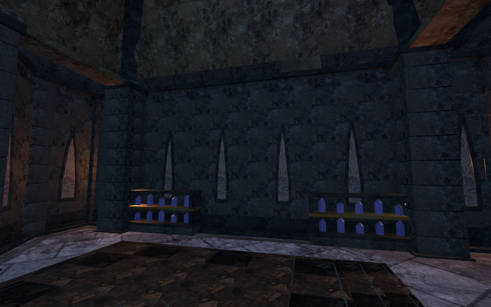
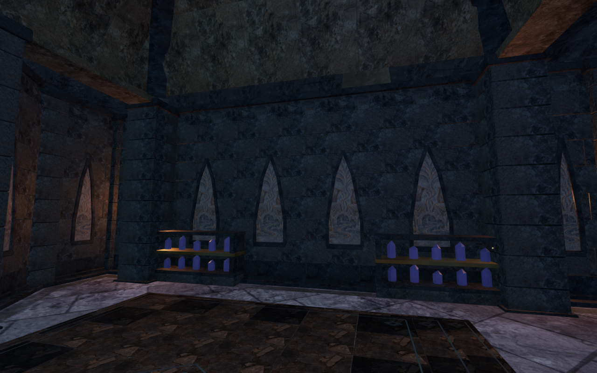
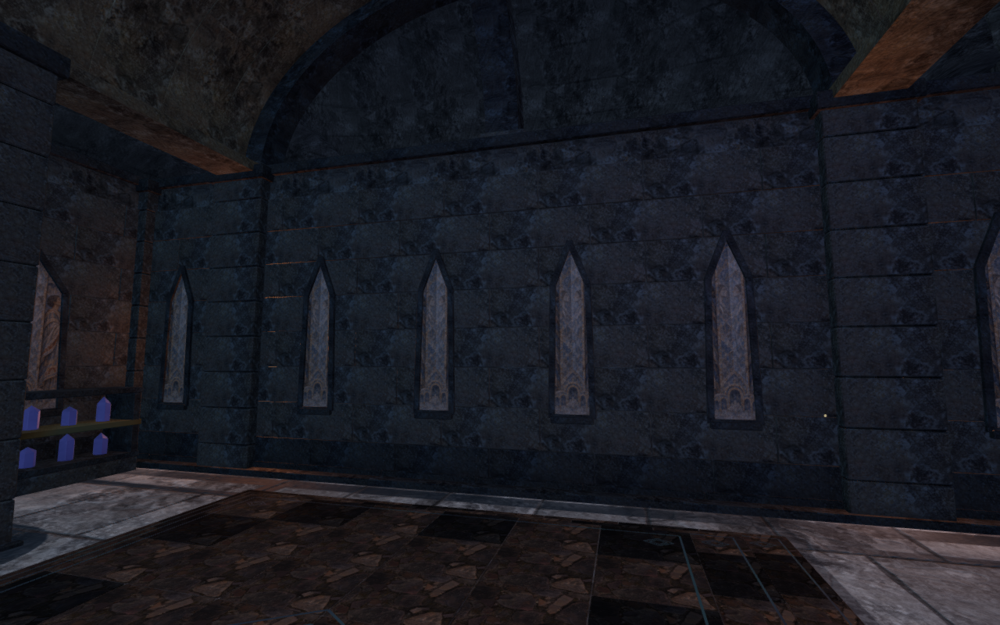
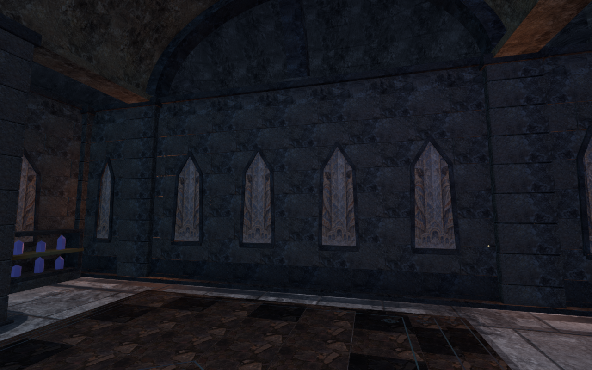

# Crystal archive bays sized to their own spans

The archive wall builder used the narrowest pier-free interval to size every
blind bay on that wall. Short end slots therefore cropped paintings in broad
central spans. The violet chamber's inner central paintings were only 0.57 m
wide despite having room for 1.22 m. Each bay now uses its own clear span for
the masonry cutout, painted inset and dressed frame.

The matched pair retains the same player/camera positions, clock and High
settings. All four figures preserve the complete 1280 × 800 capture pixels
through lossless WebP conversion.

## Construction

Pier exclusion, bay centres, room outlines and supporting masonry follow their
existing layout. Each remaining interval is divided into bays; a bay's radius
is 30% of its own spacing, capped at 0.95 m. The violet rear wall retains its
0.396 m end-bay radii while its four central radii increase to 0.849 m.
Across the seven enclosed rooms, 14 of 85 measured bays become wider. The
guide-light porch retains its existing wall construction.

The masonry between adjacent bays follows their individual profiles. Both
painted faces and their frames use that same profile. The wall backing remains
sealed at its existing depth. Widening exposes more of the existing artwork;
the portrait coordinates retain equal physical texel scale. The atlas,
lighting and [art attribution](asset-credits.md) retain their existing sources.

## Verification

An assembled-wall regression first fails against the preceding implementation:
an exterior ray in the violet chamber's central bay hits masonry. After the
repair, independently chosen exterior and interior rays meet the painted faces
at their existing depths. This catches both a wider painting still buried in
masonry and a larger cutout left without its painted inset.

The 44 selected tests across ten files pass, together with three CPU-guard
checks. Coverage includes the delivered enclosure, working lanes, sight/audio
barriers, display crouch clearance, fresco texel scale and atlas gutters,
vaults, shutters, foundations, all 69 gates, moving-door collision, restored
field progress, campaign storage, rendering settings, audio and chapter startup.
The shared recess test samples each bay using its own radius.

A comparison with `d1e33b5` builds 54 walls across jungle, desert, snow, water,
volcano and eclipse themes: three sides at stages 0, 4 and 7, each 13 m long.
All geometry attribute/index bytes, material names, mesh transforms and returned
measurements compare equal, representing 534,336 triangles. This is a sampled
builder comparison, rather than an entire-world equivalence claim.

Seven preceding and thirteen final browser views are reviewed. The seven room
observers retain identical player/camera coordinates. Medium and Low repeat the
violet room; a normal follow view, 3.64 m assisted walk and crouch/stand return
sequence inspect controller behaviour. All final frames have linked shaders
and finite buffers, with no recorded errors or warnings. The sampled controller
states retain full health, legal body/camera positions and an opaque avatar;
crouch blending reaches 0.999775 and returns below 0.000225. Enemy simulation
is not advanced during the assisted walk.

Both surveys freeze 589 source/runtime-asset hashes. Replacing the crystal
chapter with the desert disposes all eight painted batches, their shared
material and atlas exactly once each; the replacement world retains none of
those tracked objects. The temporary browser and preview close after the check.
The production build passes with its existing large-bundle advisory.

Production keyboard and touch cases move 2.17 m and 2.10 m in the violet
chamber, retain full health and pass one complete-store reload comparison each,
excluding only per-chapter `lastPlayed`. The disposable fixture marks field
tasks through that chamber complete and selects stage 4; these tasks are not
earned by the check. Both cases use Low at a 360 × 600 CSS viewport and 0.5
pixel density. The four native UI captures are reviewed separately from the
full-resolution figures above. All four served JS/CSS response hashes match
the build, the development hook is absent, and requests/console report no
errors or warnings. The entry/game chunks are `index-DOxNl9Ib.js` and
`game-Dw9jz8xe.js`. Each browser and the production preview close afterward.

## Remaining work

This repairs a measured layout defect. The surrounding chambers still have
broad dark masonry and repeated equipment, and the narrow silhouettes continue
to crop some artwork. Forge interiors, unobserved snow interiors, wider terrain
composition and continuous placement/contact review remain open. These point
observations do not establish the whole world's polish, subjective listening
quality, consumer-device performance or AAA graphics.
