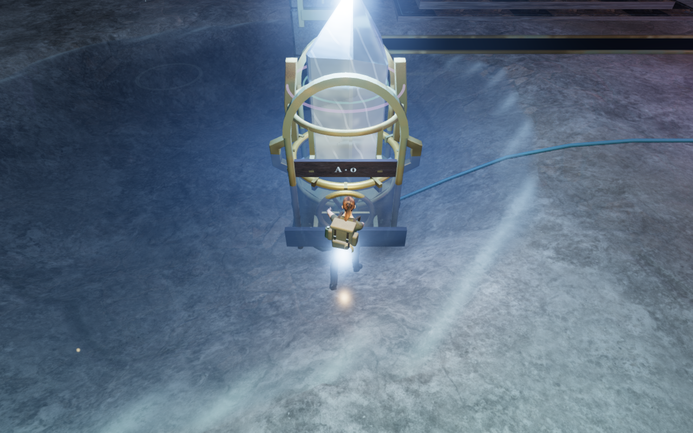
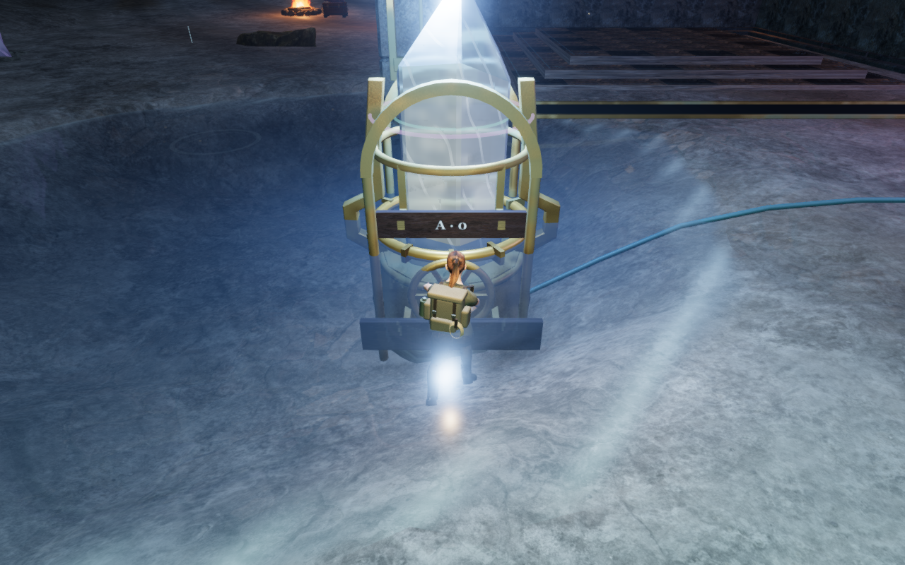
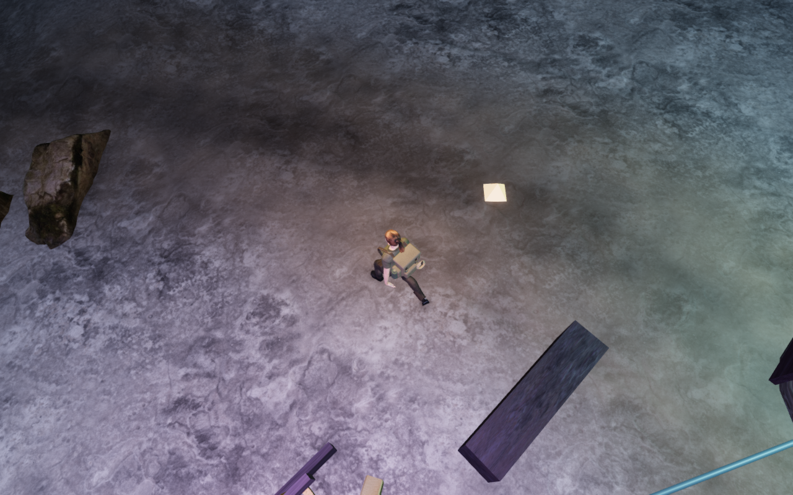
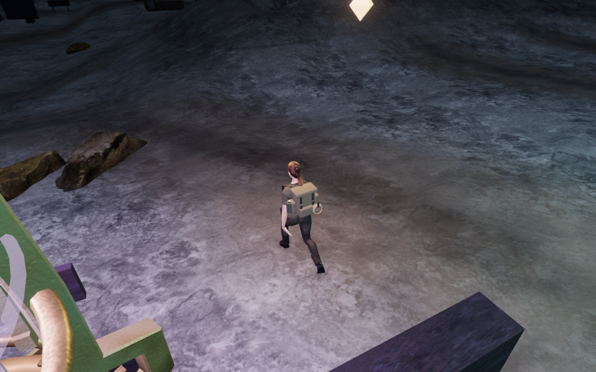
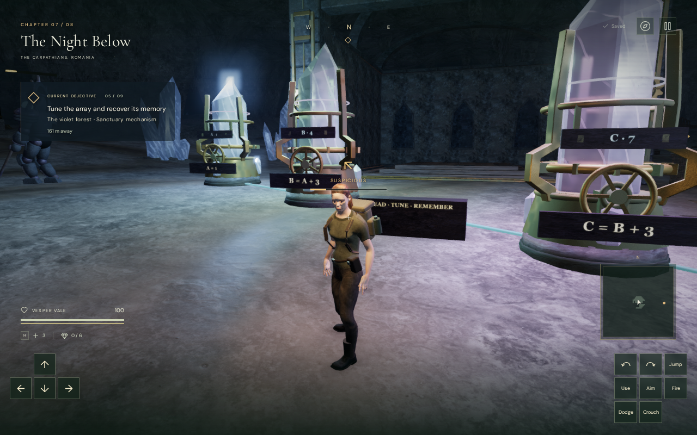
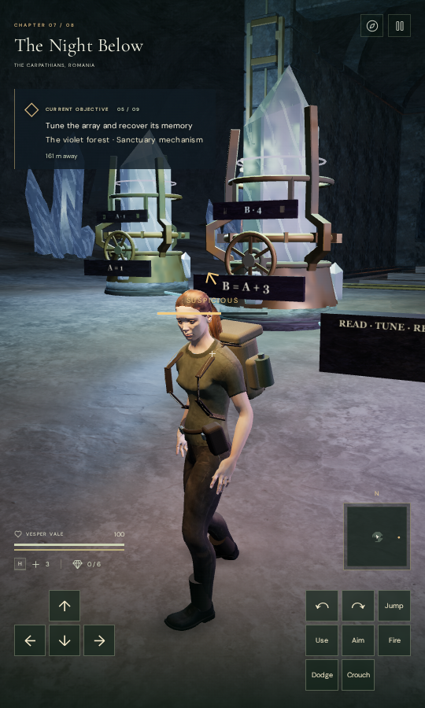

# Nearby camera recovery after crystal turns

The follow camera now retries its small neighboring angles before retaining
a large upward detour. This repairs a recorded ascending-array return where
the explorer's selected pitch was 0.13 radians, but a remembered obstruction
response kept the camera looking down at about 60 degrees after a lower view
became clear. The returning view now settles at about 30 degrees and shows
more of the surrounding chamber.

The retry applies when the remembered upward adjustment exceeds 0.4 radians
after pitch clamping. Existing body visibility, arm clearance, interpolation,
terrain and ceiling checks still select the view. Other retained detours keep
their preceding priority. The selected yaw and pitch, player position, puzzle
controls, saved records, materials, geometry, lights and sound remain unchanged.

## Recorded routes and controls

Three local replays cover the mirrored front instrument, the ascending return
and the paired-heart front instrument. They use the recorded controller routes
with prepared field progress, disabled enemy simulation and muted audio. Eight
local legs and six reversible physical wheel adjustments reach the same
arrivals with the same selected look in both camera versions.

The control substitutes the preceding camera module into the current world;
it does not run an earlier complete application. The moving poses are retained
after each route, and the follow camera receives 120 additional 60 Hz updates
for the recorded view. Separate stationary checks helped distinguish the
moving pose from a rested explorer.

| Recorded view | Previous camera pitch | Current camera pitch |
| --- | ---: | ---: |
| Mirrored front instrument | 41.74° | 29.95° |
| Ascending return | 60.16° | 30.11° |
| Paired-heart front instrument | 18.20° | 18.20° |

All 1,519 current recorded camera updates pass the camera-space and swept-arm
queries. All 286 posed body targets remain clear in each update's scenery and
terrain visibility queries. Explorer coverage stays exactly 1 throughout these
three cases. The earlier apparent fade in these views is therefore not caused
by the character's distance mask. A bright glow remains over the footwear and
nearby floor; its source needs a separate rendering and lighting review.

The trace also finds sharp camera corrections during walking. The largest
recorded arm rotation on the ascending route changes from 11.27° to 11.09°
per 60 Hz update. The other two routes retain their preceding largest steps.
This repairs the retained overhead view, while broader continuous framing and
motion smoothing remain open. Registered targets and swept arms do not prove
visibility of every rendered face or every possible campaign approach.

## Regression and delivery

The new regression builds the current crystal instruments and delivered
terrain at the recorded return. The original straight arm remains obstructed,
so simply dropping to the requested angle is insufficient. Over 180 camera
updates, the lower neighboring view remains clear, preserves the player and
selected look, and settles without repeated climbing or retraction. The same
test fails against the previous camera at the lower-view assertion.

All 49 selected regressions pass, covering follow recovery, posed framing,
camera bounds and terrain sight, resonance interactions, focused puzzle views
and persistence. The production build passes in 6.49 seconds with the existing
large-chunk advisory.

Native built-game checks pass with keyboard/High at 1280×800 and touch/Low at
540×900. Each solves the ascending objective `[1, 4, 7, 10]` in twelve turns
and advances from objective 3 to objective 4. Movement, look, crouch,
jump/landing and map inputs pass. An earned first adjustment and two later
gameplay-store reloads give three reloads per case; comparisons exclude the
expected `lastPlayed` timestamp metadata. The page has no development game
hook, and the loaded JavaScript/CSS filenames and delivered explorer model
hash match the current production files. Both cases have no recorded errors
or warnings apart from the filtered GPU readback diagnostic.

Verification uses the shared CPU launcher, locked to nine of sixteen available
CPUs (56.25%), with one test worker and one browser at a time. Temporary
browser profiles, seeded stores, raw captures, logs and comparison helpers stay
in ignored local staging. Each browser and its temporary preview server close
when the check finishes; final audits retain only their helper, which then
exits. No dependency, runtime asset or external recording is added.

These checks do not establish human campaign traversal, consumer hardware
performance, subjective audio quality or AAA graphics. Wider chamber
composition, crystal glare, camera motion and full campaign visual acceptance
remain under review.

## Captures

The controlled captures retain their actual follow cameras and moving poses.
All twenty final route and native captures are reviewed.
The intentional WebP delivery preserves captured decoded RGBA pixels and
dimensions through checked lossless conversion.

| Recorded route view | Previous camera | Current camera |
| --- | --- | --- |
| Mirrored front |  |  |
| Ascending return |  |  |

| Native built view | Capture |
| --- | --- |
| Keyboard/High after landing |  |
| Touch/Low after landing |  |

The implementation is in [camera-follow.js](../src/camera-follow.js), with
the recorded-court regression in
[camera-follow.test.js](../tests/camera-follow.test.js).
