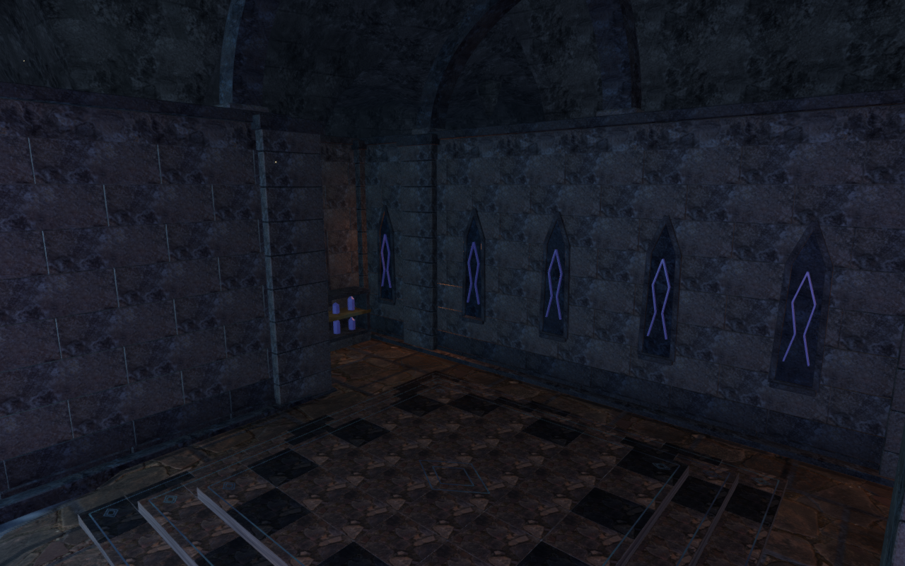
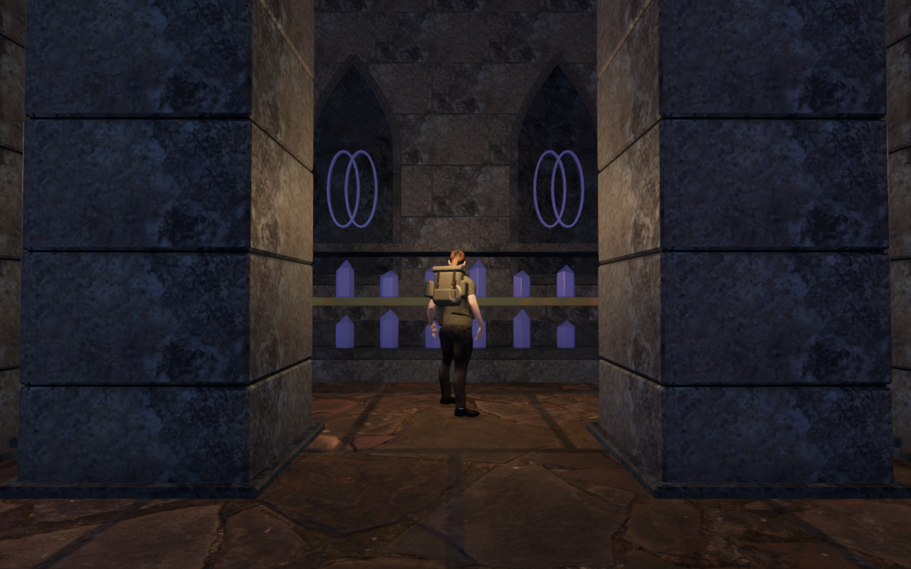
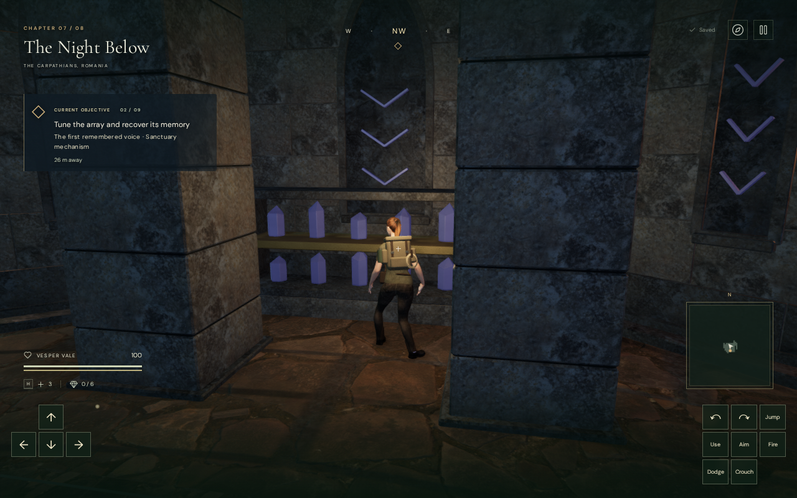
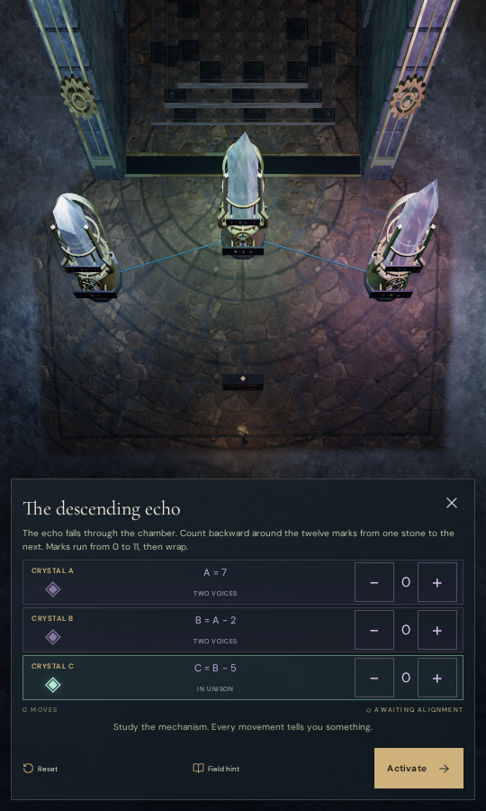

# Crystal archive enclosures

Seven chambers in The Night Below now have different lower footprints and
furnished reading spaces. Their resonance instruments already occupy the
forecourts, leaving the former interiors empty and visually repetitive. The
new rooms retain the original working core and entrance shoulders while
extending their rear or side spaces. The first chamber retains its original
counterweight hardware and square plan.

| Chamber | Lower plan | Archive cases |
| --- | --- | --- |
| Guide-light chamber | Original square | None; counterweights retained |
| Echo apsis | Faceted rear apse | 1 |
| Opposed reading wings | Two lateral wings | 2 |
| Long ascending gallery | Extended rear gallery | 2 |
| Flared violet archive | Wider rear corners | 2 |
| Broken western store | Asymmetric western room | 1 |
| Heart reading crossing | Side pockets and a central rear apse | 3 |
| Faceted prism archive | Octagonal rear enclosure | 3 |

The fourteen cases are passive scenery. Dressed limestone bases and posts
carry fitted shelves with small calcite specimens. The chamber walls reuse
the existing sealed blind-bay construction; bay placement reserves the load
piers instead of hiding recesses behind them. Continuous recessed cores seal
the dressed pier joints. Full-width foundations reach below the sampled
terrain across their footprints.

The preceding archive crowns retain their geometry. Joined piers, screen
bearings and two rear portals support ribs where a new wall moves away from
its original springing position. Gate panels still sink into their original
drives. The forecourt controls, authored field tasks, gate entrances, terrain
heights, water surfaces and save schema retain their coordinates and behavior.

Paving follows the same authored polygons as the walls. Signed outer-edge
distance and winding cover concave rooms without introducing seams along
internal triangulation diagonals. The floor shader changes color and normal
detail; it does not raise the terrain or alter the water beds.

Camera surfaces are captured from individual construction pieces before
material batching. Capturing bounds from a merged batch incorrectly filled
empty rooms during development; the repaired registration preserves actual
camera aisles. Movement, sight, sound and projectiles use delivered triangle
kernels rather than whole-batch bounding boxes. The new geometry is not
registered as a climbable walking surface.

The seven replacement enclosures contain 358,680 delivered source triangles
in 42 material batches. Geometry arrays occupy 34,433,280 bytes. These are
whole replacement-enclosure counts, including their revised wall detail,
rather than incremental renderer or total spatial-index memory. All
1,076,040 position vertices and their normals are finite; the closest sampled
vertex has 16.464 metres of clearance beneath the cavern ceiling. No external
texture, model, dependency, recording, light slot or music is added.

The initial selected regression run passes all 76 cases. It covers generated
paving expressions, preserved working cores and entrance shoulders, 21 empty
camera arms, finite sight/audio barriers, 212 regional wall faces, sealed
recesses and buried full-width foundations. After the display clearance repair,
the fifteen affected enclosure, vault and field-solid cases are repeated and
pass, including all fourteen reproduced knee-contact stances. The unchanged
archive crowns retain 62,409 delivered-vertex checks, 10,202 reachable body rays
and 522 bearing queries. The final production build passes in 3.47 seconds with
the existing large-chunk advisory. The entire campaign suite has not been
repeated at this milestone.

An independent delivered-body check first found 673 embedded vertex records
at all fourteen display fronts during crouching, with a deepest contact of
65.605 mm. Wall kernels now retain their 0.4 m aisle margin while display
kernels use 0.65 m in both standing and crouching. This protects the transition
at an accepted standing edge. Kernel geometry is copied before the two
constructions are recombined for rendering; rebatched world triangle positions
match the preceding builder within 0.471 micrometres. Material groups and
triangle counts match. The original source reconstruction is checked against
its recorded SHA-256 before dependency paths are adjusted for the observer.

The repaired boundary check passes 224 poses: all fourteen displays, four
facings (toward, ±45 degrees and away), standing and crouching, under both High
and Low settings. It examines 10,773,280 visible character vertex records
against independently indexed delivered enclosure triangles. None is invalid
or embedded; no observed contact remains in these sampled poses. This does
not cover every moving, airborne or interacting body pose.

The final static survey records 38 High views and eight Low interiors across
all eight chambers, including all fourteen displays. Every frame retains a
legal grounded prepared stance, full health, linked programs and no GL error;
High output has finite HDR and Low uses RGBA8. All 46 views are reviewed on
eight contact sheets. The oblique views use a constrained construction lens;
front, interior and display views use the normal follow camera. The survey
prepares restored field progress, hides guardians and mutes audio. These are
controlled composition views rather than an earned campaign playthrough.

An additional un-restored source inspection verifies all 41 control positions
and 66 direct tuning-source sight lines. All four pool emitters remain over
exposed water, with independent interpolated sheet depths of 1.406, 1.331,
1.410 and 0.580 metres. Their 46, 58, 51 and 55 sampled clear-bank positions
retain dry standing access and unobstructed source rays. No recording, music
or emitter position is changed. These checks verify geometry access; they do
not establish subjective listening quality.

All 42 final enclosure geometries dispose exactly once when changing to the
jungle chapter. World, obstacle and camera registries are replaced. Intermediate
batch geometries are disposed during construction; their physical kernels own
copied triangle data. The browser and server close after the check.

The current built interface passes keyboard/High at 1280×800 and emulated
portrait touch/Low at 540×900. Both inputs open the tablet, retain an earned
first adjustment through a reload, solve the descending echo at `[7, 5, 0]`
and advance from objective 1 to 2. Movement, crouch, chosen look, jump/landing
and map access pass, followed by two further whole-store reloads per input.
Neither layout overflows. Two prepared occupied arrivals, at the new rear
wall and the formerly accepted display edge, recover nearby with health,
chosen look and progression preserved. Only the current chapter's position,
played time and surveyed map cells may change during that recovery and short
movement check; all other chapter data remains intact. Each recovered arrival
passes two further exact paused-store reload comparisons. Together the four
cases verify ten reloads, ignoring only the last-played timestamps in the paused
comparisons. Fourteen actual explorer model responses match the delivery
SHA-256, and the loaded bundles match the current build. There is no development
hook or application/HTTP error; only the known screenshot readback diagnostic
is excluded from warnings.

All sixteen native captures are reviewed on three contact sheets. The rear
wall arrival moves 1.5 m to clear ground; the display-edge arrival moves 0.75 m.
Both retain their chosen yaw and pitch before movement and exact reloads.

The final controller check passes all sixty legs across the eight chambers,
including visits to every new display and returns to the thresholds. It covers
810.643 metres in 12,116 normal controller updates. All 69 recorded
views retain legal grounded positions, full health, finite HDR and linked
shaders. The 0.35 m navigation grid uses the unchanged swept movement predicate;
display target selection also requires its existing 0.18 m corner clearance.
Display destinations remain inside the authored room, outside the former
core and on dry standing ground. Each chamber starts at a prepared entrance.
The first helper retained 49 completed legs before its 40-minute deadline; the
remaining eleven resume from the last verified controller endpoint. Field
progress is restored, guardians are disabled and sound is muted. These local
circuits do not establish earned campaign completion or play duration.

Four intentional public captures preserve decoded RGBA pixels and dimensions
through verified lossless WebP conversion. The opposed wing uses a constrained
construction lens in the prepared survey; the heart apse uses its follow
camera. The other two images show the current built interface. The recovered
arrival is paused with its pause modal hidden for the photograph; the portrait
image shows the ordinary focused tuning controls.

| Scene | Verified capture |
| --- | --- |
| Opposed reading wing, High construction observer |  |
| Heart apse, High follow camera |  |
| Built occupied-display recovery, keyboard/High |  |
| Built tuning controls, portrait touch/Low |  |

All verification workloads use the shared 5/16 CPU cap: five CPUs on the
sixteen-CPU sandbox, with inherited affinity locked for child threads. The
three CPU-guard checks pass. Private fixtures, player saves, browser profiles
and raw reports remain in ignored local staging.

This improves lower chamber composition. Broader cavern scenery, continuous
campaign routes, combat, human listening and the full eight-chapter visual
acceptance remain open. Automated inspection does not establish playthrough
duration, subjective sound quality, AAA graphics or consumer-device frame rate.
